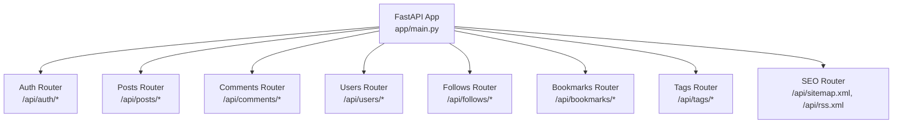
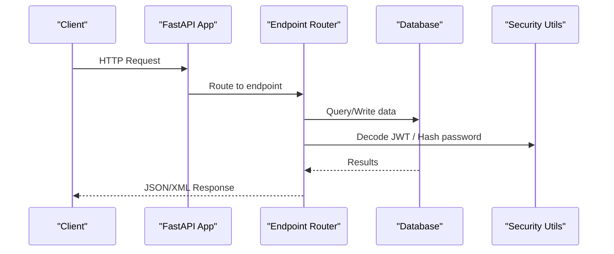
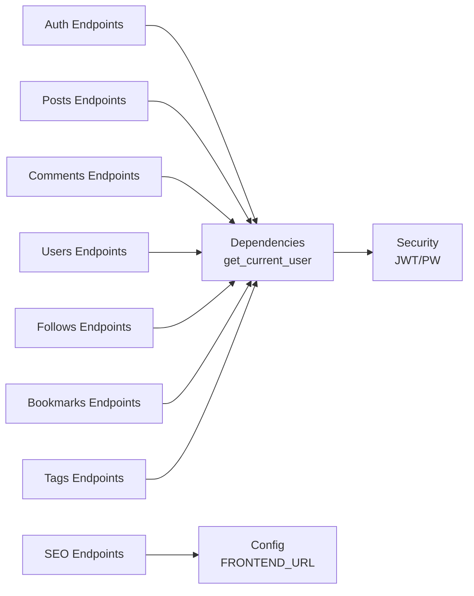

# API Reference

<cite>
**Referenced Files in This Document**
- [main.py](file://app/main.py)
- [auth.py](file://app/api/endpoints/auth.py)
- [posts.py](file://app/api/endpoints/posts.py)
- [comments.py](file://app/api/endpoints/comments.py)
- [users.py](file://app/api/endpoints/users.py)
- [follows.py](file://app/api/endpoints/follows.py)
- [bookmarks.py](file://app/api/endpoints/bookmarks.py)
- [tags.py](file://app/api/endpoints/tags.py)
- [seo.py](file://app/api/endpoints/seo.py)
- [config.py](file://app/core/config.py)
- [dependencies.py](file://app/core/dependencies.py)
- [security.py](file://app/core/security.py)
- [user.py](file://app/schemas/user.py)
- [post.py](file://app/schemas/post.py)
- [comment.py](file://app/schemas/comment.py)
</cite>

## Table of Contents
1. [Introduction](#introduction)
2. [Project Structure](#project-structure)
3. [Core Components](#core-components)
4. [Architecture Overview](#architecture-overview)
5. [Detailed Component Analysis](#detailed-component-analysis)
6. [Dependency Analysis](#dependency-analysis)
7. [Performance Considerations](#performance-considerations)
8. [Troubleshooting Guide](#troubleshooting-guide)
9. [Conclusion](#conclusion)

## Introduction
This document provides comprehensive API documentation for the Lekhani backend, covering all endpoint groups: Auth, Posts, Comments, Users, Follows, Bookmarks, Tags, and SEO (sitemap and RSS). It specifies HTTP methods, URL patterns, request/response schemas, authentication requirements, parameter validation rules, status codes, error handling, rate limiting, CORS configuration, and security considerations.

## Project Structure
The backend is a FastAPI application with modular routers under app/api/endpoints, Pydantic schemas under app/schemas, core utilities under app/core, and SQLAlchemy models under app/models. The main application wires up middleware (CORS, COOP, private network), database initialization, and includes the API router under /api.

**Diagram sources**
- [main.py:33-81](file://app/main.py#L33-L81)

**Section sources**
- [main.py:1-89](file://app/main.py#L1-L89)

## Core Components
- Authentication: JWT-based access tokens; Google OAuth login flow; password hashing and verification.
- Authorization: Optional and required user dependencies to protect endpoints.
- Data Models and Schemas: Pydantic models define request/response contracts and validation rules.
- Database: SQLAlchemy ORM with automatic table creation and migration helpers.

Key implementation references:
- Security utilities: token creation/decoding, password hashing/verification.
- Dependencies: OAuth2 bearer scheme, optional bearer scheme.
- Configuration: secret key, token expiry, allowed origins, frontend URL.

**Section sources**
- [security.py:1-34](file://app/core/security.py#L1-L34)
- [dependencies.py:1-53](file://app/core/dependencies.py#L1-L53)
- [config.py:1-48](file://app/core/config.py#L1-L48)
- [user.py:1-37](file://app/schemas/user.py#L1-L37)
- [post.py:1-60](file://app/schemas/post.py#L1-L60)
- [comment.py:1-32](file://app/schemas/comment.py#L1-L32)

## Architecture Overview
The API follows a layered architecture:
- Middleware layer handles CORS, COOP headers, and private-network preflight responses.
- Router layer exposes REST endpoints grouped by domain.
- Service logic resides within endpoint handlers using SQLAlchemy sessions.
- Schemas enforce input/output contracts.

**Diagram sources**
- [main.py:33-81](file://app/main.py#L33-L81)
- [dependencies.py:10-53](file://app/core/dependencies.py#L10-L53)
- [security.py:19-32](file://app/core/security.py#L19-L32)

## Detailed Component Analysis

### Authentication Endpoints (/api/auth)
Base path: /api/auth

- POST /api/auth/google-login
  - Purpose: Authenticate via Google ID token and issue an access token.
  - Auth: None
  - Request body:
    - token: string (Google ID token)
  - Response: Token object containing access_token, token_type, and user.
  - Status codes:
    - 200: Success
    - 400: Invalid or missing JSON body; missing email in payload
    - 401: Invalid Google token or audience mismatch
  - Notes: Creates user if not exists; sets hashed_password placeholder.

- POST /api/auth/register
  - Purpose: Register a new user.
  - Auth: None
  - Request body: UserCreate (email, username, full_name, password)
  - Response: UserResponse
  - Status codes:
    - 201: Created
    - 400: Email or username already taken
  - Validation: Email must be valid; password is hashed server-side.

- POST /api/auth/login
  - Purpose: Login with email/password and receive an access token.
  - Auth: None
  - Request body: UserLogin (email, password)
  - Response: Token object
  - Status codes:
    - 200: Success
    - 401: Invalid credentials

- GET /api/auth/me
  - Purpose: Get current authenticated user info.
  - Auth: Required (Bearer token)
  - Response: UserResponse
  - Status codes:
    - 200: Success
    - 401: Unauthorized

Authentication details:
- Bearer token expected in Authorization header.
- Token decoding and expiration handled centrally.

Error handling:
- Consistent 400/401 errors for invalid inputs and credentials.

Integration pattern:
- Use google-login to obtain a token, then include it in subsequent requests.

**Section sources**
- [auth.py:18-87](file://app/api/endpoints/auth.py#L18-L87)
- [auth.py:89-104](file://app/api/endpoints/auth.py#L89-L104)
- [auth.py:107-120](file://app/api/endpoints/auth.py#L107-L120)
- [auth.py:123-126](file://app/api/endpoints/auth.py#L123-L126)
- [dependencies.py:10-53](file://app/core/dependencies.py#L10-L53)
- [security.py:19-32](file://app/core/security.py#L19-L32)
- [user.py:25-28](file://app/schemas/user.py#L25-L28)

### Posts Endpoints (/api/posts)
Base path: /api/posts

- GET /api/posts
  - Purpose: List published posts with filtering and pagination.
  - Auth: Optional (for per-user clap/bookmark state)
  - Query parameters:
    - skip: integer >= 0 (default 0)
    - limit: integer 1..100 (default 10)
    - published: integer (optional; defaults to 1 when omitted)
    - topic: string (exact match)
    - tag: string (match by slug or name)
    - feed: string ("following" restricts to followed authors)
    - q: string (search title/subtitle/content)
  - Response: Array of PostResponse objects
  - Status codes:
    - 200: Success
    - 404: Tag not found (when tag filter provided)
  - Notes: Decorates posts with my_claps and bookmarked flags for the current user.

- GET /api/posts/me
  - Purpose: List posts authored by the current user.
  - Auth: Required
  - Query parameters:
    - published: integer (optional)
  - Response: Array of PostResponse objects
  - Status codes:
    - 200: Success

- GET /api/posts/slug/{slug}
  - Purpose: Retrieve a post by slug.
  - Auth: Optional
  - Response: PostResponse
  - Status codes:
    - 200: Success
    - 404: Not found

- GET /api/posts/user/{user_id}
  - Purpose: List posts by a specific author.
  - Auth: Optional
  - Query parameters:
    - published: integer (optional; defaults to 1 when omitted)
  - Response: Array of PostResponse objects
  - Status codes:
    - 200: Success

- GET /api/posts/{post_id}
  - Purpose: Retrieve a post by ID.
  - Auth: Optional
  - Response: PostResponse
  - Status codes:
    - 200: Success
    - 404: Not found

- POST /api/posts
  - Purpose: Create a new post.
  - Auth: Required
  - Request body: PostCreate (title, subtitle, content, cover_image, topic, published, tags)
  - Response: PostResponse
  - Status codes:
    - 201: Created
  - Notes: Generates slug from title; enforces max tags; normalizes tag names/slugs.

- PUT /api/posts/{post_id}
  - Purpose: Update a post (author-only).
  - Auth: Required
  - Path parameter: post_id
  - Request body: PostUpdate (partial fields allowed)
  - Response: PostResponse
  - Status codes:
    - 200: Updated
    - 403: Not authorized
    - 404: Not found

- DELETE /api/posts/{post_id}
  - Purpose: Delete a post (author-only).
  - Auth: Required
  - Path parameter: post_id
  - Response: 204 No Content
  - Status codes:
    - 204: Deleted
    - 403: Not authorized
    - 404: Not found

- POST /api/posts/{post_id}/clap
  - Purpose: Increment clap count for a post (idempotent per user with cap).
  - Auth: Required
  - Path parameter: post_id
  - Response: ClapResponse (clap_count, my_claps)
  - Status codes:
    - 200: Success
    - 404: Not found
  - Notes: Caps per-user clap increments at 50; updates post.clap_count.

Filtering behavior:
- Default filters applied when published is not provided.
- Topic exact match.
- Tag matching by slug or name.
- Search uses case-insensitive substring matching across title, subtitle, and content.
- Following feed requires authentication and filters by followed users.

Validation rules:
- Pagination bounds enforced.
- Tag normalization trims whitespace, deduplicates, enforces length constraints, and caps at 5 tags per post.

**Section sources**
- [posts.py:83-126](file://app/api/endpoints/posts.py#L83-L126)
- [posts.py:129-140](file://app/api/endpoints/posts.py#L129-L140)
- [posts.py:143-153](file://app/api/endpoints/posts.py#L143-L153)
- [posts.py:156-170](file://app/api/endpoints/posts.py#L156-L170)
- [posts.py:173-183](file://app/api/endpoints/posts.py#L173-L183)
- [posts.py:186-214](file://app/api/endpoints/posts.py#L186-L214)
- [posts.py:217-249](file://app/api/endpoints/posts.py#L217-L249)
- [posts.py:252-267](file://app/api/endpoints/posts.py#L252-L267)
- [posts.py:270-297](file://app/api/endpoints/posts.py#L270-L297)
- [post.py:6-39](file://app/schemas/post.py#L6-L39)
- [post.py:57-60](file://app/schemas/post.py#L57-L60)

### Comments Endpoints (/api/comments)
Base path: /api/comments

- GET /api/comments/post/{post_id}
  - Purpose: List comments for a post.
  - Auth: None
  - Path parameter: post_id
  - Response: Array of CommentResponse objects
  - Status codes:
    - 200: Success
    - 404: Post not found

- POST /api/comments
  - Purpose: Create a comment on a post.
  - Auth: Required
  - Request body: CommentCreate (content, post_id)
  - Response: CommentResponse
  - Status codes:
    - 201: Created
    - 404: Post not found

- DELETE /api/comments/{comment_id}
  - Purpose: Delete a comment (author-only).
  - Auth: Required
  - Path parameter: comment_id
  - Response: 204 No Content
  - Status codes:
    - 204: Deleted
    - 403: Not authorized
    - 404: Not found

**Section sources**
- [comments.py:13-21](file://app/api/endpoints/comments.py#L13-L21)
- [comments.py:23-43](file://app/api/endpoints/comments.py#L23-L43)
- [comments.py:45-61](file://app/api/endpoints/comments.py#L45-L61)
- [comment.py:8-9](file://app/schemas/comment.py#L8-L9)
- [comment.py:22-31](file://app/schemas/comment.py#L22-L31)

### Users Endpoints (/api/users)
Base path: /api/users

- GET /api/users/{user_id}
  - Purpose: Retrieve user profile with counts and following state.
  - Auth: Optional (to determine is_following)
  - Path parameter: user_id
  - Response: UserProfileResponse (includes follower_count, following_count, post_count, is_following)
  - Status codes:
    - 200: Success
    - 404: Not found

**Section sources**
- [users.py:13-41](file://app/api/endpoints/users.py#L13-L41)
- [user.py:30-34](file://app/schemas/user.py#L30-L34)

### Follows Endpoints (/api/follows)
Base path: /api/follows

- POST /api/follows/{user_id}
  - Purpose: Follow a user.
  - Auth: Required
  - Path parameter: user_id
  - Response: { following: true, follower_count: number }
  - Status codes:
    - 201: Created
    - 400: Cannot follow self
    - 404: Target user not found

- DELETE /api/follows/{user_id}
  - Purpose: Unfollow a user.
  - Auth: Required
  - Path parameter: user_id
  - Response: { following: false, follower_count: number }
  - Status codes:
    - 200: OK
    - 404: Target user not found

- GET /api/follows/{user_id}/followers
  - Purpose: List followers of a user.
  - Auth: None
  - Path parameter: user_id
  - Response: Array of UserResponse objects
  - Status codes:
    - 200: Success
    - 404: Target user not found

- GET /api/follows/{user_id}/following
  - Purpose: List users that a user follows.
  - Auth: None
  - Path parameter: user_id
  - Response: Array of UserResponse objects
  - Status codes:
    - 200: Success
    - 404: Target user not found

**Section sources**
- [follows.py:20-40](file://app/api/endpoints/follows.py#L20-L40)
- [follows.py:43-60](file://app/api/endpoints/follows.py#L43-L60)
- [follows.py:63-76](file://app/api/endpoints/follows.py#L63-L76)
- [follows.py:79-92](file://app/api/endpoints/follows.py#L79-L92)
- [user.py:17-23](file://app/schemas/user.py#L17-L23)

### Bookmarks Endpoints (/api/bookmarks)
Base path: /api/bookmarks

- GET /api/bookmarks
  - Purpose: List posts bookmarked by the current user.
  - Auth: Required
  - Response: Array of PostResponse objects (with bookmarked=true and my_claps populated)
  - Status codes:
    - 200: Success

- POST /api/bookmarks/{post_id}
  - Purpose: Bookmark a post.
  - Auth: Required
  - Path parameter: post_id
  - Response: { bookmarked: true }
  - Status codes:
    - 201: Created
    - 404: Post not found

- DELETE /api/bookmarks/{post_id}
  - Purpose: Remove a bookmark.
  - Auth: Required
  - Path parameter: post_id
  - Response: 204 No Content
  - Status codes:
    - 204: Removed
    - 404: Not found (bookmark may not exist; idempotent delete)

**Section sources**
- [bookmarks.py:15-39](file://app/api/endpoints/bookmarks.py#L15-L39)
- [bookmarks.py:42-60](file://app/api/endpoints/bookmarks.py#L42-L60)
- [bookmarks.py:63-77](file://app/api/endpoints/bookmarks.py#L63-L77)
- [post.py:26-39](file://app/schemas/post.py#L26-L39)

### Tags Endpoints (/api/tags)
Base path: /api/tags

- GET /api/tags
  - Purpose: List popular tags by number of published posts.
  - Auth: None
  - Query parameters:
    - limit: integer 1..100 (default 20)
  - Response: Array of TagResponse objects (id, name, slug, post_count)
  - Status codes:
    - 200: Success

- GET /api/tags/{slug}/posts
  - Purpose: List published posts tagged with a given tag slug.
  - Auth: Optional (for per-user clap state)
  - Path parameter: slug
  - Query parameters:
    - skip: integer >= 0 (default 0)
    - limit: integer 1..100 (default 20)
  - Response: Array of PostResponse objects
  - Status codes:
    - 200: Success
    - 404: Tag not found

**Section sources**
- [tags.py:16-32](file://app/api/endpoints/tags.py#L16-L32)
- [tags.py:35-69](file://app/api/endpoints/tags.py#L35-L69)
- [tag.py:1-10](file://app/schemas/tag.py#L1-L10)

### SEO Endpoints (/api/sitemap.xml, /api/rss.xml)
Base path: /api

- GET /api/sitemap.xml
  - Purpose: Generate XML sitemap including homepage, published posts, and authors.
  - Auth: None
  - Response: application/xml
  - Status codes:
    - 200: Success

- GET /api/rss.xml
  - Purpose: Generate RSS feed of latest published posts.
  - Auth: None
  - Response: application/xml
  - Status codes:
    - 200: Success

Notes:
- Uses FRONTEND_URL from settings to construct absolute links.
- Sitemap includes changefreq and priority hints.
- RSS includes atom link and limits to latest 50 posts.

**Section sources**
- [seo.py:11-52](file://app/api/endpoints/seo.py#L11-L52)
- [seo.py:54-87](file://app/api/endpoints/seo.py#L54-L87)
- [config.py:28-29](file://app/core/config.py#L28-L29)

## Dependency Analysis
The following diagram shows how routers depend on shared components for authentication, configuration, and schemas.

**Diagram sources**
- [auth.py:1-16](file://app/api/endpoints/auth.py#L1-L16)
- [posts.py:1-17](file://app/api/endpoints/posts.py#L1-L17)
- [comments.py:1-11](file://app/api/endpoints/comments.py#L1-L11)
- [users.py:1-10](file://app/api/endpoints/users.py#L1-L10)
- [follows.py:1-10](file://app/api/endpoints/follows.py#L1-L10)
- [bookmarks.py:1-12](file://app/api/endpoints/bookmarks.py#L1-L12)
- [tags.py:1-13](file://app/api/endpoints/tags.py#L1-L13)
- [seo.py:1-9](file://app/api/endpoints/seo.py#L1-L9)
- [dependencies.py:10-53](file://app/core/dependencies.py#L10-L53)
- [security.py:1-34](file://app/core/security.py#L1-L34)
- [config.py:17-29](file://app/core/config.py#L17-L29)

**Section sources**
- [dependencies.py:10-53](file://app/core/dependencies.py#L10-L53)
- [security.py:1-34](file://app/core/security.py#L1-L34)
- [config.py:17-29](file://app/core/config.py#L17-L29)

## Performance Considerations
- Pagination: All list endpoints support skip/limit to prevent large payloads.
- Filtering: Use query parameters (topic, tag, q) to reduce result sets.
- Decorators: Per-user clap/bookmark state is computed only when needed and batched to minimize queries.
- Tag normalization: Limits tags per post and avoids duplicate work.
- SEO generation: Sitemap/RSS queries are read-only and limited to published content.

Recommendations:
- Cache frequent reads (e.g., popular tags, post lists) at the edge or application level.
- Index frequently filtered columns (e.g., posts.published, posts.slug, tags.slug).
- Monitor slow queries and consider read replicas for high-traffic endpoints.

[No sources needed since this section provides general guidance]

## Troubleshooting Guide
Common issues and resolutions:
- 401 Unauthorized:
  - Cause: Missing or invalid Bearer token; expired token.
  - Resolution: Ensure Authorization header contains a valid token; refresh via login or google-login.
- 403 Forbidden:
  - Cause: Attempting to update/delete resources owned by another user.
  - Resolution: Verify resource ownership before mutation.
- 404 Not Found:
  - Cause: Resource does not exist (post, comment, tag, user).
  - Resolution: Validate IDs/slugs; ensure resource creation succeeded.
- 400 Bad Request:
  - Cause: Invalid input (e.g., missing fields, invalid email); attempting to follow self.
  - Resolution: Validate request bodies against schema definitions.

Rate limiting:
- Not implemented in the codebase. Consider adding middleware or using a reverse proxy (e.g., Nginx, Cloudflare) to enforce per-IP or per-user limits.

CORS configuration:
- Allowed origins configured via ALLOW_ORIGINS and regex for Vercel domains.
- Credentials enabled; ensure clients send cookies or auth headers appropriately.

Security considerations:
- SECRET_KEY must be set securely in production.
- ACCESS_TOKEN_EXPIRE_MINUTES controls token lifetime.
- Passwords are hashed with bcrypt; avoid logging sensitive data.
- Google client ID verification ensures token audience matches expected value.

**Section sources**
- [dependencies.py:13-39](file://app/core/dependencies.py#L13-L39)
- [security.py:10-17](file://app/core/security.py#L10-L17)
- [config.py:17-23](file://app/core/config.py#L17-L23)
- [main.py:36-44](file://app/main.py#L36-L44)

## Conclusion
The Lekhani backend provides a robust set of APIs for content management, social features, and SEO. Authentication is JWT-based with optional Google OAuth integration. Endpoints are well-scoped, validated via Pydantic schemas, and protected where necessary. For production deployments, ensure secure configuration of secrets, enable rate limiting, and monitor performance.

[No sources needed since this section summarizes without analyzing specific files]