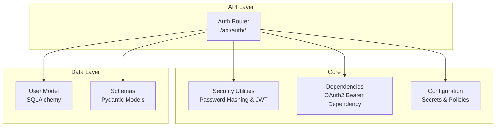
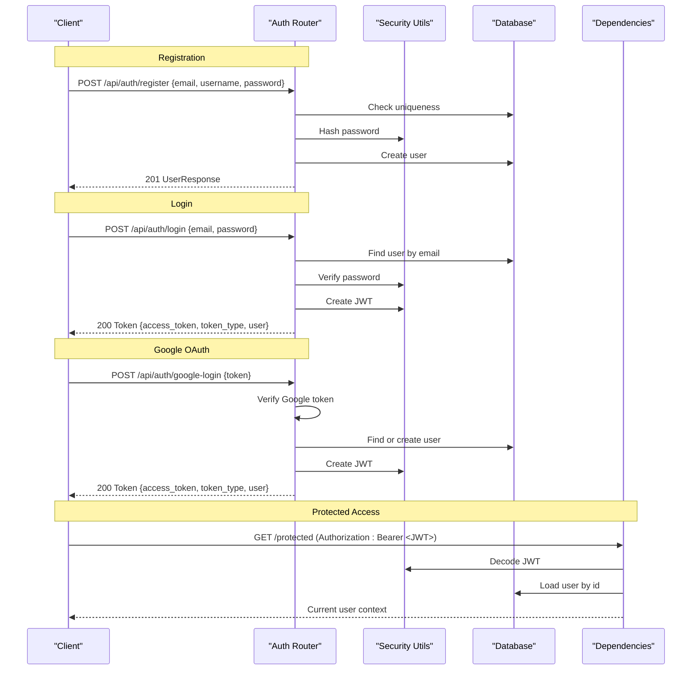
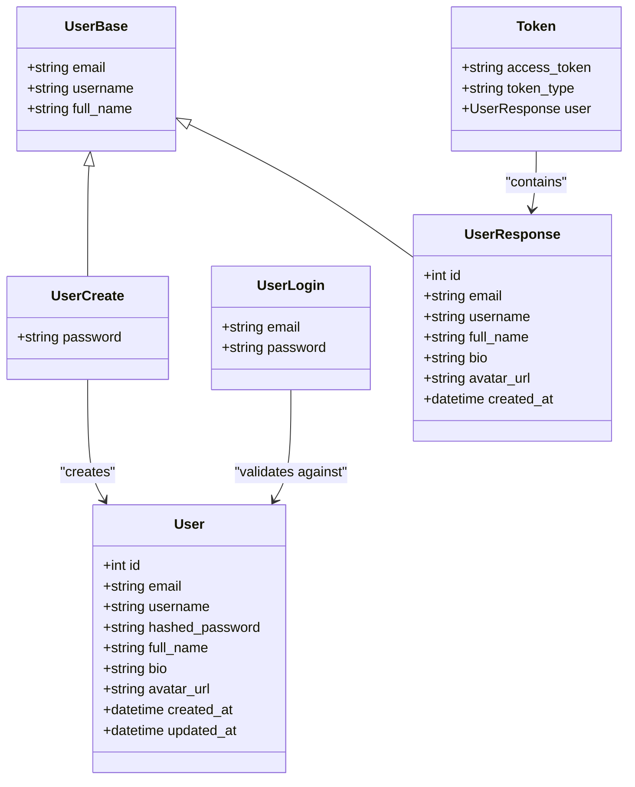
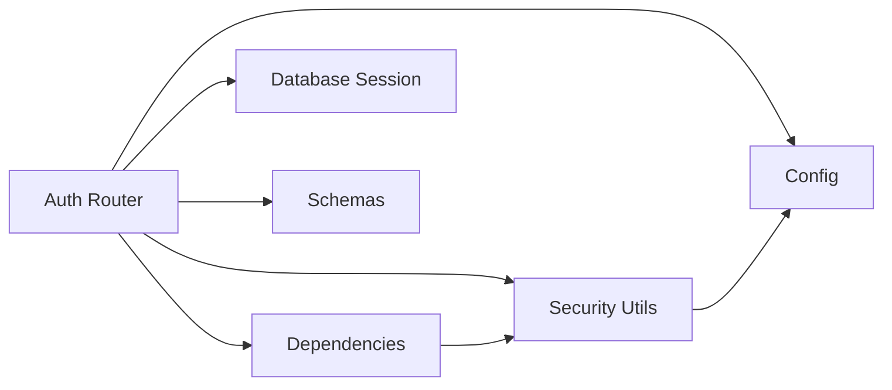

# Authentication Endpoints

<cite>
**Referenced Files in This Document**   
- [auth.py](file://app/api/endpoints/auth.py)
- [security.py](file://app/core/security.py)
- [dependencies.py](file://app/core/dependencies.py)
- [user.py](file://app/models/user.py)
- [user.py](file://app/schemas/user.py)
- [config.py](file://app/core/config.py)
- [test_auth.py](file://tests/test_auth.py)
</cite>

## Table of Contents
1. [Introduction](#introduction)
2. [Project Structure](#project-structure)
3. [Core Components](#core-components)
4. [Architecture Overview](#architecture-overview)
5. [Detailed Component Analysis](#detailed-component-analysis)
6. [Dependency Analysis](#dependency-analysis)
7. [Performance Considerations](#performance-considerations)
8. [Troubleshooting Guide](#troubleshooting-guide)
9. [Conclusion](#conclusion)

## Introduction
This document provides detailed API documentation for the authentication endpoints, including:
- User registration with email and password
- Login to obtain JWT access tokens
- Google OAuth integration via token verification
It also covers request/response schemas, validation rules, error handling patterns, security considerations, password hashing, token expiration policies, and session management.

## Project Structure
The authentication functionality is implemented under the FastAPI application:
- Endpoint definitions are in the auth router
- Security utilities (password hashing, JWT creation/decoding) are centralized
- Pydantic schemas define request/response contracts
- SQLAlchemy models represent persistent entities
- Configuration holds secrets and policy values
- Tests validate core flows

**Diagram sources**
- [auth.py:1-128](file://app/api/endpoints/auth.py#L1-L128)
- [security.py:1-34](file://app/core/security.py#L1-L34)
- [dependencies.py:1-53](file://app/core/dependencies.py#L1-L53)
- [config.py:1-48](file://app/core/config.py#L1-L48)
- [user.py:1-28](file://app/models/user.py#L1-L28)
- [user.py:1-37](file://app/schemas/user.py#L1-L37)

**Section sources**
- [auth.py:1-128](file://app/api/endpoints/auth.py#L1-L128)
- [security.py:1-34](file://app/core/security.py#L1-L34)
- [dependencies.py:1-53](file://app/core/dependencies.py#L1-L53)
- [config.py:1-48](file://app/core/config.py#L1-L48)
- [user.py:1-28](file://app/models/user.py#L1-L28)
- [user.py:1-37](file://app/schemas/user.py#L1-L37)

## Core Components
- Auth Router: Defines /register, /login, /google-login, and /me endpoints.
- Security Utilities: Implements bcrypt-based password hashing and JWT encode/decode with configurable algorithm and secret key.
- Dependencies: Provides an OAuth2 Bearer dependency to extract and validate current user from the Authorization header.
- Schemas: Define request/response structures for users and tokens.
- Model: Represents the User entity in the database.
- Config: Holds SECRET_KEY, ALGORITHM, ACCESS_TOKEN_EXPIRE_MINUTES, GOOGLE_CLIENT_ID, and other settings.

Key responsibilities:
- Registration validates uniqueness and hashes passwords before persisting.
- Login verifies credentials and issues a signed JWT access token.
- Google login verifies the external ID token, finds or creates a user, and issues a JWT access token.
- Protected routes can use the current user dependency to enforce authorization.

**Section sources**
- [auth.py:18-126](file://app/api/endpoints/auth.py#L18-L126)
- [security.py:8-32](file://app/core/security.py#L8-L32)
- [dependencies.py:10-39](file://app/core/dependencies.py#L10-L39)
- [user.py:5-23](file://app/schemas/user.py#L5-L23)
- [user.py:6-17](file://app/models/user.py#L6-L17)
- [config.py:17-26](file://app/core/config.py#L17-L26)

## Architecture Overview
Authentication flow overview:
- Client sends credentials to register or login.
- Server validates input, persists user if needed, and returns a JWT access token.
- For Google OAuth, server verifies the external token and issues a JWT access token.
- Subsequent requests include the JWT in the Authorization header; the server decodes it to identify the user.

**Diagram sources**
- [auth.py:18-126](file://app/api/endpoints/auth.py#L18-L126)
- [security.py:19-32](file://app/core/security.py#L19-L32)
- [dependencies.py:13-39](file://app/core/dependencies.py#L13-L39)

## Detailed Component Analysis

### Register Endpoint
- Path: POST /api/auth/register
- Request body schema:
  - email: string, must be a valid email address
  - username: string, unique
  - full_name: optional string
  - password: string
- Response schema:
  - id: integer
  - email: string
  - username: string
  - full_name: optional string
  - bio: optional string
  - avatar_url: optional string
  - created_at: datetime
- Validation rules:
  - Email uniqueness enforced against existing users
  - Username uniqueness enforced against existing users
  - Password is hashed using bcrypt before storage
- Error handling:
  - 400 Bad Request when email or username already exists
- Security considerations:
  - Passwords are never stored in plaintext
  - Use HTTPS to protect credentials in transit

Example request:
- Method: POST
- URL: /api/auth/register
- Body: { "email": "user@example.com", "username": "alice", "full_name": "Alice", "password": "securePass123" }

Example response:
- Status: 201 Created
- Body: { "id": 1, "email": "user@example.com", "username": "alice", "full_name": "Alice", "bio": null, "avatar_url": null, "created_at": "2024-01-01T00:00:00Z" }

**Section sources**
- [auth.py:89-104](file://app/api/endpoints/auth.py#L89-L104)
- [user.py:5-12](file://app/schemas/user.py#L5-L12)
- [user.py:17-23](file://app/schemas/user.py#L17-L23)
- [security.py:13-17](file://app/core/security.py#L13-L17)

### Login Endpoint
- Path: POST /api/auth/login
- Request body schema:
  - email: string, must be a valid email address
  - password: string
- Response schema:
  - access_token: string (JWT)
  - token_type: string ("bearer")
  - user: object matching UserResponse
- Validation rules:
  - Email/password verified against stored hash
- Error handling:
  - 401 Unauthorized when credentials are invalid
- Token policy:
  - JWT access token includes exp claim set to current time + ACCESS_TOKEN_EXPIRE_MINUTES
  - Algorithm and secret key are configured centrally

Example request:
- Method: POST
- URL: /api/auth/login
- Body: { "email": "user@example.com", "password": "securePass123" }

Example response:
- Status: 200 OK
- Body: { "access_token": "<jwt>", "token_type": "bearer", "user": { ... } }

Usage example:
- Include Authorization header on subsequent requests: Authorization: Bearer <access_token>

**Section sources**
- [auth.py:107-120](file://app/api/endpoints/auth.py#L107-L120)
- [user.py:25-28](file://app/schemas/user.py#L25-L28)
- [security.py:19-27](file://app/core/security.py#L19-L27)
- [config.py:17-23](file://app/core/config.py#L17-L23)

### Google OAuth Integration
- Path: POST /api/auth/google-login
- Request body schema:
  - token: string (Google ID token)
- Processing steps:
  - Validate JSON body presence and structure
  - Verify the Google token via Google’s tokeninfo endpoint
  - Validate audience matches configured GOOGLE_CLIENT_ID
  - Extract email, name, and picture from payload
  - Find existing user by email or create a new user
  - Issue a JWT access token with standard claims
- Response schema:
  - access_token: string (JWT)
  - token_type: string ("bearer")
  - user: object matching UserResponse
- Error handling:
  - 400 Bad Request for malformed JSON or missing fields
  - 401 Unauthorized for invalid Google token or audience mismatch

Example request:
- Method: POST
- URL: /api/auth/google-login
- Body: { "token": "<google_id_token>" }

Example response:
- Status: 200 OK
- Body: { "access_token": "<jwt>", "token_type": "bearer", "user": { ... } }

Notes:
- The implementation uses synchronous HTTP calls to verify the Google token. In high-throughput environments, consider asynchronous clients to avoid blocking.

**Section sources**
- [auth.py:18-87](file://app/api/endpoints/auth.py#L18-L87)
- [config.py:25-26](file://app/core/config.py#L25-L26)

### Get Current User Info
- Path: GET /api/auth/me
- Authorization: Requires a valid Bearer token
- Response schema:
  - UserResponse object
- Purpose: Returns authenticated user details for client-side state or profile display

Example request:
- Method: GET
- URL: /api/auth/me
- Headers: Authorization: Bearer <access_token>

Example response:
- Status: 200 OK
- Body: { "id": 1, "email": "user@example.com", "username": "alice", "full_name": "Alice", "bio": null, "avatar_url": null, "created_at": "2024-01-01T00:00:00Z" }

**Section sources**
- [auth.py:123-126](file://app/api/endpoints/auth.py#L123-L126)
- [dependencies.py:13-39](file://app/core/dependencies.py#L13-L39)

### Data Models and Schemas
- User model fields:
  - id: primary key
  - email: unique, indexed
  - username: unique, indexed
  - hashed_password: required
  - full_name: optional
  - bio: optional text
  - avatar_url: optional
  - created_at: timestamp
  - updated_at: timestamp
- Pydantic schemas:
  - UserBase: base fields for email, username, full_name
  - UserCreate: adds password for registration
  - UserLogin: email and password for login
  - UserResponse: persisted user fields returned to clients
  - Token: wraps access_token, token_type, and user

**Diagram sources**
- [user.py:6-17](file://app/models/user.py#L6-L17)
- [user.py:5-28](file://app/schemas/user.py#L5-L28)

**Section sources**
- [user.py:6-17](file://app/models/user.py#L6-L17)
- [user.py:5-28](file://app/schemas/user.py#L5-L28)

## Dependency Analysis
- Auth Router depends on:
  - Security utilities for password hashing and JWT operations
  - Database session provider
  - Pydantic schemas for validation and serialization
  - Configuration for secrets and policies
- Dependencies module provides:
  - OAuth2 Bearer scheme pointing to /api/auth/login
  - get_current_user dependency that decodes JWT and loads user
- Security module depends on:
  - pydantic_settings configuration for SECRET_KEY and ALGORITHM
  - passlib CryptContext for bcrypt hashing
  - python-jose for JWT encoding/decoding

**Diagram sources**
- [auth.py:1-128](file://app/api/endpoints/auth.py#L1-L128)
- [security.py:1-34](file://app/core/security.py#L1-L34)
- [dependencies.py:1-53](file://app/core/dependencies.py#L1-L53)
- [config.py:1-48](file://app/core/config.py#L1-L48)

**Section sources**
- [auth.py:1-128](file://app/api/endpoints/auth.py#L1-L128)
- [security.py:1-34](file://app/core/security.py#L1-L34)
- [dependencies.py:1-53](file://app/core/dependencies.py#L1-L53)
- [config.py:1-48](file://app/core/config.py#L1-L48)

## Performance Considerations
- Google token verification uses synchronous HTTP requests; consider async clients for scalability.
- JWT decoding occurs per protected request; ensure efficient database lookups and caching strategies if needed.
- Password hashing uses bcrypt; tune cost factor appropriately for your environment.
- Avoid returning sensitive fields in responses; UserResponse excludes password.

[No sources needed since this section provides general guidance]

## Troubleshooting Guide
Common errors and resolutions:
- Invalid or missing JSON body for Google login:
  - Ensure the request body is valid JSON and contains a "token" field.
- Missing Google token:
  - Confirm the frontend passes the Google ID token correctly.
- Invalid Google token or audience mismatch:
  - Verify GOOGLE_CLIENT_ID matches the token’s audience.
- Invalid credentials:
  - Check email/password combination; ensure correct casing and no extra whitespace.
- Token expired:
  - Refresh the access token by re-authenticating; handle 401 responses in the client.
- Could not validate credentials:
  - Ensure Authorization header is present and formatted as "Bearer <token>".

Operational checks:
- Verify SECRET_KEY and ALGORITHM are set securely in production.
- Ensure DATABASE_URL points to the intended database.
- Monitor logs for failed Google token verification and database constraints.

**Section sources**
- [auth.py:20-55](file://app/api/endpoints/auth.py#L20-L55)
- [auth.py:107-120](file://app/api/endpoints/auth.py#L107-L120)
- [dependencies.py:13-39](file://app/core/dependencies.py#L13-L39)
- [config.py:17-26](file://app/core/config.py#L17-L26)

## Conclusion
The authentication system provides secure user registration, credential-based login with JWT access tokens, and Google OAuth integration. It enforces input validation, password hashing, and token expiration policies. Clients should manage tokens securely, send them via the Authorization header, and handle error responses gracefully.

[No sources needed since this section summarizes without analyzing specific files]