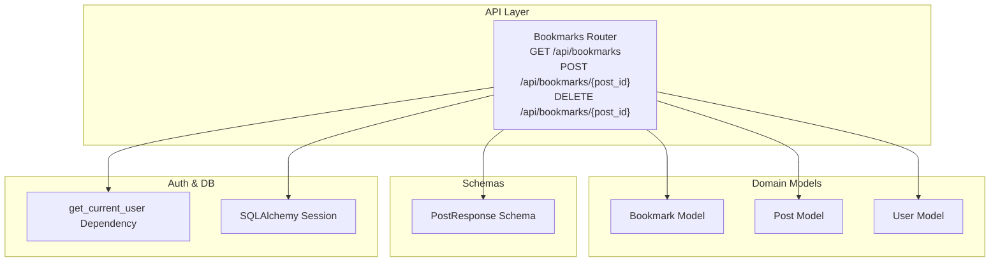
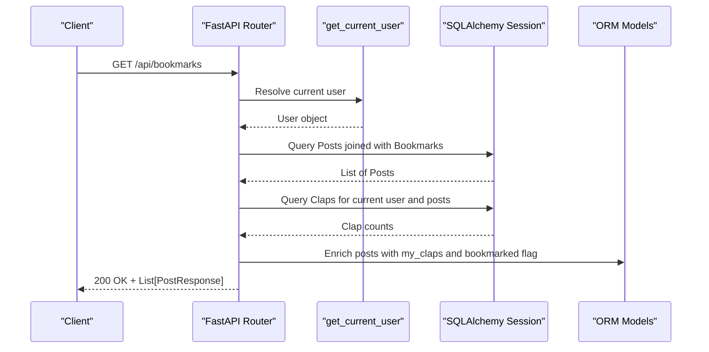
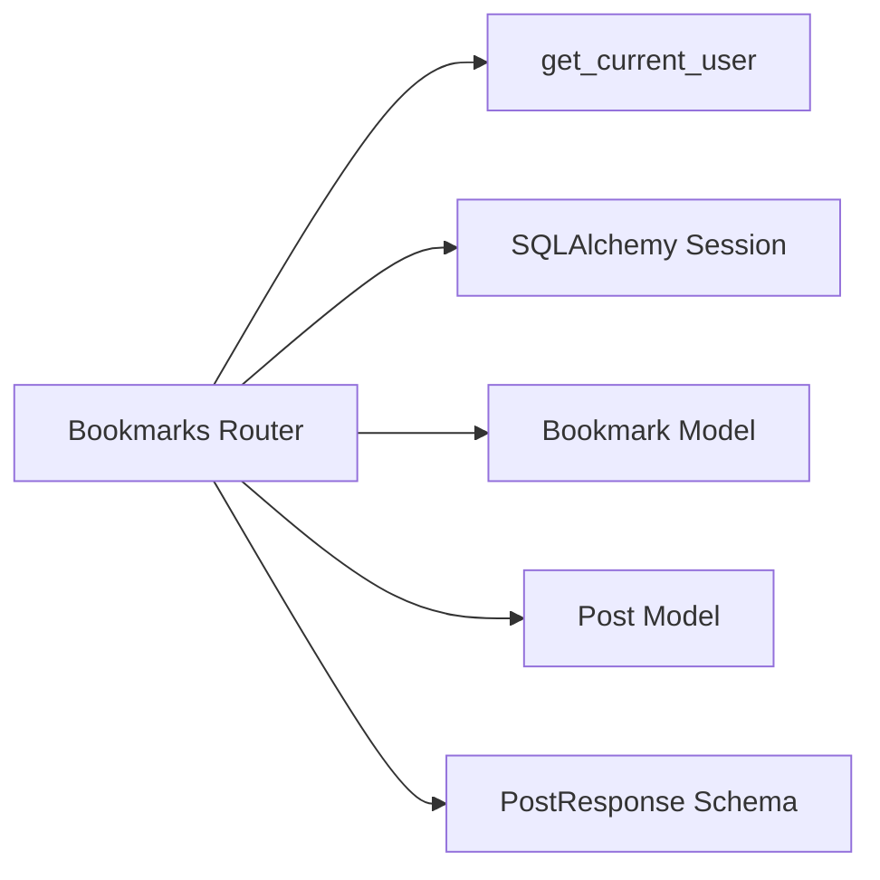

# Bookmarks Endpoints

<cite>
**Referenced Files in This Document**   
- [bookmarks.py](file://app/api/endpoints/bookmarks.py)
- [bookmark.py](file://app/models/bookmark.py)
- [post.py](file://app/models/post.py)
- [user.py](file://app/models/user.py)
- [post.py](file://app/schemas/post.py)
- [dependencies.py](file://app/core/dependencies.py)
- [__init__.py](file://app/api/__init__.py)
</cite>

## Table of Contents
1. [Introduction](#introduction)
2. [Project Structure](#project-structure)
3. [Core Components](#core-components)
4. [Architecture Overview](#architecture-overview)
5. [Detailed Component Analysis](#detailed-component-analysis)
6. [Dependency Analysis](#dependency-analysis)
7. [Performance Considerations](#performance-considerations)
8. [Troubleshooting Guide](#troubleshooting-guide)
9. [Conclusion](#conclusion)

## Introduction
This document provides comprehensive API documentation for the bookmark management endpoints. It covers:
- Creating, removing, and retrieving bookmarks
- Request/response schemas for bookmark-related operations
- Validation rules and error handling
- Relationship mapping to posts
- Notes on categorization, search within bookmarks, and export functionality (not implemented)
- Performance optimization strategies for large bookmark collections and caching recommendations

## Project Structure
The bookmark feature is implemented as a FastAPI router with models and schemas defined under app/models and app/schemas. The router is mounted at /api/bookmarks.

**Diagram sources**
- [bookmarks.py:1-78](file://app/api/endpoints/bookmarks.py#L1-L78)
- [bookmark.py:1-19](file://app/models/bookmark.py#L1-L19)
- [post.py:1-32](file://app/models/post.py#L1-L32)
- [user.py:1-28](file://app/models/user.py#L1-L28)
- [post.py:1-60](file://app/schemas/post.py#L1-L60)
- [dependencies.py:1-53](file://app/core/dependencies.py#L1-L53)

**Section sources**
- [__init__.py:1-15](file://app/api/__init__.py#L1-L15)
- [bookmarks.py:1-78](file://app/api/endpoints/bookmarks.py#L1-L78)

## Core Components
- Bookmarks Router: Provides endpoints to list user bookmarks, add a bookmark, and remove a bookmark.
- Bookmark Model: Defines the database table and relationships between users and posts.
- Post Model: Defines post fields and relationships including bookmarks.
- PostResponse Schema: Defines the response shape for posts returned by the bookmarks endpoint.
- Authentication Dependency: Ensures requests are authenticated via JWT and resolves the current user.

Key responsibilities:
- Enforce authentication for all bookmark operations.
- Maintain uniqueness of bookmarks per user and post.
- Return enriched post data with clap counts and bookmarked flags.

**Section sources**
- [bookmarks.py:1-78](file://app/api/endpoints/bookmarks.py#L1-L78)
- [bookmark.py:1-19](file://app/models/bookmark.py#L1-L19)
- [post.py:1-32](file://app/models/post.py#L1-L32)
- [post.py:1-60](file://app/schemas/post.py#L1-L60)
- [dependencies.py:1-53](file://app/core/dependencies.py#L1-L53)

## Architecture Overview
The bookmark endpoints follow a layered architecture:
- HTTP layer: FastAPI routes handle request parsing and response serialization.
- Service logic: In-process logic queries the database and enriches responses.
- Data layer: SQLAlchemy ORM interacts with the relational database.
- Auth layer: JWT-based authentication ensures only authorized users access their bookmarks.

**Diagram sources**
- [bookmarks.py:15-39](file://app/api/endpoints/bookmarks.py#L15-L39)
- [dependencies.py:13-39](file://app/core/dependencies.py#L13-L39)

## Detailed Component Analysis

### Endpoint: Get My Bookmarks
- Method: GET
- Path: /api/bookmarks
- Authentication: Required (Bearer token)
- Response: Array of PostResponse objects representing the user’s bookmarked posts, ordered by most recently bookmarked first. Each post includes clap_count and my_claps, and has bookmarked set to true.

Behavior:
- Joins Post and Bookmark tables filtered by current user.
- Orders results by Bookmark.created_at descending.
- Fetches clap counts for the current user across the returned posts and attaches them as my_claps.
- Marks each returned post as bookmarked.

Request schema:
- No request body.
- Authorization header required: Bearer <JWT>.

Response schema:
- Array of PostResponse:
  - id: integer
  - slug: string
  - author_id: integer
  - author: UserResponse object
  - clap_count: integer
  - my_claps: integer
  - bookmarked: boolean (always true for this endpoint)
  - tags: array of strings
  - tag_slugs: array of strings
  - created_at: datetime
  - updated_at: datetime

Validation rules:
- Requires valid JWT; otherwise returns 401 Unauthorized.
- If no bookmarks exist, returns an empty array.

Error handling:
- 401 Unauthorized if credentials are invalid or expired.

Example response:
- See PostResponse schema definition for field types and structure.

**Section sources**
- [bookmarks.py:15-39](file://app/api/endpoints/bookmarks.py#L15-L39)
- [post.py:26-39](file://app/schemas/post.py#L26-L39)
- [dependencies.py:13-39](file://app/core/dependencies.py#L13-L39)

### Endpoint: Add Bookmark
- Method: POST
- Path: /api/bookmarks/{post_id}
- Authentication: Required (Bearer token)
- Response: JSON object with bookmarked: true upon success.
- Status codes:
  - 201 Created when bookmark added or already exists (idempotent).
  - 404 Not Found if the specified post does not exist.
  - 401 Unauthorized if authentication fails.

Behavior:
- Validates that the post exists.
- Checks for existing bookmark for the current user and post.
- Creates a new Bookmark record if none exists.
- Commits transaction and returns success payload.

Request schema:
- No request body.
- Path parameter: post_id (integer).
- Authorization header required: Bearer <JWT>.

Response schema:
- { "bookmarked": true }

Validation rules:
- post_id must be a valid integer.
- Duplicate bookmarks are allowed (no error raised).

Error handling:
- 404 Not Found when post_id does not correspond to any post.
- 401 Unauthorized for invalid/expired tokens.

Example request:
- POST /api/bookmarks/42 with Authorization: Bearer <token>

Example response:
- { "bookmarked": true }

**Section sources**
- [bookmarks.py:42-60](file://app/api/endpoints/bookmarks.py#L42-L60)

### Endpoint: Remove Bookmark
- Method: DELETE
- Path: /api/bookmarks/{post_id}
- Authentication: Required (Bearer token)
- Response: No content (204 No Content) when successful.
- Behavior:
  - Removes the bookmark entry if it exists for the current user and post.
  - Idempotent: deleting a non-existent bookmark succeeds without error.

Request schema:
- No request body.
- Path parameter: post_id (integer).
- Authorization header required: Bearer <JWT>.

Response schema:
- Empty body with 204 status code.

Validation rules:
- post_id must be a valid integer.

Error handling:
- 401 Unauthorized for invalid/expired tokens.

Example request:
- DELETE /api/bookmarks/42 with Authorization: Bearer <token>

**Section sources**
- [bookmarks.py:63-77](file://app/api/endpoints/bookmarks.py#L63-L77)

### Data Model: Bookmark
- Table name: bookmarks
- Columns:
  - id: primary key, integer
  - user_id: foreign key to users.id, indexed
  - post_id: foreign key to posts.id, indexed
  - created_at: timestamp defaulting to UTC now
- Constraints:
  - UniqueConstraint(user_id, post_id) prevents duplicate bookmarks per user and post.
- Relationships:
  - user: relationship to User model
  - post: relationship to Post model with back_populates="bookmarks"

Complexity:
- Insertion and deletion are O(1) with indexes on user_id and post_id.
- Uniqueness constraint enforces integrity at the database level.

**Section sources**
- [bookmark.py:1-19](file://app/models/bookmark.py#L1-L19)

### Data Model: Post
- Fields include title, subtitle, content, slug, cover_image, topic, clap_count, author_id, published, timestamps.
- Relationships:
  - author: User
  - comments: Comment
  - claps: Clap
  - bookmarks: Bookmark
  - tags: Tag (secondary join table)
- Computed property:
  - tag_names: returns list of tag names from related tags.

Relevance to bookmarks:
- Bookmarks reference posts via post_id.
- The get_my_bookmarks endpoint enriches posts with clap counts and sets bookmarked=true.

**Section sources**
- [post.py:1-32](file://app/models/post.py#L1-L32)

### Schema: PostResponse
- Extends PostBase and adds:
  - id, slug, author_id, author (UserResponse), clap_count, my_claps, bookmarked, tags, tag_slugs, created_at, updated_at.
- Validators:
  - tags_to_names: converts Tag objects to names.
  - tags_to_slugs: converts Tag objects to slugs.

Usage:
- Returned by GET /api/bookmarks for each bookmarked post.

**Section sources**
- [post.py:1-60](file://app/schemas/post.py#L1-L60)

### Authentication Dependency: get_current_user
- Extracts JWT from Authorization header using OAuth2PasswordBearer.
- Decodes token and validates signature/expiry.
- Resolves user by ID from the database.
- Raises 401 Unauthorized for invalid/expired tokens or missing user.

Security considerations:
- All bookmark endpoints require a valid bearer token.
- Token expiry is handled explicitly.

**Section sources**
- [dependencies.py:1-53](file://app/core/dependencies.py#L1-L53)

## Dependency Analysis
The bookmark endpoints depend on:
- Authentication dependency for user resolution.
- Database session for querying posts, bookmarks, and claps.
- ORM models for relationships and constraints.
- Pydantic schemas for response validation and serialization.

**Diagram sources**
- [bookmarks.py:1-78](file://app/api/endpoints/bookmarks.py#L1-L78)
- [dependencies.py:1-53](file://app/core/dependencies.py#L1-L53)
- [bookmark.py:1-19](file://app/models/bookmark.py#L1-L19)
- [post.py:1-32](file://app/models/post.py#L1-L32)
- [post.py:1-60](file://app/schemas/post.py#L1-L60)

**Section sources**
- [bookmarks.py:1-78](file://app/api/endpoints/bookmarks.py#L1-L78)
- [dependencies.py:1-53](file://app/core/dependencies.py#L1-L53)

## Performance Considerations
Current implementation notes:
- GET /api/bookmarks performs two queries: one for posts joined with bookmarks, and another for clap counts across the returned posts.
- For large bookmark collections, consider:
  - Pagination: Add query parameters like limit and offset to reduce payload size.
  - Selective loading: Use eager loading for tags and author to avoid N+1 queries.
  - Indexing: Ensure indexes exist on bookmarks.user_id and bookmarks.post_id (already present in model).
  - Caching: Cache the user’s bookmark list and associated clap counts using Redis or in-memory cache with TTL.
  - Batch updates: When adding/removing multiple bookmarks, batch insert/delete operations.

Caching strategy recommendations:
- Cache key pattern: user_bookmarks:{user_id}
- Expiration: Short-lived (e.g., 5–10 minutes) to balance freshness and performance.
- Invalidation: Invalidate cache on bookmark create/delete operations.

Optimization opportunities:
- Combine clap count retrieval into a single aggregated query.
- Use database-level computed columns or materialized views for frequently accessed aggregates.

[No sources needed since this section provides general guidance]

## Troubleshooting Guide
Common issues and resolutions:
- 401 Unauthorized:
  - Cause: Missing, invalid, or expired JWT token.
  - Resolution: Ensure Authorization header contains a valid Bearer token; refresh token if expired.
- 404 Not Found (Add Bookmark):
  - Cause: Specified post_id does not exist.
  - Resolution: Verify post_id validity before calling the endpoint.
- Empty bookmark list:
  - Cause: User has no bookmarks.
  - Resolution: This is expected; client should handle empty arrays gracefully.

Debugging tips:
- Log the resolved user_id from the JWT payload to confirm correct user context.
- Inspect database constraints to ensure unique bookmarks per user and post.

**Section sources**
- [dependencies.py:13-39](file://app/core/dependencies.py#L13-L39)
- [bookmarks.py:42-60](file://app/api/endpoints/bookmarks.py#L42-L60)

## Conclusion
The bookmark endpoints provide essential functionality for managing user bookmarks with clear request/response contracts and robust authentication. While advanced features such as categorization, search within bookmarks, and export are not implemented, the system is structured to support future enhancements. Performance optimizations like pagination, caching, and query tuning can significantly improve scalability for large bookmark collections.

[No sources needed since this section summarizes without analyzing specific files]