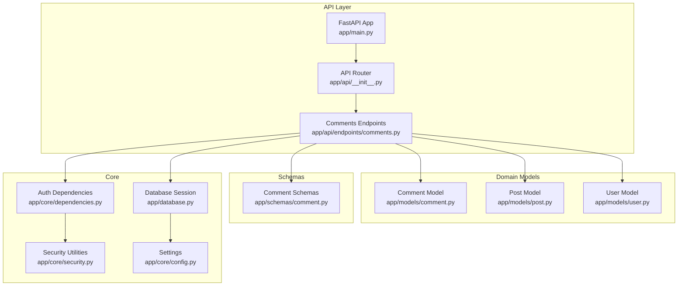
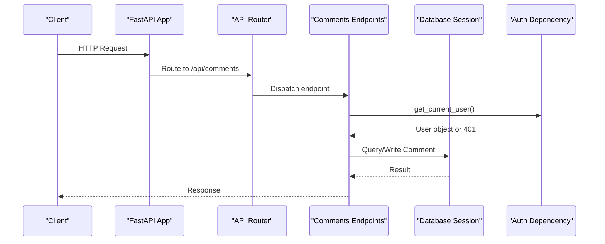
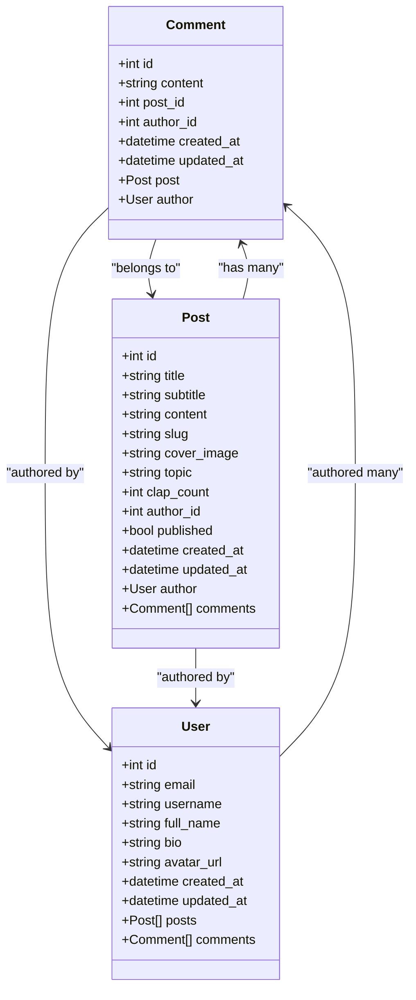
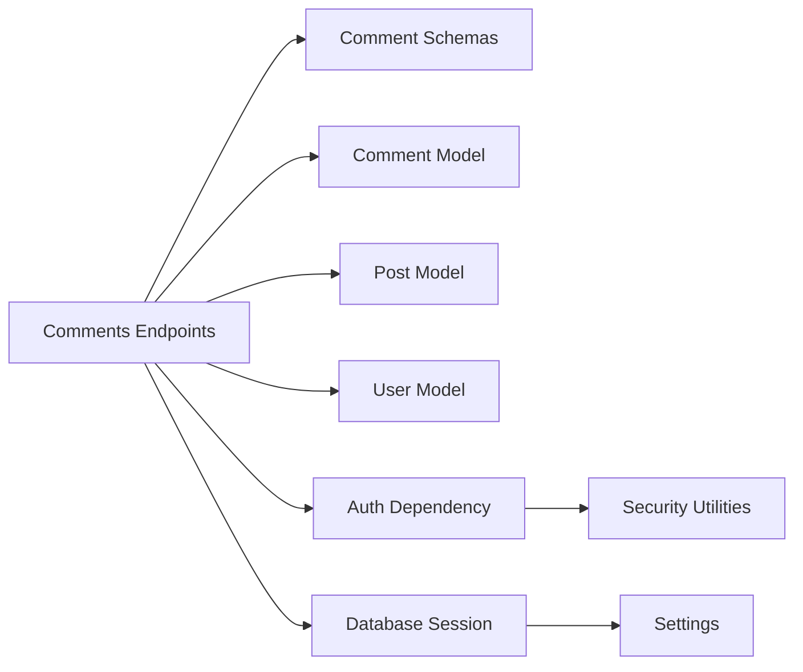

# Comments Endpoints

<cite>
**Referenced Files in This Document**
- [comments.py](file://app/api/endpoints/comments.py)
- [comment.py](file://app/schemas/comment.py)
- [comment_model.py](file://app/models/comment.py)
- [post_model.py](file://app/models/post.py)
- [user_model.py](file://app/models/user.py)
- [dependencies.py](file://app/core/dependencies.py)
- [security.py](file://app/core/security.py)
- [database.py](file://app/database.py)
- [main.py](file://app/main.py)
- [api_init.py](file://app/api/__init__.py)
- [config.py](file://app/core/config.py)
- [requirements.txt](file://requirements.txt)
</cite>

## Table of Contents
1. [Introduction](#introduction)
2. [Project Structure](#project-structure)
3. [Core Components](#core-components)
4. [Architecture Overview](#architecture-overview)
5. [Detailed Component Analysis](#detailed-component-analysis)
6. [Dependency Analysis](#dependency-analysis)
7. [Performance Considerations](#performance-considerations)
8. [Troubleshooting Guide](#troubleshooting-guide)
9. [Conclusion](#conclusion)

## Introduction
This document provides detailed API documentation for the comments management endpoints. It covers:
- Creating comments on posts
- Retrieving comments for a specific post
- Deleting comments with ownership verification
- Data models and schemas for comment objects
- Relationships to posts and users
- Authentication requirements
- Current limitations (no nested comments, no rate limiting or spam prevention)
- Recommendations for moderation workflows and integration with post views

## Project Structure
The comments feature is implemented as a FastAPI router under the API layer, with Pydantic schemas for request/response validation and SQLAlchemy models for persistence.

**Diagram sources**
- [main.py:33-81](file://app/main.py#L33-L81)
- [api_init.py:5-14](file://app/api/__init__.py#L5-L14)
- [comments.py:1-62](file://app/api/endpoints/comments.py#L1-L62)
- [comment_model.py:1-18](file://app/models/comment.py#L1-L18)
- [post_model.py:1-32](file://app/models/post.py#L1-L32)
- [user_model.py:1-28](file://app/models/user.py#L1-L28)
- [comment.py:1-32](file://app/schemas/comment.py#L1-L32)
- [dependencies.py:10-52](file://app/core/dependencies.py#L10-L52)
- [security.py:1-34](file://app/core/security.py#L1-L34)
- [database.py:1-27](file://app/database.py#L1-L27)
- [config.py:5-48](file://app/core/config.py#L5-L48)

**Section sources**
- [main.py:33-81](file://app/main.py#L33-L81)
- [api_init.py:5-14](file://app/api/__init__.py#L5-L14)

## Core Components
- Comments endpoints: define routes for listing, creating, and deleting comments.
- Comment schema: defines input/output structures for comments.
- Comment model: defines database table and relationships to Post and User.
- Authentication dependency: ensures requests are authenticated via JWT.
- Database session: provides scoped database sessions per request.

Key responsibilities:
- Validation: Pydantic schemas validate incoming payloads.
- Authorization: Ownership check prevents unauthorized deletions.
- Persistence: SQLAlchemy ORM handles CRUD operations.

**Section sources**
- [comments.py:13-61](file://app/api/endpoints/comments.py#L13-L61)
- [comment.py:5-31](file://app/schemas/comment.py#L5-L31)
- [comment_model.py:6-17](file://app/models/comment.py#L6-L17)
- [dependencies.py:13-39](file://app/core/dependencies.py#L13-L39)
- [database.py:20-25](file://app/database.py#L20-L25)

## Architecture Overview
The comments endpoints are mounted under /api/comments and require authentication for write operations.

**Diagram sources**
- [main.py:81-81](file://app/main.py#L81-L81)
- [api_init.py:9-9](file://app/api/__init__.py#L9-L9)
- [comments.py:13-61](file://app/api/endpoints/comments.py#L13-L61)
- [dependencies.py:13-39](file://app/core/dependencies.py#L13-L39)
- [database.py:20-25](file://app/database.py#L20-L25)

## Detailed Component Analysis

### API Endpoints

#### List Comments for a Post
- Method: GET
- Path: /api/comments/post/{post_id}
- Authentication: Not required
- Description: Returns all comments for a given post, ordered by creation time ascending.
- Path parameters:
  - post_id: integer
- Success response: Array of comment objects
- Error responses:
  - 404 Not Found: If the specified post does not exist

Request example:
- GET /api/comments/post/42

Response example:
- 200 OK: Array of comment objects

Error examples:
- 404 Not Found: {"detail": "Post not found"}

**Section sources**
- [comments.py:13-21](file://app/api/endpoints/comments.py#L13-L21)

#### Create a Comment
- Method: POST
- Path: /api/comments
- Authentication: Required (Bearer token)
- Description: Creates a new comment associated with a post and the authenticated user.
- Request body: CommentCreate schema
- Success response: CommentResponse object
- Error responses:
  - 401 Unauthorized: Invalid or missing token
  - 404 Not Found: If the referenced post does not exist
  - 422 Unprocessable Entity: Validation errors in request body

Request body fields:
- content: string (required)
- post_id: integer (required)

Success response fields:
- id: integer
- content: string
- post_id: integer
- author_id: integer
- author: CommentAuthor object
- created_at: datetime
- updated_at: datetime

Error examples:
- 401 Unauthorized: {"detail": "Could not validate credentials"}
- 404 Not Found: {"detail": "Post not found"}
- 422 Unprocessable Entity: Validation error details

**Section sources**
- [comments.py:23-43](file://app/api/endpoints/comments.py#L23-L43)
- [comment.py:8-10](file://app/schemas/comment.py#L8-L10)
- [comment.py:22-31](file://app/schemas/comment.py#L22-L31)

#### Delete a Comment
- Method: DELETE
- Path: /api/comments/{comment_id}
- Authentication: Required (Bearer token)
- Description: Deletes a comment only if the authenticated user is the author.
- Path parameters:
  - comment_id: integer
- Success response: 204 No Content
- Error responses:
  - 401 Unauthorized: Invalid or missing token
  - 403 Forbidden: Attempting to delete a comment you do not own
  - 404 Not Found: If the comment does not exist

Error examples:
- 403 Forbidden: {"detail": "Not authorized to delete this comment"}
- 404 Not Found: {"detail": "Comment not found"}

**Section sources**
- [comments.py:45-61](file://app/api/endpoints/comments.py#L45-L61)

### Data Models and Relationships

**Diagram sources**
- [comment_model.py:6-17](file://app/models/comment.py#L6-L17)
- [post_model.py:6-32](file://app/models/post.py#L6-L32)
- [user_model.py:6-28](file://app/models/user.py#L6-L28)

**Section sources**
- [comment_model.py:6-17](file://app/models/comment.py#L6-L17)
- [post_model.py:6-32](file://app/models/post.py#L6-L32)
- [user_model.py:6-28](file://app/models/user.py#L6-L28)

### Request and Response Schemas

- CommentBase
  - content: string (required)

- CommentCreate
  - content: string (required)
  - post_id: integer (required)

- CommentUpdate
  - content: optional string

- CommentAuthor
  - id: integer
  - username: string
  - full_name: optional string

- CommentResponse
  - id: integer
  - content: string
  - post_id: integer
  - author_id: integer
  - author: CommentAuthor
  - created_at: datetime
  - updated_at: datetime

Validation rules:
- content must be provided when creating a comment.
- post_id must be an integer when creating a comment.
- The server validates that the referenced post exists before creating a comment.

Note: There is no explicit length or format validation for content at the schema level; consider adding constraints such as minimum/maximum length and sanitization rules.

**Section sources**
- [comment.py:5-31](file://app/schemas/comment.py#L5-L31)
- [comments.py:30-43](file://app/api/endpoints/comments.py#L30-L43)

### Authentication and Authorization
- All write endpoints require a valid Bearer token obtained from the auth flow.
- get_current_user extracts the user from the JWT payload and returns a User object.
- Deletion requires ownership verification: only the comment’s author can delete it.

Authentication flow:
- Client includes Authorization: Bearer <token> header.
- Server decodes the token and resolves the user.
- If invalid/expired, a 401 Unauthorized is returned.

Authorization flow:
- On delete, the server compares the comment’s author_id with the current user’s id.
- If mismatched, a 403 Forbidden is returned.

**Section sources**
- [dependencies.py:13-39](file://app/core/dependencies.py#L13-L39)
- [security.py:19-32](file://app/core/security.py#L19-L32)
- [comments.py:45-61](file://app/api/endpoints/comments.py#L45-L61)

### Nested Comments and Threading
- The current implementation does not support nested comments or threading.
- Comments are flat and belong directly to a post.
- To implement threading, extend the Comment model with a parent_id field and update endpoints to handle hierarchy.

Recommendation:
- Add parent_id: integer (nullable) to Comment.
- Update list endpoint to return threaded structure or provide separate endpoints for replies.
- Enforce depth limits and ordering rules.

[No sources needed since this section proposes conceptual changes]

### Moderation Workflows
- Current endpoints do not include moderation flags or soft deletes.
- Recommended enhancements:
  - Add moderation status fields (e.g., approved, flagged, hidden).
  - Provide admin endpoints to approve/reject comments.
  - Implement soft delete for auditability.
  - Integrate content filtering and spam detection services.

[No sources needed since this section proposes conceptual improvements]

### Integration with Post Views
- Comments are retrieved per post using the post identifier.
- When displaying a post, fetch its comments via the list endpoint.
- Consider caching comment lists per post to reduce database load.

**Section sources**
- [comments.py:13-21](file://app/api/endpoints/comments.py#L13-L21)

### Rate Limiting and Spam Prevention
- The current implementation does not include rate limiting or spam prevention.
- Recommendations:
  - Implement per-user and per-post rate limiting for comment creation.
  - Add content filters for profanity, links, and suspicious patterns.
  - Use CAPTCHA or challenge flows for suspected spam.
  - Track and block repeat offenders based on behavior signals.

[No sources needed since this section provides general guidance]

## Dependency Analysis

**Diagram sources**
- [comments.py:1-62](file://app/api/endpoints/comments.py#L1-L62)
- [comment.py:1-32](file://app/schemas/comment.py#L1-L32)
- [comment_model.py:1-18](file://app/models/comment.py#L1-L18)
- [post_model.py:1-32](file://app/models/post.py#L1-L32)
- [user_model.py:1-28](file://app/models/user.py#L1-L28)
- [dependencies.py:10-52](file://app/core/dependencies.py#L10-L52)
- [security.py:1-34](file://app/core/security.py#L1-L34)
- [database.py:1-27](file://app/database.py#L1-L27)
- [config.py:5-48](file://app/core/config.py#L5-L48)

**Section sources**
- [comments.py:1-62](file://app/api/endpoints/comments.py#L1-L62)
- [dependencies.py:10-52](file://app/core/dependencies.py#L10-L52)

## Performance Considerations
- Indexes: Ensure indexes exist on foreign keys (post_id, author_id) for efficient queries.
- Pagination: For posts with many comments, implement pagination to limit payload size.
- N+1 queries: Avoid loading unnecessary related data; use eager loading where appropriate.
- Caching: Cache comment lists per post to reduce repeated database reads.
- Connection pooling: Leverage existing pool settings to manage database connections efficiently.

[No sources needed since this section provides general guidance]

## Troubleshooting Guide
Common issues and resolutions:
- 401 Unauthorized:
  - Cause: Missing or invalid Bearer token.
  - Resolution: Ensure the client sends a valid token obtained from the auth flow.

- 403 Forbidden:
  - Cause: Attempting to delete a comment not authored by the current user.
  - Resolution: Verify ownership before deletion or adjust permissions accordingly.

- 404 Not Found:
  - Cause: Referenced post or comment does not exist.
  - Resolution: Validate IDs before making requests.

- 422 Unprocessable Entity:
  - Cause: Invalid request payload (missing or incorrect fields).
  - Resolution: Validate request body against the schema definitions.

**Section sources**
- [dependencies.py:13-39](file://app/core/dependencies.py#L13-L39)
- [comments.py:13-61](file://app/api/endpoints/comments.py#L13-L61)

## Conclusion
The comments endpoints provide essential functionality for creating, retrieving, and deleting comments on posts with basic ownership-based authorization. The system currently lacks nested comments, rate limiting, and spam prevention features. Enhancements should focus on threading, moderation controls, security hardening, and performance optimizations to support scalable and secure comment interactions.