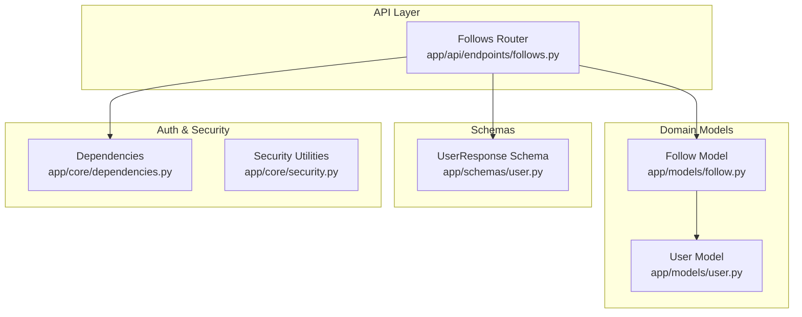
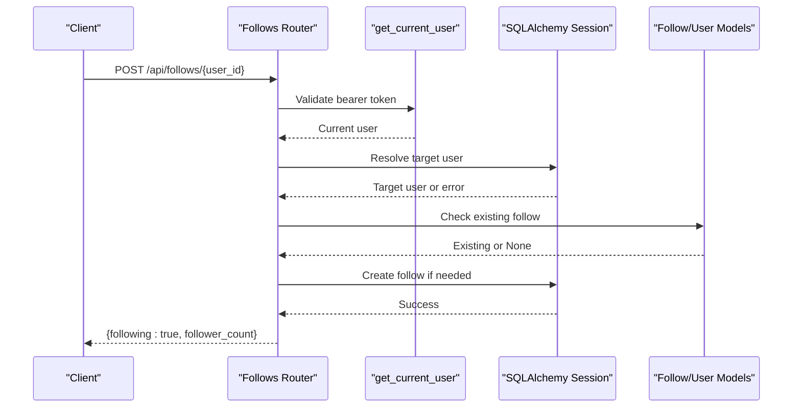
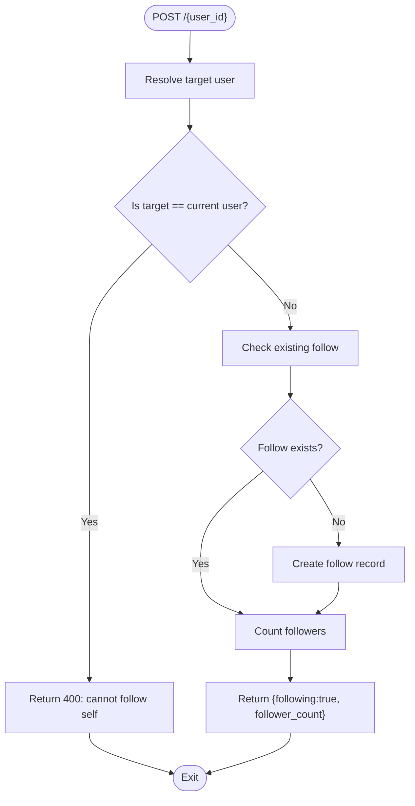
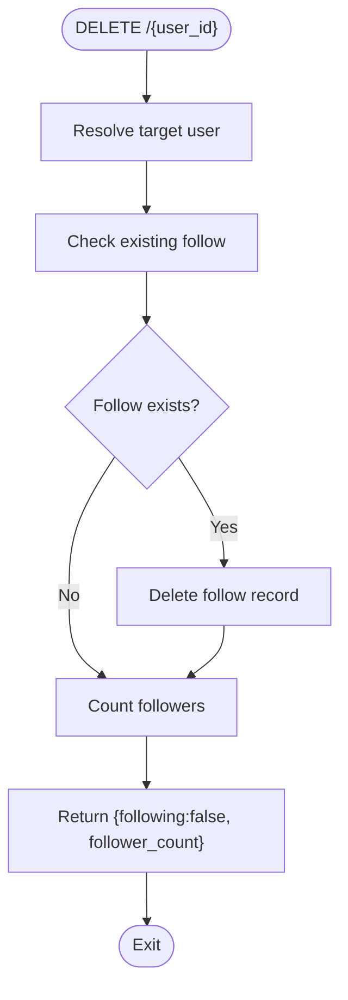
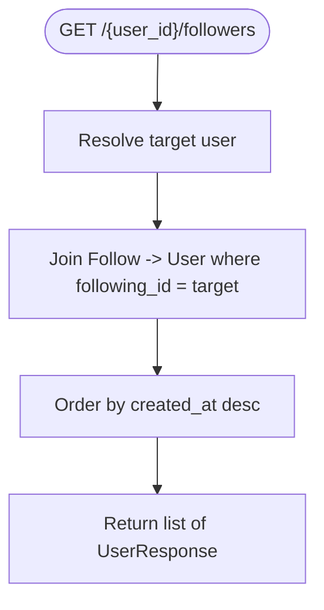
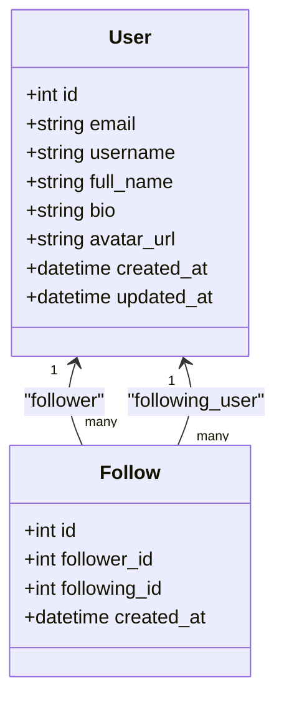
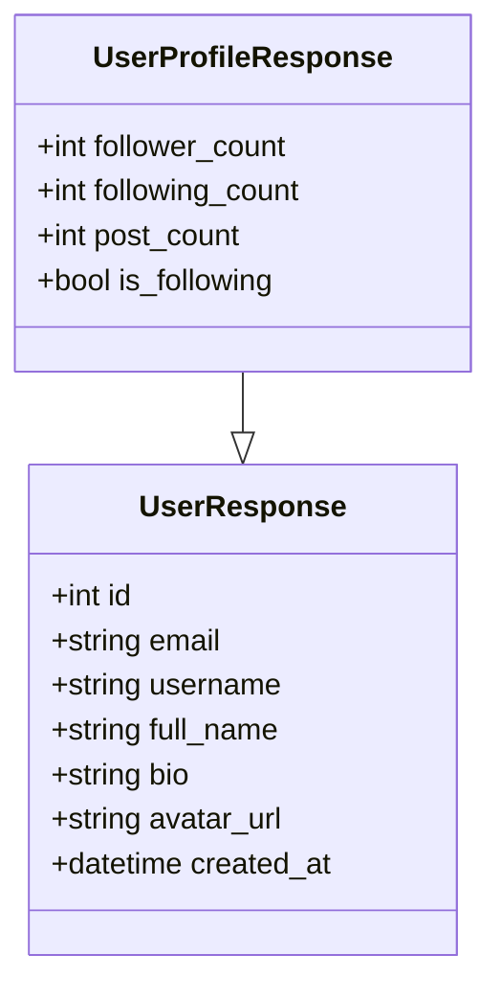
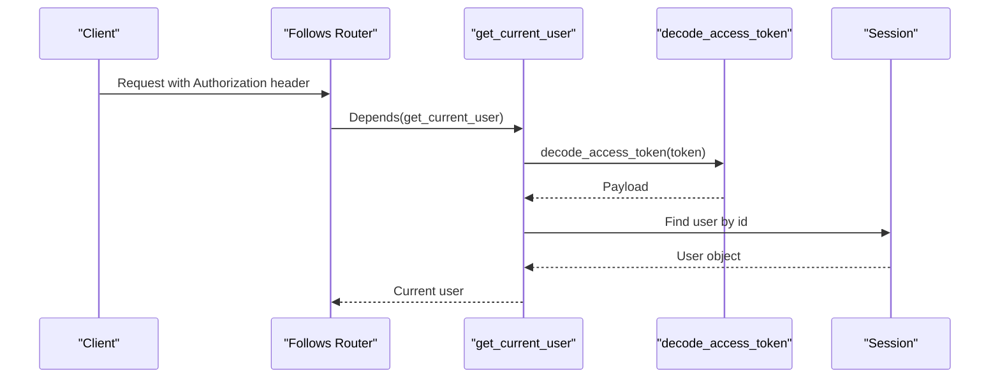
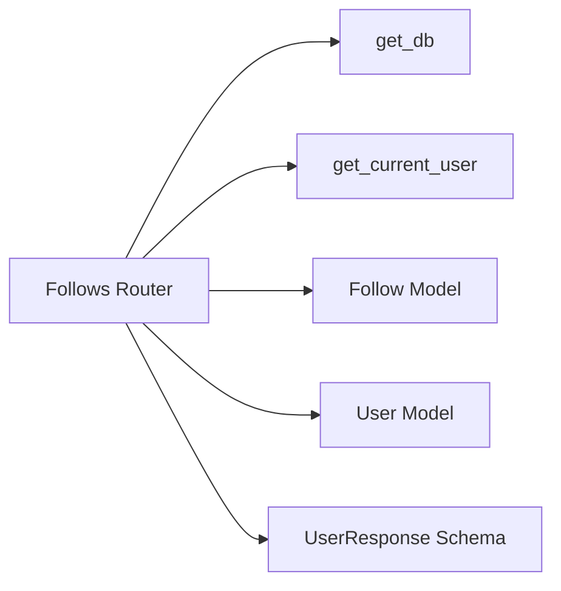

# Follows Endpoints

<cite>
**Referenced Files in This Document**   
- [follows.py](file://app/api/endpoints/follows.py)
- [follow.py](file://app/models/follow.py)
- [user.py](file://app/models/user.py)
- [user.py (schemas)](file://app/schemas/user.py)
- [dependencies.py](file://app/core/dependencies.py)
- [security.py](file://app/core/security.py)
</cite>

## Table of Contents
1. [Introduction](#introduction)
2. [Project Structure](#project-structure)
3. [Core Components](#core-components)
4. [Architecture Overview](#architecture-overview)
5. [Detailed Component Analysis](#detailed-component-analysis)
6. [Dependency Analysis](#dependency-analysis)
7. [Performance Considerations](#performance-considerations)
8. [Troubleshooting Guide](#troubleshooting-guide)
9. [Conclusion](#conclusion)
10. [Appendices](#appendices)

## Introduction
This document provides detailed API documentation for the social following endpoints. It covers follow/unfollow operations, retrieving followers and following lists, and guidance for feed generation based on followed authors. It includes request/response schemas, validation rules, performance considerations for large follower counts, examples of social graph traversal, mutual follow detection, and recommendations for rate limiting and anti-spam measures.

## Project Structure
The follows feature is implemented as a FastAPI router with SQLAlchemy models and Pydantic schemas:
- API endpoints are defined under app/api/endpoints/follows.py
- Data models are defined under app/models/follow.py and app/models/user.py
- Response schemas are defined under app/schemas/user.py
- Authentication dependencies are provided by app/core/dependencies.py and app/core/security.py

**Diagram sources**
- [follows.py:1-93](file://app/api/endpoints/follows.py#L1-L93)
- [follow.py:1-21](file://app/models/follow.py#L1-L21)
- [user.py:1-28](file://app/models/user.py#L1-L28)
- [user.py (schemas):1-37](file://app/schemas/user.py#L1-L37)
- [dependencies.py:1-53](file://app/core/dependencies.py#L1-L53)
- [security.py:1-34](file://app/core/security.py#L1-L34)

**Section sources**
- [follows.py:1-93](file://app/api/endpoints/follows.py#L1-L93)
- [follow.py:1-21](file://app/models/follow.py#L1-L21)
- [user.py:1-28](file://app/models/user.py#L1-L28)
- [user.py (schemas):1-37](file://app/schemas/user.py#L1-L37)
- [dependencies.py:1-53](file://app/core/dependencies.py#L1-L53)
- [security.py:1-34](file://app/core/security.py#L1-L34)

## Core Components
- Follows Router: Provides endpoints to follow/unfollow users and retrieve followers/following lists.
- Follow Model: Represents the many-to-many relationship between users via a join table with uniqueness constraints.
- User Model: Defines user attributes and relationships to posts, comments, and follow records.
- UserResponse Schema: Defines the response shape for user data returned by endpoints.
- Dependencies: Provide authenticated current user context using JWT.
- Security: Handles password hashing and JWT token creation/decoding.

**Section sources**
- [follows.py:1-93](file://app/api/endpoints/follows.py#L1-L93)
- [follow.py:1-21](file://app/models/follow.py#L1-L21)
- [user.py:1-28](file://app/models/user.py#L1-L28)
- [user.py (schemas):1-37](file://app/schemas/user.py#L1-L37)
- [dependencies.py:1-53](file://app/core/dependencies.py#L1-L53)
- [security.py:1-34](file://app/core/security.py#L1-L34)

## Architecture Overview
The follows endpoints operate within an authenticated context and interact with the database through SQLAlchemy sessions. The flow involves validating the target user, enforcing business rules (e.g., cannot follow self), updating the follow relationship, and returning consistent responses.

**Diagram sources**
- [follows.py:20-40](file://app/api/endpoints/follows.py#L20-L40)
- [dependencies.py:13-39](file://app/core/dependencies.py#L13-L39)
- [follow.py:7-21](file://app/models/follow.py#L7-L21)
- [user.py:6-28](file://app/models/user.py#L6-L28)

## Detailed Component Analysis

### Follow Endpoint
- Path: POST /api/follows/{user_id}
- Authentication: Required (Bearer token)
- Behavior:
  - Validates that the target user exists.
  - Prevents self-follow.
  - Creates a follow record if it does not already exist.
  - Returns whether the requester is now following and the target’s follower count.
- Request:
  - Path parameter: user_id (integer)
  - Headers: Authorization: Bearer <token>
- Response:
  - Status code: 201 Created
  - Body:
    - following: boolean
    - follower_count: integer
- Validation Rules:
  - Cannot follow yourself.
  - Idempotent: duplicate follow requests do not create additional records.
- Error Responses:
  - 401 Unauthorized: invalid or missing token.
  - 400 Bad Request: attempting to follow self.
  - 404 Not Found: target user does not exist.

**Diagram sources**
- [follows.py:20-40](file://app/api/endpoints/follows.py#L20-L40)

**Section sources**
- [follows.py:20-40](file://app/api/endpoints/follows.py#L20-L40)

### Unfollow Endpoint
- Path: DELETE /api/follows/{user_id}
- Authentication: Required (Bearer token)
- Behavior:
  - Validates that the target user exists.
  - Removes the follow relationship if present.
  - Returns whether the requester is no longer following and the updated follower count.
- Request:
  - Path parameter: user_id (integer)
  - Headers: Authorization: Bearer <token>
- Response:
  - Status code: 200 OK
  - Body:
    - following: boolean (always false after operation)
    - follower_count: integer
- Error Responses:
  - 401 Unauthorized: invalid or missing token.
  - 404 Not Found: target user does not exist.

**Diagram sources**
- [follows.py:43-60](file://app/api/endpoints/follows.py#L43-L60)

**Section sources**
- [follows.py:43-60](file://app/api/endpoints/follows.py#L43-L60)

### Followers List Endpoint
- Path: GET /api/follows/{user_id}/followers
- Authentication: Not required
- Behavior:
  - Validates that the target user exists.
  - Retrieves users who follow the target, ordered by most recent first.
- Request:
  - Path parameter: user_id (integer)
- Response:
  - Status code: 200 OK
  - Body: Array of UserResponse objects
- Error Responses:
  - 404 Not Found: target user does not exist.

**Diagram sources**
- [follows.py:63-76](file://app/api/endpoints/follows.py#L63-L76)
- [follow.py:7-21](file://app/models/follow.py#L7-L21)
- [user.py:6-28](file://app/models/user.py#L6-L28)

**Section sources**
- [follows.py:63-76](file://app/api/endpoints/follows.py#L63-L76)

### Following List Endpoint
- Path: GET /api/follows/{user_id}/following
- Authentication: Not required
- Behavior:
  - Validates that the target user exists.
  - Retrieves users followed by the target, ordered by most recent first.
- Request:
  - Path parameter: user_id (integer)
- Response:
  - Status code: 200 OK
  - Body: Array of UserResponse objects
- Error Responses:
  - 404 Not Found: target user does not exist.

**Diagram sources**
- [follows.py:79-92](file://app/api/endpoints/follows.py#L79-L92)
- [follow.py:7-21](file://app/models/follow.py#L7-L21)
- [user.py:6-28](file://app/models/user.py#L6-L28)

**Section sources**
- [follows.py:79-92](file://app/api/endpoints/follows.py#L79-L92)

### Data Models and Relationships
- Follow model:
  - Unique constraint ensures one follow per pair (follower_id, following_id).
  - Timestamped with created_at for ordering.
  - Relationships to User for both sides of the connection.
- User model:
  - Contains core profile fields and timestamps.
  - Relationships to posts, comments, and follow records.

**Diagram sources**
- [user.py:6-28](file://app/models/user.py#L6-L28)
- [follow.py:7-21](file://app/models/follow.py#L7-L21)

**Section sources**
- [user.py:6-28](file://app/models/user.py#L6-L28)
- [follow.py:7-21](file://app/models/follow.py#L7-L21)

### Schemas
- UserResponse:
  - Fields: id, email, username, full_name, bio, avatar_url, created_at.
  - Used to serialize user data in followers/following lists.
- UserProfileResponse:
  - Extends UserResponse with follower_count, following_count, post_count, is_following.
  - Useful for profile pages showing social metrics and follow state.

**Diagram sources**
- [user.py (schemas):17-35](file://app/schemas/user.py#L17-L35)

**Section sources**
- [user.py (schemas):1-37](file://app/schemas/user.py#L1-L37)

### Authentication and Security
- get_current_user dependency:
  - Extracts and validates the bearer token.
  - Decodes JWT payload to obtain user ID and resolves the user from the database.
  - Raises 401 Unauthorized for invalid/expired tokens or missing user.
- Security utilities:
  - Password hashing and verification.
  - JWT token creation and decoding.

**Diagram sources**
- [dependencies.py:13-39](file://app/core/dependencies.py#L13-L39)
- [security.py:29-32](file://app/core/security.py#L29-L32)

**Section sources**
- [dependencies.py:1-53](file://app/core/dependencies.py#L1-L53)
- [security.py:1-34](file://app/core/security.py#L1-L34)

## Dependency Analysis
- The Follows router depends on:
  - Database session via get_db.
  - Current user via get_current_user for write endpoints.
  - Follow and User models for queries and mutations.
  - UserResponse schema for serialization.

**Diagram sources**
- [follows.py:1-93](file://app/api/endpoints/follows.py#L1-L93)
- [dependencies.py:1-53](file://app/core/dependencies.py#L1-L53)
- [follow.py:1-21](file://app/models/follow.py#L1-L21)
- [user.py:1-28](file://app/models/user.py#L1-L28)
- [user.py (schemas):1-37](file://app/schemas/user.py#L1-L37)

**Section sources**
- [follows.py:1-93](file://app/api/endpoints/follows.py#L1-L93)
- [dependencies.py:1-53](file://app/core/dependencies.py#L1-L53)
- [follow.py:1-21](file://app/models/follow.py#L1-L21)
- [user.py:1-28](file://app/models/user.py#L1-L28)
- [user.py (schemas):1-37](file://app/schemas/user.py#L1-L37)

## Performance Considerations
- Large follower/following sets:
  - Pagination: Add limit/offset or cursor-based pagination to avoid loading entire lists into memory.
  - Indexes: Ensure indexes on follower_id and following_id columns; they are already indexed in the model.
  - Eager loading: For profile views, consider preloading related counts to reduce N+1 queries.
- Counting followers:
  - The follow/unfollow endpoints compute follower counts on each call. For high-traffic profiles, consider caching counts or maintaining denormalized counters.
- Ordering:
  - Sorting by created_at desc is efficient due to indexing; ensure composite indexes if filtering by multiple criteria.
- Feed generation (future extension):
  - Use materialized views or dedicated feed tables for popular authors to avoid expensive joins at query time.
  - Implement incremental updates when new posts are published by followed authors.

[No sources needed since this section provides general guidance]

## Troubleshooting Guide
- 401 Unauthorized:
  - Cause: Missing, expired, or invalid JWT token.
  - Resolution: Refresh token and retry; verify token issuance and expiration settings.
- 400 Bad Request (self-follow):
  - Cause: Attempting to follow your own account.
  - Resolution: Prevent client-side self-follow attempts.
- 404 Not Found:
  - Cause: Target user does not exist.
  - Resolution: Verify user_id and ensure the user exists before calling endpoints.
- Duplicate follow behavior:
  - Cause: Multiple follow requests for the same pair.
  - Resolution: The endpoint is idempotent; subsequent calls return success without creating duplicates.

**Section sources**
- [follows.py:20-40](file://app/api/endpoints/follows.py#L20-L40)
- [follows.py:43-60](file://app/api/endpoints/follows.py#L43-L60)
- [follows.py:63-76](file://app/api/endpoints/follows.py#L63-L76)
- [follows.py:79-92](file://app/api/endpoints/follows.py#L79-L92)

## Conclusion
The follows endpoints provide a robust foundation for managing social relationships. They enforce key validations, maintain referential integrity via unique constraints, and return consistent response shapes. To scale further, implement pagination, caching for follower counts, and a dedicated feed pipeline for personalized content delivery. Rate limiting and anti-spam controls should be added to protect against abuse and ensure fair usage.

[No sources needed since this section summarizes without analyzing specific files]

## Appendices

### API Reference Summary
- POST /api/follows/{user_id}
  - Auth: Required
  - Request: path user_id
  - Response: { following: boolean, follower_count: integer }
  - Errors: 400 (self-follow), 401 (unauthorized), 404 (not found)
- DELETE /api/follows/{user_id}
  - Auth: Required
  - Request: path user_id
  - Response: { following: boolean, follower_count: integer }
  - Errors: 401 (unauthorized), 404 (not found)
- GET /api/follows/{user_id}/followers
  - Auth: Optional
  - Request: path user_id
  - Response: array of UserResponse
  - Errors: 404 (not found)
- GET /api/follows/{user_id}/following
  - Auth: Optional
  - Request: path user_id
  - Response: array of UserResponse
  - Errors: 404 (not found)

**Section sources**
- [follows.py:20-92](file://app/api/endpoints/follows.py#L20-L92)
- [user.py (schemas):17-35](file://app/schemas/user.py#L17-L35)

### Social Graph Traversal Examples
- Mutual follow detection:
  - Given two users A and B, check if A follows B and B follows A by querying follow records in both directions.
- Recommended authors:
  - Identify authors followed by users similar to the current user (collaborative filtering) or authors frequently engaged with by the current user.

[No sources needed since this section provides conceptual examples]

### Feed Personalization Algorithms
- Weighted scoring:
  - Score posts from followed authors based on recency, engagement signals, and author relevance.
- Time-windowed feeds:
  - Limit feed generation to recent posts to improve performance and relevance.
- Caching strategies:
  - Cache computed feeds per user with invalidation on new posts or changes in follow relationships.

[No sources needed since this section provides conceptual guidance]

### Rate Limiting and Anti-Spam Measures
- Rate limiting:
  - Apply per-user limits on follow/unfollow operations (e.g., X requests per minute).
  - Use middleware or gateway-level throttling to protect endpoints.
- Anti-spam:
  - Enforce minimum account age or reputation thresholds before allowing follow actions.
  - Detect rapid follow bursts and require CAPTCHA or cooldown periods.
  - Monitor and block automated patterns using behavioral analysis.

[No sources needed since this section provides general guidance]