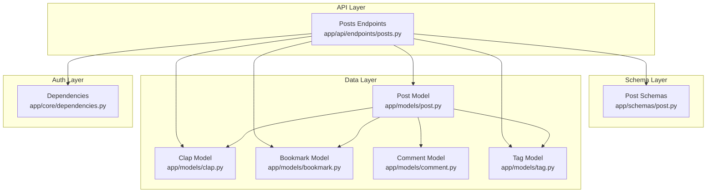
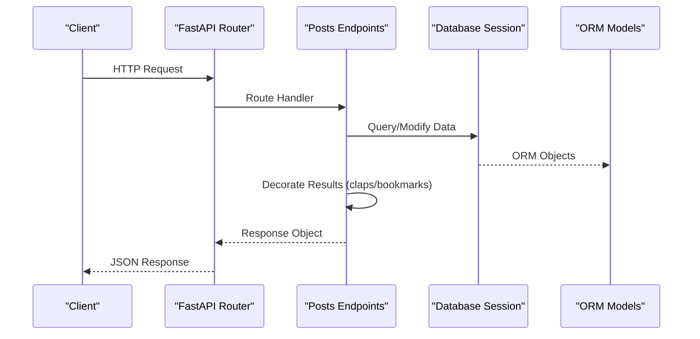
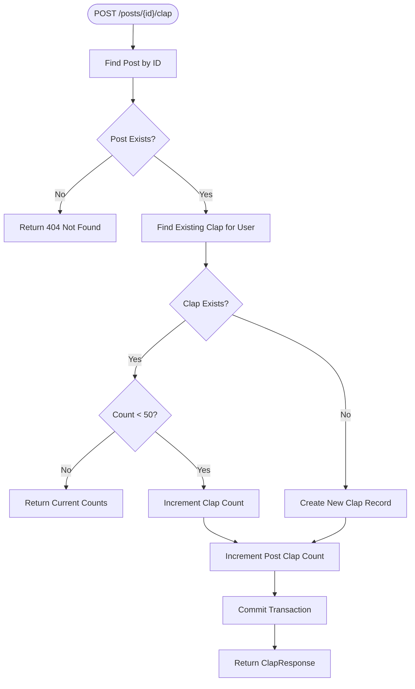
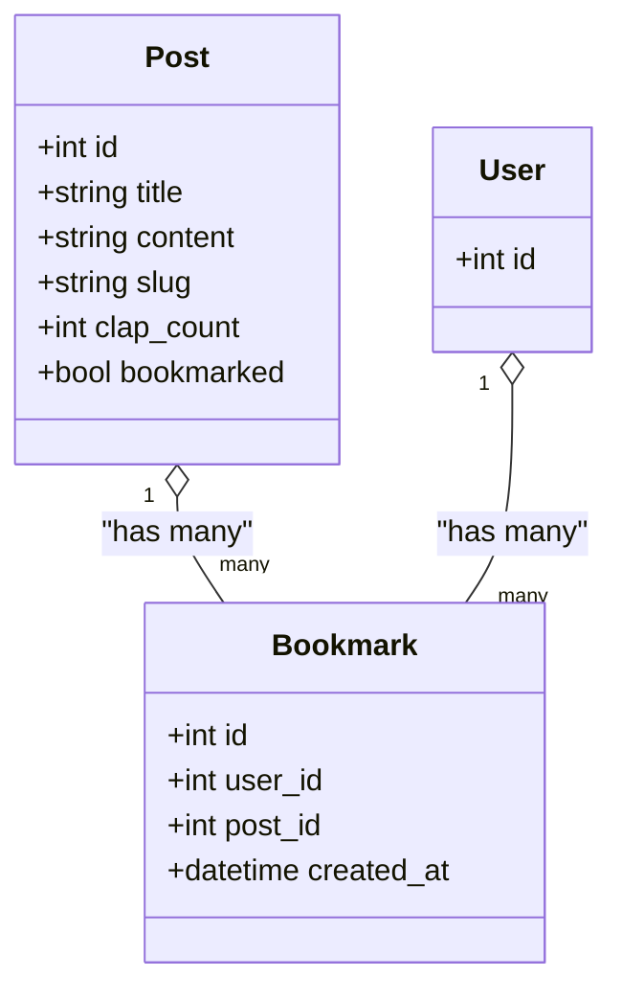
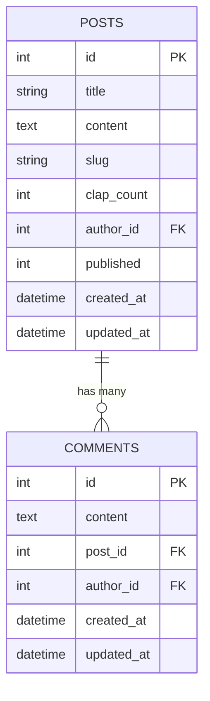
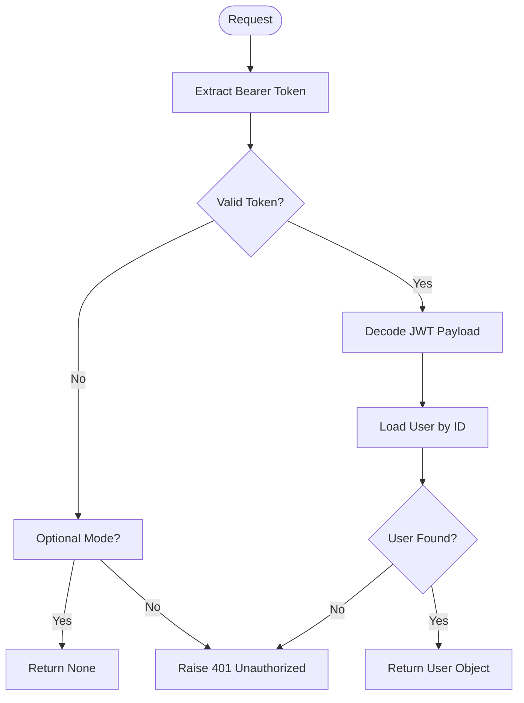

# Posts Endpoints

<cite>
**Referenced Files in This Document**   
- [posts.py](file://app/api/endpoints/posts.py)
- [post.py](file://app/schemas/post.py)
- [post_model.py](file://app/models/post.py)
- [clap_model.py](file://app/models/clap.py)
- [bookmark_model.py](file://app/models/bookmark.py)
- [comment_model.py](file://app/models/comment.py)
- [tag_model.py](file://app/models/tag.py)
- [dependencies.py](file://app/core/dependencies.py)
- [test_posts.py](file://tests/test_posts.py)
</cite>

## Table of Contents
1. [Introduction](#introduction)
2. [Project Structure](#project-structure)
3. [Core Components](#core-components)
4. [Architecture Overview](#architecture-overview)
5. [Detailed Component Analysis](#detailed-component-analysis)
6. [Dependency Analysis](#dependency-analysis)
7. [Performance Considerations](#performance-considerations)
8. [Troubleshooting Guide](#troubleshooting-guide)
9. [Conclusion](#conclusion)

## Introduction
This document provides comprehensive API documentation for the posts management endpoints. It covers CRUD operations, rich text support, tag-based filtering, search by title/content, author-specific queries, pagination, permission checks, and integration with clap, bookmark, and comment relationships. Request/response schemas, validation rules, and error handling are included to help both technical and non-technical users understand how to interact with the posts API.

## Project Structure
The posts feature is implemented as a FastAPI router with Pydantic schemas and SQLAlchemy models:
- Endpoints: app/api/endpoints/posts.py
- Schemas: app/schemas/post.py
- Models: app/models/post.py, app/models/clap.py, app/models/bookmark.py, app/models/comment.py, app/models/tag.py
- Authentication dependencies: app/core/dependencies.py
- Tests: tests/test_posts.py

**Diagram sources**
- [posts.py:1-298](file://app/api/endpoints/posts.py#L1-L298)
- [post.py:1-60](file://app/schemas/post.py#L1-L60)
- [post_model.py:1-32](file://app/models/post.py#L1-L32)
- [clap_model.py:1-20](file://app/models/clap.py#L1-L20)
- [bookmark_model.py:1-19](file://app/models/bookmark.py#L1-L19)
- [comment_model.py:1-18](file://app/models/comment.py#L1-L18)
- [tag_model.py:1-29](file://app/models/tag.py#L1-L29)
- [dependencies.py:1-53](file://app/core/dependencies.py#L1-L53)

**Section sources**
- [posts.py:1-298](file://app/api/endpoints/posts.py#L1-L298)
- [post.py:1-60](file://app/schemas/post.py#L1-L60)
- [post_model.py:1-32](file://app/models/post.py#L1-L32)
- [clap_model.py:1-20](file://app/models/clap.py#L1-L20)
- [bookmark_model.py:1-19](file://app/models/bookmark.py#L1-L19)
- [comment_model.py:1-18](file://app/models/comment.py#L1-L18)
- [tag_model.py:1-29](file://app/models/tag.py#L1-L29)
- [dependencies.py:1-53](file://app/core/dependencies.py#L1-L53)

## Core Components
- Posts endpoints provide list, create, update, delete, and clap operations.
- PostResponse includes viewer-specific fields my_claps and bookmarked, populated per request.
- Tag normalization enforces deduplication, length constraints, and slug generation.
- Search supports title, subtitle, and content using case-insensitive matching.
- Filtering supports published status, topic, tag (by name or slug), and feed mode for followed authors.
- Pagination uses skip and limit parameters.

Key responsibilities:
- Endpoint routing and query composition
- Schema validation and serialization
- ORM model relationships and data integrity
- Authentication and authorization via dependencies

**Section sources**
- [posts.py:22-80](file://app/api/endpoints/posts.py#L22-L80)
- [posts.py:83-126](file://app/api/endpoints/posts.py#L83-L126)
- [post.py:6-59](file://app/schemas/post.py#L6-L59)
- [post_model.py:6-32](file://app/models/post.py#L6-L32)

## Architecture Overview
The posts API follows a layered architecture:
- HTTP layer: FastAPI endpoints define routes, validate inputs, and return responses.
- Service logic: Query building, tagging, and decoration of results occur within endpoint functions.
- Data layer: SQLAlchemy models define tables, relationships, and constraints.
- Auth layer: JWT-based authentication provides current user context.

**Diagram sources**
- [posts.py:83-126](file://app/api/endpoints/posts.py#L83-L126)
- [dependencies.py:13-51](file://app/core/dependencies.py#L13-L51)

## Detailed Component Analysis

### List Posts
- Endpoint: GET /api/posts
- Purpose: Retrieve posts with optional filters and pagination.
- Query Parameters:
  - skip: integer, default 0, minimum 0
  - limit: integer, default 10, range 1–100
  - published: integer, optional; filter by published status (0=draft, 1=published). Defaults to published=1 when not provided.
  - topic: string, optional; exact match on topic field.
  - tag: string, optional; matches tag by name or slug. Returns empty list if tag not found.
  - feed: string, optional; when set to "following", returns posts authored by users followed by the authenticated user. Requires authentication.
  - q: string, optional; full-text-like search across title, subtitle, and content using case-insensitive matching.
- Behavior:
  - If no tags match, returns an empty list.
  - Applies ordering by creation date descending.
  - Attaches viewer-specific clap count and bookmark state.
- Responses:
  - 200 OK: Array of PostResponse objects.
  - 401 Unauthorized: Missing or invalid bearer token when feed="following".
- Notes:
  - Rich text content is supported via the content field.
  - Tags are normalized and limited to a maximum per post.

**Section sources**
- [posts.py:83-126](file://app/api/endpoints/posts.py#L83-L126)
- [post.py:26-54](file://app/schemas/post.py#L26-L54)

### Get My Posts
- Endpoint: GET /api/posts/me
- Purpose: Retrieve posts authored by the current user.
- Query Parameters:
  - published: integer, optional; filter by published status.
- Behavior:
  - Orders by updated_at descending.
  - Attaches viewer-specific clap and bookmark state.
- Responses:
  - 200 OK: Array of PostResponse objects.
  - 401 Unauthorized: Missing or invalid bearer token.

**Section sources**
- [posts.py:129-140](file://app/api/endpoints/posts.py#L129-L140)
- [post.py:26-54](file://app/schemas/post.py#L26-L54)

### Get Post by Slug
- Endpoint: GET /api/posts/slug/{slug}
- Purpose: Retrieve a single post by its slug.
- Path Parameters:
  - slug: string
- Responses:
  - 200 OK: PostResponse object.
  - 404 Not Found: When slug does not exist.
  - 401 Unauthorized: Not applicable unless additional auth is required elsewhere.

**Section sources**
- [posts.py:143-153](file://app/api/endpoints/posts.py#L143-L153)
- [post.py:26-54](file://app/schemas/post.py#L26-L54)

### Get User Posts
- Endpoint: GET /api/posts/user/{user_id}
- Purpose: Retrieve posts by a specific author.
- Path Parameters:
  - user_id: integer
- Query Parameters:
  - published: integer, optional; defaults to published=1 when not provided.
- Responses:
  - 200 OK: Array of PostResponse objects.
  - 404 Not Found: No posts found (returns empty array rather than 404).

**Section sources**
- [posts.py:156-170](file://app/api/endpoints/posts.py#L156-L170)
- [post.py:26-54](file://app/schemas/post.py#L26-L54)

### Get Post by ID
- Endpoint: GET /api/posts/{post_id}
- Purpose: Retrieve a single post by its numeric ID.
- Path Parameters:
  - post_id: integer
- Responses:
  - 200 OK: PostResponse object.
  - 404 Not Found: When post does not exist.

**Section sources**
- [posts.py:173-183](file://app/api/endpoints/posts.py#L173-L183)
- [post.py:26-54](file://app/schemas/post.py#L26-L54)

### Create Post
- Endpoint: POST /api/posts
- Purpose: Create a new post with optional tags and rich text content.
- Authorization: Required (Bearer token).
- Request Body (PostCreate):
  - title: string, required
  - subtitle: string, optional
  - content: string, required (supports rich text)
  - cover_image: string, optional
  - topic: string, optional
  - published: integer, default 0 (draft)
  - tags: array of strings, optional; normalized and deduplicated, max 5 per post
- Behavior:
  - Generates a URL-friendly slug from title; ensures uniqueness by appending timestamp if needed.
  - Normalizes tags: trims whitespace, enforces length constraints, deduplicates, and creates missing tags.
  - Sets initial clap_count to 0.
- Responses:
  - 201 Created: PostResponse object with my_claps=0 and bookmarked=False.
  - 401 Unauthorized: Missing or invalid bearer token.
  - 422 Validation Error: Invalid request body.

**Section sources**
- [posts.py:186-214](file://app/api/endpoints/posts.py#L186-L214)
- [post.py:6-15](file://app/schemas/post.py#L6-L15)
- [tag_model.py:6-29](file://app/models/tag.py#L6-L29)

### Update Post
- Endpoint: PUT /api/posts/{post_id}
- Purpose: Update post fields including published/draft status and tags.
- Authorization: Required (Bearer token).
- Path Parameters:
  - post_id: integer
- Request Body (PostUpdate):
  - title: string, optional
  - subtitle: string, optional
  - content: string, optional
  - cover_image: string, optional
  - topic: string, optional
  - published: integer, optional
  - tags: array of strings, optional; normalized and deduplicated, max 5 per post
- Behavior:
  - Authorship check: only the post’s author can update it.
  - Regenerates slug if title changes; ensures uniqueness.
  - Updates tags if provided.
- Responses:
  - 200 OK: Updated PostResponse object.
  - 401 Unauthorized: Missing or invalid bearer token.
  - 403 Forbidden: Current user is not the author.
  - 404 Not Found: Post does not exist.
  - 422 Validation Error: Invalid request body.

**Section sources**
- [posts.py:217-249](file://app/api/endpoints/posts.py#L217-L249)
- [post.py:17-25](file://app/schemas/post.py#L17-L25)

### Delete Post
- Endpoint: DELETE /api/posts/{post_id}
- Purpose: Delete a post.
- Authorization: Required (Bearer token).
- Path Parameters:
  - post_id: integer
- Behavior:
  - Authorship check: only the post’s author can delete it.
- Responses:
  - 204 No Content: Successful deletion.
  - 401 Unauthorized: Missing or invalid bearer token.
  - 403 Forbidden: Current user is not the author.
  - 404 Not Found: Post does not exist.

**Section sources**
- [posts.py:252-267](file://app/api/endpoints/posts.py#L252-L267)

### Clap Post
- Endpoint: POST /api/posts/{post_id}/clap
- Purpose: Increment clap count for a post and track per-user clap progress.
- Authorization: Required (Bearer token).
- Path Parameters:
  - post_id: integer
- Behavior:
  - Increments clap count up to a per-user cap of 50 claps per post.
  - Creates a unique clap record per user-post pair.
  - Updates post.clap_count accordingly.
- Responses:
  - 200 OK: ClapResponse with clap_count and my_claps.
  - 401 Unauthorized: Missing or invalid bearer token.
  - 404 Not Found: Post does not exist.

**Section sources**
- [posts.py:270-297](file://app/api/endpoints/posts.py#L270-L297)
- [clap_model.py:7-19](file://app/models/clap.py#L7-L19)

### Post Object Schema
- PostBase fields:
  - title: string, required
  - subtitle: string, optional
  - content: string, required (rich text supported)
  - cover_image: string, optional
  - topic: string, optional
  - published: integer, default 0
- PostCreate extends PostBase with:
  - tags: array of strings, optional
- PostUpdate allows partial updates of all PostBase fields plus tags.
- PostResponse adds:
  - id: integer
  - slug: string
  - author_id: integer
  - author: nested UserResponse object
  - clap_count: integer, default 0
  - my_claps: integer, default 0 (viewer-specific)
  - bookmarked: boolean, default False (viewer-specific)
  - tags: array of strings (names)
  - tag_slugs: array of strings
  - created_at: datetime
  - updated_at: datetime
- Validation:
  - Tags are converted from Tag objects to names/slugs during serialization.

**Section sources**
- [post.py:6-59](file://app/schemas/post.py#L6-L59)

### Tag Handling and Normalization
- Tag normalization:
  - Trims whitespace and collapses internal spaces.
  - Enforces minimum length of 2 and maximum length of 40 characters.
  - Deduplicates by lowercase key.
  - Limits to maximum 5 tags per post.
  - Resolves existing tags by slug or name; creates new tags if missing.
- Slug generation:
  - Converts title to lowercase, removes disallowed characters, replaces separators with hyphens, truncates to 80 characters.
  - Falls back to a generated identifier if slug becomes empty.

**Section sources**
- [posts.py:22-58](file://app/api/endpoints/posts.py#L22-L58)
- [tag_model.py:6-29](file://app/models/tag.py#L6-L29)

### Clap System Integration
- Clap model:
  - Unique constraint per user-post pair.
  - Tracks cumulative count per user for a given post.
- Clap endpoint:
  - Increments per-user clap count up to 50.
  - Updates post.clap_count and returns current totals.

**Diagram sources**
- [posts.py:270-297](file://app/api/endpoints/posts.py#L270-L297)
- [clap_model.py:7-19](file://app/models/clap.py#L7-L19)

**Section sources**
- [posts.py:270-297](file://app/api/endpoints/posts.py#L270-L297)
- [clap_model.py:7-19](file://app/models/clap.py#L7-L19)

### Bookmark Associations
- Viewer-specific bookmark state is attached to each post response via the bookmarked boolean field.
- Bookmark model enforces unique user-post pairs.
- Decoration logic marks posts as bookmarked based on the current user’s bookmarks.

**Diagram sources**
- [post_model.py:6-32](file://app/models/post.py#L6-L32)
- [bookmark_model.py:7-18](file://app/models/bookmark.py#L7-L18)

**Section sources**
- [posts.py:61-80](file://app/api/endpoints/posts.py#L61-L80)
- [bookmark_model.py:7-18](file://app/models/bookmark.py#L7-L18)

### Comment Relationships
- Comments are related to posts via a one-to-many relationship.
- Deleting a post cascades to comments.
- While comments are not directly exposed in PostResponse, they are part of the data model and can be queried through separate endpoints.

**Diagram sources**
- [post_model.py:6-32](file://app/models/post.py#L6-L32)
- [comment_model.py:6-18](file://app/models/comment.py#L6-L18)

**Section sources**
- [post_model.py:22-26](file://app/models/post.py#L22-L26)
- [comment_model.py:6-18](file://app/models/comment.py#L6-L18)

## Dependency Analysis
Authentication and authorization are handled via FastAPI dependencies:
- get_current_user: Validates Bearer token, decodes JWT, retrieves user, raises 401 on errors.
- get_current_user_optional: Attempts optional authentication; returns None if token is missing or invalid.

**Diagram sources**
- [dependencies.py:13-51](file://app/core/dependencies.py#L13-L51)

**Section sources**
- [dependencies.py:13-51](file://app/core/dependencies.py#L13-L51)

## Performance Considerations
- Pagination: Use skip and limit to control result sets; default limit is 10, maximum 100.
- Tag filtering: Single tag lookup joins post_tags; ensure tag exists before querying to avoid unnecessary scans.
- Search: Case-insensitive substring search across multiple columns; consider database-level indexing for performance.
- Decoration: Viewer-specific clap and bookmark states are loaded in bulk for efficiency.
- Tag normalization: Limited to 5 tags per post; deduplication reduces redundant associations.

[No sources needed since this section provides general guidance]

## Troubleshooting Guide
Common issues and resolutions:
- 401 Unauthorized:
  - Cause: Missing or invalid Bearer token.
  - Resolution: Ensure valid JWT is provided in Authorization header.
- 403 Forbidden:
  - Cause: Attempting to update or delete a post that is not owned by the current user.
  - Resolution: Verify ownership or use appropriate credentials.
- 404 Not Found:
  - Cause: Requested post or slug does not exist.
  - Resolution: Confirm IDs and slugs are correct.
- Empty tag results:
  - Cause: Tag name or slug not found.
  - Resolution: Verify tag existence or adjust query parameters.
- Tag normalization limits:
  - Cause: Exceeding maximum tags per post or invalid tag lengths.
  - Resolution: Limit to 5 tags and ensure lengths between 2 and 40 characters.

**Section sources**
- [posts.py:217-267](file://app/api/endpoints/posts.py#L217-L267)
- [dependencies.py:13-51](file://app/core/dependencies.py#L13-L51)

## Conclusion
The posts API provides robust CRUD operations with advanced filtering, search, and pagination. It integrates clap counts, bookmark states, and comment relationships while enforcing strict authorization and validation rules. The design balances flexibility (rich text content, flexible tag handling) with safety (authorship checks, unique constraints). For optimal performance, leverage pagination and efficient tag lookups, and ensure proper authentication headers are included in requests.

[No sources needed since this section summarizes without analyzing specific files]