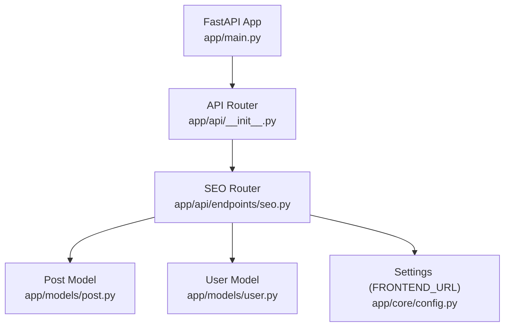
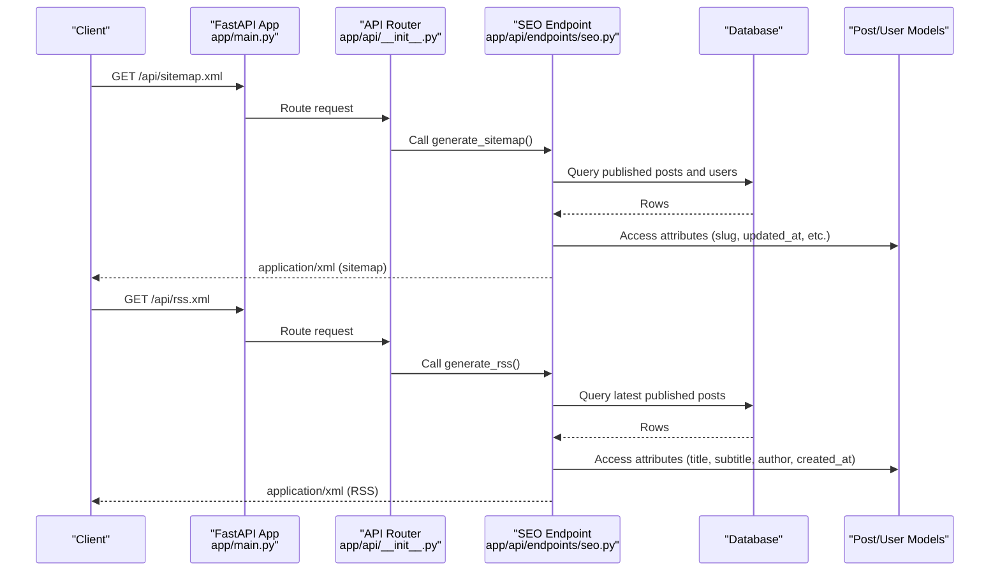
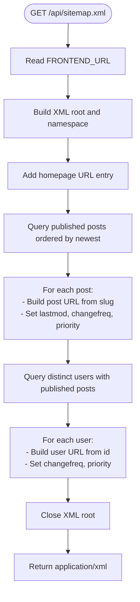
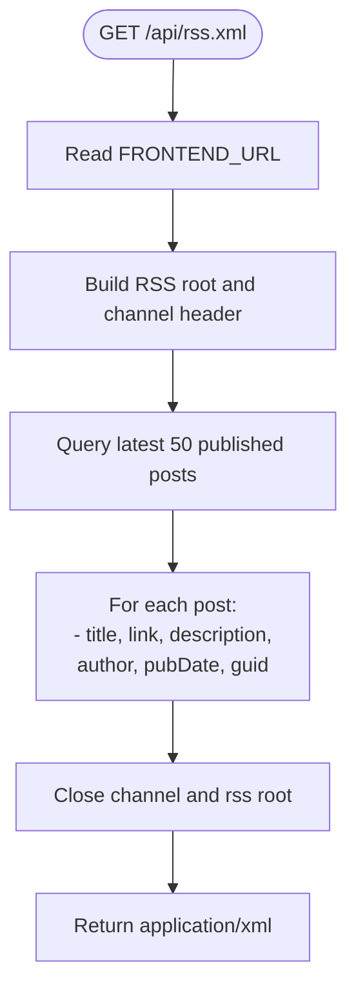
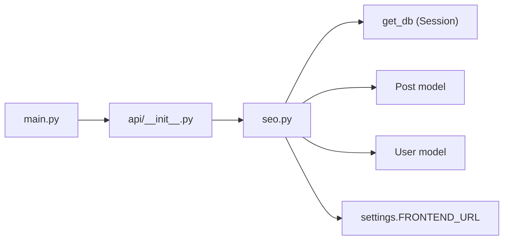

# SEO Endpoints

<cite>
**Referenced Files in This Document**   
- [seo.py](file://app/api/endpoints/seo.py)
- [__init__.py](file://app/api/__init__.py)
- [main.py](file://app/main.py)
- [config.py](file://app/core/config.py)
- [post.py](file://app/models/post.py)
- [user.py](file://app/models/user.py)
</cite>

## Table of Contents
1. [Introduction](#introduction)
2. [Project Structure](#project-structure)
3. [Core Components](#core-components)
4. [Architecture Overview](#architecture-overview)
5. [Detailed Component Analysis](#detailed-component-analysis)
6. [Dependency Analysis](#dependency-analysis)
7. [Performance Considerations](#performance-considerations)
8. [Troubleshooting Guide](#troubleshooting-guide)
9. [Conclusion](#conclusion)

## Introduction
This document provides comprehensive API documentation for SEO optimization endpoints, including sitemap generation and RSS feed creation. It explains how dynamic content is generated from the database, response formats for XML documents, and best practices for SEO implementation. It also covers caching strategies, update triggers, and performance optimizations for large content libraries.

## Project Structure
The SEO endpoints are implemented as FastAPI routes under a dedicated router and mounted into the application’s API router. The endpoints generate XML responses dynamically by querying published posts and users.

**Diagram sources**
- [main.py:81-85](file://app/main.py#L81-L85)
- [__init__.py:5-14](file://app/api/__init__.py#L5-L14)
- [seo.py:1-10](file://app/api/endpoints/seo.py#L1-L10)
- [post.py:6-26](file://app/models/post.py#L6-L26)
- [user.py:6-19](file://app/models/user.py#L6-L19)
- [config.py:28-29](file://app/core/config.py#L28-L29)

**Section sources**
- [main.py:81-85](file://app/main.py#L81-L85)
- [__init__.py:5-14](file://app/api/__init__.py#L5-L14)

## Core Components
- Sitemap endpoint: Generates an XML sitemap including the homepage, published posts, and user profile pages.
- RSS endpoint: Generates an RSS 2.0 feed with the latest published posts.
- Configuration: Uses FRONTEND_URL to build absolute links in XML responses.
- Data models: Post and User provide the data required for generating URLs and metadata.

Key responsibilities:
- Build valid XML structures for sitemaps and RSS feeds.
- Query only published content to ensure search engines and subscribers see live material.
- Return XML responses with appropriate media types.

**Section sources**
- [seo.py:11-52](file://app/api/endpoints/seo.py#L11-L52)
- [seo.py:54-87](file://app/api/endpoints/seo.py#L54-L87)
- [config.py:28-29](file://app/core/config.py#L28-L29)
- [post.py:6-26](file://app/models/post.py#L6-L26)
- [user.py:6-19](file://app/models/user.py#L6-L19)

## Architecture Overview
The SEO endpoints are part of the public API surface. They do not require authentication and return XML directly. The app mounts the API router at /api, so the effective paths are /api/sitemap.xml and /api/rss.xml.

**Diagram sources**
- [main.py:81-85](file://app/main.py#L81-L85)
- [__init__.py:5-14](file://app/api/__init__.py#L5-L14)
- [seo.py:11-52](file://app/api/endpoints/seo.py#L11-L52)
- [seo.py:54-87](file://app/api/endpoints/seo.py#L54-L87)

## Detailed Component Analysis

### Sitemap Generation (/api/sitemap.xml)
Purpose:
- Provide a complete list of indexable URLs for search engines.
- Include homepage, published post pages, and user profile pages.

Request:
- Method: GET
- Path: /api/sitemap.xml
- Headers: None required

Response:
- Status: 200 OK
- Content-Type: application/xml
- Body: XML sitemap compliant with the Sitemap Protocol

Sitemap structure:
- Root element: urlset with namespace http://www.sitemaps.org/schemas/sitemap/0.9
- Entries:
  - Homepage URL with daily change frequency and highest priority
  - Published post URLs with weekly change frequency and medium-high priority
  - User profile URLs with weekly change frequency and lower priority

Dynamic content rules:
- Base URL is derived from FRONTEND_URL configuration.
- Only published posts are included.
- Dates use ISO date format for lastmod; RSS uses RFC 2822 dates.

Example sitemap indexing:
- Homepage entry
- Post entries per slug
- User entries per id

Best practices:
- Keep lastmod accurate to reflect content changes.
- Use appropriate priorities and changefreq values.
- Ensure all URLs are publicly accessible.

**Section sources**
- [seo.py:11-52](file://app/api/endpoints/seo.py#L11-L52)
- [config.py:28-29](file://app/core/config.py#L28-L29)
- [post.py:6-26](file://app/models/post.py#L6-L26)
- [user.py:6-19](file://app/models/user.py#L6-L19)

#### Sitemap Flowchart

**Diagram sources**
- [seo.py:11-52](file://app/api/endpoints/seo.py#L11-L52)

### RSS Feed Creation (/api/rss.xml)
Purpose:
- Syndicate the latest published posts for readers and aggregators.

Request:
- Method: GET
- Path: /api/rss.xml
- Headers: None required

Response:
- Status: 200 OK
- Content-Type: application/xml
- Body: RSS 2.0 feed with Atom link self-reference

Feed structure:
- Channel-level fields: title, link, description, language, lastBuildDate, atom:link self
- Items: Up to the latest 50 published posts
  - Title: post title
  - Link: absolute post URL using slug
  - Description: subtitle if present, otherwise first 200 characters of content
  - Author: email and display name or username
  - PubDate: RFC 2822 formatted date
  - GUID: absolute post URL

Syndication example:
- Aggregators subscribe to /api/rss.xml
- New posts appear within the next fetch cycle
- Subscribers can parse items and render titles, descriptions, and links

**Section sources**
- [seo.py:54-87](file://app/api/endpoints/seo.py#L54-L87)
- [config.py:28-29](file://app/core/config.py#L28-L29)
- [post.py:6-26](file://app/models/post.py#L6-L26)
- [user.py:6-19](file://app/models/user.py#L6-L19)

#### RSS Flowchart

**Diagram sources**
- [seo.py:54-87](file://app/api/endpoints/seo.py#L54-L87)

### SEO Metadata Management
Current scope:
- The codebase does not include dedicated endpoints for managing SEO metadata such as meta tags, Open Graph properties, or structured data.
- SEO-related behavior is limited to generating sitemaps and RSS feeds.

Recommendations:
- Introduce a metadata model and endpoints to manage page-level SEO fields (e.g., title, description, canonical URL).
- Expose these fields via existing post and user endpoints or through new SEO-specific endpoints.
- Serve HTML pages with proper meta tags based on stored metadata.

[No sources needed since this section provides general guidance]

## Dependency Analysis
The SEO endpoints depend on:
- FastAPI routing and dependency injection
- SQLAlchemy ORM session provided by get_db
- Post and User models for data access
- Settings for FRONTEND_URL

**Diagram sources**
- [seo.py:1-10](file://app/api/endpoints/seo.py#L1-L10)
- [main.py:81-85](file://app/main.py#L81-L85)
- [__init__.py:5-14](file://app/api/__init__.py#L5-L14)
- [config.py:28-29](file://app/core/config.py#L28-L29)

**Section sources**
- [seo.py:1-10](file://app/api/endpoints/seo.py#L1-L10)
- [main.py:81-85](file://app/main.py#L81-L85)
- [__init__.py:5-14](file://app/api/__init__.py#L5-L14)

## Performance Considerations
- Database queries:
  - Sitemap queries all published posts and joins users; consider pagination or precomputed tables for very large catalogs.
  - RSS limits results to 50 items; ensure indexes exist on published and created_at columns.
- XML generation:
  - String concatenation is used; for large outputs, consider streaming or templating engines to reduce memory usage.
- Caching:
  - Implement response caching (e.g., HTTP cache headers, CDN caching, or server-side cache) for both endpoints.
  - Invalidate caches when posts are published, updated, or deleted.
- Concurrency:
  - Avoid holding database sessions longer than necessary; keep query scopes minimal.
- Frontend URL:
  - Ensure FRONTEND_URL is correctly configured to avoid broken links in XML.

[No sources needed since this section provides general guidance]

## Troubleshooting Guide
Common issues and resolutions:
- Incorrect base URLs:
  - Verify FRONTEND_URL in settings to ensure absolute links in XML.
- Missing or incorrect content:
  - Confirm posts are marked as published and have valid slugs.
  - Ensure user profiles referenced in sitemap exist and are accessible.
- Date formatting:
  - Sitemap lastmod uses date-only format; RSS pubDate uses RFC 2822. Validate timezone handling if migrating environments.
- Large datasets:
  - If endpoints become slow, add database indexes and implement caching or background job updates.

**Section sources**
- [config.py:28-29](file://app/core/config.py#L28-L29)
- [post.py:6-26](file://app/models/post.py#L6-L26)
- [user.py:6-19](file://app/models/user.py#L6-L19)
- [seo.py:11-87](file://app/api/endpoints/seo.py#L11-L87)

## Conclusion
The SEO endpoints provide essential XML resources for search engine indexing and content syndication. The sitemap includes key site pages and dynamic post/user URLs, while the RSS feed delivers the latest published content. To scale effectively, adopt caching, optimize database queries, and consider extending the system with dedicated SEO metadata management.

[No sources needed since this section summarizes without analyzing specific files]