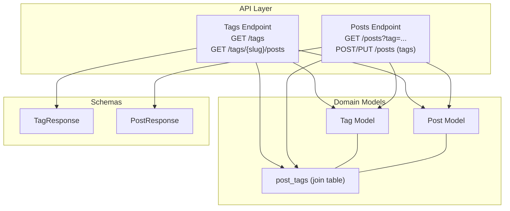
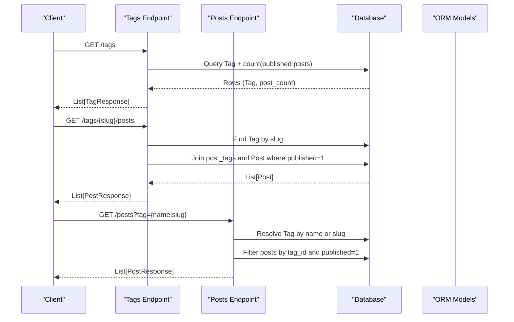
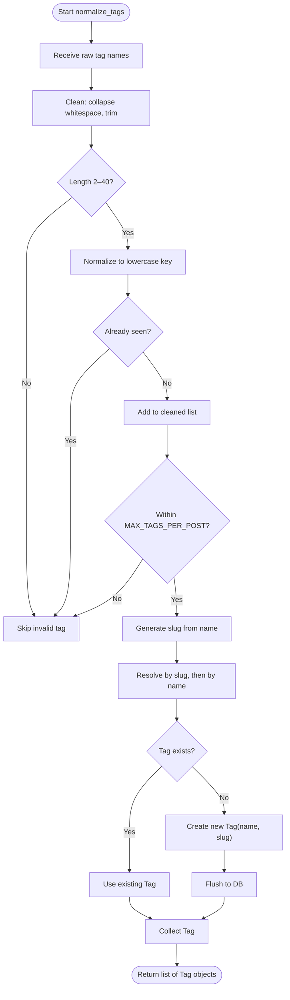
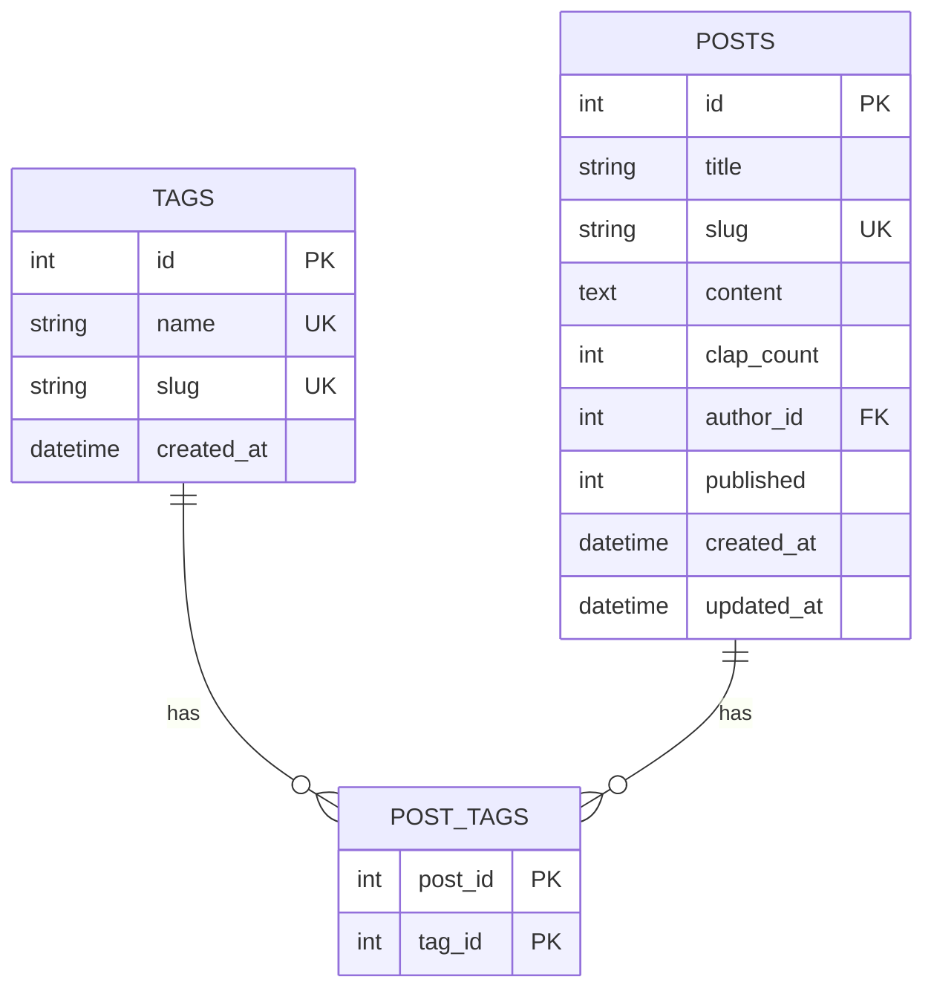
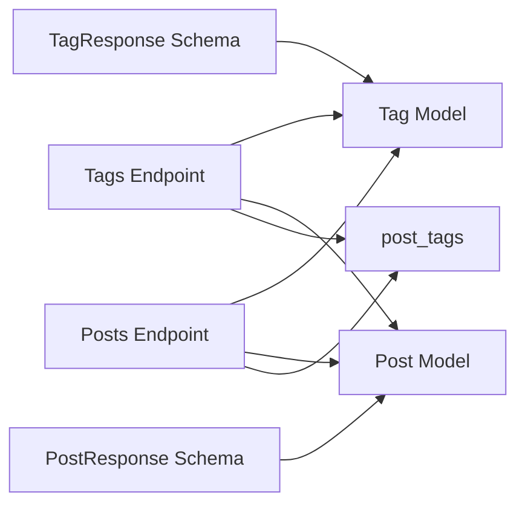

# Tags Endpoints

<cite>
**Referenced Files in This Document**
- [tags.py](file://app/api/endpoints/tags.py)
- [posts.py](file://app/api/endpoints/posts.py)
- [tag.py](file://app/models/tag.py)
- [post.py](file://app/models/post.py)
- [tag_schema.py](file://app/schemas/tag.py)
- [post_schema.py](file://app/schemas/post.py)
</cite>

## Table of Contents
1. [Introduction](#introduction)
2. [Project Structure](#project-structure)
3. [Core Components](#core-components)
4. [Architecture Overview](#architecture-overview)
5. [Detailed Component Analysis](#detailed-component-analysis)
6. [Dependency Analysis](#dependency-analysis)
7. [Performance Considerations](#performance-considerations)
8. [Troubleshooting Guide](#troubleshooting-guide)
9. [Conclusion](#conclusion)
10. [Appendices](#appendices)

## Introduction
This document provides detailed API documentation for tag management and tag-based content filtering in the backend. It covers:
- Retrieval of popular tags
- Retrieval of posts by tag
- Tag-based filtering when listing posts
- Tag normalization, duplicate prevention, and relationship mapping to posts
- SEO considerations for tag pages
- Examples for tag hierarchy, popular tag discovery, and tag suggestion strategies

Note: The current implementation exposes read-only tag endpoints and integrates tag handling into post creation and updates. There is no dedicated endpoint to create or update tags directly; tags are created implicitly through post operations.

## Project Structure
The tag-related functionality spans API endpoints, data models, and schemas:
- API endpoints define routes for listing tags and fetching posts by tag
- Models define the Tag entity and its many-to-many relationship with Post via a join table
- Schemas define response shapes for tags and posts, including tag name and slug exposure

**Diagram sources**
- [tags.py:16-69](file://app/api/endpoints/tags.py#L16-L69)
- [posts.py:83-126](file://app/api/endpoints/posts.py#L83-L126)
- [posts.py:186-214](file://app/api/endpoints/posts.py#L186-L214)
- [tag.py:6-27](file://app/models/tag.py#L6-L27)
- [post.py:6-31](file://app/models/post.py#L6-L31)
- [tag_schema.py:4-10](file://app/schemas/tag.py#L4-L10)
- [post_schema.py:26-54](file://app/schemas/post.py#L26-L54)

**Section sources**
- [tags.py:1-69](file://app/api/endpoints/tags.py#L1-L69)
- [posts.py:1-298](file://app/api/endpoints/posts.py#L1-L298)
- [tag.py:1-29](file://app/models/tag.py#L1-L29)
- [post.py:1-32](file://app/models/post.py#L1-L32)
- [tag_schema.py:1-11](file://app/schemas/tag.py#L1-L11)
- [post_schema.py:1-60](file://app/schemas/post.py#L1-L60)

## Core Components
- Tags API
  - GET /tags: Returns popular tags ranked by published post count
  - GET /tags/{slug}/posts: Returns posts associated with a specific tag slug
- Posts API integration
  - GET /posts?tag={name_or_slug}: Filters posts by tag name or slug
  - POST /posts and PUT /posts/{id}: Accepts optional tags list; normalizes and persists tags

Key behaviors:
- Only published posts are counted for popularity and included in tag-based listings
- Tag names are normalized and deduplicated before association
- Slugs are generated from tag names and used for stable URLs

**Section sources**
- [tags.py:16-69](file://app/api/endpoints/tags.py#L16-L69)
- [posts.py:83-126](file://app/api/endpoints/posts.py#L83-L126)
- [posts.py:186-214](file://app/api/endpoints/posts.py#L186-L214)

## Architecture Overview
The tag system uses a many-to-many relationship between posts and tags through a join table. Popular tags are computed by counting published posts per tag. Tag-based post retrieval joins the join table and filters by tag id.

**Diagram sources**
- [tags.py:16-69](file://app/api/endpoints/tags.py#L16-L69)
- [posts.py:83-126](file://app/api/endpoints/posts.py#L83-L126)

## Detailed Component Analysis

### Tags API: GET /tags
Purpose:
- Return popular tags sorted by number of published posts, then alphabetically by tag name.

Request:
- Method: GET
- Path: /tags
- Query parameters:
  - limit: integer, default 20, range 1–100

Response:
- Array of TagResponse objects with fields:
  - id: integer
  - name: string
  - slug: string
  - post_count: integer (number of published posts tagged)

Behavior:
- Joins Tag with post_tags and Post
- Filters only published posts (published == 1)
- Groups by Tag.id and orders by count descending, then name ascending
- Applies limit

Validation rules:
- limit must be within 1–100

Example response shape:
- [
    { "id": 1, "name": "Technology", "slug": "technology", "post_count": 12 },
    { "id": 2, "name": "Design", "slug": "design", "post_count": 8 }
  ]

**Section sources**
- [tags.py:16-32](file://app/api/endpoints/tags.py#L16-L32)
- [tag_schema.py:4-10](file://app/schemas/tag.py#L4-L10)

### Tags API: GET /tags/{slug}/posts
Purpose:
- Retrieve posts associated with a given tag slug.

Request:
- Method: GET
- Path: /tags/{slug}/posts
- Path parameters:
  - slug: string (required)
- Query parameters:
  - skip: integer, default 0, minimum 0
  - limit: integer, default 20, range 1–100

Response:
- Array of PostResponse objects including:
  - id, title, subtitle, content, slug, cover_image, topic, clap_count, author, my_claps, bookmarked, tags (names), tag_slugs, created_at, updated_at

Behavior:
- Resolves tag by slug; returns 404 if not found
- Joins post_tags and Post, filters by tag_id and published == 1
- Orders by Post.created_at descending
- Applies offset and limit
- If authenticated user is present, attaches viewer-specific clap counts and bookmark state

Validation rules:
- skip >= 0
- limit between 1 and 100

Error handling:
- 404 when tag slug does not exist

Example request:
- GET /tags/design/posts?skip=0&limit=20

Example response shape:
- [
    { "id": 101, "title": "UI Patterns", "slug": "ui-patterns", "tags": ["Design"], "tag_slugs": ["design"], ... },
    { "id": 102, "title": "Color Systems", "slug": "color-systems", "tags": ["Design"], "tag_slugs": ["design"], ... }
  ]

**Section sources**
- [tags.py:35-69](file://app/api/endpoints/tags.py#L35-L69)
- [post_schema.py:26-54](file://app/schemas/post.py#L26-L54)

### Posts API: Tag-based Filtering
Purpose:
- Filter posts by tag using either tag name or tag slug.

Request:
- Method: GET
- Path: /posts
- Query parameters:
  - tag: string (optional). Matches Tag.name or Tag.slug after trimming whitespace

Behavior:
- If tag provided, resolves Tag by exact match on slug or name
- If tag not found, returns empty array
- Filters posts by tag_id and published == 1
- Combines with other filters like topic, search q, feed, and pagination

Validation rules:
- tag is trimmed before matching

Example requests:
- GET /posts?tag=technology
- GET /posts?tag=Technology

Example response:
- Array of PostResponse filtered by the specified tag

**Section sources**
- [posts.py:83-126](file://app/api/endpoints/posts.py#L83-L126)

### Tag Normalization and Duplicate Prevention
Purpose:
- Normalize tag names during post creation/update, prevent duplicates, and ensure consistent slugs.

Process:
- Clean input: collapse whitespace, strip leading/trailing spaces
- Enforce length constraints: 2–40 characters
- Deduplicate case-insensitively
- Limit to maximum tags per post
- Generate slug from tag name
- Resolve existing tag by slug first, then by name; otherwise create new tag
- Associate resolved tags with the post

Constraints:
- Maximum tags per post: 5
- Tag name length: 2–40 characters
- Slug generation removes non-word characters except Devanagari Unicode block, collapses separators, and truncates to 80 characters

Algorithm flow:

**Diagram sources**
- [posts.py:33-58](file://app/api/endpoints/posts.py#L33-L58)

Usage points:
- POST /posts: tags field processed via normalize_tags
- PUT /posts/{id}: tags field processed via normalize_tags

**Section sources**
- [posts.py:33-58](file://app/api/endpoints/posts.py#L33-L58)
- [posts.py:186-214](file://app/api/endpoints/posts.py#L186-L214)
- [posts.py:217-249](file://app/api/endpoints/posts.py#L217-L249)

### Relationship Mapping: Tag ↔ Post
Data model:
- Tag has a many-to-many relationship with Post through post_tags
- Post has a many-to-many relationship with Tag through post_tags
- post_tags contains post_id and tag_id as composite primary keys with cascading deletes

Schema exposure:
- PostResponse includes tags (list of tag names) and tag_slugs (list of tag slugs)
- TagResponse includes id, name, slug, and post_count

**Diagram sources**
- [tag.py:6-27](file://app/models/tag.py#L6-L27)
- [post.py:6-31](file://app/models/post.py#L6-L31)
- [post_schema.py:26-54](file://app/schemas/post.py#L26-L54)
- [tag_schema.py:4-10](file://app/schemas/tag.py#L4-L10)

**Section sources**
- [tag.py:1-29](file://app/models/tag.py#L1-L29)
- [post.py:1-32](file://app/models/post.py#L1-L32)
- [post_schema.py:26-54](file://app/schemas/post.py#L26-L54)
- [tag_schema.py:1-11](file://app/schemas/tag.py#L1-L11)

### Tag Statistics
Current statistics:
- Popularity metric: number of published posts associated with each tag
- Computed at query time via aggregation

Limitations:
- No separate tag-level metrics such as total claps or bookmarks
- No historical trend data

Recommendations:
- Introduce a tag_statistics table or materialized view to track cumulative metrics over time
- Expose additional endpoints for tag-level analytics (e.g., top tags by engagement)

**Section sources**
- [tags.py:16-32](file://app/api/endpoints/tags.py#L16-L32)

### Tag Hierarchy, Popular Tag Discovery, and Tag Suggestions
- Tag hierarchy: Not implemented. Tags are flat entities without parent-child relationships.
- Popular tag discovery: Implemented via GET /tags, which ranks tags by published post count.
- Tag suggestions: Not implemented server-side. Clients can implement client-side suggestions based on:
  - Autocomplete against Tag.name
  - Frequency weighting from GET /tags
  - Contextual relevance from recent posts

Recommendations:
- Add a parent_tag_id column to Tag for hierarchical tagging
- Implement a suggestion endpoint that combines frequency, recency, and contextual signals

**Section sources**
- [tags.py:16-32](file://app/api/endpoints/tags.py#L16-L32)

### SEO Optimization for Tag Pages
Best practices:
- Use tag slugs in URLs for stable, readable links
- Ensure tag pages include meta title and description derived from tag name
- Provide canonical URLs pointing to the tag page
- Include structured data (JSON-LD) for breadcrumbs and article lists
- Avoid duplicate content by canonicalizing tag name vs slug variations

Implementation notes:
- Tag slugs are unique and generated deterministically from tag names
- Tag pages should render content using GET /tags/{slug}/posts

**Section sources**
- [tag.py:14-20](file://app/models/tag.py#L14-L20)
- [posts.py:22-30](file://app/api/endpoints/posts.py#L22-L30)

## Dependency Analysis
Component dependencies:
- Tags endpoint depends on Tag and Post models and the post_tags join table
- Posts endpoint depends on Tag and post_tags for filtering and normalization
- Schemas depend on ORM models to serialize responses

**Diagram sources**
- [tags.py:1-69](file://app/api/endpoints/tags.py#L1-L69)
- [posts.py:1-298](file://app/api/endpoints/posts.py#L1-L298)
- [tag.py:1-29](file://app/models/tag.py#L1-L29)
- [post.py:1-32](file://app/models/post.py#L1-L32)
- [tag_schema.py:1-11](file://app/schemas/tag.py#L1-L11)
- [post_schema.py:1-60](file://app/schemas/post.py#L1-L60)

**Section sources**
- [tags.py:1-69](file://app/api/endpoints/tags.py#L1-L69)
- [posts.py:1-298](file://app/api/endpoints/posts.py#L1-L298)

## Performance Considerations
- Pagination: Both tag listing and tag-post listing support limit and skip to control payload size
- Indexes: Tag.name and Tag.slug are indexed; Post.slug and Post.title are indexed
- Aggregation: Popular tags use GROUP BY and ORDER BY COUNT; consider materialized views for high traffic
- N+1 queries: Decorate_posts fetches claps/bookmarks in bulk for efficiency
- Slug generation: Deterministic and bounded length reduces storage overhead

Recommendations:
- Cache popular tags for short periods
- Precompute tag_counts in a background job if traffic is high
- Use connection pooling and query optimization for large datasets

**Section sources**
- [tags.py:16-32](file://app/api/endpoints/tags.py#L16-L32)
- [tags.py:35-69](file://app/api/endpoints/tags.py#L35-L69)
- [posts.py:61-80](file://app/api/endpoints/posts.py#L61-L80)

## Troubleshooting Guide
Common issues:
- Tag not found: Occurs when querying /tags/{slug}/posts with an invalid slug
  - Resolution: Verify slug correctness or create a post with the desired tag to auto-create it
- Empty results for tag filter: Occurs when tag name/slug does not match any existing tag
  - Resolution: Check spelling and case; remember matching is exact after trimming
- Too many tags: Exceeding MAX_TAGS_PER_POST will truncate extra tags
  - Resolution: Limit client-side to 5 tags per post
- Invalid tag names: Names shorter than 2 or longer than 40 characters are ignored
  - Resolution: Adjust input to meet length constraints

Error responses:
- 404 Not Found for missing tag slug
- Empty arrays for unresolved tag filters

**Section sources**
- [tags.py:35-45](file://app/api/endpoints/tags.py#L35-L45)
- [posts.py:112-116](file://app/api/endpoints/posts.py#L112-L116)
- [posts.py:33-58](file://app/api/endpoints/posts.py#L33-L58)

## Conclusion
The tag system provides robust mechanisms for discovering popular tags and filtering posts by tag. Tag normalization ensures consistency and prevents duplicates, while slugs enable SEO-friendly URLs. While tag hierarchy and advanced suggestion algorithms are not yet implemented, the foundation supports future enhancements such as hierarchical tagging and richer tag analytics.

## Appendices

### API Reference Summary

- GET /tags
  - Purpose: List popular tags by published post count
  - Query params: limit (1–100)
  - Response: Array of TagResponse

- GET /tags/{slug}/posts
  - Purpose: List posts by tag slug
  - Path params: slug
  - Query params: skip (>=0), limit (1–100)
  - Response: Array of PostResponse

- GET /posts?tag={name|slug}
  - Purpose: Filter posts by tag name or slug
  - Query params: tag (optional)
  - Response: Array of PostResponse

- POST /posts
  - Purpose: Create a post with optional tags
  - Body: PostCreate including optional tags list
  - Behavior: Normalizes and associates tags

- PUT /posts/{id}
  - Purpose: Update a post, optionally replacing tags
  - Body: PostUpdate including optional tags list
  - Behavior: Normalizes and associates tags

**Section sources**
- [tags.py:16-69](file://app/api/endpoints/tags.py#L16-L69)
- [posts.py:83-126](file://app/api/endpoints/posts.py#L83-L126)
- [posts.py:186-214](file://app/api/endpoints/posts.py#L186-L214)
- [posts.py:217-249](file://app/api/endpoints/posts.py#L217-L249)