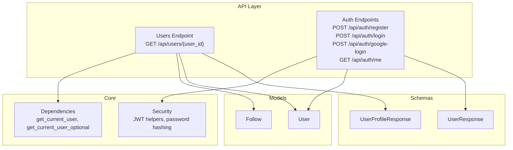
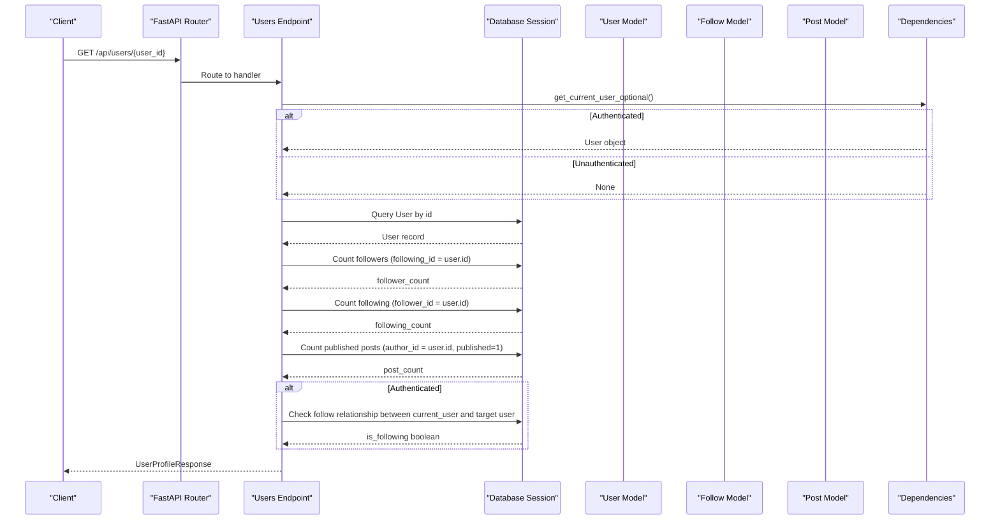
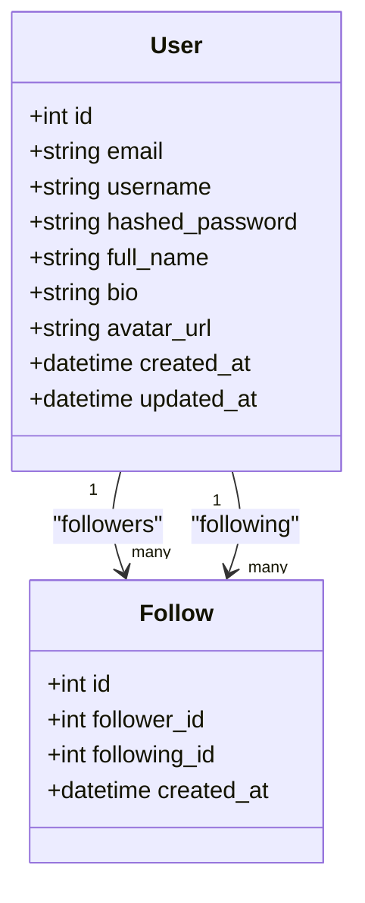
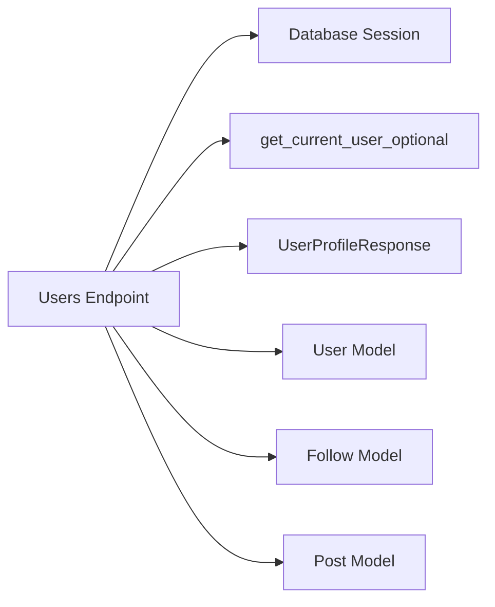

# Users Endpoints

<cite>
**Referenced Files in This Document**
- [users.py](file://app/api/endpoints/users.py)
- [user.py](file://app/schemas/user.py)
- [user_model.py](file://app/models/user.py)
- [auth.py](file://app/api/endpoints/auth.py)
- [dependencies.py](file://app/core/dependencies.py)
- [security.py](file://app/core/security.py)
- [follow.py](file://app/models/follow.py)
- [main.py](file://app/main.py)
- [config.py](file://app/core/config.py)
- [api_init.py](file://app/api/__init__.py)
</cite>

## Table of Contents
1. [Introduction](#introduction)
2. [Project Structure](#project-structure)
3. [Core Components](#core-components)
4. [Architecture Overview](#architecture-overview)
5. [Detailed Component Analysis](#detailed-component-analysis)
6. [Dependency Analysis](#dependency-analysis)
7. [Performance Considerations](#performance-considerations)
8. [Troubleshooting Guide](#troubleshooting-guide)
9. [Conclusion](#conclusion)

## Introduction
This document provides comprehensive API documentation for user profile management endpoints, focusing on retrieving a user’s public profile and integrating with the authentication system to determine follow relationships. It also outlines how to extend the API for profile updates, avatar management, and account settings modification, including request/response schemas, validation rules, privacy controls, and permission checks.

The current implementation exposes:
- A GET endpoint to retrieve a user’s public profile with follower/following/post counts and an optional “is following” flag when authenticated.
- Authentication endpoints for login, registration, Google OAuth, and fetching the authenticated user’s own profile.

## Project Structure
User-related functionality is organized as follows:
- API endpoints under app/api/endpoints
- Pydantic schemas under app/schemas
- SQLAlchemy models under app/models
- Security utilities under app/core
- Application entry point and configuration under app/main.py and app/core/config.py

**Diagram sources**
- [users.py:10-41](file://app/api/endpoints/users.py#L10-L41)
- [auth.py:18-126](file://app/api/endpoints/auth.py#L18-L126)
- [user.py:17-34](file://app/schemas/user.py#L17-L34)
- [user_model.py:6-26](file://app/models/user.py#L6-L26)
- [follow.py:7-19](file://app/models/follow.py#L7-L19)
- [dependencies.py:13-51](file://app/core/dependencies.py#L13-L51)
- [security.py:10-32](file://app/core/security.py#L10-L32)

**Section sources**
- [main.py:33-81](file://app/main.py#L33-L81)
- [api_init.py:5-14](file://app/api/__init__.py#L5-L14)

## Core Components
- User Profile Retrieval Endpoint: Returns a user’s public profile with aggregated counts and optional follow status.
- Authentication System: Provides JWT-based access tokens and optional Google OAuth flow; includes endpoints for register, login, google-login, and me.
- Data Models: User and Follow models define the database schema and relationships.
- Schemas: Pydantic models define request/response structures and validation rules.
- Dependencies: FastAPI dependency injection for current user resolution (required and optional).

Key responsibilities:
- users.py: Exposes GET /api/users/{user_id}.
- auth.py: Handles authentication flows and returns Token/UserResponse.
- dependencies.py: Resolves current user from Bearer token or returns None if unauthenticated.
- security.py: Implements password hashing and JWT creation/decoding.
- user_model.py: Defines User table and relationships.
- follow.py: Defines Follow table and relationships.
- user.py (schemas): Defines UserResponse, UserProfileResponse, and related types.

**Section sources**
- [users.py:13-41](file://app/api/endpoints/users.py#L13-L41)
- [auth.py:18-126](file://app/api/endpoints/auth.py#L18-L126)
- [dependencies.py:13-51](file://app/core/dependencies.py#L13-L51)
- [security.py:10-32](file://app/core/security.py#L10-L32)
- [user_model.py:6-26](file://app/models/user.py#L6-L26)
- [follow.py:7-19](file://app/models/follow.py#L7-L19)
- [user.py:17-34](file://app/schemas/user.py#L17-L34)

## Architecture Overview
The user profile retrieval endpoint composes data from multiple tables and enriches it with derived fields. When a client sends a request, the endpoint:
- Validates the user ID path parameter.
- Fetches the User record.
- Computes follower_count, following_count, post_count.
- Optionally determines is_following based on the authenticated caller.

**Diagram sources**
- [users.py:13-41](file://app/api/endpoints/users.py#L13-L41)
- [dependencies.py:42-51](file://app/core/dependencies.py#L42-L51)
- [user_model.py:6-26](file://app/models/user.py#L6-L26)
- [follow.py:7-19](file://app/models/follow.py#L7-L19)

## Detailed Component Analysis

### User Profile Retrieval
- Endpoint: GET /api/users/{user_id}
- Path Parameter:
  - user_id: integer, required
- Response Model: UserProfileResponse
  - Inherits from UserResponse:
    - id: integer
    - email: string (email format)
    - username: string
    - full_name: string | null
    - bio: string | null
    - avatar_url: string | null
    - created_at: datetime
  - Additional fields:
    - follower_count: integer (default 0)
    - following_count: integer (default 0)
    - post_count: integer (default 0)
    - is_following: boolean (default false)
- Behavior:
  - If user not found: returns 404 with localized detail message.
  - Counts are computed via separate queries against Follow and Post tables.
  - is_following is set only when a valid bearer token is provided; otherwise remains false.

Request Examples:
- Public profile retrieval (no token):
  - GET /api/users/123
- With authentication (to include is_following):
  - GET /api/users/123
  - Authorization: Bearer <access_token>

Response Example:
- {
    "id": 123,
    "email": "user@example.com",
    "username": "user123",
    "full_name": "Jane Doe",
    "bio": "Writer and storyteller.",
    "avatar_url": "https://example.com/avatar.jpg",
    "created_at": "2024-01-01T00:00:00Z",
    "follower_count": 10,
    "following_count": 5,
    "post_count": 42,
    "is_following": true
  }

Error Responses:
- 404 Not Found: User does not exist.
- 401 Unauthorized: Invalid or expired token when attempting to compute is_following (handled by dependency).

Validation Rules:
- Email must be a valid email format (enforced by schema).
- Username and full_name are strings; full_name is optional.
- Avatar URL and bio are optional strings.

Privacy Controls:
- The endpoint returns public profile fields only.
- Sensitive fields like hashed_password are not exposed.
- is_following requires authentication; otherwise defaults to false.

Integration with Authentication:
- Uses get_current_user_optional to optionally resolve the authenticated user.
- If a valid token is present, the endpoint computes whether the current user follows the target user.

Permission Checks:
- No write permissions needed for reading profiles.
- Optional authentication improves response richness but is not required.

**Section sources**
- [users.py:13-41](file://app/api/endpoints/users.py#L13-L41)
- [user.py:17-34](file://app/schemas/user.py#L17-L34)
- [dependencies.py:42-51](file://app/core/dependencies.py#L42-L51)

### Authentication Endpoints
- POST /api/auth/register
  - Request Body: UserCreate
    - email: string (email format)
    - username: string
    - full_name: string | null
    - password: string
  - Response: UserResponse
  - Validation:
    - Email uniqueness enforced at application level.
    - Username uniqueness enforced at application level.
  - Errors:
    - 400 Bad Request: Duplicate email or username.

- POST /api/auth/login
  - Request Body: UserLogin
    - email: string (email format)
    - password: string
  - Response: Token
    - access_token: string
    - token_type: string ("bearer")
    - user: UserResponse
  - Errors:
    - 401 Unauthorized: Invalid credentials.

- POST /api/auth/google-login
  - Request Body: JSON object containing token field (Google ID token)
  - Flow:
    - Verifies Google token audience against configured GOOGLE_CLIENT_ID.
    - Extracts email, name, picture.
    - Creates or finds existing user.
    - Issues JWT access token.
  - Response: Token
  - Errors:
    - 400 Bad Request: Missing or invalid JSON body, missing token, missing email.
    - 401 Unauthorized: Invalid Google token or audience mismatch.

- GET /api/auth/me
  - Requires valid Bearer token.
  - Response: UserResponse
  - Errors:
    - 401 Unauthorized: Invalid or expired token.

Authentication Integration Notes:
- Access tokens are JWTs signed using HS256 with configurable expiration.
- Passwords are hashed using bcrypt before storage.
- Google OAuth flow integrates external identity provider and maps to internal User model.

**Section sources**
- [auth.py:18-126](file://app/api/endpoints/auth.py#L18-L126)
- [security.py:10-32](file://app/core/security.py#L10-L32)
- [config.py:18-26](file://app/core/config.py#L18-L26)

### Data Models and Relationships
- User Model:
  - Fields: id, email, username, hashed_password, full_name, bio, avatar_url, created_at, updated_at.
  - Relationships: posts, comments, following, followers.
- Follow Model:
  - Fields: id, follower_id, following_id, created_at.
  - Unique constraint ensures no duplicate follow relationships.

**Diagram sources**
- [user_model.py:6-26](file://app/models/user.py#L6-L26)
- [follow.py:7-19](file://app/models/follow.py#L7-L19)

**Section sources**
- [user_model.py:6-26](file://app/models/user.py#L6-L26)
- [follow.py:7-19](file://app/models/follow.py#L7-L19)

### Schema Definitions and Validation
- UserBase:
  - email: EmailStr
  - username: str
  - full_name: Optional[str]
- UserCreate:
  - Extends UserBase with password: str
- UserLogin:
  - email: EmailStr
  - password: str
- UserResponse:
  - id: int
  - email: EmailStr
  - username: str
  - full_name: Optional[str]
  - bio: Optional[str]
  - avatar_url: Optional[str]
  - created_at: datetime
- Token:
  - access_token: str
  - token_type: str
  - user: UserResponse
- UserProfileResponse:
  - Inherits UserResponse
  - follower_count: int (default 0)
  - following_count: int (default 0)
  - post_count: int (default 0)
  - is_following: bool (default false)

Validation Rules:
- Email must conform to standard email format.
- Required fields: email, username, password (for create/login).
- Optional fields: full_name, bio, avatar_url.

**Section sources**
- [user.py:5-34](file://app/schemas/user.py#L5-L34)

## Dependency Analysis
The user profile endpoint depends on:
- Database session for querying User, Follow, and Post entities.
- Optional authentication dependency to determine is_following.
- Schemas for response modeling.

**Diagram sources**
- [users.py:13-41](file://app/api/endpoints/users.py#L13-L41)
- [dependencies.py:42-51](file://app/core/dependencies.py#L42-L51)
- [user_model.py:6-26](file://app/models/user.py#L6-L26)
- [follow.py:7-19](file://app/models/follow.py#L7-L19)

**Section sources**
- [users.py:13-41](file://app/api/endpoints/users.py#L13-L41)
- [dependencies.py:42-51](file://app/core/dependencies.py#L42-L51)

## Performance Considerations
- Multiple Queries: The endpoint performs several queries (User, Followers, Following, Posts, Follow check). Consider batching or using ORM joins where appropriate to reduce round trips.
- Indexing: Ensure indexes on foreign keys (follower_id, following_id) and author_id in posts to optimize count queries.
- Caching: For high-traffic profiles, consider caching follower/following/post counts with short TTLs.
- Pagination: If exposing post lists later, implement pagination to avoid large payloads.

[No sources needed since this section provides general guidance]

## Troubleshooting Guide
Common issues and resolutions:
- 404 Not Found on profile retrieval:
  - Cause: User ID does not exist.
  - Resolution: Verify user_id and ensure the user exists in the database.
- 401 Unauthorized on profile retrieval:
  - Cause: Invalid or expired token when computing is_following.
  - Resolution: Refresh access token or re-authenticate.
- 400 Bad Request on registration:
  - Cause: Duplicate email or username.
  - Resolution: Use unique email and username values.
- 401 Unauthorized on login:
  - Cause: Incorrect email/password combination.
  - Resolution: Verify credentials or reset password.
- Google login failures:
  - Cause: Invalid token or audience mismatch.
  - Resolution: Ensure GOOGLE_CLIENT_ID matches the token’s audience and that the token is valid.

**Section sources**
- [users.py:19-21](file://app/api/endpoints/users.py#L19-L21)
- [auth.py:90-104](file://app/api/endpoints/auth.py#L90-L104)
- [auth.py:107-120](file://app/api/endpoints/auth.py#L107-L120)
- [auth.py:18-87](file://app/api/endpoints/auth.py#L18-L87)

## Conclusion
The current user profile management API provides robust read-only access to public user profiles with optional enrichment when authenticated. Authentication endpoints support both traditional login and Google OAuth, issuing JWTs for protected routes. To extend the API for profile updates, avatar management, and account settings modification, introduce additional endpoints with appropriate permission checks and validation rules, ensuring sensitive fields remain protected and privacy controls are enforced.

[No sources needed since this section summarizes without analyzing specific files]