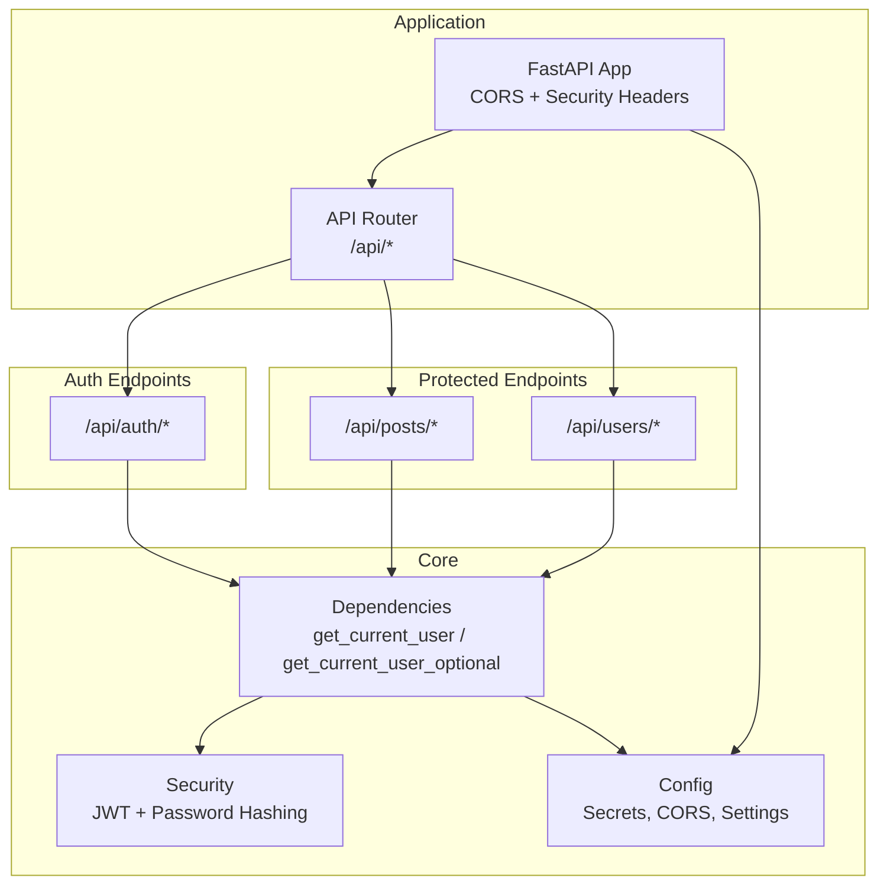
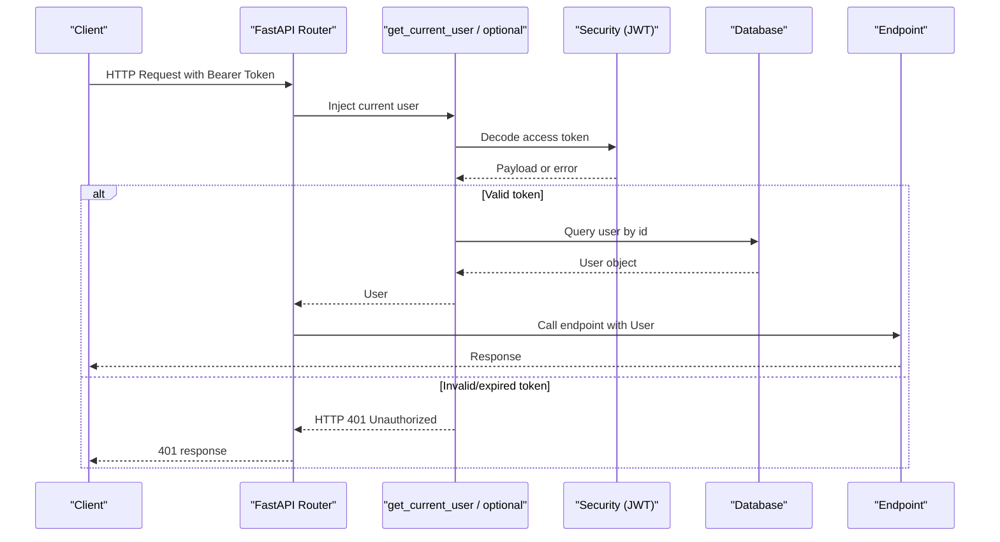
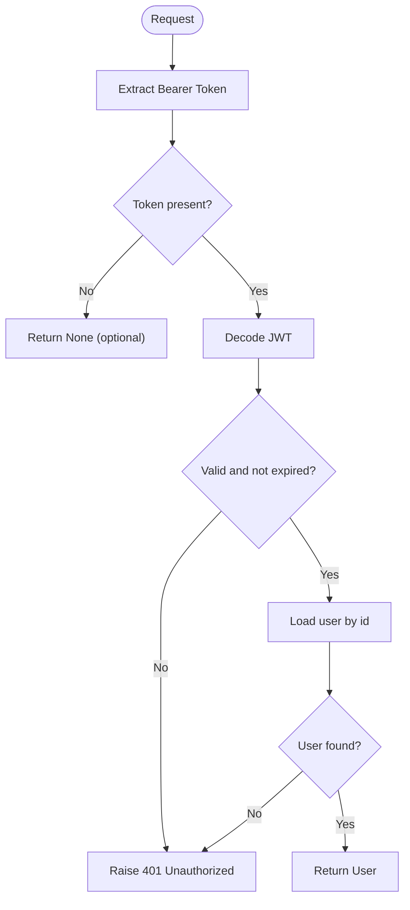
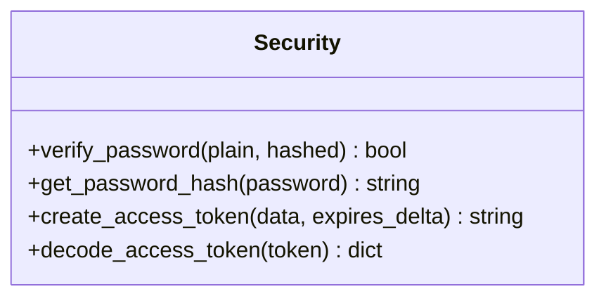
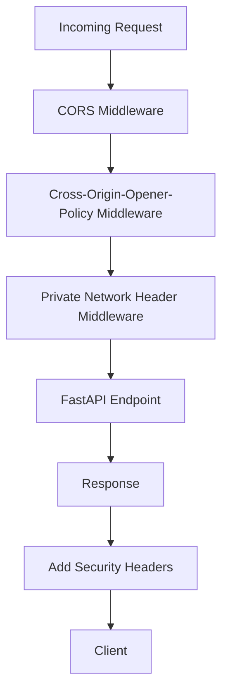
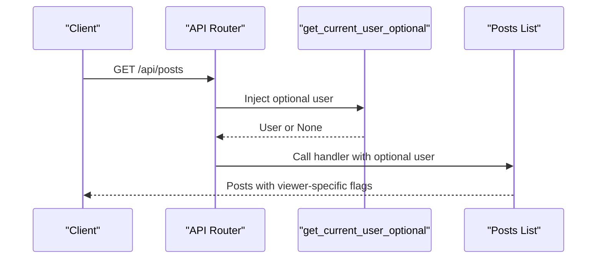
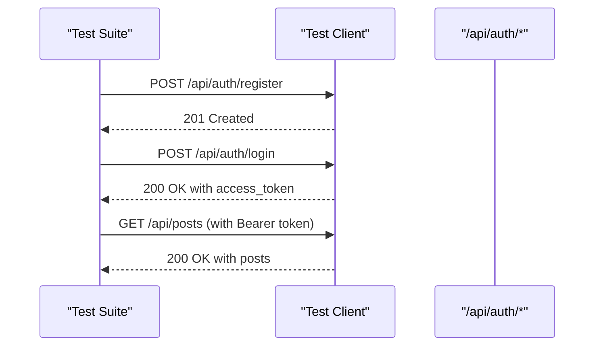
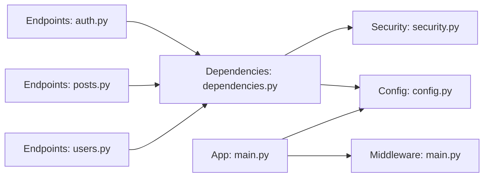

# Authentication Dependencies & Middleware

<cite>
**Referenced Files in This Document**
- [main.py](file://app/main.py)
- [config.py](file://app/core/config.py)
- [dependencies.py](file://app/core/dependencies.py)
- [security.py](file://app/core/security.py)
- [auth.py](file://app/api/endpoints/auth.py)
- [posts.py](file://app/api/endpoints/posts.py)
- [users.py](file://app/api/endpoints/users.py)
- [__init__.py](file://app/api/__init__.py)
- [test_auth.py](file://tests/test_auth.py)
</cite>

## Table of Contents
1. [Introduction](#introduction)
2. [Project Structure](#project-structure)
3. [Core Components](#core-components)
4. [Architecture Overview](#architecture-overview)
5. [Detailed Component Analysis](#detailed-component-analysis)
6. [Dependency Analysis](#dependency-analysis)
7. [Performance Considerations](#performance-considerations)
8. [Troubleshooting Guide](#troubleshooting-guide)
9. [Conclusion](#conclusion)

## Introduction
This document explains the authentication dependencies and middleware components used by the Lekhani backend. It focuses on FastAPI dependency injection for user authentication, token handling, request/response middleware, CORS configuration, and security headers. It also documents how API endpoints integrate with these dependencies, including optional vs required authentication, authorization patterns, error handling, testing strategies, and performance considerations.

## Project Structure
The authentication-related code is organized into:
- Core utilities for security and dependencies
- API endpoints that use those dependencies
- Application-level middleware for cross-origin and security headers
- Configuration for secrets, tokens, and CORS
- Tests validating authentication flows

**Diagram sources**
- [main.py:33-81](file://app/main.py#L33-L81)
- [__init__.py:3-14](file://app/api/__init__.py#L3-L14)
- [dependencies.py:10-51](file://app/core/dependencies.py#L10-L51)
- [security.py:8-32](file://app/core/security.py#L8-L32)
- [config.py:5-48](file://app/core/config.py#L5-L48)

**Section sources**
- [main.py:33-81](file://app/main.py#L33-L81)
- [__init__.py:3-14](file://app/api/__init__.py#L3-L14)

## Core Components
- Authentication dependencies:
  - `get_current_user`: Validates Bearer token, decodes JWT, resolves user from database, raises HTTP 401 on invalid/expired tokens.
  - `get_current_user_optional`: Returns None when no token or invalid token; otherwise returns authenticated user.
- Security utilities:
  - Password hashing and verification using bcrypt.
  - JWT creation and decoding with configurable secret key and algorithm.
- Middleware:
  - CORS middleware configured via settings.
  - Custom ASGI middlewares to add Cross-Origin-Opener-Policy and private-network headers.
- Configuration:
  - Secret key, algorithm, token expiry, Google client ID, allowed origins, server host/port.

**Section sources**
- [dependencies.py:10-51](file://app/core/dependencies.py#L10-L51)
- [security.py:8-32](file://app/core/security.py#L8-L32)
- [main.py:36-79](file://app/main.py#L36-L79)
- [config.py:17-41](file://app/core/config.py#L17-L41)

## Architecture Overview
Authentication flow overview:
- Clients send requests with Authorization: Bearer <token>.
- FastAPI invokes `get_current_user` or `get_current_user_optional`.
- Dependencies decode JWT, validate signature and expiration, and fetch the user from the database.
- Protected endpoints receive a validated User object; optional endpoints may proceed without a user.

**Diagram sources**
- [dependencies.py:13-51](file://app/core/dependencies.py#L13-L51)
- [security.py:19-32](file://app/core/security.py#L19-L32)
- [auth.py:107-126](file://app/api/endpoints/auth.py#L107-L126)

## Detailed Component Analysis

### Authentication Dependencies
- OAuth2 scheme setup:
  - Standard bearer scheme pointing to `/api/auth/login`.
  - Optional bearer scheme for routes that allow anonymous access.
- `get_current_user`:
  - Decodes JWT using shared secret and algorithm.
  - Handles expired tokens and general JWT errors.
  - Extracts user id from payload and loads user from DB.
  - Raises HTTP 401 with WWW-Authenticate header on failures.
- `get_current_user_optional`:
  - Safely wraps `get_current_user`, returning None if token is missing or invalid.

**Diagram sources**
- [dependencies.py:10-51](file://app/core/dependencies.py#L10-L51)

**Section sources**
- [dependencies.py:10-51](file://app/core/dependencies.py#L10-L51)

### Security Utilities
- Password hashing and verification:
  - Uses bcrypt via passlib context.
  - Truncates long passwords to comply with bcrypt limits.
- JWT operations:
  - Creates access tokens with subject (user id) and expiration.
  - Decodes tokens with explicit algorithms and secret key.

**Diagram sources**
- [security.py:8-32](file://app/core/security.py#L8-L32)

**Section sources**
- [security.py:8-32](file://app/core/security.py#L8-L32)

### Middleware and CORS
- CORS middleware:
  - Configured with allowed origins and regex for Vercel domains.
  - Allows credentials and all methods/headers.
- Custom ASGI middlewares:
  - Adds Cross-Origin-Opener-Policy header.
  - Adds Access-Control-Allow-Private-Network header when requested.

**Diagram sources**
- [main.py:36-79](file://app/main.py#L36-L79)

**Section sources**
- [main.py:36-79](file://app/main.py#L36-L79)

### Integration Patterns with API Endpoints
- Required authentication:
  - Endpoints like post creation/update/delete and clap require `current_user: User = Depends(get_current_user)`.
  - These endpoints enforce ownership checks before mutating resources.
- Optional authentication:
  - Read endpoints accept `current_user: Optional[User] = Depends(get_current_user_optional)` to enrich responses (e.g., bookmark state, following status).
- Route protection strategy:
  - Use required dependency for write endpoints.
  - Use optional dependency for read endpoints to support both authenticated and anonymous users.

Examples:
- Auth endpoints:
  - Login/register return JWT tokens.
  - `/api/auth/me` requires authentication.
- Posts endpoints:
  - List posts supports optional auth for personalized data.
  - Create/update/delete require authentication and check ownership.
- Users endpoints:
  - Profile retrieval supports optional auth to compute follow state.

**Diagram sources**
- [posts.py:83-126](file://app/api/endpoints/posts.py#L83-L126)
- [dependencies.py:42-51](file://app/core/dependencies.py#L42-L51)

**Section sources**
- [auth.py:89-126](file://app/api/endpoints/auth.py#L89-L126)
- [posts.py:83-298](file://app/api/endpoints/posts.py#L83-L298)
- [users.py:13-41](file://app/api/endpoints/users.py#L13-L41)

### Permission Checking and Role-Based Access Control
- Current implementation uses resource ownership checks rather than role-based access control:
  - Update and delete endpoints verify that the requesting user is the author.
- Role-based access control:
  - Not implemented in the current codebase.
  - To add roles, extend the User model and dependencies to include role claims and permission checks.

**Section sources**
- [posts.py:217-267](file://app/api/endpoints/posts.py#L217-L267)

### Error Handling Patterns
- Authentication errors:
  - Expired or invalid tokens raise HTTP 401 with WWW-Authenticate header.
- Resource errors:
  - Missing resources raise HTTP 404.
  - Unauthorized mutations raise HTTP 403.
- Input validation:
  - JSON parsing and field presence are validated in login endpoints.

**Section sources**
- [dependencies.py:13-39](file://app/core/dependencies.py#L13-L39)
- [posts.py:143-183](file://app/api/endpoints/posts.py#L143-L183)
- [posts.py:217-267](file://app/api/endpoints/posts.py#L217-L267)
- [auth.py:18-87](file://app/api/endpoints/auth.py#L18-L87)

### Testing Approaches for Authenticated Routes
- Test fixtures:
  - Register a user and log in to obtain an access token.
  - Use the token in subsequent requests to protected endpoints.
- Example coverage:
  - Registration and login success paths.
  - Google login flow (mocked external verification).

**Diagram sources**
- [test_auth.py:1-30](file://tests/test_auth.py#L1-L30)
- [auth.py:89-126](file://app/api/endpoints/auth.py#L89-L126)

**Section sources**
- [test_auth.py:1-30](file://tests/test_auth.py#L1-L30)

## Dependency Analysis
High-level relationships:
- Endpoints depend on core dependencies for authentication.
- Core dependencies rely on security utilities and configuration.
- Application middleware depends on configuration for CORS and headers.

**Diagram sources**
- [auth.py:1-126](file://app/api/endpoints/auth.py#L1-L126)
- [posts.py:1-298](file://app/api/endpoints/posts.py#L1-L298)
- [users.py:1-41](file://app/api/endpoints/users.py#L1-L41)
- [dependencies.py:1-51](file://app/core/dependencies.py#L1-L51)
- [security.py:1-32](file://app/core/security.py#L1-L32)
- [config.py:1-48](file://app/core/config.py#L1-L48)
- [main.py:33-81](file://app/main.py#L33-L81)

**Section sources**
- [auth.py:1-126](file://app/api/endpoints/auth.py#L1-L126)
- [posts.py:1-298](file://app/api/endpoints/posts.py#L1-L298)
- [users.py:1-41](file://app/api/endpoints/users.py#L1-L41)
- [dependencies.py:1-51](file://app/core/dependencies.py#L1-L51)
- [security.py:1-32](file://app/core/security.py#L1-L32)
- [config.py:1-48](file://app/core/config.py#L1-L48)
- [main.py:33-81](file://app/main.py#L33-L81)

## Performance Considerations
- Token validation overhead:
  - JWT decoding is lightweight; ensure SECRET_KEY and ALGORITHM are correctly set to avoid unnecessary retries.
- Database queries:
  - Avoid N+1 queries by batching lookups where possible (e.g., fetching related clap/bookmark states in bulk).
- Caching strategies:
  - Consider caching frequently accessed user profiles or post lists using an in-memory cache (e.g., Redis) keyed by user id or query parameters.
  - Cache JWT public key material if switching to asymmetric algorithms.
- Session management:
  - Stateless JWT avoids server-side sessions; consider short-lived access tokens with refresh tokens for improved security and performance.
- Middleware cost:
  - Keep custom middlewares minimal; only add necessary headers to reduce per-request overhead.

[No sources needed since this section provides general guidance]

## Troubleshooting Guide
- 401 Unauthorized:
  - Verify Authorization header format: `Authorization: Bearer <token>`.
  - Ensure token is not expired; adjust ACCESS_TOKEN_EXPIRE_MINUTES if needed.
  - Confirm SECRET_KEY and ALGORITHM match between token issuance and validation.
- CORS issues:
  - Check ALLOW_ORIGINS includes the frontend domain.
  - For Vercel previews, confirm regex allows dynamic subdomains.
- Private network access:
  - Ensure private-network preflight header is sent by the browser and handled by middleware.
- Debugging authentication flows:
  - Log token payloads and user resolution steps in dependencies and endpoints.
  - Validate Google client ID and token audience during third-party login.

**Section sources**
- [dependencies.py:13-39](file://app/core/dependencies.py#L13-L39)
- [main.py:36-79](file://app/main.py#L36-L79)
- [config.py:17-41](file://app/core/config.py#L17-L41)
- [auth.py:18-87](file://app/api/endpoints/auth.py#L18-L87)

## Conclusion
The Lekhani backend implements robust authentication through FastAPI dependencies and JWT-based security utilities. Endpoints integrate authentication via required and optional dependencies, enabling flexible route protection. Middleware ensures proper CORS and security headers. While role-based access control is not yet implemented, the architecture supports extension. Testing covers core authentication flows, and performance can be further optimized with caching and efficient database queries.

[No sources needed since this section summarizes without analyzing specific files]