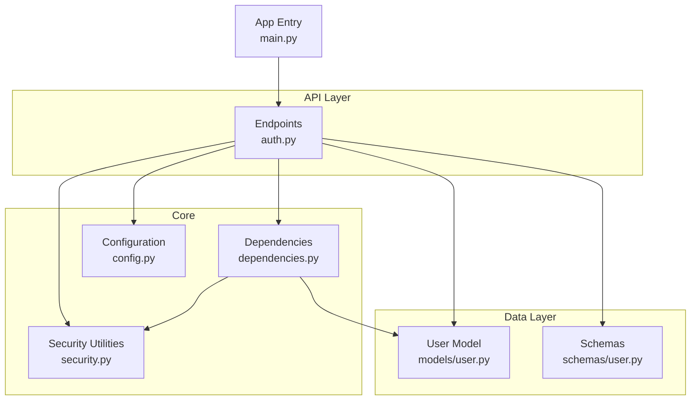
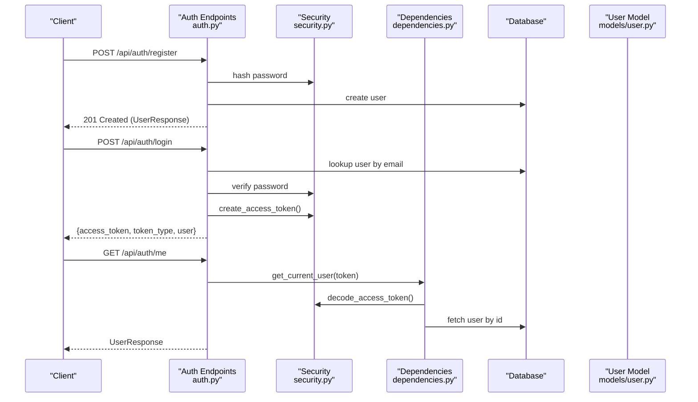
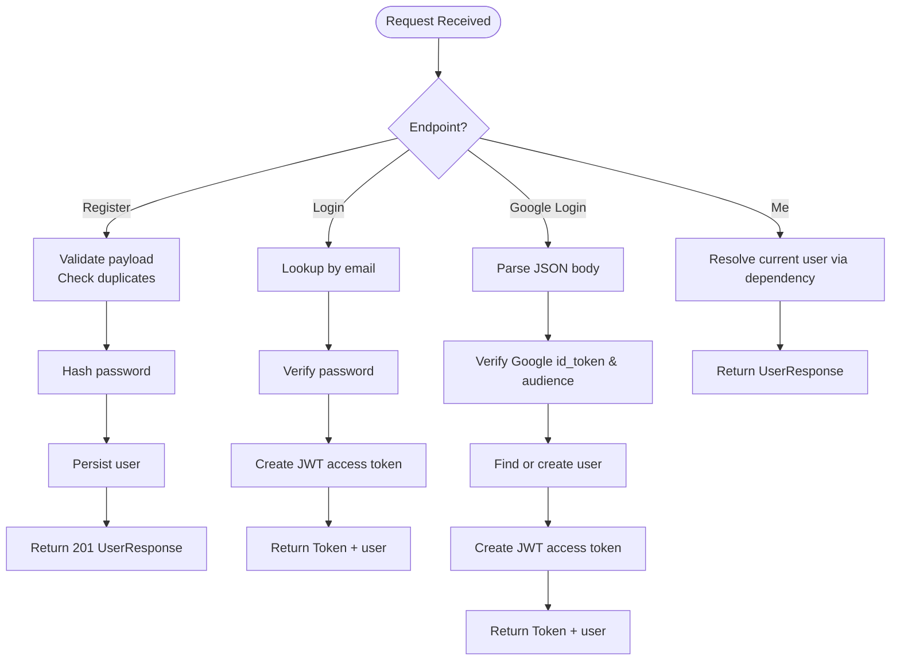
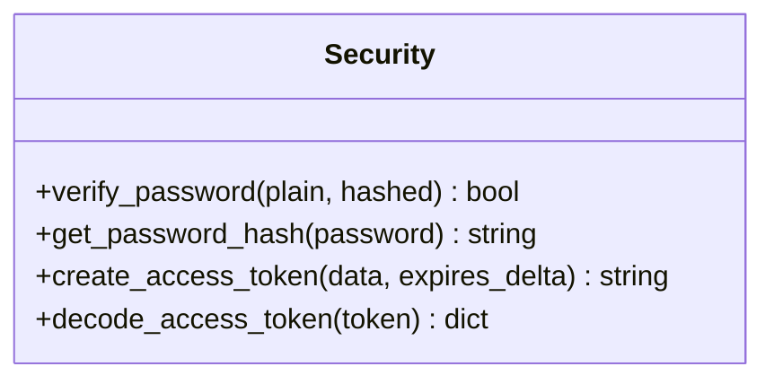
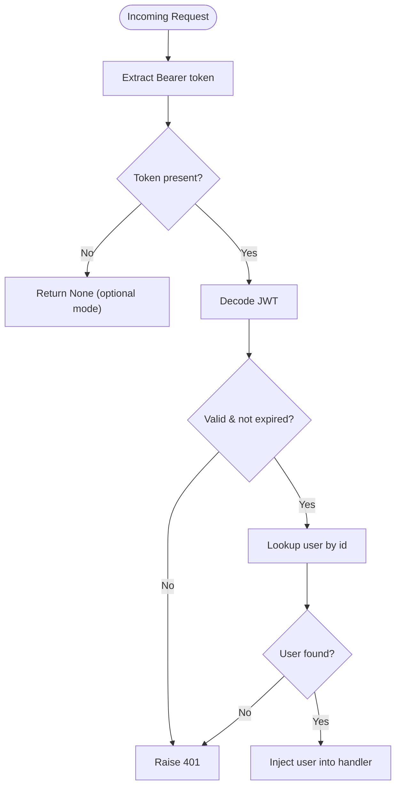
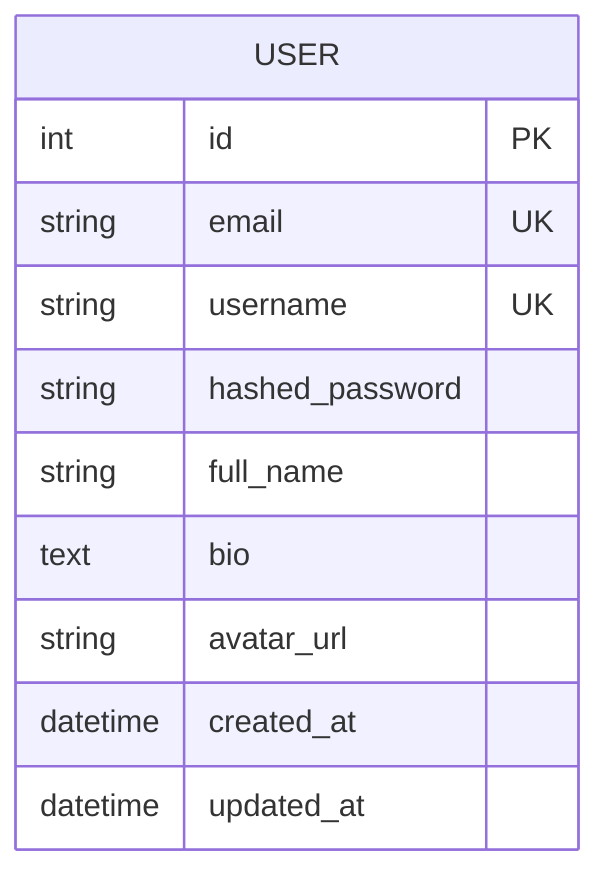
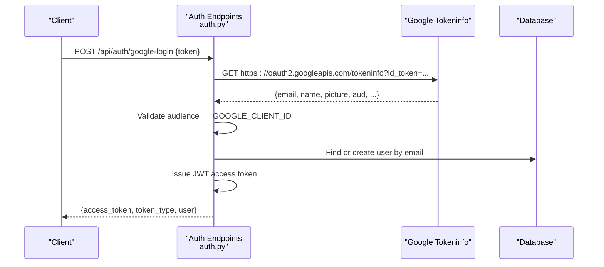
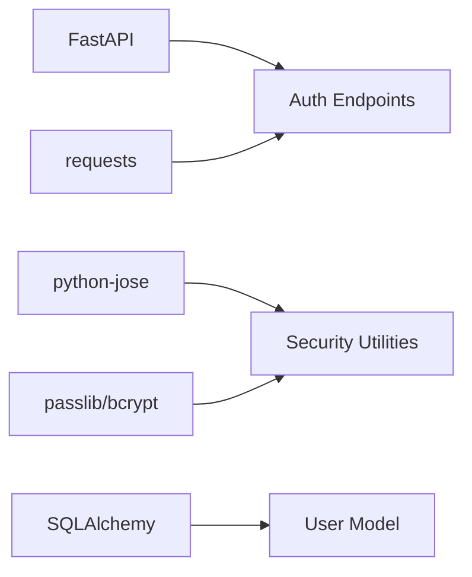

# Authentication System

<cite>
**Referenced Files in This Document**
- [auth.py](file://app/api/endpoints/auth.py)
- [security.py](file://app/core/security.py)
- [dependencies.py](file://app/core/dependencies.py)
- [user.py](file://app/models/user.py)
- [user.py](file://app/schemas/user.py)
- [config.py](file://app/core/config.py)
- [main.py](file://app/main.py)
- [requirements.txt](file://requirements.txt)
- [test_auth.py](file://tests/test_auth.py)
</cite>

## Table of Contents
1. [Introduction](#introduction)
2. [Project Structure](#project-structure)
3. [Core Components](#core-components)
4. [Architecture Overview](#architecture-overview)
5. [Detailed Component Analysis](#detailed-component-analysis)
6. [Dependency Analysis](#dependency-analysis)
7. [Performance Considerations](#performance-considerations)
8. [Troubleshooting Guide](#troubleshooting-guide)
9. [Conclusion](#conclusion)

## Introduction
This document explains the Lekhani authentication system, covering:
- JWT token creation and decoding using python-jose
- Password hashing with bcrypt via passlib
- Google OAuth integration for login
- Complete flows from registration to login and protected route access
- Security measures including password handling, token expiration, and configuration
- Implementation patterns for custom dependencies and middleware
- Best practices, common vulnerabilities, mitigations, and debugging guidance

The backend is built with FastAPI and uses SQLAlchemy for persistence. Authentication endpoints are exposed under /api/auth.

## Project Structure
Authentication-related code is organized into focused modules:
- API endpoints for auth operations
- Core security utilities for JWT and password hashing
- Dependency injection for current user resolution
- Data models and schemas for users and tokens
- Configuration for secrets, algorithms, and environment variables
- Tests validating core auth flows

**Diagram sources**
- [auth.py:1-128](file://app/api/endpoints/auth.py#L1-L128)
- [security.py:1-34](file://app/core/security.py#L1-L34)
- [dependencies.py:1-53](file://app/core/dependencies.py#L1-L53)
- [user.py:1-28](file://app/models/user.py#L1-L28)
- [user.py:1-37](file://app/schemas/user.py#L1-L37)
- [config.py:1-48](file://app/core/config.py#L1-L48)
- [main.py:33-81](file://app/main.py#L33-L81)

**Section sources**
- [auth.py:1-128](file://app/api/endpoints/auth.py#L1-L128)
- [security.py:1-34](file://app/core/security.py#L1-L34)
- [dependencies.py:1-53](file://app/core/dependencies.py#L1-L53)
- [user.py:1-28](file://app/models/user.py#L1-L28)
- [user.py:1-37](file://app/schemas/user.py#L1-L37)
- [config.py:1-48](file://app/core/config.py#L1-L48)
- [main.py:33-81](file://app/main.py#L33-L81)

## Core Components
- Authentication endpoints: register, login, google-login, and get current user info
- Security utilities: password hashing/verification, JWT encode/decode
- Dependencies: OAuth2 bearer token extraction and current user resolution
- User model: database schema for users
- Schemas: Pydantic models for request/response validation
- Configuration: secrets, algorithm, token expiry, Google client ID, CORS

Key responsibilities:
- Endpoints orchestrate business logic and interact with DB and security utilities
- Security module centralizes cryptographic operations
- Dependencies provide reusable authentication checks for routes
- Models and schemas define data contracts
- Config manages environment-driven settings

**Section sources**
- [auth.py:18-126](file://app/api/endpoints/auth.py#L18-L126)
- [security.py:8-32](file://app/core/security.py#L8-L32)
- [dependencies.py:10-51](file://app/core/dependencies.py#L10-L51)
- [user.py:6-27](file://app/models/user.py#L6-L27)
- [user.py:5-35](file://app/schemas/user.py#L5-L35)
- [config.py:5-48](file://app/core/config.py#L5-L48)

## Architecture Overview
High-level flow:
- Client calls /api/auth/register or /api/auth/login to obtain a JWT access token
- For Google OAuth, client calls /api/auth/google-login with an id_token; server verifies it and issues an access token
- Protected routes require Authorization: Bearer <access_token>
- The dependency layer decodes the token, validates signature and expiry, resolves the user, and injects it into route handlers

**Diagram sources**
- [auth.py:89-126](file://app/api/endpoints/auth.py#L89-L126)
- [security.py:19-32](file://app/core/security.py#L19-L32)
- [dependencies.py:13-39](file://app/core/dependencies.py#L13-L39)
- [user.py:6-27](file://app/models/user.py#L6-L27)

## Detailed Component Analysis

### Authentication Endpoints (/api/auth)
Responsibilities:
- Register new users with validated input and hashed passwords
- Authenticate users and issue JWT access tokens
- Handle Google OAuth login by verifying id_token and issuing access tokens
- Provide current user info endpoint protected by authentication

Key behaviors:
- Registration checks for duplicate email and username before creating a user
- Login verifies credentials and returns a bearer token with configured expiry
- Google login verifies audience and extracts user profile fields; creates or reuses existing user
- Current user endpoint requires valid bearer token

Error handling:
- Invalid JSON payloads return 400
- Missing or invalid Google token returns 401
- Duplicate email/username returns 400
- Wrong credentials return 401

**Diagram sources**
- [auth.py:18-126](file://app/api/endpoints/auth.py#L18-L126)

**Section sources**
- [auth.py:18-126](file://app/api/endpoints/auth.py#L18-L126)

### Security Utilities (JWT and Passwords)
Responsibilities:
- Password hashing and verification using bcrypt via passlib
- JWT access token creation with configurable expiry
- JWT decoding for token validation

Implementation highlights:
- Uses CryptContext with bcrypt scheme
- Truncates long passwords to bcrypt’s 72-byte limit before hashing
- Encodes JWT with HS256 using SECRET_KEY and sets exp claim
- Decodes JWT with explicit algorithm list

**Diagram sources**
- [security.py:8-32](file://app/core/security.py#L8-L32)

**Section sources**
- [security.py:8-32](file://app/core/security.py#L8-L32)

### Dependencies (Protected Route Access)
Responsibilities:
- Extract bearer token from requests
- Decode and validate JWT
- Resolve current user from database
- Provide optional current user for routes that support both authenticated and anonymous access

Error handling:
- Expired tokens raise 401 with “Token has expired”
- Malformed or invalid tokens raise 401 with “Could not validate credentials”
- Optional variant returns None on missing or invalid tokens

**Diagram sources**
- [dependencies.py:10-51](file://app/core/dependencies.py#L10-L51)

**Section sources**
- [dependencies.py:10-51](file://app/core/dependencies.py#L10-L51)

### User Model and Schemas
- User model defines database columns for identity, credentials, profile, and timestamps
- Schemas define request/response contracts for registration, login, and token responses
- Token schema includes access_token, token_type, and user object

**Diagram sources**
- [user.py:6-17](file://app/models/user.py#L6-L17)

**Section sources**
- [user.py:6-27](file://app/models/user.py#L6-L27)
- [user.py:5-35](file://app/schemas/user.py#L5-L35)

### Google OAuth Integration
Flow:
- Client sends Google id_token to /api/auth/google-login
- Server verifies the token against Google’s tokeninfo endpoint and checks audience matches GOOGLE_CLIENT_ID
- Server finds or creates a local user based on email
- Server issues a JWT access token and returns it along with user info

**Diagram sources**
- [auth.py:18-87](file://app/api/endpoints/auth.py#L18-L87)
- [config.py:25-26](file://app/core/config.py#L25-L26)

**Section sources**
- [auth.py:18-87](file://app/api/endpoints/auth.py#L18-L87)
- [config.py:25-26](file://app/core/config.py#L25-L26)

### Configuration and Environment
- SECRET_KEY and ALGORITHM control JWT signing
- ACCESS_TOKEN_EXPIRE_MINUTES controls token lifetime
- GOOGLE_CLIENT_ID is used to validate Google id_token audience
- ALLOW_ORIGINS configures CORS for frontend domains
- FRONTEND_URL is used elsewhere in the app (e.g., sitemap/RSS)

Important notes:
- Ensure SECRET_KEY is set securely in production
- Keep GOOGLE_CLIENT_ID aligned with your Google Cloud project
- Review ALLOW_ORIGINS to restrict CORS appropriately

**Section sources**
- [config.py:17-37](file://app/core/config.py#L17-L37)

## Dependency Analysis
External libraries and their roles:
- FastAPI: web framework and routing
- uvicorn: ASGI server
- pydantic and pydantic-settings: data validation and configuration
- email-validator: email format validation
- httpx: HTTP client (not directly used in auth endpoints; requests is used for Google verification)
- python-dotenv: environment loading
- sqlalchemy and psycopg2-binary: ORM and PostgreSQL driver
- python-jose[cryptography]: JWT encoding/decoding
- passlib[bcrypt] and bcrypt: password hashing
- python-multipart: form parsing
- requests: HTTP client for Google token verification

**Diagram sources**
- [requirements.txt:1-15](file://requirements.txt#L1-L15)
- [auth.py:1-128](file://app/api/endpoints/auth.py#L1-L128)
- [security.py:1-34](file://app/core/security.py#L1-L34)
- [user.py:1-28](file://app/models/user.py#L1-L28)

**Section sources**
- [requirements.txt:1-15](file://requirements.txt#L1-L15)

## Performance Considerations
- Password hashing cost: bcrypt is intentionally slow; tune passlib parameters if needed for performance vs security trade-offs
- JWT decode overhead is minimal; ensure efficient dependency usage across routes
- Database queries: avoid N+1 patterns when returning user profiles; consider eager loading relationships if expanding endpoints
- Google token verification: network call per login; consider caching strategies or rate limiting to mitigate abuse

[No sources needed since this section provides general guidance]

## Troubleshooting Guide
Common issues and resolutions:
- Invalid or missing JSON body in Google login: ensure client sends a proper JSON object with a token field
- Audience mismatch for Google token: verify GOOGLE_CLIENT_ID matches the Google project’s client ID used to generate the id_token
- Expired JWT: clients must refresh tokens or re-authenticate; implement token refresh strategy at the application level
- Incorrect credentials: check email/password combination and ensure password hashing is consistent
- CORS errors: confirm ALLOW_ORIGINS includes the frontend origin and allow_credentials is set appropriately when cookies are used

Debugging tips:
- Inspect logs around Google token verification and JWT creation/validation
- Validate SECRET_KEY and ALGORITHM configuration
- Use test cases to reproduce flows locally

**Section sources**
- [auth.py:18-87](file://app/api/endpoints/auth.py#L18-L87)
- [dependencies.py:13-39](file://app/core/dependencies.py#L13-L39)
- [config.py:17-37](file://app/core/config.py#L17-L37)

## Conclusion
The Lekhani authentication system implements secure, standard practices:
- Password hashing with bcrypt via passlib
- JWT-based session management using python-jose with configurable expiry
- Google OAuth integration for seamless sign-in
- Clean separation of concerns across endpoints, security utilities, and dependencies

Recommendations for hardening:
- Enforce password strength validation at the schema layer
- Implement refresh tokens and rotation to improve security posture
- Store tokens securely (e.g., HttpOnly, Secure, SameSite cookies) if switching from bearer-only flows
- Add rate limiting and account lockout mechanisms
- Audit and restrict CORS origins strictly
- Rotate SECRET_KEY periodically and manage secrets via a secure vault

[No sources needed since this section summarizes without analyzing specific files]