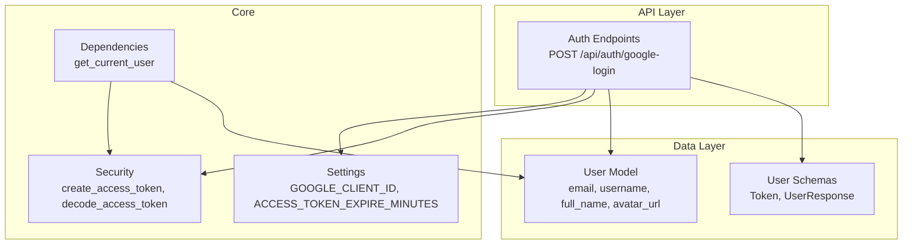
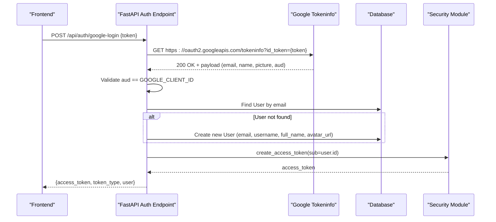
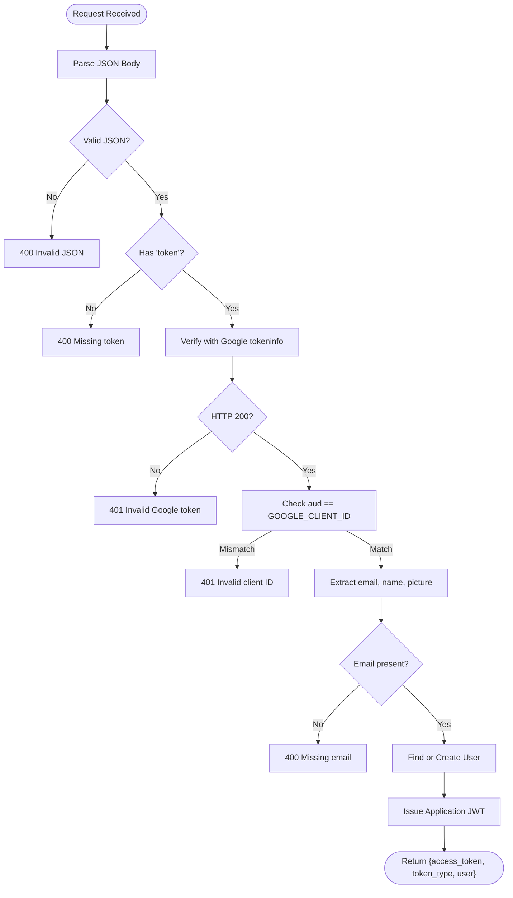
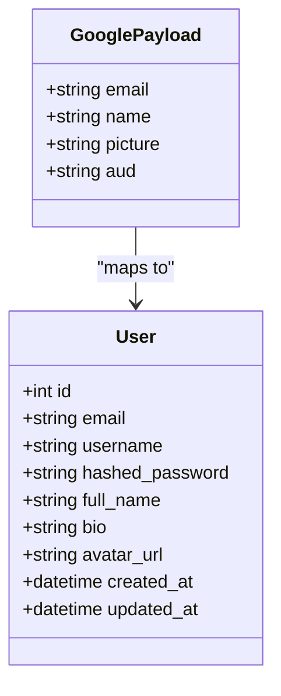
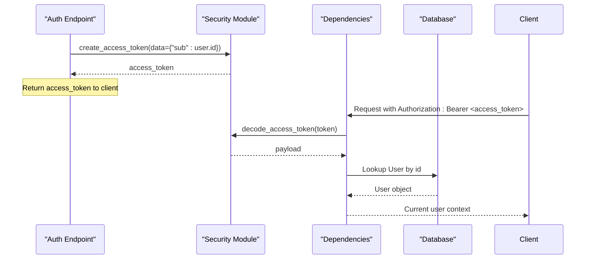
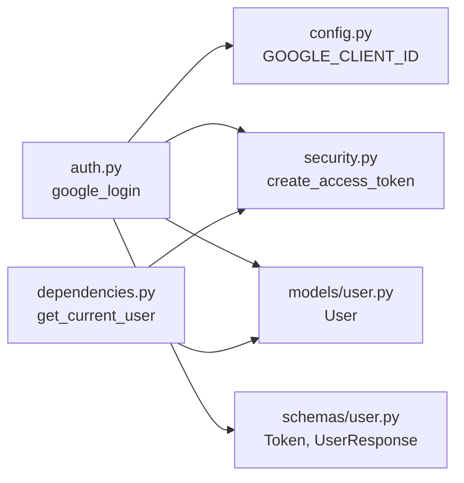

# Google OAuth Integration

<cite>
**Referenced Files in This Document**
- [auth.py](file://app/api/endpoints/auth.py)
- [user.py](file://app/models/user.py)
- [config.py](file://app/core/config.py)
- [security.py](file://app/core/security.py)
- [dependencies.py](file://app/core/dependencies.py)
- [user.py](file://app/schemas/user.py)
- [README.md](file://README.md)
- [test_auth.py](file://tests/test_auth.py)
</cite>

## Table of Contents
1. [Introduction](#introduction)
2. [Project Structure](#project-structure)
3. [Core Components](#core-components)
4. [Architecture Overview](#architecture-overview)
5. [Detailed Component Analysis](#detailed-component-analysis)
6. [Dependency Analysis](#dependency-analysis)
7. [Performance Considerations](#performance-considerations)
8. [Troubleshooting Guide](#troubleshooting-guide)
9. [Conclusion](#conclusion)
10. [Appendices](#appendices)

## Introduction
This document explains the Google OAuth integration in the Lekhani backend authentication system. The implementation uses a server-side token verification flow: the frontend obtains an ID token from Google and sends it to the backend, which verifies the token with Google, maps the user profile to the local User model, and issues an application JWT for subsequent API access.

Key aspects covered:
- Google OAuth 2.0 flow as implemented (ID token verification and exchange)
- Client registration and environment configuration
- Callback handling via a dedicated endpoint
- User profile synchronization with the local User model
- Security considerations and error handling
- Setup instructions and testing procedures

## Project Structure
The Google OAuth integration spans several modules:
- Authentication endpoints define the Google login route and response handling
- Configuration provides Google client settings and token expiration
- Security utilities generate and validate application JWTs
- Dependencies provide current-user resolution for protected routes
- Schemas define request/response models
- Models define the persistent User entity

**Diagram sources**
- [auth.py:18-87](file://app/api/endpoints/auth.py#L18-L87)
- [config.py:17-27](file://app/core/config.py#L17-L27)
- [security.py:19-32](file://app/core/security.py#L19-L32)
- [dependencies.py:13-39](file://app/core/dependencies.py#L13-L39)
- [user.py:6-17](file://app/models/user.py#L6-L17)
- [user.py:25-28](file://app/schemas/user.py#L25-L28)

**Section sources**
- [README.md:43-49](file://README.md#L43-L49)
- [auth.py:18-87](file://app/api/endpoints/auth.py#L18-L87)
- [config.py:17-27](file://app/core/config.py#L17-L27)
- [security.py:19-32](file://app/core/security.py#L19-L32)
- [dependencies.py:13-39](file://app/core/dependencies.py#L13-L39)
- [user.py:6-17](file://app/models/user.py#L6-L17)
- [user.py:25-28](file://app/schemas/user.py#L25-L28)

## Core Components
- Google login endpoint: Validates the incoming Google ID token, checks audience against configured client ID, extracts email/name/avatar, finds or creates a local user, and returns an application JWT plus user data.
- Settings: Holds GOOGLE_CLIENT_ID and token expiry configuration.
- Security: Creates and decodes application JWTs using SECRET_KEY and ALGORITHM.
- Dependencies: Provides get_current_user to resolve authenticated users from JWTs on protected routes.
- User model and schemas: Define persistence fields and API contracts for user data and tokens.

**Section sources**
- [auth.py:18-87](file://app/api/endpoints/auth.py#L18-L87)
- [config.py:17-27](file://app/core/config.py#L17-L27)
- [security.py:19-32](file://app/core/security.py#L19-L32)
- [dependencies.py:13-39](file://app/core/dependencies.py#L13-L39)
- [user.py:6-17](file://app/models/user.py#L6-L17)
- [user.py:25-28](file://app/schemas/user.py#L25-L28)

## Architecture Overview
The Google OAuth integration follows this sequence:
1. Frontend authenticates with Google and obtains an ID token.
2. Frontend calls POST /api/auth/google-login with the ID token.
3. Backend verifies the token with Google’s tokeninfo endpoint and validates the audience.
4. Backend extracts user identity (email, name, picture).
5. Backend locates or creates a local User record.
6. Backend issues an application JWT and returns it along with user data.

**Diagram sources**
- [auth.py:18-87](file://app/api/endpoints/auth.py#L18-L87)
- [security.py:19-32](file://app/core/security.py#L19-L32)
- [config.py:25-27](file://app/core/config.py#L25-L27)

## Detailed Component Analysis

### Google Login Endpoint
Responsibilities:
- Accepts a JSON body containing a Google ID token.
- Verifies the token with Google’s tokeninfo endpoint.
- Ensures the token audience matches the configured GOOGLE_CLIENT_ID.
- Extracts email, full_name, and avatar_url.
- Finds or creates a local User record.
- Issues an application JWT and returns it with user data.

Error handling highlights:
- Invalid or missing JSON body returns 400.
- Missing token field returns 400.
- Non-200 response from Google returns 401 with details.
- Audience mismatch returns 401.
- Missing email in payload returns 400.

**Diagram sources**
- [auth.py:18-87](file://app/api/endpoints/auth.py#L18-L87)

**Section sources**
- [auth.py:18-87](file://app/api/endpoints/auth.py#L18-L87)

### User Profile Synchronization
Mapping from Google payload to local User:
- email -> User.email
- full_name -> User.full_name
- avatar_url -> User.avatar_url
- username is derived from the local part of email when creating a new user

Persistence behavior:
- If a user with the same email exists, that user is reused.
- If no user exists, a new User is created with default timestamps.

**Diagram sources**
- [user.py:6-17](file://app/models/user.py#L6-L17)
- [auth.py:50-74](file://app/api/endpoints/auth.py#L50-L74)

**Section sources**
- [user.py:6-17](file://app/models/user.py#L6-L17)
- [auth.py:50-74](file://app/api/endpoints/auth.py#L50-L74)

### Token Management
Application JWT lifecycle:
- Issued after successful Google login with subject set to the local user ID.
- Expiration is controlled by ACCESS_TOKEN_EXPIRE_MINUTES.
- Protected routes use get_current_user to decode and validate the JWT.

**Diagram sources**
- [security.py:19-32](file://app/core/security.py#L19-L32)
- [dependencies.py:13-39](file://app/core/dependencies.py#L13-L39)
- [auth.py:78-87](file://app/api/endpoints/auth.py#L78-L87)

**Section sources**
- [security.py:19-32](file://app/core/security.py#L19-L32)
- [dependencies.py:13-39](file://app/core/dependencies.py#L13-L39)
- [auth.py:78-87](file://app/api/endpoints/auth.py#L78-L87)

### API Contracts
- POST /api/auth/google-login
  - Request body: { "token": string }
  - Response: { "access_token": string, "token_type": "bearer", "user": UserResponse }
- GET /api/auth/me
  - Requires valid Bearer token
  - Response: UserResponse

UserResponse includes:
- id, email, username, full_name, bio, avatar_url, created_at

**Section sources**
- [auth.py:18-87](file://app/api/endpoints/auth.py#L18-L87)
- [auth.py:123-126](file://app/api/endpoints/auth.py#L123-L126)
- [user.py:17-23](file://app/schemas/user.py#L17-L23)
- [user.py:25-28](file://app/schemas/user.py#L25-L28)

## Dependency Analysis
The Google OAuth integration depends on:
- FastAPI routing and request parsing
- HTTP requests to Google’s tokeninfo endpoint
- SQLAlchemy ORM for User persistence
- Pydantic models for validation and serialization
- JWT library for application token creation/validation
- Passlib for password hashing (used elsewhere; not directly used in Google flow beyond placeholder)

**Diagram sources**
- [auth.py:18-87](file://app/api/endpoints/auth.py#L18-L87)
- [config.py:25-27](file://app/core/config.py#L25-L27)
- [security.py:19-32](file://app/core/security.py#L19-L32)
- [user.py:6-17](file://app/models/user.py#L6-L17)
- [user.py:25-28](file://app/schemas/user.py#L25-L28)
- [dependencies.py:13-39](file://app/core/dependencies.py#L13-L39)

**Section sources**
- [auth.py:18-87](file://app/api/endpoints/auth.py#L18-L87)
- [config.py:25-27](file://app/core/config.py#L25-L27)
- [security.py:19-32](file://app/core/security.py#L19-L32)
- [user.py:6-17](file://app/models/user.py#L6-L17)
- [user.py:25-28](file://app/schemas/user.py#L25-L28)
- [dependencies.py:13-39](file://app/core/dependencies.py#L13-L39)

## Performance Considerations
- Network latency: Each Google login performs an outbound HTTP call to verify the token. Consider caching verified tokens if appropriate for your threat model.
- Database queries: Single lookup by email per login; ensure proper indexing on email (already indexed in the model).
- Token size: ID tokens can be large; avoid logging sensitive payloads.
- Concurrency: Ensure database session handling is thread-safe under concurrent requests.

[No sources needed since this section provides general guidance]

## Troubleshooting Guide
Common issues and resolutions:
- Invalid or missing JSON body: Ensure the client sends a JSON object with a "token" field.
- Missing Google token: Validate that the frontend passes the ID token obtained from Google.
- Google token verification failure: Check network connectivity and Google service availability; inspect the HTTP status and response text returned by Google.
- Audience mismatch: Confirm GOOGLE_CLIENT_ID matches the audience in the ID token.
- Missing email in payload: Ensure the Google account grants the necessary scopes so that email is included in the ID token.

Operational tips:
- Inspect logs around token verification and user creation steps.
- Use the interactive docs at /docs to test endpoints locally.
- For local development, confirm DATABASE_URL points to SQLite or PostgreSQL as expected.

**Section sources**
- [auth.py:18-87](file://app/api/endpoints/auth.py#L18-L87)
- [config.py:25-27](file://app/core/config.py#L25-L27)

## Conclusion
The Lekhani backend implements a secure Google OAuth integration by verifying Google ID tokens server-side, mapping user profiles to the local User model, and issuing application JWTs for protected routes. Proper configuration of GOOGLE_CLIENT_ID and careful handling of errors ensure robust authentication. The design keeps concerns separated across endpoints, configuration, security, dependencies, models, and schemas.

[No sources needed since this section summarizes without analyzing specific files]

## Appendices

### Setup Instructions

#### Google Cloud Console Configuration
- Create a Google OAuth 2.0 Client ID for a web application.
- Add authorized JavaScript origins and redirect URIs as required by your frontend.
- Record the Client ID and configure it in the backend environment variable GOOGLE_CLIENT_ID.

Environment variables:
- GOOGLE_CLIENT_ID: Your Google OAuth Client ID.
- SECRET_KEY: Secret key for signing application JWTs.
- ACCESS_TOKEN_EXPIRE_MINUTES: JWT lifetime in minutes.
- DATABASE_URL: Database connection string (SQLite default for local, PostgreSQL recommended for production).
- FRONTEND_URL: Public frontend URL for generated links.

Testing procedures:
- Run the application and open http://127.0.0.1:8000/docs.
- Call POST /api/auth/google-login with a valid Google ID token.
- Verify the response contains access_token and user.
- Use the returned access_token to call GET /api/auth/me.

Local tests:
- The repository includes a basic test for Google login that asserts success with a mock token.

**Section sources**
- [config.py:17-27](file://app/core/config.py#L17-L27)
- [README.md:33-41](file://README.md#L33-L41)
- [README.md:43-49](file://README.md#L43-L49)
- [test_auth.py:22-29](file://tests/test_auth.py#L22-L29)

### Security Considerations
- Always verify the token audience against GOOGLE_CLIENT_ID to prevent token misuse.
- Do not log sensitive payloads such as ID tokens or secrets.
- Use HTTPS in production for all API endpoints.
- Rotate SECRET_KEY periodically and store it securely.
- Enforce least-privilege scopes when requesting Google user data.

**Section sources**
- [auth.py:36-48](file://app/api/endpoints/auth.py#L36-L48)
- [security.py:19-32](file://app/core/security.py#L19-L32)
- [config.py:17-27](file://app/core/config.py#L17-L27)