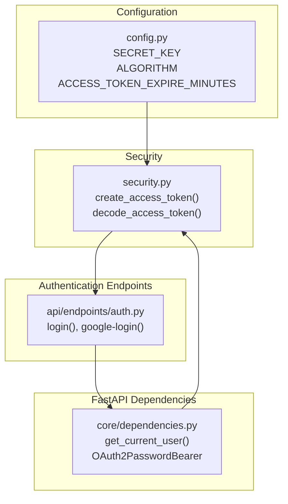
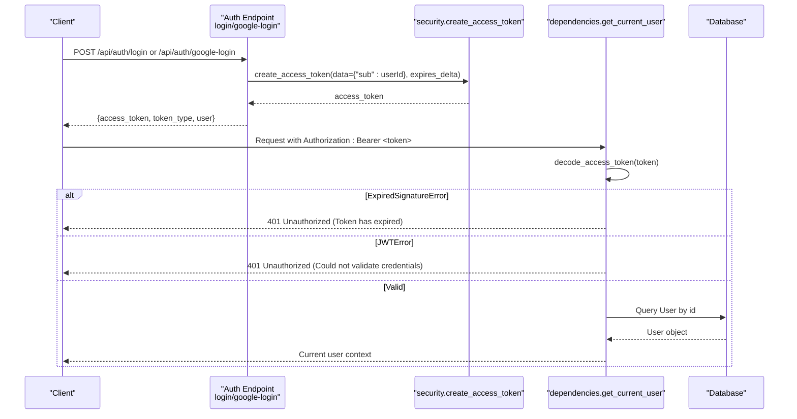
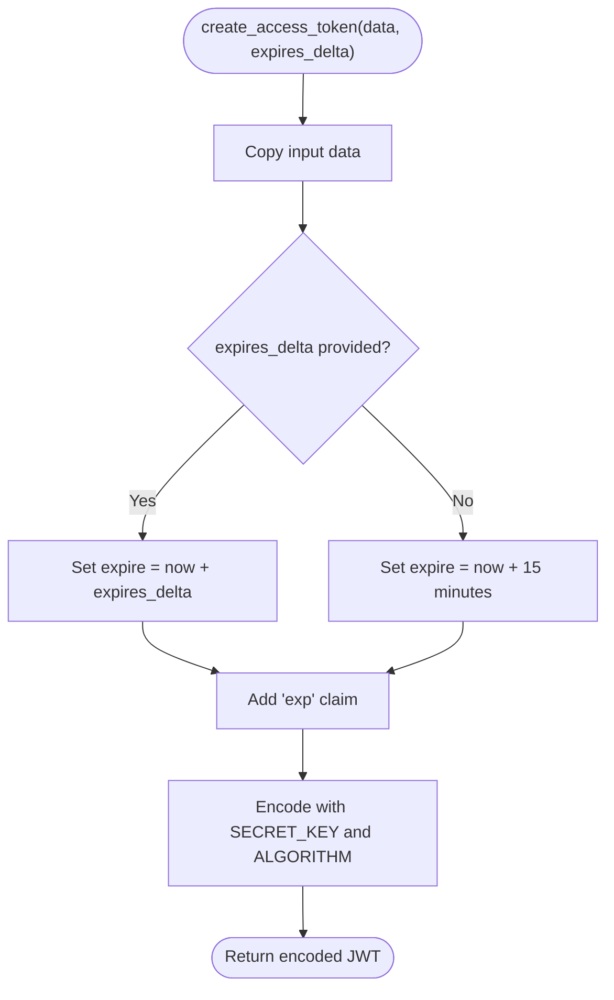
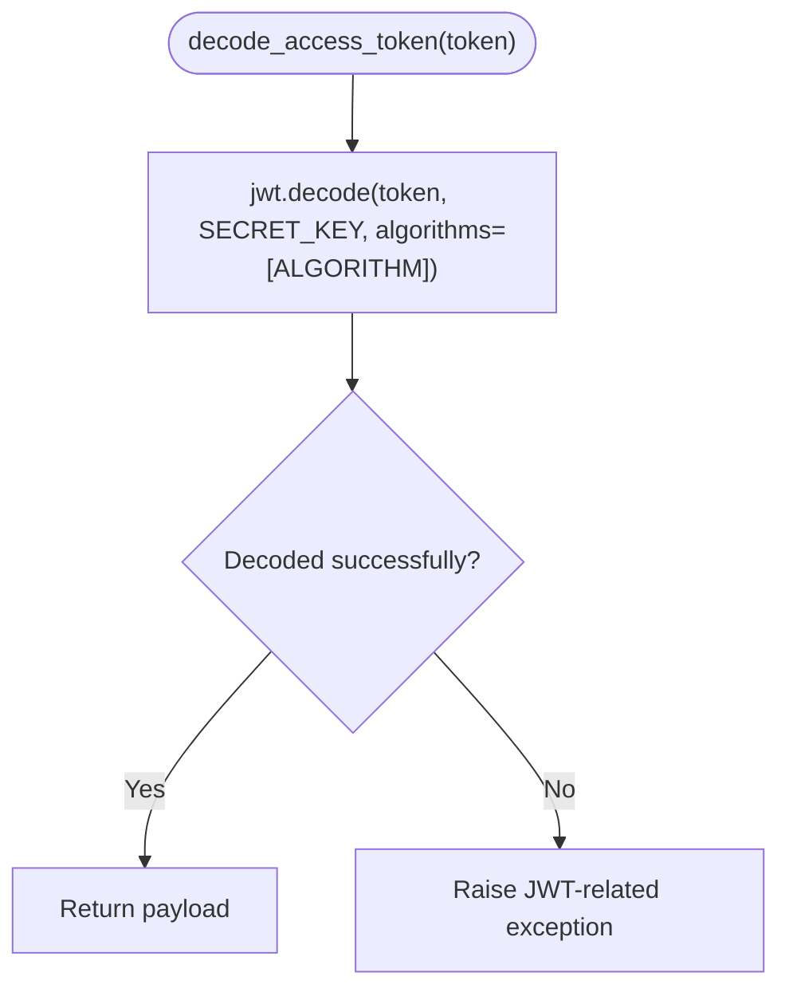
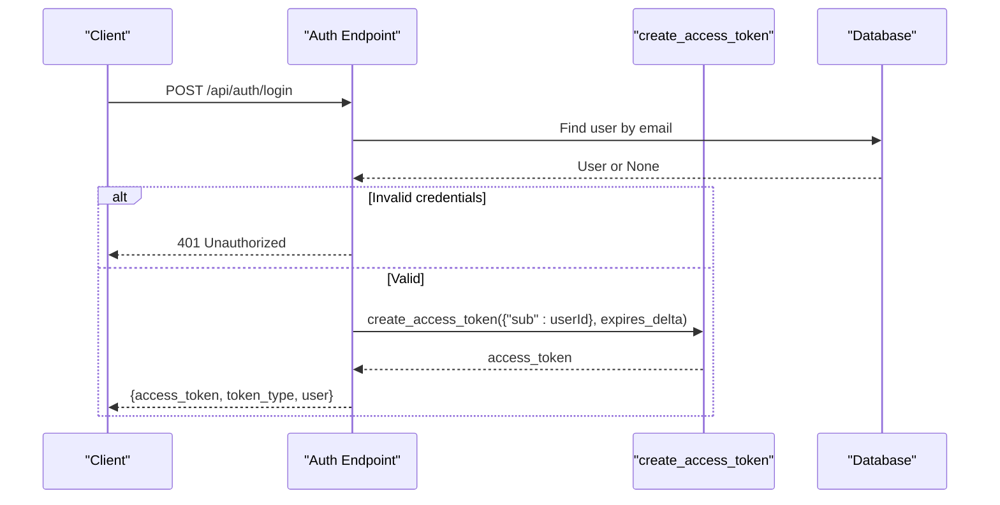
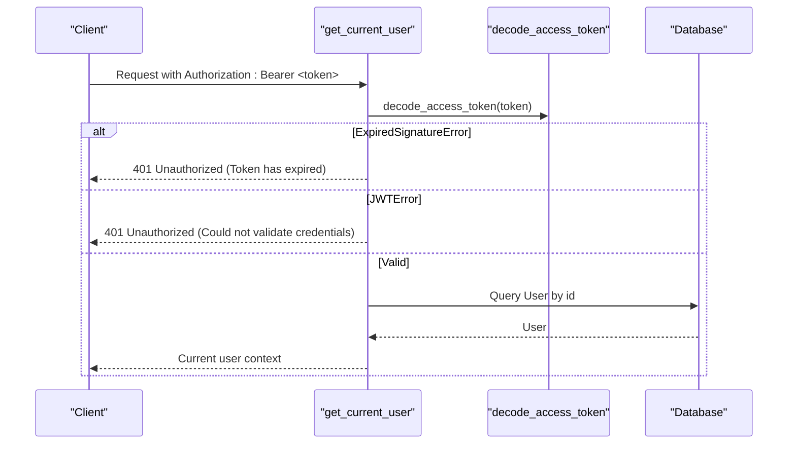
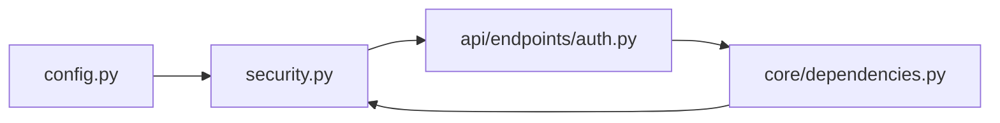

# JWT Token Management

<cite>
**Referenced Files in This Document**   
- [security.py](file://app/core/security.py)
- [config.py](file://app/core/config.py)
- [auth.py](file://app/api/endpoints/auth.py)
- [dependencies.py](file://app/core/dependencies.py)
- [requirements.txt](file://requirements.txt)
</cite>

## Table of Contents
1. [Introduction](#introduction)
2. [Project Structure](#project-structure)
3. [Core Components](#core-components)
4. [Architecture Overview](#architecture-overview)
5. [Detailed Component Analysis](#detailed-component-analysis)
6. [Dependency Analysis](#dependency-analysis)
7. [Performance Considerations](#performance-considerations)
8. [Troubleshooting Guide](#troubleshooting-guide)
9. [Conclusion](#conclusion)
10. [Appendices](#appendices)

## Introduction
This document explains how the Lekhani authentication system manages JSON Web Tokens (JWT). It focuses on access token creation using python-jose, payload structure, expiration handling, algorithm configuration, decoding, error handling for expired tokens, and integration with FastAPI dependencies. It also provides guidance on custom dependency injection for protected routes, token validation middleware patterns, refresh strategies, blacklisting mechanisms, and performance considerations for high-traffic scenarios.

## Project Structure
The JWT-related logic is implemented across a small set of focused modules:
- Security utilities for token creation and decoding
- Configuration for secrets, algorithms, and token lifetime
- Authentication endpoints that issue tokens
- FastAPI dependencies that decode and validate tokens per request

**Diagram sources**
- [security.py:19-32](file://app/core/security.py#L19-L32)
- [config.py:17-23](file://app/core/config.py#L17-L23)
- [auth.py:107-120](file://app/api/endpoints/auth.py#L107-L120)
- [dependencies.py:10-39](file://app/core/dependencies.py#L10-L39)

**Section sources**
- [security.py:1-34](file://app/core/security.py#L1-L34)
- [config.py:1-48](file://app/core/config.py#L1-L48)
- [auth.py:1-128](file://app/api/endpoints/auth.py#L1-L128)
- [dependencies.py:1-53](file://app/core/dependencies.py#L1-L53)

## Core Components
- Token creation and decoding are centralized in security utilities.
- Configuration defines the signing secret, algorithm, and default token lifetime.
- Authentication endpoints create tokens after successful login or Google OAuth flow.
- FastAPI dependencies extract and validate tokens from incoming requests.

Key responsibilities:
- Create signed JWTs with an exp claim and user identifier.
- Decode and verify signatures, propagating specific errors for expiration and invalid tokens.
- Provide reusable FastAPI dependencies to protect routes by resolving the current user from the token.

**Section sources**
- [security.py:19-32](file://app/core/security.py#L19-L32)
- [config.py:17-23](file://app/core/config.py#L17-L23)
- [auth.py:78-87](file://app/api/endpoints/auth.py#L78-L87)
- [auth.py:112-120](file://app/api/endpoints/auth.py#L112-L120)
- [dependencies.py:13-39](file://app/core/dependencies.py#L13-L39)

## Architecture Overview
The JWT flow integrates FastAPI’s dependency injection with python-jose for secure token handling.

**Diagram sources**
- [auth.py:107-120](file://app/api/endpoints/auth.py#L107-L120)
- [auth.py:78-87](file://app/api/endpoints/auth.py#L78-L87)
- [security.py:19-32](file://app/core/security.py#L19-L32)
- [dependencies.py:13-39](file://app/core/dependencies.py#L13-L39)

## Detailed Component Analysis

### Access Token Creation: create_access_token
Purpose:
- Build a JWT payload containing the user identifier and an expiration timestamp.
- Sign the token using the configured secret and algorithm.

Parameters:
- data: dict — Payload fields to include; typically contains the user identifier under the sub claim.
- expires_delta: Optional[timedelta] — Expiration duration; defaults to 15 minutes if not provided.

Return value:
- str — The encoded JWT string.

Implementation highlights:
- Copies input data to avoid mutation.
- Adds an exp claim based on current UTC time plus the provided or default delta.
- Encodes using settings.SECRET_KEY and settings.ALGORITHM.

Usage patterns:
- Called in login and Google login endpoints with a timedelta derived from ACCESS_TOKEN_EXPIRE_MINUTES.

**Diagram sources**
- [security.py:19-27](file://app/core/security.py#L19-L27)

**Section sources**
- [security.py:19-27](file://app/core/security.py#L19-L27)
- [auth.py:78-87](file://app/api/endpoints/auth.py#L78-L87)
- [auth.py:112-120](file://app/api/endpoints/auth.py#L112-L120)

### Token Decoding and Error Handling: decode_access_token
Purpose:
- Verify and decode a JWT using the configured secret and algorithm.
- Propagate jose-specific exceptions so callers can handle them distinctly.

Behavior:
- Calls jwt.decode with the token, settings.SECRET_KEY, and algorithms=[settings.ALGORITHM].
- Returns the decoded payload dict.

Error handling:
- ExpiredSignatureError is raised when the token is expired; handled upstream to return a clear 401 response.
- Other JWTError instances indicate malformed or tampered tokens; handled upstream to return a generic unauthorized response.

**Diagram sources**
- [security.py:29-32](file://app/core/security.py#L29-L32)

**Section sources**
- [security.py:29-32](file://app/core/security.py#L29-L32)
- [dependencies.py:19-28](file://app/core/dependencies.py#L19-L28)

### Configuration: SECRET_KEY, ALGORITHM, and Token Lifetime
- SECRET_KEY: Secret used to sign and verify tokens. Loaded from environment or fallback default.
- ALGORITHM: Signing algorithm; HS256 by default.
- ACCESS_TOKEN_EXPIRE_MINUTES: Default token lifetime used by endpoints.

Recommendations:
- Always override SECRET_KEY via environment variables in production.
- Keep ALGORITHM consistent between creation and verification.
- Tune ACCESS_TOKEN_EXPIRE_MINUTES according to security requirements and UX needs.

**Section sources**
- [config.py:17-23](file://app/core/config.py#L17-L23)

### Authentication Endpoints: Login and Google Login
Login:
- Validates user credentials.
- Creates an access token with sub=user.id and a configurable expiration.
- Returns access_token, token_type, and user info.

Google Login:
- Verifies the Google ID token audience against GOOGLE_CLIENT_ID.
- Resolves or creates a local user record.
- Issues an access token with sub=user.id and a configurable expiration.

Both flows use create_access_token with a timedelta derived from ACCESS_TOKEN_EXPIRE_MINUTES.

**Diagram sources**
- [auth.py:107-120](file://app/api/endpoints/auth.py#L107-L120)
- [security.py:19-27](file://app/core/security.py#L19-L27)

**Section sources**
- [auth.py:107-120](file://app/api/endpoints/auth.py#L107-L120)
- [auth.py:18-87](file://app/api/endpoints/auth.py#L18-L87)

### FastAPI Dependency Injection: get_current_user
Purpose:
- Extract the bearer token from the request.
- Decode and validate it.
- Resolve the current user from the database using the sub claim.

Behavior:
- Uses OAuth2PasswordBearer to read the Authorization header.
- Catches ExpiredSignatureError and JWTError to return appropriate 401 responses.
- Converts sub to integer and queries the database for the corresponding user.

Optional variant:
- get_current_user_optional returns None instead of raising when no token is present or invalid, enabling partially public routes.

**Diagram sources**
- [dependencies.py:13-39](file://app/core/dependencies.py#L13-L39)
- [security.py:29-32](file://app/core/security.py#L29-L32)

**Section sources**
- [dependencies.py:10-53](file://app/core/dependencies.py#L10-L53)

### Example Usage Patterns
- Protected route example:
  - Define a route and inject current_user via Depends(get_current_user).
  - Use current_user to enforce authorization checks within the handler.
- Optional protection:
  - Use get_current_user_optional to allow anonymous access while still supporting authenticated users.

Note: These patterns are applied throughout the application by depending on get_current_user or get_current_user_optional where needed.

**Section sources**
- [dependencies.py:13-53](file://app/core/dependencies.py#L13-L53)

## Dependency Analysis
The following diagram shows the relationships among core modules involved in JWT management.

**Diagram sources**
- [config.py:17-23](file://app/core/config.py#L17-L23)
- [security.py:19-32](file://app/core/security.py#L19-L32)
- [auth.py:10-12](file://app/api/endpoints/auth.py#L10-L12)
- [dependencies.py:6-10](file://app/core/dependencies.py#L6-L10)

**Section sources**
- [security.py:1-34](file://app/core/security.py#L1-L34)
- [config.py:1-48](file://app/core/config.py#L1-L48)
- [auth.py:1-128](file://app/api/endpoints/auth.py#L1-L128)
- [dependencies.py:1-53](file://app/core/dependencies.py#L1-L53)

## Performance Considerations
- Token size: Keep payloads minimal (e.g., only sub) to reduce network overhead.
- Algorithm choice: HS256 is fast and suitable for symmetric signing; ensure SECRET_KEY is securely managed.
- Expiration tuning: Shorter lifetimes improve security but increase client re-auth traffic; balance with refresh strategies.
- Database lookups: get_current_user performs a DB query per request; consider caching user profiles at the edge or application layer if read-heavy.
- Concurrency: FastAPI’s async endpoints scale well; ensure DB connections are pooled appropriately.

[No sources needed since this section provides general guidance]

## Troubleshooting Guide
Common issues and resolutions:
- Expired tokens:
  - Symptom: 401 Unauthorized with “Token has expired”.
  - Cause: Token exceeded its exp lifetime.
  - Resolution: Implement token refresh; instruct clients to obtain a new access token.
- Invalid or tampered tokens:
  - Symptom: 401 Unauthorized with “Could not validate credentials”.
  - Cause: Malformed token, wrong secret, or unsupported algorithm.
  - Resolution: Ensure SECRET_KEY and ALGORITHM match between creation and verification; validate token format.
- Missing or incorrect Authorization header:
  - Symptom: 401 Unauthorized.
  - Resolution: Ensure clients send Authorization: Bearer <token>.

Operational tips:
- Log token validation failures without exposing sensitive details.
- Monitor 401 rates to detect potential token misuse or misconfiguration.

**Section sources**
- [dependencies.py:19-28](file://app/core/dependencies.py#L19-L28)

## Conclusion
The Lekhani backend implements JWT-based authentication using python-jose with clear separation of concerns:
- Token creation and decoding are encapsulated in security utilities.
- Configuration centralizes secrets, algorithm, and lifetime.
- Authentication endpoints issue tokens after verifying credentials or Google OAuth.
- FastAPI dependencies provide robust, reusable token validation and user resolution.

For production readiness, adopt token refresh strategies, implement token blacklisting where necessary, and apply performance optimizations such as caching and connection pooling.

[No sources needed since this section summarizes without analyzing specific files]

## Appendices

### API Reference: Token Endpoints
- POST /api/auth/login
  - Purpose: Authenticate a user and return an access token.
  - Response includes access_token, token_type, and user information.
- POST /api/auth/google-login
  - Purpose: Authenticate via Google and return an access token.
  - Response includes access_token, token_type, and user information.

**Section sources**
- [auth.py:107-120](file://app/api/endpoints/auth.py#L107-L120)
- [auth.py:18-87](file://app/api/endpoints/auth.py#L18-L87)

### Best Practices for Token Security
- Never hardcode SECRET_KEY; load from environment.
- Use strong, unique secrets per environment.
- Keep ALGORITHM consistent and up-to-date.
- Minimize claims in the token payload.
- Enforce HTTPS for all token exchanges.
- Rotate secrets periodically and invalidate existing tokens as needed.

[No sources needed since this section provides general guidance]

### Token Refresh Strategies
Recommended approach:
- Issue short-lived access tokens and longer-lived refresh tokens.
- Store refresh tokens securely (e.g., HttpOnly cookies or secure storage).
- On access token expiry, exchange the refresh token for a new access token.
- Optionally rotate refresh tokens and revoke them upon logout.

[No sources needed since this section provides general guidance]

### Blacklisting Mechanisms
To support immediate revocation:
- Maintain a blacklist store (e.g., Redis) keyed by token identifiers or hashes.
- On logout or suspicious activity, add token identifiers to the blacklist.
- In get_current_user, check the blacklist before granting access.
- Periodically purge expired entries to manage memory usage.

[No sources needed since this section provides general guidance]

### Dependencies and Libraries
- python-jose[cryptography]: Used for JWT encoding/decoding.
- passlib[bcrypt]: Used for password hashing.
- FastAPI: Provides routing, dependency injection, and HTTP utilities.

**Section sources**
- [requirements.txt:10-12](file://requirements.txt#L10-L12)