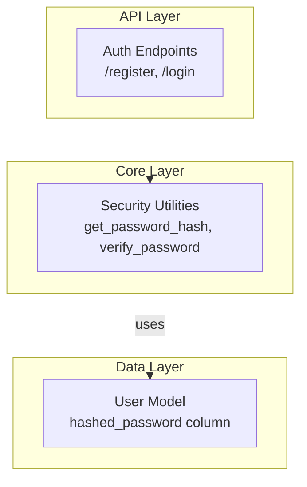
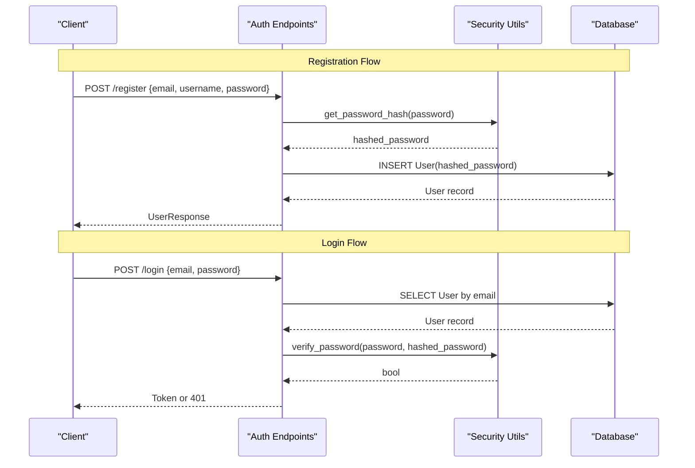
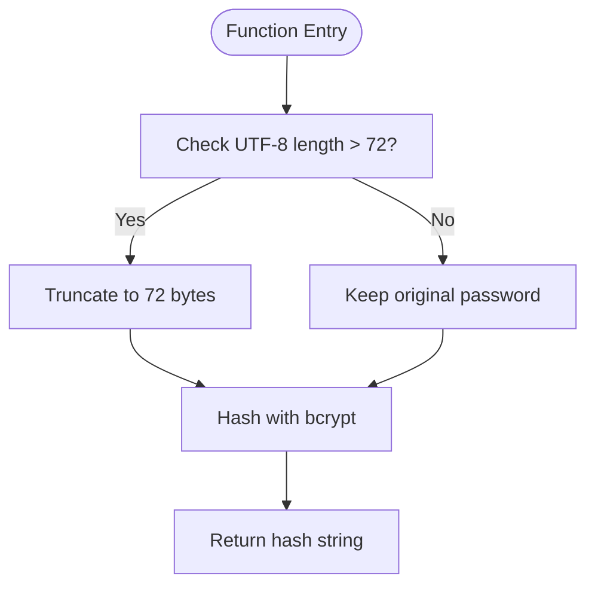
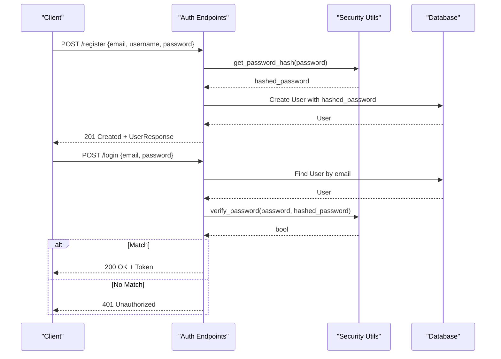
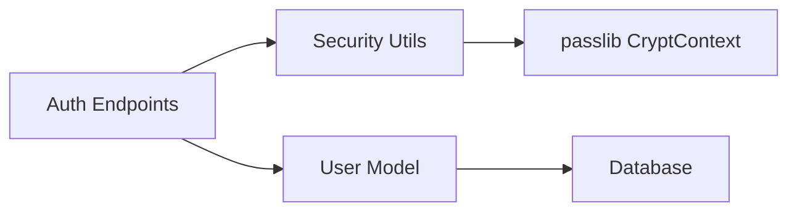

# Password Security

<cite>
**Referenced Files in This Document**
- [security.py](file://app/core/security.py)
- [auth.py](file://app/api/endpoints/auth.py)
- [user.py](file://app/models/user.py)
- [user.py (schemas)](file://app/schemas/user.py)
</cite>

## Table of Contents
1. [Introduction](#introduction)
2. [Project Structure](#project-structure)
3. [Core Components](#core-components)
4. [Architecture Overview](#architecture-overview)
5. [Detailed Component Analysis](#detailed-component-analysis)
6. [Dependency Analysis](#dependency-analysis)
7. [Performance Considerations](#performance-considerations)
8. [Troubleshooting Guide](#troubleshooting-guide)
9. [Conclusion](#conclusion)

## Introduction
This document explains the password security implementation in the Lekhani system. It focuses on bcrypt hashing via passlib CryptContext, secure storage practices, and integration points with user registration and login flows. It also covers handling long passwords under bcrypt’s 72-byte UTF-8 limit, error handling, timing attack mitigations, and debugging techniques for password-related issues.

## Project Structure
Password security is implemented across a small set of focused modules:
- Core security utilities provide hashing and verification functions.
- API endpoints integrate these utilities into registration and login workflows.
- Data models define where hashed passwords are persisted.
- Schemas validate incoming request payloads.

**Diagram sources**
- [auth.py:89-120](file://app/api/endpoints/auth.py#L89-L120)
- [security.py:10-17](file://app/core/security.py#L10-L17)
- [user.py:6-17](file://app/models/user.py#L6-L17)

**Section sources**
- [auth.py:1-128](file://app/api/endpoints/auth.py#L1-L128)
- [security.py:1-34](file://app/core/security.py#L1-L34)
- [user.py:1-28](file://app/models/user.py#L1-L28)
- [user.py (schemas):1-37](file://app/schemas/user.py#L1-L37)

## Core Components
- Bcrypt context initialization using passlib CryptContext.
- Password hashing function that enforces bcrypt’s 72-byte UTF-8 limit by truncation.
- Password verification function delegating to passlib.
- Integration in registration and login endpoints.

Key responsibilities:
- Hashing: Convert plain text passwords to bcrypt hashes before storage.
- Verification: Compare provided plaintext against stored hash securely.
- Storage: Persist only the bcrypt hash string in the database.

**Section sources**
- [security.py:5-17](file://app/core/security.py#L5-L17)
- [auth.py:89-120](file://app/api/endpoints/auth.py#L89-L120)
- [user.py:6-17](file://app/models/user.py#L6-L17)

## Architecture Overview
The password flow integrates FastAPI endpoints, core security utilities, and SQLAlchemy models.

**Diagram sources**
- [auth.py:89-120](file://app/api/endpoints/auth.py#L89-L120)
- [security.py:10-17](file://app/core/security.py#L10-L17)
- [user.py:6-17](file://app/models/user.py#L6-L17)

## Detailed Component Analysis

### Password Hashing and Verification Functions
- get_password_hash(password: str) -> str
  - Purpose: Generate a bcrypt hash from a plaintext password.
  - Behavior: If the password exceeds 72 bytes when encoded as UTF-8, it is truncated to the first 72 bytes before hashing.
  - Return: A bcrypt hash string suitable for storage.
  - Error Handling: No explicit exceptions; relies on passlib to raise errors if invalid inputs are provided.

- verify_password(plain_password: str, hashed_password: str) -> bool
  - Purpose: Verify a plaintext password against a stored bcrypt hash.
  - Behavior: Delegates to passlib CryptContext.verify.
  - Return: True if the password matches, False otherwise.
  - Error Handling: No explicit exceptions; relies on passlib to raise errors if invalid inputs are provided.

**Diagram sources**
- [security.py:13-17](file://app/core/security.py#L13-L17)

**Section sources**
- [security.py:10-17](file://app/core/security.py#L10-L17)

### Integration With Registration and Login Flows
- Registration (/register)
  - Validates input schemas (email, username, password).
  - Hashes the password using get_password_hash.
  - Persists the hashed password in the User model.
  - Returns the created user response.

- Login (/login)
  - Retrieves the user by email.
  - Uses verify_password to compare the provided password with the stored hash.
  - On success, returns an access token; on failure, returns 401 Unauthorized.

**Diagram sources**
- [auth.py:89-120](file://app/api/endpoints/auth.py#L89-L120)
- [security.py:10-17](file://app/core/security.py#L10-L17)
- [user.py:6-17](file://app/models/user.py#L6-L17)

**Section sources**
- [auth.py:89-120](file://app/api/endpoints/auth.py#L89-L120)
- [user.py (schemas):10-15](file://app/schemas/user.py#L10-L15)
- [user.py:6-17](file://app/models/user.py#L6-L17)

### Password Strength Validation
- Current state: The application does not implement explicit password strength validation beyond schema-level presence checks.
- Recommendation: Add server-side validation rules (e.g., minimum length, complexity requirements) in the UserCreate schema or a dedicated validator before calling get_password_hash.

[No sources needed since this section provides general guidance]

### Salt Generation and Secure Storage Practices
- Salt generation: Handled automatically by bcrypt via passlib CryptContext. Each call to get_password_hash generates a unique salt embedded in the resulting hash string.
- Secure storage: Only the final bcrypt hash string is stored in the database. Plaintext passwords are never persisted.

**Section sources**
- [security.py:5-17](file://app/core/security.py#L5-L17)
- [user.py:6-17](file://app/models/user.py#L6-L17)

### Handling Long Passwords (72-Byte UTF-8 Limit)
- Behavior: If a password exceeds 72 bytes when encoded as UTF-8, it is truncated to exactly 72 bytes prior to hashing.
- Implications:
  - Two different long passwords may hash to the same value if their first 72 bytes are identical after UTF-8 encoding.
  - This reduces effective entropy for very long passwords.
- Mitigation options:
  - Enforce maximum password length at the schema layer to avoid truncation surprises.
  - Alternatively, pre-hash with a strong algorithm (e.g., SHA-256) and then apply bcrypt to the digest, but ensure consistent migration and testing.

**Section sources**
- [security.py:13-17](file://app/core/security.py#L13-L17)

### Migration Strategies for Existing Hashed Passwords
- Scenario: You need to migrate existing hashes to a new scheme or adjust behavior (e.g., stop truncating long passwords).
- Strategy:
  - During login, detect legacy hashes and rehash them with updated parameters.
  - Store the new hash and invalidate old ones on next successful authentication.
  - Ensure backward compatibility during transition.
- Note: Since current code uses bcrypt directly without version tags, migrations should be carefully tested to maintain compatibility with existing hashes.

[No sources needed since this section provides general guidance]

### Timing Attack Mitigations
- Current implementation: Uses passlib’s verify which internally performs constant-time comparisons for bcrypt.
- Additional recommendations:
  - Avoid early returns based on partial checks in custom logic around password verification.
  - Do not log sensitive data such as passwords or hashes.
  - Use standardized error responses for both invalid credentials and internal failures to prevent information leakage.

**Section sources**
- [security.py:10-11](file://app/core/security.py#L10-L11)
- [auth.py:107-120](file://app/api/endpoints/auth.py#L107-L120)

### Debugging Techniques for Password-Related Issues
- Logging:
  - Log high-level events (e.g., login attempts, failures) without including sensitive details like passwords or full hashes.
  - Use structured logging to capture request IDs and timestamps for correlation.
- Diagnostics:
  - Validate that the stored hash starts with the expected bcrypt prefix.
  - Confirm that the password encoding path (UTF-8) behaves as expected for edge cases.
- Testing:
  - Write unit tests for get_password_hash and verify_password covering normal, empty, and long passwords.
  - Include negative tests for malformed inputs and unexpected types.

**Section sources**
- [auth.py:1-14](file://app/api/endpoints/auth.py#L1-L14)
- [security.py:10-17](file://app/core/security.py#L10-L17)

## Dependency Analysis
The following diagram shows how components depend on each other for password operations.

**Diagram sources**
- [auth.py:89-120](file://app/api/endpoints/auth.py#L89-L120)
- [security.py:5-17](file://app/core/security.py#L5-L17)
- [user.py:6-17](file://app/models/user.py#L6-L17)

**Section sources**
- [auth.py:89-120](file://app/api/endpoints/auth.py#L89-L120)
- [security.py:5-17](file://app/core/security.py#L5-L17)
- [user.py:6-17](file://app/models/user.py#L6-L17)

## Performance Considerations
- bcrypt cost factor: Adjust passlib’s bcrypt cost parameter to balance security and performance according to your hardware and traffic patterns.
- Database indexing: Avoid indexing hashed_password; it is large and rarely queried.
- Request throughput: Consider rate limiting on authentication endpoints to mitigate brute-force attempts.

[No sources needed since this section provides general guidance]

## Troubleshooting Guide
Common issues and resolutions:
- Invalid JSON body in Google login:
  - Symptom: 400 Bad Request with message about invalid or missing JSON body.
  - Resolution: Ensure the client sends a valid JSON object containing the required fields.
- Missing Google token:
  - Symptom: 400 Bad Request indicating missing token.
  - Resolution: Verify the client includes the id_token field in the request payload.
- Audience mismatch:
  - Symptom: 401 Unauthorized due to audience mismatch.
  - Resolution: Confirm GOOGLE_CLIENT_ID configuration matches the token’s audience.
- Email already registered:
  - Symptom: 400 Bad Request with duplicate email message.
  - Resolution: Prompt the user to use a different email or sign in.
- Username already taken:
  - Symptom: 400 Bad Request with duplicate username message.
  - Resolution: Prompt the user to choose a different username.
- Incorrect email or password:
  - Symptom: 401 Unauthorized on login.
  - Resolution: Encourage users to reset their password or verify credentials.

**Section sources**
- [auth.py:18-87](file://app/api/endpoints/auth.py#L18-L87)
- [auth.py:89-120](file://app/api/endpoints/auth.py#L89-L120)

## Conclusion
The Lekhani system implements password security using bcrypt via passlib CryptContext. Passwords are hashed with automatic salt generation and stored securely as hash strings. The current implementation handles long passwords by truncating to 72 UTF-8 bytes before hashing. Registration and login endpoints integrate these utilities to create and verify users. To strengthen security further, consider adding explicit password strength validation, enforcing maximum password lengths, tuning bcrypt cost factors, and implementing robust migration strategies for evolving hashing schemes.