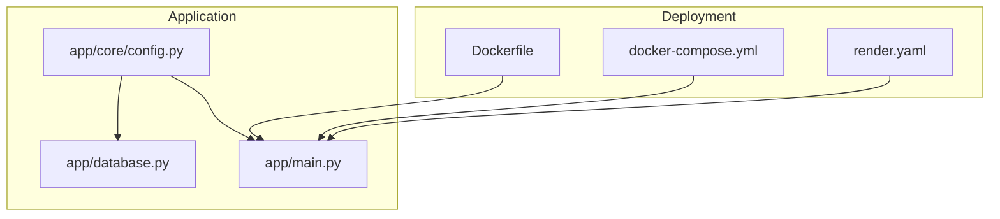
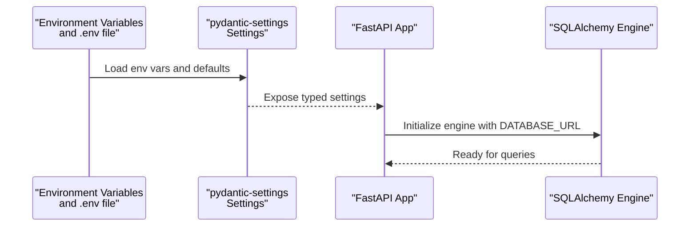
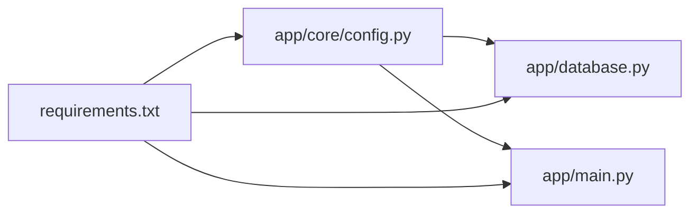

# Configuration Management

<cite>
**Referenced Files in This Document**
- [config.py](file://app/core/config.py)
- [database.py](file://app/database.py)
- [main.py](file://app/main.py)
- [Dockerfile](file://Dockerfile)
- [docker-compose.yml](file://docker-compose.yml)
- [render.yaml](file://render.yaml)
- [requirements.txt](file://requirements.txt)
</cite>

## Table of Contents
1. [Introduction](#introduction)
2. [Project Structure](#project-structure)
3. [Core Components](#core-components)
4. [Architecture Overview](#architecture-overview)
5. [Detailed Component Analysis](#detailed-component-analysis)
6. [Dependency Analysis](#dependency-analysis)
7. [Performance Considerations](#performance-considerations)
8. [Troubleshooting Guide](#troubleshooting-guide)
9. [Conclusion](#conclusion)

## Introduction
This document explains Lekhani’s configuration management system, focusing on environment variable handling with pydantic-settings, database connection configuration for SQLite (development) and PostgreSQL (production), application settings organization, and deployment configurations for local development, Docker, and Render. It also covers validation behavior, error handling for missing or invalid configuration, and best practices for managing configuration across team environments.

## Project Structure
Configuration-related code is centralized under app/core/config.py and consumed by the FastAPI application entrypoint and database layer. Deployment manifests are provided for Docker and Render.

**Diagram sources**
- [config.py:1-48](file://app/core/config.py#L1-L48)
- [database.py:1-27](file://app/database.py#L1-L27)
- [main.py:1-89](file://app/main.py#L1-L89)
- [Dockerfile:1-32](file://Dockerfile#L1-L32)
- [docker-compose.yml:1-26](file://docker-compose.yml#L1-L26)
- [render.yaml:1-31](file://render.yaml#L1-L31)

**Section sources**
- [config.py:1-48](file://app/core/config.py#L1-L48)
- [database.py:1-27](file://app/database.py#L1-L27)
- [main.py:1-89](file://app/main.py#L1-L89)
- [Dockerfile:1-32](file://Dockerfile#L1-L32)
- [docker-compose.yml:1-26](file://docker-compose.yml#L1-L26)
- [render.yaml:1-31](file://render.yaml#L1-L31)

## Core Components
- Settings model using pydantic-settings to load environment variables and defaults.
- Database engine initialization that adapts to SQLite vs PostgreSQL based on DATABASE_URL.
- Application bootstrap that uses settings for CORS, host/port, and metadata.

Key responsibilities:
- Centralize all configuration in a single typed object.
- Provide sensible defaults for local development while allowing overrides via environment variables.
- Ensure secure handling of secrets through environment injection at runtime.

**Section sources**
- [config.py:1-48](file://app/core/config.py#L1-L48)
- [database.py:1-27](file://app/database.py#L1-L27)
- [main.py:33-44](file://app/main.py#L33-L44)

## Architecture Overview
The configuration flows from environment variables into a typed settings object, which is then used by the database layer and the FastAPI application.

**Diagram sources**
- [config.py:1-48](file://app/core/config.py#L1-L48)
- [database.py:10-15](file://app/database.py#L10-L15)
- [main.py:33-44](file://app/main.py#L33-L44)

## Detailed Component Analysis

### Settings Model (pydantic-settings)
- Purpose: Define strongly-typed configuration with defaults and environment overrides.
- Behavior:
  - Loads values from environment variables when present; otherwise falls back to defaults.
  - Reads from a .env file located relative to the project root.
  - Ignores unknown fields to avoid crashes due to extra variables.

Important fields:
- Application identity and pagination: app_name, items_per_page.
- Debug flag derived from DEBUG environment variable.
- Database URL defaulting to SQLite for local development.
- Security: SECRET_KEY, ALGORITHM, ACCESS_TOKEN_EXPIRE_MINUTES.
- OAuth: GOOGLE_CLIENT_ID.
- Frontend URL for public links.
- CORS origins list.
- Server HOST and PORT.

Validation and error handling:
- pydantic-settings validates types and raises errors if values cannot be coerced.
- Missing required environment variables will cause startup failures, which is desirable for production.

Security considerations:
- SECRET_KEY should never be committed; inject via environment at runtime.
- GOOGLE_CLIENT_ID should be set per environment.

Best practices:
- Keep defaults safe for local use but enforce non-defaults in production via environment.
- Use explicit environment variable names and document them.

**Section sources**
- [config.py:1-48](file://app/core/config.py#L1-L48)

### Database Connection Configuration
- Purpose: Create SQLAlchemy engine and session factory based on DATABASE_URL.
- Behavior:
  - Detects SQLite URLs and sets connect_args to allow multi-threaded access.
  - Enables pool_pre_ping and pool_recycle for robustness.
  - Provides a dependency get_db() for request-scoped sessions.

Environment-specific behavior:
- Development: Default SQLite path is used unless overridden.
- Production: Set DATABASE_URL to a PostgreSQL connection string.

Error handling:
- Invalid DATABASE_URL or connection issues surface during engine creation or first query.

Recommendations:
- For PostgreSQL, ensure psycopg2-binary is installed (already included).
- Tune pool size and timeouts according to workload.

**Section sources**
- [database.py:1-27](file://app/database.py#L1-L27)

### Application Bootstrap and Middleware
- Uses settings.app_name for FastAPI title.
- Configures CORS with configured ALLOW_ORIGINS and an additional regex for Vercel previews.
- Adds security headers and private network support via custom middlewares.
- Host and port come from settings.HOST and settings.PORT.

Operational notes:
- In containerized environments, ensure HOST is bound to 0.0.0.0 and PORT matches the exposed port.

**Section sources**
- [main.py:33-44](file://app/main.py#L33-L44)
- [main.py:47-79](file://app/main.py#L47-L79)
- [main.py:87-89](file://app/main.py#L87-L89)

### Environment-Specific Overrides and Defaults
- Local development:
  - SQLite database file path is auto-generated under the repository root.
  - DEBUG defaults to true.
  - CORS allows localhost and common preview domains.
- Production:
  - DATABASE_URL must point to PostgreSQL.
  - SECRET_KEY must be generated and injected securely.
  - DEBUG should be false.
  - FRONTEND_URL should match the deployed frontend domain.

Override mechanism:
- Environment variables take precedence over defaults.
- A .env file can be used locally; it is explicitly loaded by the settings configuration.

**Section sources**
- [config.py:5-46](file://app/core/config.py#L5-L46)

### Secure Handling of Sensitive Configuration
- Secrets such as SECRET_KEY and GOOGLE_CLIENT_ID should be provided via environment variables at runtime.
- Avoid hardcoding secrets in source code or committing .env files.
- On Render, SECRET_KEY is generated automatically; GOOGLE_CLIENT_ID is marked unsynced so you can manage it separately.

Recommended practices:
- Rotate secrets periodically.
- Use platform secret managers or environment variable injection mechanisms.
- Validate presence of critical secrets at startup.

**Section sources**
- [config.py:17-29](file://app/core/config.py#L17-L29)
- [render.yaml:18-27](file://render.yaml#L18-L27)

### Configuration Validation and Error Handling
- pydantic-settings enforces type correctness and will raise validation errors for misconfigured values.
- Missing required environment variables result in startup failure, preventing silent misconfiguration.
- Extra environment variables are ignored to reduce friction.

Operational guidance:
- Log and surface configuration errors clearly in CI/CD pipelines.
- Fail fast on invalid DATABASE_URL or missing secrets.

**Section sources**
- [config.py:43-46](file://app/core/config.py#L43-L46)

### Deployment Configurations

#### Docker
- Base image: Python slim.
- Installs dependencies from requirements.txt.
- Exposes port 8000.
- Runs uvicorn with reload enabled for development.

Notes:
- Environment variables are expected to be provided at runtime (e.g., via docker run -e or compose environment).
- The .env file is not copied into the image; inject via runtime environment.

**Section sources**
- [Dockerfile:1-32](file://Dockerfile#L1-L32)

#### Docker Compose
- Builds and runs the backend service.
- Maps port 8000.
- Mounts source code and SQLite database file for persistence and hot reload.
- Sets minimal environment variables.

Notes:
- For PostgreSQL, replace the SQLite volume with a PostgreSQL service and set DATABASE_URL accordingly.

**Section sources**
- [docker-compose.yml:1-26](file://docker-compose.yml#L1-L26)

#### Render
- Defines a managed PostgreSQL database resource.
- Web service configured to build and start the FastAPI app.
- Injects DATABASE_URL from the managed database.
- Generates SECRET_KEY automatically.
- Disables DEBUG and configures FRONTEND_URL.
- Leaves GOOGLE_CLIENT_ID unsynced for manual management.

Notes:
- Ensure GOOGLE_CLIENT_ID is set in Render’s environment variables before deploying.
- Verify CORS includes your production frontend domain.

**Section sources**
- [render.yaml:1-31](file://render.yaml#L1-L31)

### Configuration Hierarchy and Precedence
- Highest priority: Runtime environment variables.
- Next: Values defined in .env file (explicitly loaded by settings).
- Lowest: Hardcoded defaults in the settings model.

Implications:
- Always override critical settings (DATABASE_URL, SECRET_KEY) via environment variables in production.
- Use .env only for local development convenience.

**Section sources**
- [config.py:43-46](file://app/core/config.py#L43-L46)

### Best Practices for Team Environments
- Document required environment variables and their formats.
- Provide example .env.example with placeholder values.
- Enforce non-defaults in CI/CD and production.
- Use separate repositories or secret stores for sensitive values.
- Pin dependency versions and Python version consistently across environments.

[No sources needed since this section provides general guidance]

## Dependency Analysis
Configuration is consumed by both the database layer and the application bootstrap.

**Diagram sources**
- [config.py:1-48](file://app/core/config.py#L1-L48)
- [database.py:1-27](file://app/database.py#L1-L27)
- [main.py:1-89](file://app/main.py#L1-L89)
- [requirements.txt:1-15](file://requirements.txt#L1-L15)

**Section sources**
- [requirements.txt:1-15](file://requirements.txt#L1-L15)

## Performance Considerations
- Database pooling: pool_pre_ping and pool_recycle improve resilience; tune pool_size and max_overflow based on concurrency.
- SQLite limitations: Not suitable for high-concurrency production workloads; prefer PostgreSQL.
- CORS and middleware overhead: Minimal, but keep allowed origins tight to reduce processing.

[No sources needed since this section provides general guidance]

## Troubleshooting Guide
Common issues and resolutions:
- Missing DATABASE_URL:
  - Ensure the environment variable is set to a valid SQLAlchemy URL.
  - For local development, verify the SQLite path exists and is writable.
- Invalid SECRET_KEY:
  - Generate a strong key and inject it via environment variables.
- Google OAuth misconfiguration:
  - Set GOOGLE_CLIENT_ID to a valid client ID for the target environment.
- CORS errors:
  - Add the frontend domain to ALLOW_ORIGINS and ensure allow_origin_regex includes preview deployments if needed.
- Container networking:
  - Confirm HOST is 0.0.0.0 and PORT matches the exposed port in Docker/Render.

Validation tips:
- Start the application and inspect startup logs for configuration errors.
- Use a health check endpoint to validate database connectivity after startup.

**Section sources**
- [config.py:5-46](file://app/core/config.py#L5-L46)
- [database.py:10-15](file://app/database.py#L10-L15)
- [main.py:33-44](file://app/main.py#L33-L44)

## Conclusion
Lekhani’s configuration system leverages pydantic-settings to provide a clear, typed, and validated configuration surface. Defaults enable quick local setup with SQLite, while environment variables drive production behavior, including PostgreSQL connections and secure secrets. Deployment manifests for Docker and Render streamline operations, and following the outlined best practices ensures consistent, secure, and maintainable configuration across environments.