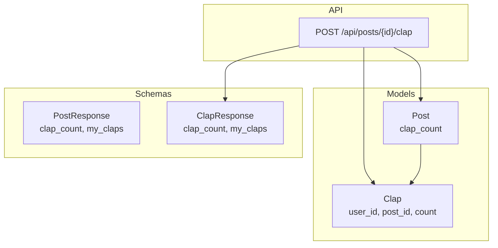
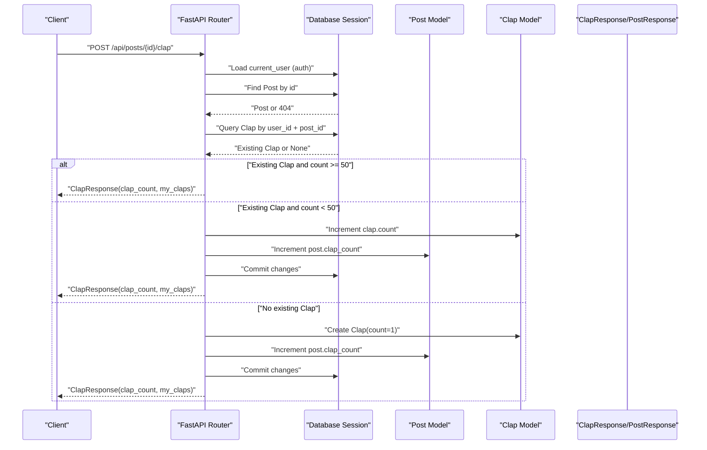
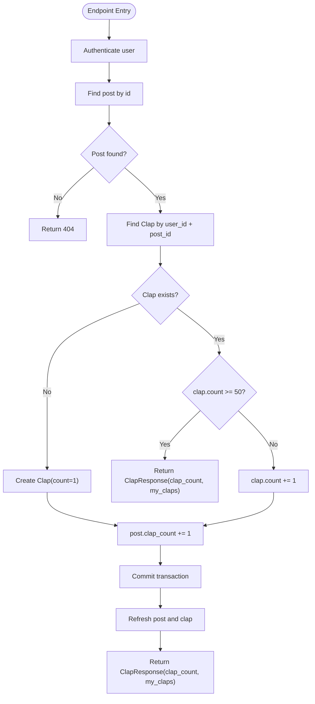
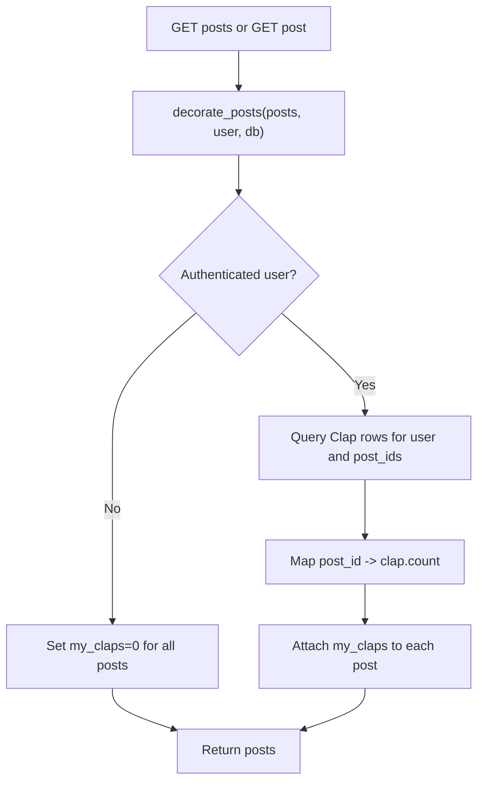
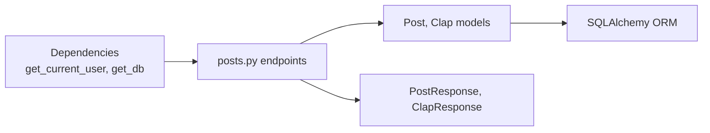

# Clap System

<cite>
**Referenced Files in This Document**
- [clap.py](file://app/models/clap.py)
- [post.py](file://app/models/post.py)
- [posts.py](file://app/api/endpoints/posts.py)
- [post.py](file://app/schemas/post.py)
</cite>

## Table of Contents
1. [Introduction](#introduction)
2. [Project Structure](#project-structure)
3. [Core Components](#core-components)
4. [Architecture Overview](#architecture-overview)
5. [Detailed Component Analysis](#detailed-component-analysis)
6. [Dependency Analysis](#dependency-analysis)
7. [Performance Considerations](#performance-considerations)
8. [Troubleshooting Guide](#troubleshooting-guide)
9. [Conclusion](#conclusion)

## Introduction
This document explains the clap system that allows users to show appreciation for posts. It covers the data model, per-user clap limits (maximum 50 claps per post), the counting mechanism, and the POST /api/posts/{id}/clap endpoint behavior including duplicate prevention, count increment logic, and response format. It also documents how clap data is decorated onto post objects for display and how individual user engagement is tracked. Finally, it addresses error handling, performance considerations for high-engagement posts, and the relationship between clap counts and post popularity metrics.

## Project Structure
The clap feature spans models, API endpoints, and schemas:
- Data model: Clap entity with a unique constraint per user-post pair and a per-record count field.
- Post model: Includes a clap_count column and relationships to claps.
- API endpoint: POST /api/posts/{id}/clap handles clap submission and updates.
- Schemas: PostResponse includes clap_count and my_claps; ClapResponse returns both values.

**Diagram sources**
- [post.py:6-26](file://app/models/post.py#L6-L26)
- [clap.py:7-19](file://app/models/clap.py#L7-L19)
- [posts.py:270-297](file://app/api/endpoints/posts.py#L270-L297)
- [post.py:26-38](file://app/schemas/post.py#L26-L38)
- [post.py:57-59](file://app/schemas/post.py#L57-L59)

**Section sources**
- [post.py:6-26](file://app/models/post.py#L6-L26)
- [clap.py:7-19](file://app/models/clap.py#L7-L19)
- [posts.py:270-297](file://app/api/endpoints/posts.py#L270-L297)
- [post.py:26-38](file://app/schemas/post.py#L26-L38)
- [post.py:57-59](file://app/schemas/post.py#L57-L59)

## Core Components
- Clap model: Stores one row per user-post pair with a count field representing how many claps that user has given to that post. A unique constraint prevents duplicate rows.
- Post model: Holds clap_count as an aggregate indicator of total claps across all users.
- Endpoint: POST /api/posts/{id}/clap enforces authentication, validates post existence, applies per-user limit (max 50), increments counts, and returns updated totals.
- Schemas: PostResponse exposes clap_count and my_claps; ClapResponse returns clap_count and my_claps from the endpoint.

Key behaviors:
- Per-user limit: Each user can give up to 50 claps to a single post.
- Duplicate prevention: The unique constraint on (user_id, post_id) ensures only one record per user-post pair.
- Counting: Both the per-user clap.count and the post.clap_count are incremented when allowed.
- Decoration: When listing or fetching posts, viewer-specific my_claps is attached to each post object.

**Section sources**
- [clap.py:7-19](file://app/models/clap.py#L7-L19)
- [post.py:6-26](file://app/models/post.py#L6-L26)
- [posts.py:61-80](file://app/api/endpoints/posts.py#L61-L80)
- [posts.py:270-297](file://app/api/endpoints/posts.py#L270-L297)
- [post.py:26-38](file://app/schemas/post.py#L26-L38)
- [post.py:57-59](file://app/schemas/post.py#L57-L59)

## Architecture Overview
The clap flow integrates authentication, database operations, and schema serialization.

**Diagram sources**
- [posts.py:270-297](file://app/api/endpoints/posts.py#L270-L297)
- [post.py:6-26](file://app/models/post.py#L6-L26)
- [clap.py:7-19](file://app/models/clap.py#L7-L19)
- [post.py:57-59](file://app/schemas/post.py#L57-L59)

## Detailed Component Analysis

### Clap Model Structure
- Fields:
  - id: Primary key.
  - user_id: Foreign key to users.
  - post_id: Foreign key to posts.
  - count: Integer defaulting to 1; represents how many claps this user gave to this post.
  - created_at, updated_at: Timestamps.
- Constraints:
  - UniqueConstraint(user_id, post_id) ensures one row per user-post pair.
- Relationships:
  - Links to User and Post models.

Complexity:
- Lookup by (user_id, post_id) is O(1) with proper indexing on foreign keys.
- Insertion is O(1) amortized.

Error handling:
- Database-level uniqueness prevents duplicate rows even under concurrent requests.

**Section sources**
- [clap.py:7-19](file://app/models/clap.py#L7-L19)

### Post Model and Clap Integration
- clap_count: Integer column initialized to 0; maintained by the endpoint to reflect total claps across all users.
- Relationship:
  - claps: One-to-many from Post to Clap.

Usage:
- Incremented alongside clap.count when a new clap is allowed.
- Used for popularity metrics and sorting/ranking.

**Section sources**
- [post.py:6-26](file://app/models/post.py#L6-L26)

### POST /api/posts/{id}/clap Endpoint Behavior
Responsibilities:
- Authentication: Requires a logged-in user via dependency injection.
- Validation: Ensures the post exists; otherwise returns 404.
- Duplicate Prevention: Queries existing Clap by user_id and post_id.
- Limit Enforcement: If existing clap.count >= 50, no further increments; returns current state.
- Count Increment Logic:
  - If existing Clap exists and count < 50: increment clap.count by 1.
  - If no existing Clap: create Clap with count = 1.
  - In both allowed cases: increment post.clap_count by 1.
- Response Format: Returns ClapResponse with clap_count and my_claps.

Edge Cases:
- Post not found: 404.
- Already at max claps (50): No-op; returns current clap_count and my_claps.
- Concurrent requests: Database constraints and transactional commit ensure consistency.

**Diagram sources**
- [posts.py:270-297](file://app/api/endpoints/posts.py#L270-L297)

**Section sources**
- [posts.py:270-297](file://app/api/endpoints/posts.py#L270-L297)

### Clap Decoration on Post Objects
When retrieving posts (list, single, user feed), the system attaches viewer-specific clap state:
- For unauthenticated users: my_claps set to 0.
- For authenticated users: queries Clap rows for the current user across requested posts and maps counts by post_id.
- Also sets bookmarked state for UX, but clap decoration focuses on my_claps.

This enables clients to display:
- Total clap_count per post.
- How many claps the current user has already given (my_claps).

**Diagram sources**
- [posts.py:61-80](file://app/api/endpoints/posts.py#L61-L80)

**Section sources**
- [posts.py:61-80](file://app/api/endpoints/posts.py#L61-L80)

### Schemas and Response Formats
- PostResponse:
  - Includes clap_count and my_claps fields for display.
  - Uses from_attributes to map ORM attributes.
- ClapResponse:
  - Contains clap_count and my_claps returned by the clap endpoint.

These schemas standardize the payload for clients and ensure consistent typing.

**Section sources**
- [post.py:26-38](file://app/schemas/post.py#L26-L38)
- [post.py:57-59](file://app/schemas/post.py#L57-L59)

## Dependency Analysis
The clap feature depends on:
- Authentication dependency to resolve current_user.
- Database session dependency for read/write operations.
- Post and Clap models for persistence.
- Pydantic schemas for request/response validation.

**Diagram sources**
- [posts.py:1-15](file://app/api/endpoints/posts.py#L1-L15)
- [post.py:6-26](file://app/models/post.py#L6-L26)
- [clap.py:7-19](file://app/models/clap.py#L7-L19)
- [post.py:26-38](file://app/schemas/post.py#L26-L38)
- [post.py:57-59](file://app/schemas/post.py#L57-L59)

**Section sources**
- [posts.py:1-15](file://app/api/endpoints/posts.py#L1-L15)
- [post.py:6-26](file://app/models/post.py#L6-L26)
- [clap.py:7-19](file://app/models/clap.py#L7-L19)
- [post.py:26-38](file://app/schemas/post.py#L26-L38)
- [post.py:57-59](file://app/schemas/post.py#L57-L59)

## Performance Considerations
- Indexing:
  - Ensure indexes exist on Clap.user_id and Clap.post_id for fast lookups during decoration and clap submission.
- Batch Operations:
  - decorate_posts uses IN clause over post IDs to minimize round-trips when decorating multiple posts.
- Concurrency:
  - Database-level unique constraint prevents duplicate Clap rows.
  - Transactional commit ensures clap.count and post.clap_count remain consistent.
- High-Engagement Posts:
  - Avoid recalculating clap aggregates on every read; rely on clap_count column.
  - Consider caching frequently accessed post clap states if read volume is very high.
- Limits:
  - Enforcing a per-user cap of 50 reduces write amplification and keeps counts bounded.

[No sources needed since this section provides general guidance]

## Troubleshooting Guide
Common issues and resolutions:
- 404 Not Found:
  - Occurs when the post does not exist. Verify the post ID and availability.
- Max Claps Reached:
  - If a user has already given 50 claps to a post, subsequent calls return the same clap_count and my_claps without changing state.
- Unexpected my_claps Value:
  - Ensure the client sends the correct Authorization header so the endpoint resolves the current user.
  - Confirm that decorate_posts is called for list/single post endpoints to populate my_claps.
- Inconsistent clap_count:
  - Check for concurrent writes; the endpoint commits within a transaction. If inconsistencies appear, verify database integrity and application logs.

Operational checks:
- Validate that the unique constraint on Clap(user_id, post_id) exists.
- Confirm that clap_count is incremented only when a clap is allowed (count < 50 or first clap).

**Section sources**
- [posts.py:270-297](file://app/api/endpoints/posts.py#L270-L297)
- [clap.py:7-19](file://app/models/clap.py#L7-L19)

## Conclusion
The clap system provides a simple yet robust mechanism for users to appreciate posts, with clear per-user limits and accurate aggregate counts. The design separates concerns between models, endpoints, and schemas, ensuring maintainability and clarity. By enforcing a maximum of 50 claps per user per post and maintaining clap_count on posts, the system supports both fine-grained user engagement tracking and coarse-grained popularity metrics. Proper decoration of my_claps enables rich UI experiences, while careful attention to indexing and concurrency safeguards performance and correctness under load.