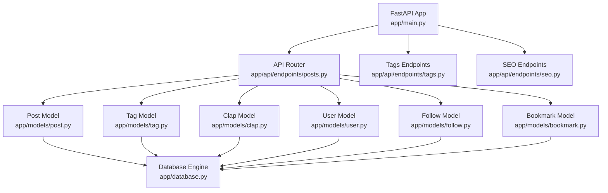
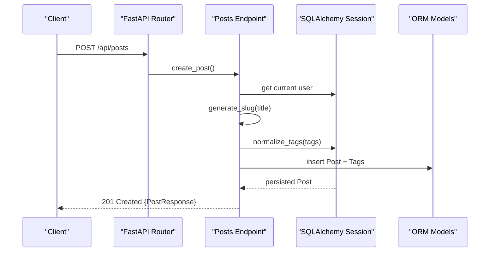
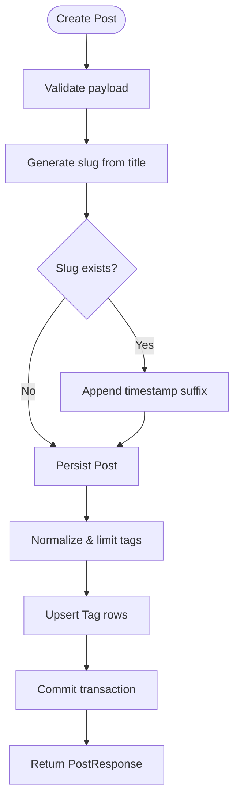
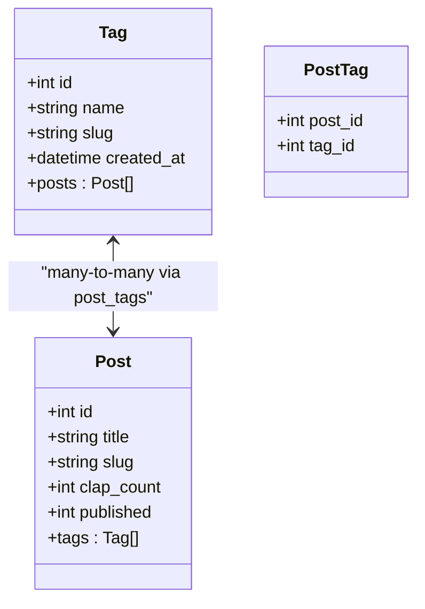
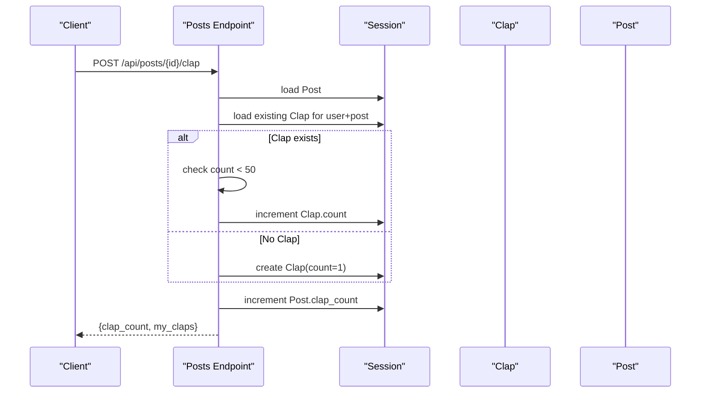
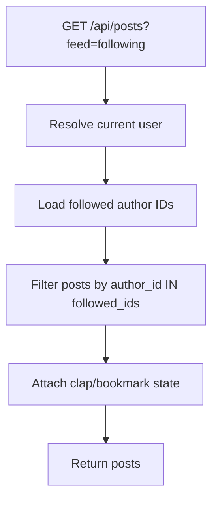
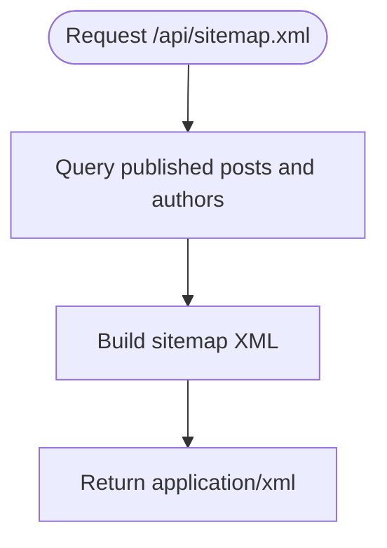
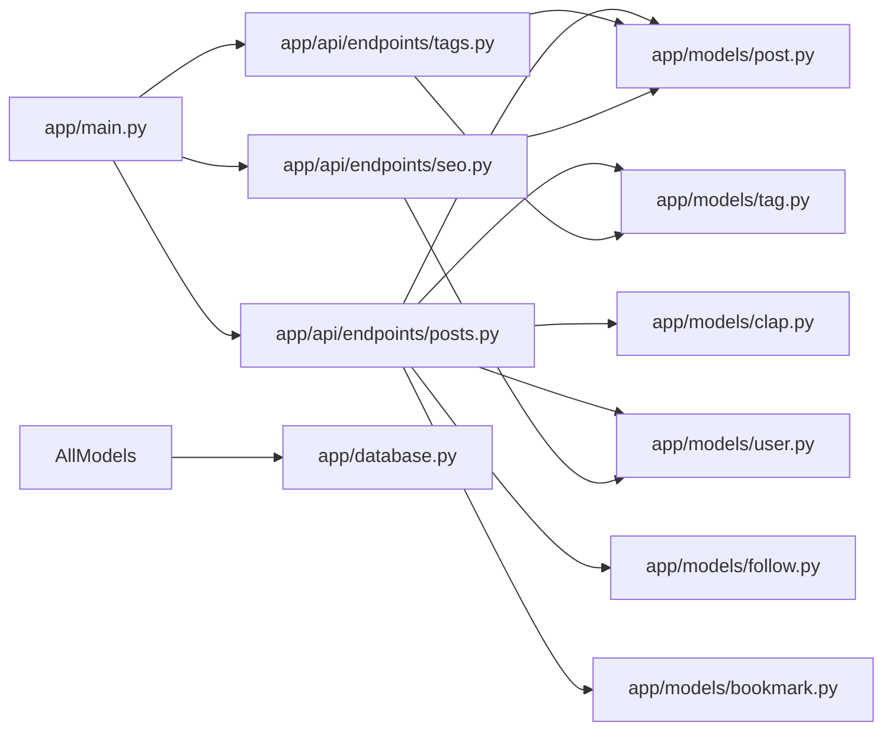

# Content Management

<cite>
**Referenced Files in This Document**
- [main.py](file://app/main.py)
- [config.py](file://app/core/config.py)
- [database.py](file://app/database.py)
- [post.py](file://app/models/post.py)
- [tag.py](file://app/models/tag.py)
- [clap.py](file://app/models/clap.py)
- [user.py](file://app/models/user.py)
- [follow.py](file://app/models/follow.py)
- [bookmark.py](file://app/models/bookmark.py)
- [posts.py](file://app/api/endpoints/posts.py)
- [tags.py](file://app/api/endpoints/tags.py)
- [seo.py](file://app/api/endpoints/seo.py)
- [post_schema.py](file://app/schemas/post.py)
- [README.md](file://README.md)
</cite>

## Table of Contents
1. [Introduction](#introduction)
2. [Project Structure](#project-structure)
3. [Core Components](#core-components)
4. [Architecture Overview](#architecture-overview)
5. [Detailed Component Analysis](#detailed-component-analysis)
6. [Dependency Analysis](#dependency-analysis)
7. [Performance Considerations](#performance-considerations)
8. [Troubleshooting Guide](#troubleshooting-guide)
9. [Conclusion](#conclusion)

## Introduction
Lekhani is a FastAPI-based content management system for Hindi writers, supporting Devanagari script throughout the stack. It provides post creation with rich text fields, draft and published states, tag-based categorization, search, feed personalization by followed authors, a clap system with per-user limits, and SEO assets (sitemap and RSS). The backend emphasizes clean data models, robust slug generation for both Latin and Devanagari titles, and efficient query patterns for popular tags and filtered feeds.

## Project Structure
The application follows a layered structure:
- API endpoints under app/api/endpoints
- Domain models under app/models
- Pydantic schemas under app/schemas
- Core configuration and dependencies under app/core
- Database engine and session management under app/database
- Application entry point and middleware under app/main

**Diagram sources**
- [main.py:1-89](file://app/main.py#L1-L89)
- [posts.py:1-298](file://app/api/endpoints/posts.py#L1-L298)
- [tags.py:1-70](file://app/api/endpoints/tags.py#L1-L70)
- [seo.py:1-88](file://app/api/endpoints/seo.py#L1-L88)
- [post.py:1-32](file://app/models/post.py#L1-L32)
- [tag.py:1-29](file://app/models/tag.py#L1-L29)
- [clap.py:1-20](file://app/models/clap.py#L1-L20)
- [user.py:1-28](file://app/models/user.py#L1-L28)
- [follow.py:1-21](file://app/models/follow.py#L1-L21)
- [bookmark.py:1-19](file://app/models/bookmark.py#L1-L19)
- [database.py:1-27](file://app/database.py#L1-L27)

**Section sources**
- [main.py:1-89](file://app/main.py#L1-L89)
- [README.md:85-98](file://README.md#L85-L98)

## Core Components
- Post lifecycle: create, update, delete, list, filter, search, and retrieve by slug or author.
- Tag system: normalization, deduplication, creation on demand, popularity ranking, and filtering posts by tag.
- Clap system: per-user clap counts with a hard cap; aggregate clap count per post.
- Feed personalization: optional “following” feed showing posts from authors you follow.
- SEO: sitemap.xml and rss.xml generation using published posts and users.
- Validation and schema: Pydantic models enforce required fields and shape responses.

Key responsibilities:
- app/models: SQLAlchemy ORM entities and relationships.
- app/api/endpoints: HTTP routes, business logic, and query composition.
- app/schemas: Request/response contracts and serialization helpers.
- app/core/config: Environment-driven settings (DB URL, CORS, frontend URL).
- app/database: Engine, session factory, and connection pooling.

**Section sources**
- [post.py:1-32](file://app/models/post.py#L1-L32)
- [tag.py:1-29](file://app/models/tag.py#L1-L29)
- [clap.py:1-20](file://app/models/clap.py#L1-L20)
- [posts.py:1-298](file://app/api/endpoints/posts.py#L1-L298)
- [tags.py:1-70](file://app/api/endpoints/tags.py#L1-L70)
- [seo.py:1-88](file://app/api/endpoints/seo.py#L1-L88)
- [post_schema.py:1-60](file://app/schemas/post.py#L1-L60)
- [config.py:1-48](file://app/core/config.py#L1-L48)
- [database.py:1-27](file://app/database.py#L1-L27)

## Architecture Overview
The system exposes RESTful endpoints for content operations. Requests are validated against Pydantic schemas, then routed to endpoint handlers that compose SQLAlchemy queries over the relational model. Decorators attach viewer-specific state (claps, bookmarks) before returning JSON.

**Diagram sources**
- [posts.py:186-214](file://app/api/endpoints/posts.py#L186-L214)
- [post.py:6-26](file://app/models/post.py#L6-L26)
- [tag.py:6-27](file://app/models/tag.py#L6-L27)

## Detailed Component Analysis

### Post Lifecycle and Workflows
- Creation:
  - Title is normalized into a slug that preserves Devanagari characters.
  - If a slug collision occurs, a timestamp suffix is appended.
  - Tags are normalized, deduplicated, limited to five, and created if missing.
  - Published flag defaults to draft (0); can be set to published (1).
- Update:
  - Only the author can update or delete their post.
  - Changing title regenerates slug with collision handling.
  - Tags can be replaced via the update payload.
- Listing and Filtering:
  - Default listing returns published posts only unless explicitly requested otherwise.
  - Filters include topic, tag, search query across title/subtitle/content, and feed=following.
  - Results are decorated with viewer-specific clap and bookmark state.
- Retrieval:
  - By id, by slug, by author, or by “me”.
- Search:
  - Case-insensitive substring matching across title, subtitle, and content.
  - Supports Hindi text due to Unicode-aware collation in SQLite/PostgreSQL.

**Diagram sources**
- [posts.py:22-30](file://app/api/endpoints/posts.py#L22-L30)
- [posts.py:33-58](file://app/api/endpoints/posts.py#L33-L58)
- [posts.py:186-214](file://app/api/endpoints/posts.py#L186-L214)

**Section sources**
- [posts.py:22-30](file://app/api/endpoints/posts.py#L22-L30)
- [posts.py:33-58](file://app/api/endpoints/posts.py#L33-L58)
- [posts.py:83-126](file://app/api/endpoints/posts.py#L83-L126)
- [posts.py:143-183](file://app/api/endpoints/posts.py#L143-L183)
- [posts.py:186-249](file://app/api/endpoints/posts.py#L186-L249)
- [post_schema.py:6-39](file://app/schemas/post.py#L6-L39)

### Tag System: Popular Tags and Filtering
- Popular tags:
  - Aggregated by number of published posts associated with each tag.
  - Ordered by popularity and name; paginated by limit.
- Tagged posts:
  - Fetches posts tagged with a given tag slug; filters to published posts.
  - Attaches viewer clap state when authenticated.

**Diagram sources**
- [tag.py:6-27](file://app/models/tag.py#L6-L27)
- [post.py:22-26](file://app/models/post.py#L22-L26)

**Section sources**
- [tags.py:16-32](file://app/api/endpoints/tags.py#L16-L32)
- [tags.py:35-69](file://app/api/endpoints/tags.py#L35-L69)
- [tag.py:6-27](file://app/models/tag.py#L6-L27)

### Clap System Mechanics
- Per-user limit:
  - Each user can clap up to 50 times on a single post.
  - Re-clapping increments the per-user clap count until the cap.
- Aggregate count:
  - Post-level clap_count is incremented atomically with each clap.
- Viewer state:
  - Responses include my_claps (per-user clap count) and clap_count (aggregate).

**Diagram sources**
- [posts.py:270-297](file://app/api/endpoints/posts.py#L270-L297)
- [clap.py:7-19](file://app/models/clap.py#L7-L19)
- [post.py:16-26](file://app/models/post.py#L16-L26)

**Section sources**
- [posts.py:270-297](file://app/api/endpoints/posts.py#L270-L297)
- [clap.py:7-19](file://app/models/clap.py#L7-L19)

### Feed Personalization Based on Followed Authors
- When feed=following is specified, only posts authored by users the requester follows are returned.
- Requires authentication; anonymous requests receive an empty following set.

**Diagram sources**
- [posts.py:104-110](file://app/api/endpoints/posts.py#L104-L110)
- [follow.py:7-19](file://app/models/follow.py#L7-L19)

**Section sources**
- [posts.py:104-110](file://app/api/endpoints/posts.py#L104-L110)
- [follow.py:7-19](file://app/models/follow.py#L7-L19)

### SEO Optimization: Slugs, Sitemap, and RSS
- Slugs:
  - Generated from titles while preserving Devanagari characters for readable URLs.
  - Unique constraints ensure canonical paths for posts and tags.
- Sitemap:
  - Generates XML including homepage, all published posts, and authors with published posts.
- RSS:
  - Exposes latest 50 published posts with metadata and links.

**Diagram sources**
- [seo.py:11-52](file://app/api/endpoints/seo.py#L11-L52)
- [post.py:13-16](file://app/models/post.py#L13-L16)

**Section sources**
- [posts.py:22-30](file://app/api/endpoints/posts.py#L22-L30)
- [seo.py:11-88](file://app/api/endpoints/seo.py#L11-L88)
- [post.py:13-16](file://app/models/post.py#L13-L16)

### Rich Text Formatting and Hindi Content Support
- Rich text:
  - The content field accepts arbitrary text, enabling rich HTML/markdown payloads from clients.
- Hindi support:
  - Slug generation retains Devanagari characters.
  - Search uses case-insensitive substring matching suitable for Unicode strings.

**Section sources**
- [post_schema.py:6-13](file://app/schemas/post.py#L6-L13)
- [posts.py:22-30](file://app/api/endpoints/posts.py#L22-L30)
- [posts.py:118-122](file://app/api/endpoints/posts.py#L118-L122)

## Dependency Analysis
High-level dependency graph between modules:

**Diagram sources**
- [main.py:1-89](file://app/main.py#L1-L89)
- [posts.py:1-298](file://app/api/endpoints/posts.py#L1-L298)
- [tags.py:1-70](file://app/api/endpoints/tags.py#L1-L70)
- [seo.py:1-88](file://app/api/endpoints/seo.py#L1-L88)
- [post.py:1-32](file://app/models/post.py#L1-L32)
- [tag.py:1-29](file://app/models/tag.py#L1-L29)
- [clap.py:1-20](file://app/models/clap.py#L1-L20)
- [user.py:1-28](file://app/models/user.py#L1-L28)
- [follow.py:1-21](file://app/models/follow.py#L1-L21)
- [bookmark.py:1-19](file://app/models/bookmark.py#L1-L19)
- [database.py:1-27](file://app/database.py#L1-L27)

**Section sources**
- [main.py:1-89](file://app/main.py#L1-L89)
- [posts.py:1-298](file://app/api/endpoints/posts.py#L1-L298)
- [tags.py:1-70](file://app/api/endpoints/tags.py#L1-L70)
- [seo.py:1-88](file://app/api/endpoints/seo.py#L1-L88)

## Performance Considerations
- Database connections:
  - Connection pool pre-ping and recycling reduce stale connection errors.
- Query efficiency:
  - Use pagination (skip/limit) on list endpoints to avoid large result sets.
  - Prefer indexed columns for frequent filters (title, slug, topic, author_id).
- Tag popularity:
  - Aggregation queries group by tag and join through post_tags; consider materialized views or periodic aggregation jobs for high traffic.
- Search:
  - Current ILIKE searches scan multiple columns; for large datasets, consider full-text indexes (e.g., PostgreSQL tsvector) or external search engines.
- Clap updates:
  - Frequent clap writes may contend on post rows; consider batching or background counters with eventual consistency.
- Decorator overhead:
  - decorate_posts performs additional queries for claps and bookmarks; batch these queries per request to minimize N+1 issues.

[No sources needed since this section provides general guidance]

## Troubleshooting Guide
- 404 Not Found:
  - Occurs when retrieving non-existent posts or tags. Verify slugs and ids.
- 403 Forbidden:
  - Updating or deleting a post requires ownership; ensure the authenticated user matches the post’s author.
- Duplicate slugs:
  - Slug collisions are resolved by appending a timestamp suffix during creation and title updates.
- Tag normalization:
  - Tags shorter than two characters or longer than forty are ignored; names are trimmed and deduplicated.
- Clap cap:
  - Per-user clap count is capped at 50; further claps do not increase the count.

**Section sources**
- [posts.py:143-153](file://app/api/endpoints/posts.py#L143-L153)
- [posts.py:217-249](file://app/api/endpoints/posts.py#L217-L249)
- [posts.py:270-297](file://app/api/endpoints/posts.py#L270-L297)
- [posts.py:33-58](file://app/api/endpoints/posts.py#L33-L58)

## Conclusion
Lekhani’s backend delivers a robust content management experience tailored for Hindi writers. It supports Devanagari-friendly slugs, flexible tagging, search, personalized feeds, and a Medium-style clap system with clear per-user limits. With well-defined models, clear validation, and SEO assets, it scales cleanly for growing content libraries. For very large datasets, consider advanced indexing, search offloading, and caching strategies to maintain performance.

[No sources needed since this section summarizes without analyzing specific files]