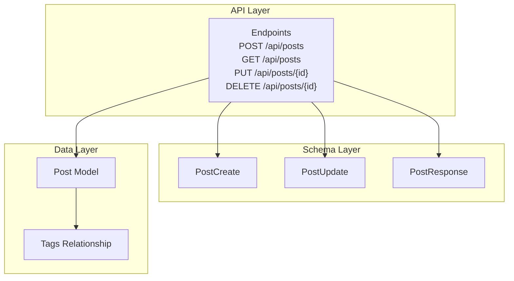
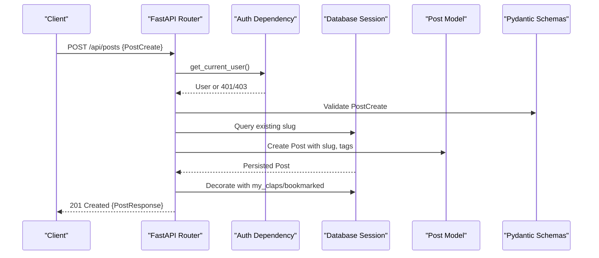
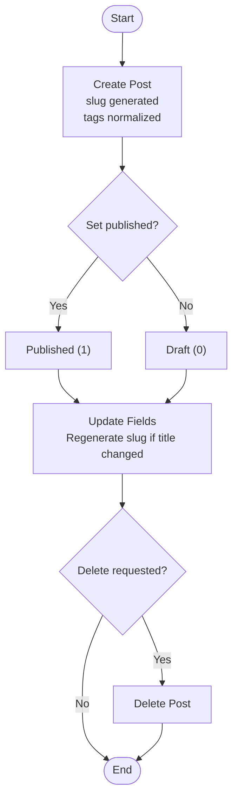
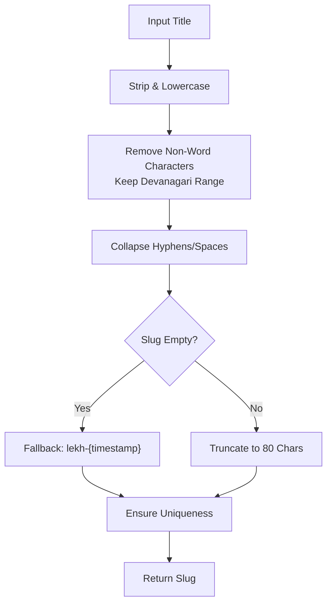
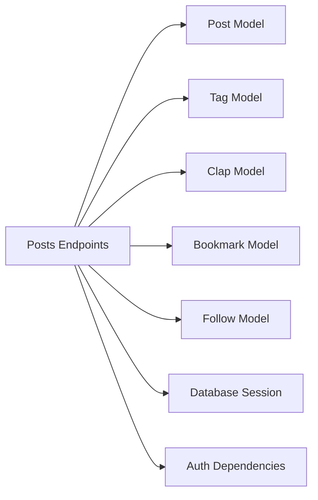

# Post CRUD Operations

<cite>
**Referenced Files in This Document**
- [posts.py](file://app/api/endpoints/posts.py)
- [post.py (schemas)](file://app/schemas/post.py)
- [post.py (models)](file://app/models/post.py)
- [test_posts.py](file://tests/test_posts.py)
</cite>

## Table of Contents
1. [Introduction](#introduction)
2. [Project Structure](#project-structure)
3. [Core Components](#core-components)
4. [Architecture Overview](#architecture-overview)
5. [Detailed Component Analysis](#detailed-component-analysis)
6. [Dependency Analysis](#dependency-analysis)
7. [Performance Considerations](#performance-considerations)
8. [Troubleshooting Guide](#troubleshooting-guide)
9. [Conclusion](#conclusion)

## Introduction
This document explains the post lifecycle and HTTP endpoints for creating, reading, updating, and deleting posts in the Lekhani content management system. It covers validation rules, slug generation with Hindi Devanagari support, state management between draft and published states, authorization requirements, and advanced features such as topic-based filtering, search, and user-specific retrieval.

## Project Structure
The post-related functionality is implemented across three primary layers:
- API endpoints define HTTP routes and orchestrate request handling.
- Schemas define input/output contracts and validation rules.
- Models define database entities and relationships.

**Diagram sources**
- [posts.py:83-298](file://app/api/endpoints/posts.py#L83-L298)
- [post.py (schemas):6-59](file://app/schemas/post.py#L6-L59)
- [post.py (models):6-27](file://app/models/post.py#L6-L27)

**Section sources**
- [posts.py:1-298](file://app/api/endpoints/posts.py#L1-L298)
- [post.py (schemas):1-60](file://app/schemas/post.py#L1-L60)
- [post.py (models):1-32](file://app/models/post.py#L1-L32)

## Core Components
- Endpoints:
  - Create a post: POST /api/posts
  - List posts: GET /api/posts
  - Update a post: PUT /api/posts/{id}
  - Delete a post: DELETE /api/posts/{id}
- Schemas:
  - PostCreate: Input schema for creation
  - PostUpdate: Partial update schema
  - PostResponse: Response payload including author, tags, clap counts, and viewer context
- Model:
  - Post: Database entity with fields for title, subtitle, content, slug, cover_image, topic, clap_count, author_id, published flag, timestamps, and relationships to tags, comments, claps, and bookmarks

Key behaviors:
- Slug generation supports Hindi Devanagari characters and ensures uniqueness.
- Tags are normalized, deduplicated, and limited per post.
- Viewer-specific metadata (my_claps, bookmarked) is attached to responses when a user is authenticated.
- Default listing filters to published posts unless explicitly requested otherwise.

**Section sources**
- [posts.py:22-30](file://app/api/endpoints/posts.py#L22-L30)
- [posts.py:33-58](file://app/api/endpoints/posts.py#L33-L58)
- [posts.py:61-80](file://app/api/endpoints/posts.py#L61-L80)
- [posts.py:83-126](file://app/api/endpoints/posts.py#L83-L126)
- [posts.py:186-214](file://app/api/endpoints/posts.py#L186-L214)
- [posts.py:217-249](file://app/api/endpoints/posts.py#L217-L249)
- [posts.py:252-267](file://app/api/endpoints/posts.py#L252-L267)
- [post.py (schemas):6-59](file://app/schemas/post.py#L6-L59)
- [post.py (models):6-27](file://app/models/post.py#L6-L27)

## Architecture Overview
The post workflow integrates FastAPI endpoints with Pydantic schemas and SQLAlchemy models. The flow includes authentication checks, optional query filtering, tag normalization, database persistence, and response decoration with viewer-specific data.

**Diagram sources**
- [posts.py:186-214](file://app/api/endpoints/posts.py#L186-L214)
- [post.py (schemas):14-15](file://app/schemas/post.py#L14-L15)
- [post.py (models):6-27](file://app/models/post.py#L6-L27)

## Detailed Component Analysis

### HTTP Endpoints

#### POST /api/posts
- Purpose: Create a new post.
- Authorization: Requires an authenticated user.
- Request body: PostCreate schema.
- Behavior:
  - Generates a slug from the title with Hindi Devanagari support.
  - Ensures slug uniqueness by appending a timestamp if needed.
  - Normalizes and attaches tags (deduplication, length constraints, max 5).
  - Sets initial clap_count to 0.
  - Persists the post and returns PostResponse with viewer context initialized.
- Status codes:
  - 201 Created on success.
  - 401/403 if not authenticated or authorized.
  - 422 for validation errors.

Example request payload:
- title: string
- subtitle: optional string
- content: string
- cover_image: optional string
- topic: optional string
- published: integer (0=draft, 1=published)
- tags: optional list of strings

Example response payload:
- id: integer
- slug: string
- title: string
- subtitle: optional string
- content: string
- cover_image: optional string
- topic: optional string
- author_id: integer
- author: object (UserResponse)
- clap_count: integer
- my_claps: integer
- bookmarked: boolean
- tags: list of strings
- tag_slugs: list of strings
- created_at: datetime
- updated_at: datetime

**Section sources**
- [posts.py:186-214](file://app/api/endpoints/posts.py#L186-L214)
- [post.py (schemas):14-15](file://app/schemas/post.py#L14-L15)
- [post.py (schemas):26-39](file://app/schemas/post.py#L26-L39)

#### GET /api/posts
- Purpose: List posts with optional filtering and pagination.
- Authorization: Optional; viewer-specific metadata is included only when authenticated.
- Query parameters:
  - skip: integer >= 0 (default 0)
  - limit: integer 1..100 (default 10)
  - published: integer (optional; default filter to published=1)
  - topic: string (exact match)
  - tag: string (match by tag slug or name)
  - feed: string ("following" restricts to followed authors)
  - q: string (search across title, subtitle, content using case-insensitive matching)
- Behavior:
  - Defaults to published posts unless published parameter is provided.
  - Applies topic and tag filters.
  - Supports search via ILIKE across multiple fields.
  - Orders by created_at descending.
  - Decorates results with my_claps and bookmarked flags for the current user.
- Status codes:
  - 200 OK with array of PostResponse.
  - 401/403 if required auth is enforced elsewhere (not in this endpoint).
  - 422 for invalid query parameters.

Example query:
- GET /api/posts?topic=travel&tag=हिंदी&q=उत्सव&published=1&limit=20

**Section sources**
- [posts.py:83-126](file://app/api/endpoints/posts.py#L83-L126)
- [posts.py:61-80](file://app/api/endpoints/posts.py#L61-L80)

#### PUT /api/posts/{id}
- Purpose: Update an existing post.
- Authorization: Requires the authenticated user to be the post’s author.
- Request body: PostUpdate schema (partial updates allowed).
- Behavior:
  - Validates existence of the post.
  - Enforces ownership before applying updates.
  - Regenerates slug if title changes and ensures uniqueness.
  - Updates tags if provided (normalization and limits apply).
  - Returns updated PostResponse with viewer context.
- Status codes:
  - 200 OK on success.
  - 404 Not Found if post does not exist.
  - 403 Forbidden if not the author.
  - 422 for validation errors.

Example request payload:
- title: optional string
- subtitle: optional string
- content: optional string
- cover_image: optional string
- topic: optional string
- published: optional integer
- tags: optional list of strings

**Section sources**
- [posts.py:217-249](file://app/api/endpoints/posts.py#L217-L249)
- [post.py (schemas):17-24](file://app/schemas/post.py#L17-L24)

#### DELETE /api/posts/{id}
- Purpose: Delete a post.
- Authorization: Requires the authenticated user to be the post’s author.
- Behavior:
  - Validates existence of the post.
  - Enforces ownership before deletion.
  - Removes the post from the database.
- Status codes:
  - 204 No Content on success.
  - 404 Not Found if post does not exist.
  - 403 Forbidden if not the author.

**Section sources**
- [posts.py:252-267](file://app/api/endpoints/posts.py#L252-L267)

### Post Lifecycle
The lifecycle encompasses creation, optional publication, updates, and deletion. State transitions are managed through the published field:
- Draft: published = 0
- Published: published = 1

**Diagram sources**
- [posts.py:186-214](file://app/api/endpoints/posts.py#L186-L214)
- [posts.py:217-249](file://app/api/endpoints/posts.py#L217-L249)
- [posts.py:252-267](file://app/api/endpoints/posts.py#L252-L267)
- [post.py (models):18-20](file://app/models/post.py#L18-L20)

**Section sources**
- [posts.py:186-214](file://app/api/endpoints/posts.py#L186-L214)
- [posts.py:217-249](file://app/api/endpoints/posts.py#L217-L249)
- [posts.py:252-267](file://app/api/endpoints/posts.py#L252-L267)
- [post.py (models):18-20](file://app/models/post.py#L18-L20)

### Validation Rules and Constraints
- Title: Required for creation; optional for updates.
- Content: Required for creation; optional for updates.
- Subtitle, cover_image, topic: Optional throughout.
- published: Integer; 0 for draft, 1 for published.
- tags: Optional list of strings; normalized and deduplicated; each tag must be between 2 and 40 characters; maximum 5 tags per post.
- Slug: Auto-generated from title; unique; supports Hindi Devanagari; truncated to 80 characters; fallback uses timestamp if empty.

Tag normalization behavior:
- Whitespace collapsed to single spaces.
- Case-insensitive deduplication.
- Length constraints enforced.
- Missing tags are created automatically.

**Section sources**
- [posts.py:22-30](file://app/api/endpoints/posts.py#L22-L30)
- [posts.py:33-58](file://app/api/endpoints/posts.py#L33-L58)
- [post.py (schemas):6-24](file://app/schemas/post.py#L6-L24)

### Slug Generation with Hindi Devanagari Support
- The slug generator preserves Hindi Devanagari Unicode ranges while stripping other non-word characters.
- Multiple hyphens/spaces are collapsed into a single hyphen.
- If no valid slug remains, a fallback slug is generated using a timestamp.
- Uniqueness is enforced at creation and during title updates.

**Diagram sources**
- [posts.py:22-30](file://app/api/endpoints/posts.py#L22-L30)

**Section sources**
- [posts.py:22-30](file://app/api/endpoints/posts.py#L22-L30)

### Schemas

#### PostCreate
- Fields:
  - title: string (required)
  - subtitle: optional string
  - content: string (required)
  - cover_image: optional string
  - topic: optional string
  - published: integer (default 0)
  - tags: optional list of strings

Validation:
- Inherits base validations from PostBase.
- Tags are processed by endpoint logic (normalization and limits).

**Section sources**
- [post.py (schemas):6-15](file://app/schemas/post.py#L6-L15)

#### PostUpdate
- Fields:
  - title: optional string
  - subtitle: optional string
  - content: optional string
  - cover_image: optional string
  - topic: optional string
  - published: optional integer
  - tags: optional list of strings

Behavior:
- Only provided fields are applied.
- Slug regeneration occurs if title changes.

**Section sources**
- [post.py (schemas):17-24](file://app/schemas/post.py#L17-L24)

#### PostResponse
- Fields:
  - id: integer
  - slug: string
  - title: string
  - subtitle: optional string
  - content: string
  - cover_image: optional string
  - topic: optional string
  - author_id: integer
  - author: object (UserResponse)
  - clap_count: integer (default 0)
  - my_claps: integer (default 0)
  - bookmarked: boolean (default False)
  - tags: list of strings
  - tag_slugs: list of strings
  - created_at: datetime
  - updated_at: datetime

Transformations:
- Converts Tag objects to names and slugs for JSON serialization.
- Enables ORM attribute mapping.

**Section sources**
- [post.py (schemas):26-59](file://app/schemas/post.py#L26-L59)

### Advanced Features

#### Topic-Based Filtering
- Filter posts by exact topic match using the topic query parameter.
- Useful for curating content by subject areas.

Usage example:
- GET /api/posts?topic=travel

**Section sources**
- [posts.py:101-102](file://app/api/endpoints/posts.py#L101-L102)

#### Search Functionality
- Full-text-like search across title, subtitle, and content using case-insensitive matching.
- Parameter: q.

Usage example:
- GET /api/posts?q=उत्सव

**Section sources**
- [posts.py:118-122](file://app/api/endpoints/posts.py#L118-L122)

#### User-Specific Post Retrieval
- Get all posts by a specific user: GET /api/posts/user/{user_id}
- Get current user’s posts: GET /api/posts/me
- Both support optional published filtering.

Usage examples:
- GET /api/posts/user/123?published=1
- GET /api/posts/me?published=0

**Section sources**
- [posts.py:129-140](file://app/api/endpoints/posts.py#L129-L140)
- [posts.py:156-170](file://app/api/endpoints/posts.py#L156-L170)

#### Following Feed
- Retrieve posts authored by users you follow using feed=following.
- Requires authentication; returns posts from followed authors.

Usage example:
- GET /api/posts?feed=following

**Section sources**
- [posts.py:104-110](file://app/api/endpoints/posts.py#L104-L110)

#### Tag-Based Filtering
- Filter posts by tag slug or name using tag parameter.
- Returns empty list if tag not found.

Usage example:
- GET /api/posts?tag=हिंदी

**Section sources**
- [posts.py:112-116](file://app/api/endpoints/posts.py#L112-L116)

### Error Handling Patterns
- 404 Not Found: When a post does not exist.
- 403 Forbidden: When attempting to update or delete a post without ownership.
- 422 Validation Error: When request payloads fail schema validation.
- 204 No Content: Successful deletion with no response body.

Common error messages:
- "Post not found"
- "Not authorized to update this post"
- "Not authorized to delete this post"

**Section sources**
- [posts.py:149-153](file://app/api/endpoints/posts.py#L149-L153)
- [posts.py:179-183](file://app/api/endpoints/posts.py#L179-L183)
- [posts.py:224-229](file://app/api/endpoints/posts.py#L224-L229)
- [posts.py:258-263](file://app/api/endpoints/posts.py#L258-L263)

### Authorization Requirements
- Creation, update, and deletion require an authenticated user.
- Update and deletion enforce ownership checks against the post’s author_id.
- Listing endpoints accept optional authentication to enrich responses with viewer-specific data.

**Section sources**
- [posts.py:186-191](file://app/api/endpoints/posts.py#L186-L191)
- [posts.py:217-223](file://app/api/endpoints/posts.py#L217-L223)
- [posts.py:252-257](file://app/api/endpoints/posts.py#L252-L257)

## Dependency Analysis
The post module depends on several models and utilities:
- Post model defines core fields and relationships.
- Tag model and post_tags association table manage many-to-many tagging.
- Clap and Bookmark models provide engagement metrics and viewer state.
- Follow model enables following-feed filtering.
- Dependencies inject database sessions and current user context.

**Diagram sources**
- [posts.py:1-16](file://app/api/endpoints/posts.py#L1-L16)
- [post.py (models):6-27](file://app/models/post.py#L6-L27)

**Section sources**
- [posts.py:1-16](file://app/api/endpoints/posts.py#L1-L16)
- [post.py (models):6-27](file://app/models/post.py#L6-L27)

## Performance Considerations
- Pagination: Use skip and limit to control result sets; default limit is 10, maximum 100.
- Indexes: Post.title, Post.slug, and Post.topic are indexed to optimize queries.
- Tag normalization: Limits tags to 5 per post and enforces length constraints to reduce overhead.
- Decorator optimization: Viewer-specific clap and bookmark state is fetched efficiently using IN clauses for batch operations.
- Search: ILIKE searches can be expensive; consider adding full-text indexes if search volume increases.

[No sources needed since this section provides general guidance]

## Troubleshooting Guide
- Duplicate tags: Ensure tags are within 2–40 characters and that duplicates are removed automatically.
- Slug collisions: If titles produce identical slugs, a timestamp suffix is appended; verify uniqueness after updates.
- Tag filtering returns empty: Confirm the tag exists by slug or name; otherwise, the endpoint returns an empty list.
- Ownership errors: Verify the authenticated user matches the post’s author_id before update/delete.
- Validation failures: Check required fields (title, content) and types (published as integer).

**Section sources**
- [posts.py:33-58](file://app/api/endpoints/posts.py#L33-L58)
- [posts.py:112-116](file://app/api/endpoints/posts.py#L112-L116)
- [posts.py:224-229](file://app/api/endpoints/posts.py#L224-L229)
- [posts.py:258-263](file://app/api/endpoints/posts.py#L258-L263)

## Conclusion
The post CRUD operations in Lekhani provide a robust foundation for content management with strong validation, flexible filtering, and viewer-aware responses. The design emphasizes clarity and safety through explicit authorization checks, normalized tagging, and careful slug generation that supports Hindi Devanagari. Advanced features like topic filtering, search, and following feeds enable rich discovery and personalization.

[No sources needed since this section summarizes without analyzing specific files]