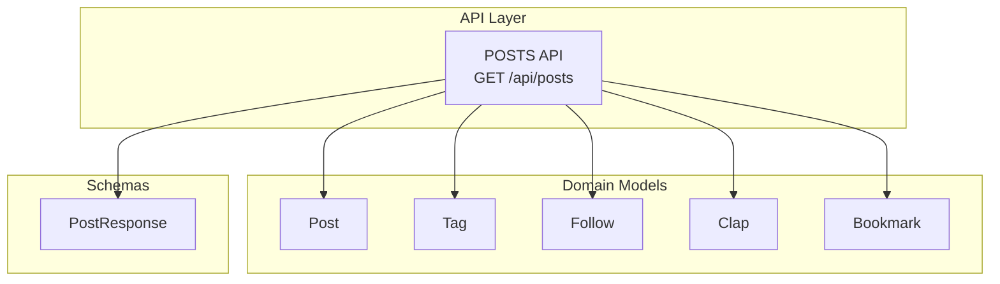
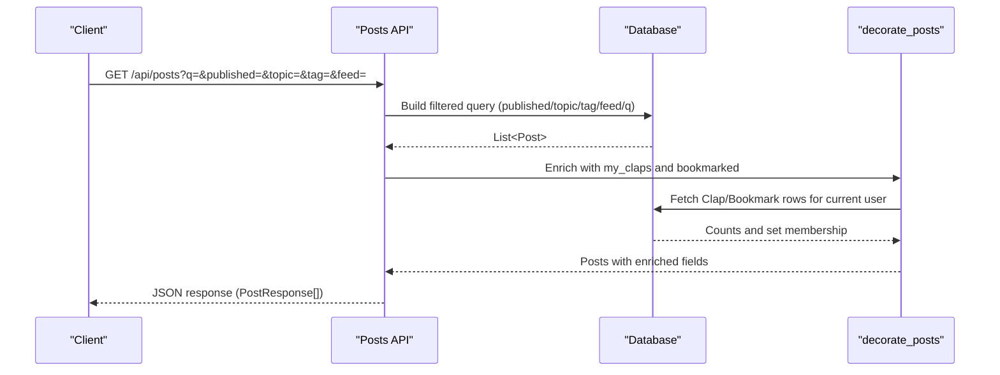
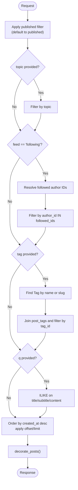
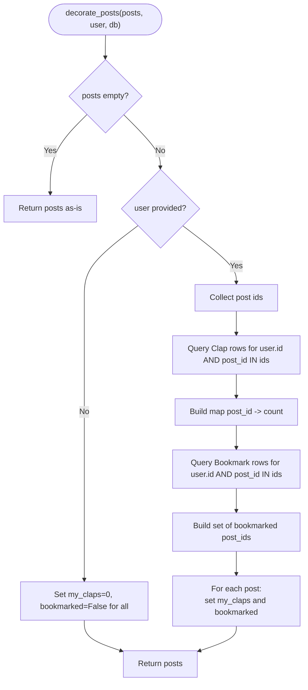
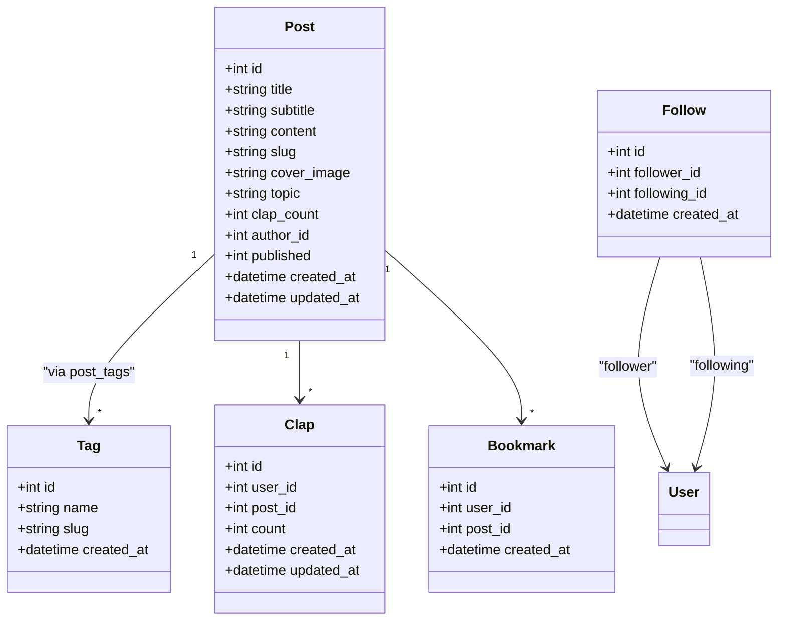

# Search and Filtering

<cite>
**Referenced Files in This Document**
- [posts.py](file://app/api/endpoints/posts.py)
- [post.py](file://app/models/post.py)
- [tag.py](file://app/models/tag.py)
- [follow.py](file://app/models/follow.py)
- [bookmark.py](file://app/models/bookmark.py)
- [clap.py](file://app/models/clap.py)
- [post_schema.py](file://app/schemas/post.py)
- [database.py](file://app/database.py)
- [README.md](file://README.md)
</cite>

## Table of Contents
1. [Introduction](#introduction)
2. [Project Structure](#project-structure)
3. [Core Components](#core-components)
4. [Architecture Overview](#architecture-overview)
5. [Detailed Component Analysis](#detailed-component-analysis)
6. [Dependency Analysis](#dependency-analysis)
7. [Performance Considerations](#performance-considerations)
8. [Troubleshooting Guide](#troubleshooting-guide)
9. [Conclusion](#conclusion)

## Introduction
This document explains how the Lekhani platform searches and filters posts, focusing on:
- Full-text search using the q parameter across title, subtitle, and content fields with ILIKE operations
- Filters for published status, topic, tags, and feed personalization based on followed authors
- The decorate_posts function that enriches results with viewer-specific clap counts and bookmark status
- Performance considerations, indexing strategies, and best practices for efficient queries
- Examples of complex search and filtering combinations

The implementation is built with FastAPI and SQLAlchemy, using PostgreSQL-compatible SQL features like ILIKE for case-insensitive text matching.

## Project Structure
The search and filtering logic lives primarily in the posts endpoint, with supporting models and schemas defining data structures and relationships.

**Diagram sources**
- [posts.py:83-126](file://app/api/endpoints/posts.py#L83-L126)
- [post.py:6-26](file://app/models/post.py#L6-L26)
- [tag.py:6-27](file://app/models/tag.py#L6-L27)
- [follow.py:7-19](file://app/models/follow.py#L7-L19)
- [clap.py:7-19](file://app/models/clap.py#L7-L19)
- [bookmark.py:7-17](file://app/models/bookmark.py#L7-L17)
- [post_schema.py:26-39](file://app/schemas/post.py#L26-L39)

**Section sources**
- [posts.py:83-126](file://app/api/endpoints/posts.py#L83-L126)
- [post.py:6-26](file://app/models/post.py#L6-L26)
- [tag.py:6-27](file://app/models/tag.py#L6-L27)
- [follow.py:7-19](file://app/models/follow.py#L7-L19)
- [clap.py:7-19](file://app/models/clap.py#L7-L19)
- [bookmark.py:7-17](file://app/models/bookmark.py#L7-L17)
- [post_schema.py:26-39](file://app/schemas/post.py#L26-L39)

## Core Components
- Posts API endpoint GET /api/posts supports query parameters:
  - q: full-text search across title, subtitle, and content using ILIKE
  - published: filter by published status (default to published when not provided)
  - topic: exact match on post.topic
  - tag: filter by tag name or slug via a join to post_tags
  - feed: personalization; feed=following returns posts authored by users the current user follows
- decorate_posts enriches each returned Post with:
  - my_claps: number of claps the current user has given to this post
  - bookmarked: whether the current user has bookmarked this post

Key responsibilities:
- Query building and filtering in get_posts
- Viewer enrichment in decorate_posts
- Data contracts in PostResponse schema

**Section sources**
- [posts.py:61-80](file://app/api/endpoints/posts.py#L61-L80)
- [posts.py:83-126](file://app/api/endpoints/posts.py#L83-L126)
- [post_schema.py:26-39](file://app/schemas/post.py#L26-L39)

## Architecture Overview
The following sequence diagram shows the request flow for searching and filtering posts, including enrichment.

**Diagram sources**
- [posts.py:83-126](file://app/api/endpoints/posts.py#L83-L126)
- [posts.py:61-80](file://app/api/endpoints/posts.py#L61-L80)

## Detailed Component Analysis

### Query Parameters and Filtering Logic
The main listing endpoint composes filters in order:
- Published status: defaults to published if not specified
- Topic: exact equality on Post.topic
- Feed personalization: when feed=following, restricts to posts by followed authors
- Tag: resolves tag by name or slug and joins post_tags
- Full-text search: applies ILIKE across title, subtitle, and content

**Diagram sources**
- [posts.py:95-126](file://app/api/endpoints/posts.py#L95-L126)

**Section sources**
- [posts.py:95-126](file://app/api/endpoints/posts.py#L95-L126)

### Full-Text Search with ILIKE
- Parameter: q
- Behavior: matches any substring in title, subtitle, or content using ILIKE
- Notes:
  - Case-insensitive matching suitable for Hindi and other scripts
  - Uses OR across three columns, which can be expensive without indexes

Example usage patterns:
- Basic search: GET /api/posts?q=कहानी
- Combined with filters: GET /api/posts?q=निबंध&topic=कहानी&tag=हिंदी

**Section sources**
- [posts.py:118-122](file://app/api/endpoints/posts.py#L118-L122)

### Published Status Filter
- Parameter: published (integer)
- Default behavior: if not provided, only published posts are returned
- Use cases:
  - Public feed: omit published to default to published
  - Author dashboard: pass published values to include drafts

Example usage patterns:
- Public feed: GET /api/posts?topic=कहानी
- Include drafts: GET /api/posts?published=0

**Section sources**
- [posts.py:96-99](file://app/api/endpoints/posts.py#L96-L99)

### Topic-Based Filtering
- Parameter: topic
- Behavior: exact match on Post.topic
- Typical use: category navigation

Example usage patterns:
- Category page: GET /api/posts?topic=कहानी

**Section sources**
- [posts.py:101-102](file://app/api/endpoints/posts.py#L101-L102)

### Tag-Based Filtering
- Parameter: tag
- Behavior: resolves Tag by name or slug, then joins post_tags to filter posts
- If tag does not exist, returns an empty list

Example usage patterns:
- Tag page: GET /api/posts?tag=हिंदी

**Section sources**
- [posts.py:112-116](file://app/api/endpoints/posts.py#L112-L116)
- [tag.py:6-27](file://app/models/tag.py#L6-L27)

### Feed Personalization (Following Authors)
- Parameter: feed=following
- Behavior: retrieves posts authored by users the current user follows
- Requires authenticated user; otherwise returns no posts from followed authors

Example usage patterns:
- Personalized feed: GET /api/posts?feed=following

**Section sources**
- [posts.py:104-110](file://app/api/endpoints/posts.py#L104-L110)
- [follow.py:7-19](file://app/models/follow.py#L7-L19)

### decorate_posts Enrichment
Purpose: attach viewer-specific state to each post:
- my_claps: count of claps the current user gave to the post
- bookmarked: boolean indicating if the current user bookmarked the post

Implementation highlights:
- For unauthenticated users, sets my_claps=0 and bookmarked=False
- For authenticated users, performs two targeted queries:
  - Clap counts grouped by post_id for the current user
  - Bookmark existence set for the current user

Complexity:
- O(U + B + C) where U is number of posts returned, B is bookmarks for those posts, C is claps for those posts
- Efficient due to IN clauses and single-pass enrichment

**Diagram sources**
- [posts.py:61-80](file://app/api/endpoints/posts.py#L61-L80)
- [clap.py:7-19](file://app/models/clap.py#L7-L19)
- [bookmark.py:7-17](file://app/models/bookmark.py#L7-L17)

**Section sources**
- [posts.py:61-80](file://app/api/endpoints/posts.py#L61-L80)

### Data Contracts
- PostResponse includes:
  - Base post fields plus id, slug, author, clap_count, my_claps, bookmarked, tags, tag_slugs, timestamps
- Schema validators convert Tag objects to names and slugs for clean JSON output

**Section sources**
- [post_schema.py:26-54](file://app/schemas/post.py#L26-L54)

## Dependency Analysis
The posts endpoint depends on multiple domain models and relationships:

**Diagram sources**
- [post.py:6-26](file://app/models/post.py#L6-L26)
- [tag.py:6-27](file://app/models/tag.py#L6-L27)
- [follow.py:7-19](file://app/models/follow.py#L7-L19)
- [clap.py:7-19](file://app/models/clap.py#L7-L19)
- [bookmark.py:7-17](file://app/models/bookmark.py#L7-L17)

**Section sources**
- [post.py:6-26](file://app/models/post.py#L6-L26)
- [tag.py:6-27](file://app/models/tag.py#L6-L27)
- [follow.py:7-19](file://app/models/follow.py#L7-L19)
- [clap.py:7-19](file://app/models/clap.py#L7-L19)
- [bookmark.py:7-17](file://app/models/bookmark.py#L7-L17)

## Performance Considerations

### Indexing Strategy
Recommended indexes to optimize common queries:
- Full-text search (q):
  - Trigram indexes on title, subtitle, content for ILIKE performance
  - Example index types: gin pg_trgm on each column
- Exact filters:
  - topic: btree index already present
  - slug: unique index already present
  - author_id: consider adding an index if not present
- Tag-based filtering:
  - Composite index on post_tags(tag_id, post_id) to speed up joins
- Following feed:
  - Index on follows(follower_id, following_id) to quickly resolve followed authors
- Pagination:
  - Ensure created_at is indexed to optimize ORDER BY created_at DESC

Notes:
- ILIKE with leading wildcards (%term%) cannot use standard btree indexes; trigram indexes are required for performance at scale
- Avoid returning large result sets; enforce reasonable limits (already enforced via limit parameter)

**Section sources**
- [post.py:9-15](file://app/models/post.py#L9-L15)
- [tag.py:17-19](file://app/models/tag.py#L17-L19)
- [follow.py:13-15](file://app/models/follow.py#L13-L15)
- [posts.py:112-116](file://app/api/endpoints/posts.py#L112-L116)
- [posts.py:118-124](file://app/api/endpoints/posts.py#L118-L124)

### Query Optimization Best Practices
- Prefer narrowing filters before applying full-text search to reduce candidate set
- Combine topic or tag filters with q to minimize ILLIKE scans
- Use pagination (skip/limit) consistently to avoid large payloads
- Cache popular tag/topic pages at the application layer if needed
- Monitor slow queries and adjust indexes accordingly

### Complexity Analysis
- decorate_posts:
  - Time: O(U + B + C), where U = number of posts, B = bookmarks for those posts, C = claps for those posts
  - Space: O(B + C) for intermediate maps/sets
- Tag resolution:
  - O(1) average lookup by slug/name assuming proper indexes
- Following feed:
  - O(F) to fetch followed author IDs, then O(P) to filter posts by author_id IN (...)

**Section sources**
- [posts.py:61-80](file://app/api/endpoints/posts.py#L61-L80)
- [posts.py:112-116](file://app/api/endpoints/posts.py#L112-L116)
- [posts.py:104-110](file://app/api/endpoints/posts.py#L104-L110)

## Troubleshooting Guide

### Common Issues
- No results when filtering by tag:
  - Cause: tag does not exist
  - Resolution: verify tag name or slug exists; endpoint returns empty list if not found
- Unexpectedly empty following feed:
  - Cause: no followed authors or unauthenticated user
  - Resolution: ensure user is authenticated and follows at least one author
- Slow search performance:
  - Cause: missing trigram indexes for ILIKE
  - Resolution: add gin pg_trgm indexes on title, subtitle, content
- High memory usage with large result sets:
  - Cause: excessive limit or missing pagination
  - Resolution: cap limit and use skip for cursor-style pagination

### Debugging Tips
- Inspect generated SQL for ILIKE patterns and joins
- Validate tag resolution path and post_tags join conditions
- Confirm bookmark/clap queries target the correct user_id and post_id set

**Section sources**
- [posts.py:112-116](file://app/api/endpoints/posts.py#L112-L116)
- [posts.py:104-110](file://app/api/endpoints/posts.py#L104-L110)
- [posts.py:61-80](file://app/api/endpoints/posts.py#L61-L80)

## Conclusion
The Lekhani platform provides robust search and filtering for posts through:
- Full-text search with ILIKE across key text fields
- Precise filters for published status, topic, and tags
- Personalized feed based on followed authors
- Viewer-aware enrichment for clap counts and bookmark status

For production-scale performance, implement trigram indexes for ILIKE, ensure appropriate indexes on foreign keys and join tables, and apply consistent pagination. These measures will keep queries fast and responsive even with large datasets.