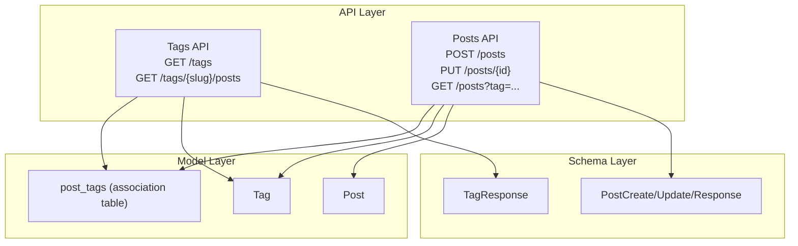
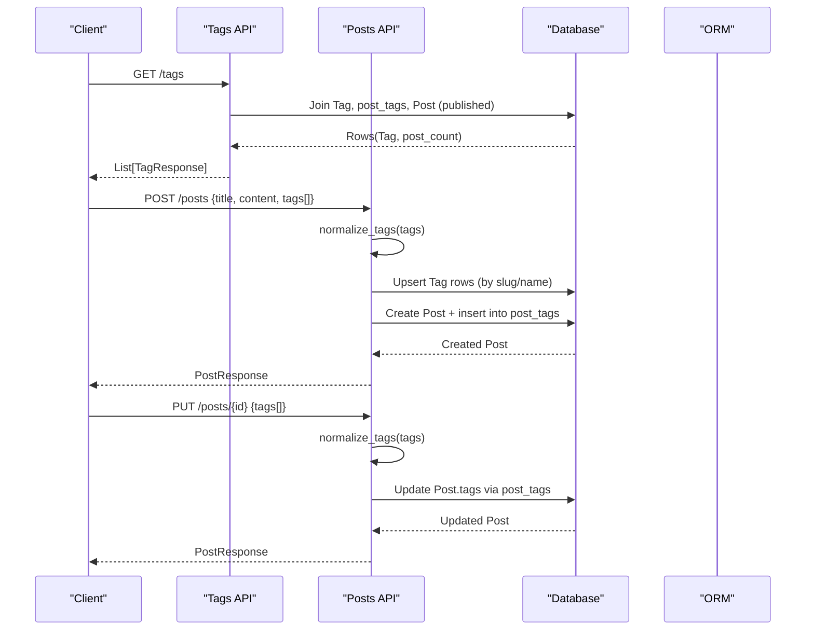
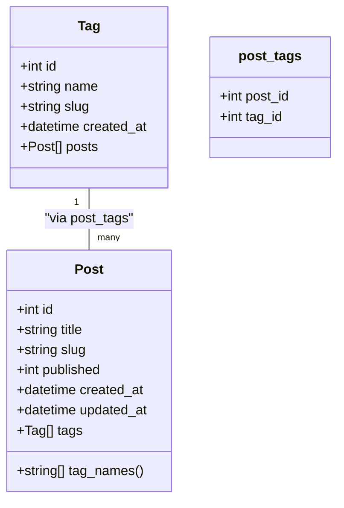
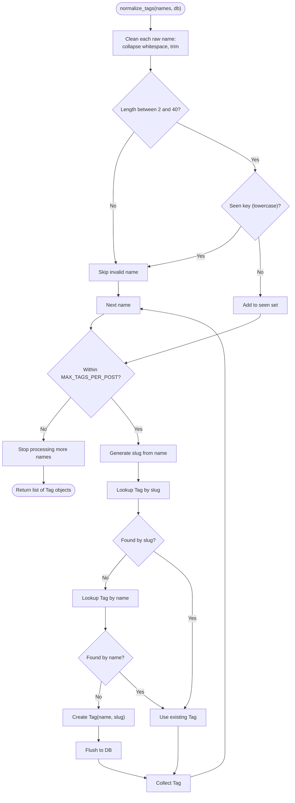
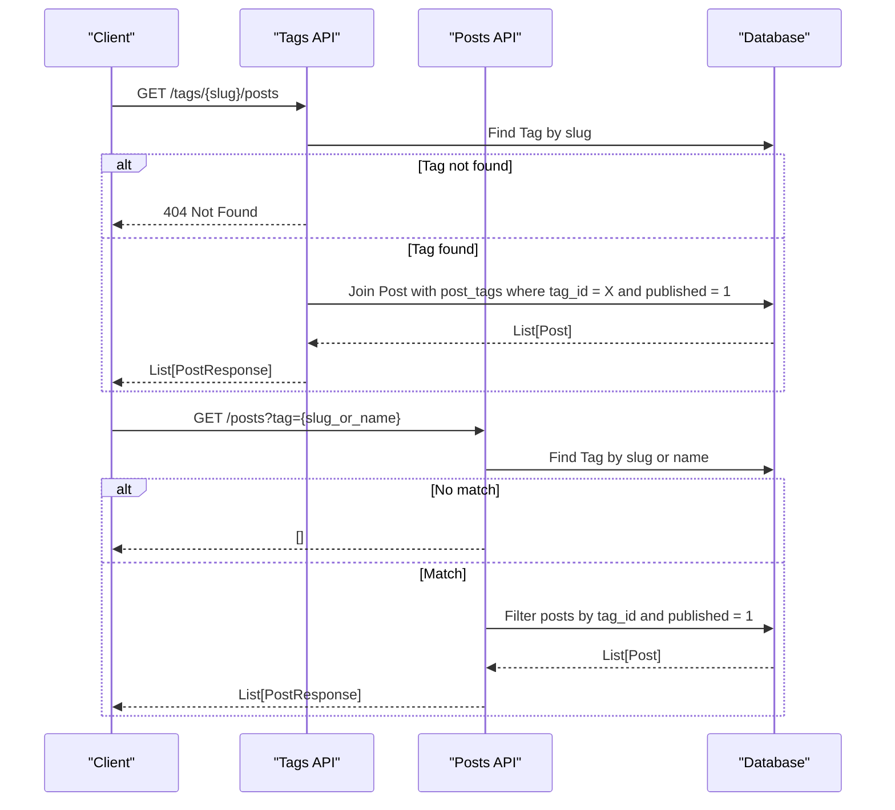
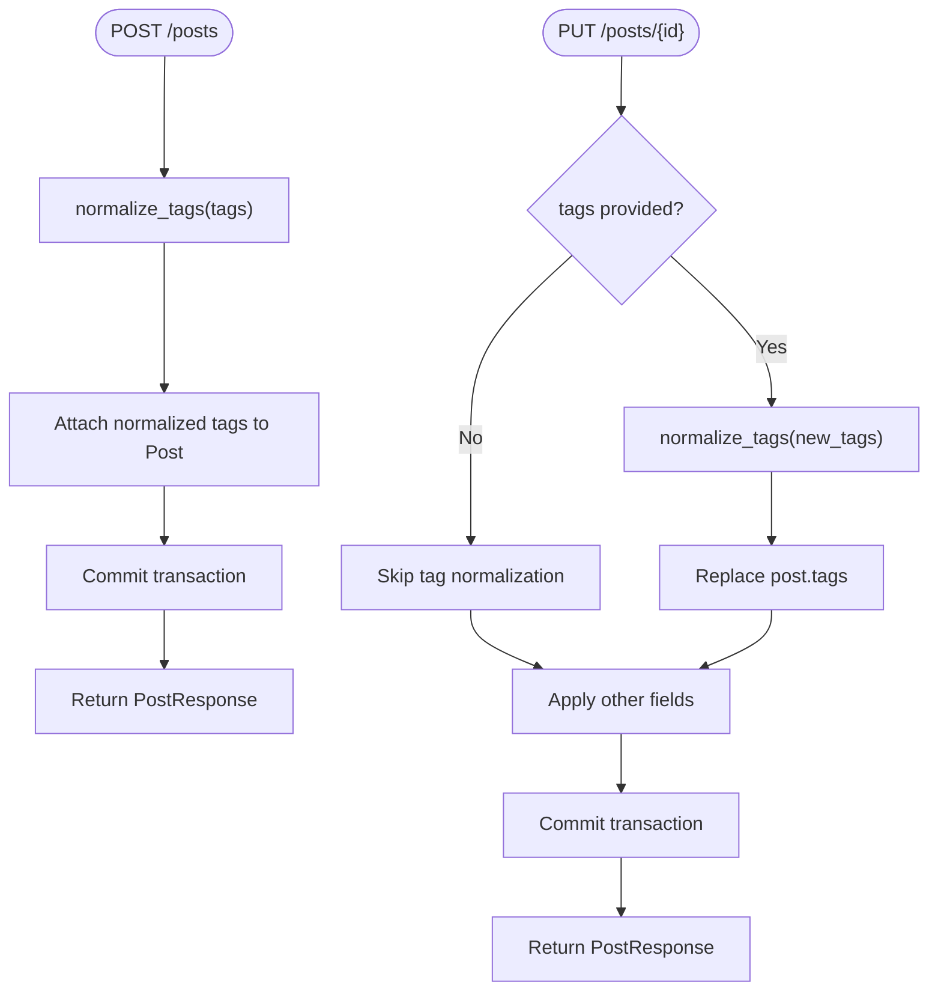
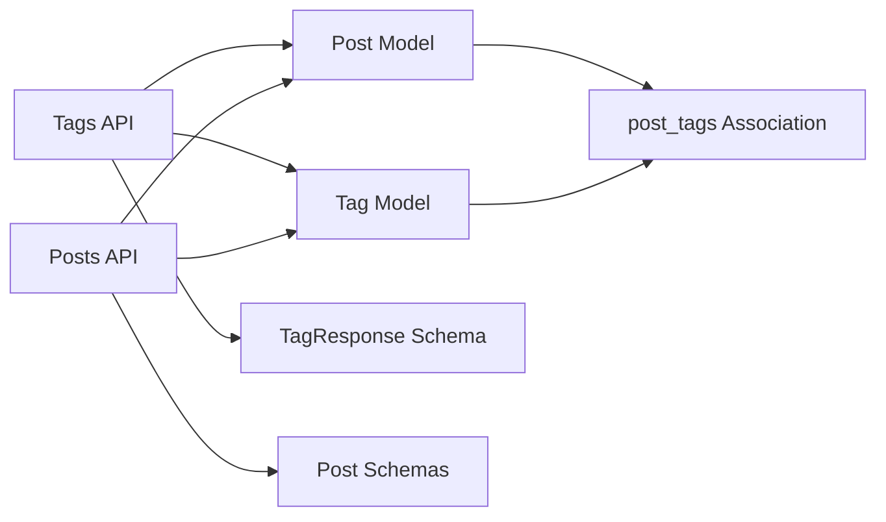

# Tag System

<cite>
**Referenced Files in This Document**
- [tag.py](file://app/models/tag.py)
- [post.py](file://app/models/post.py)
- [tag_schema.py](file://app/schemas/tag.py)
- [post_schema.py](file://app/schemas/post.py)
- [tags_api.py](file://app/api/endpoints/tags.py)
- [posts_api.py](file://app/api/endpoints/posts.py)
</cite>

## Table of Contents
1. [Introduction](#introduction)
2. [Project Structure](#project-structure)
3. [Core Components](#core-components)
4. [Architecture Overview](#architecture-overview)
5. [Detailed Component Analysis](#detailed-component-analysis)
6. [Dependency Analysis](#dependency-analysis)
7. [Performance Considerations](#performance-considerations)
8. [Troubleshooting Guide](#troubleshooting-guide)
9. [Conclusion](#conclusion)

## Introduction
This document explains the tag system implemented in Lekhani. It covers the Tag model, the many-to-many relationship between posts and tags through the post_tags association table, tag normalization (name cleaning, deduplication, slug generation), the MAX_TAGS_PER_POST constraint, tag discovery and popular tag retrieval, tag-based post filtering, API endpoints for tags and posts, and performance considerations including query patterns and caching strategies.

## Project Structure
The tag system spans models, schemas, and API endpoints:
- Models define the database schema and relationships.
- Schemas define request/response contracts.
- Endpoints implement tag listing, tag-based post retrieval, and tag integration during post creation and updates.

**Diagram sources**
- [tags_api.py:16-69](file://app/api/endpoints/tags.py#L16-L69)
- [posts_api.py:186-249](file://app/api/endpoints/posts.py#L186-L249)
- [tag_schema.py:4-10](file://app/schemas/tag.py#L4-L10)
- [post_schema.py:14-54](file://app/schemas/post.py#L14-L54)
- [tag.py:6-27](file://app/models/tag.py#L6-L27)
- [post.py:22-30](file://app/models/post.py#L22-L30)

**Section sources**
- [tags_api.py:1-70](file://app/api/endpoints/tags.py#L1-L70)
- [posts_api.py:1-298](file://app/api/endpoints/posts.py#L1-L298)
- [tag.py:1-29](file://app/models/tag.py#L1-L29)
- [post.py:1-32](file://app/models/post.py#L1-L32)
- [tag_schema.py:1-11](file://app/schemas/tag.py#L1-L11)
- [post_schema.py:1-60](file://app/schemas/post.py#L1-L60)

## Core Components
- Tag model with unique name and slug, timestamps, and a many-to-many relationship to Post via post_tags.
- Post model with a many-to-many relationship to Tag and helper property for tag names.
- Association table post_tags linking Post.id and Tag.id with cascade deletes.
- TagResponse schema used by tag endpoints to return tag metadata and post counts.
- PostCreate/Update/Response schemas that accept and expose tag lists and slugs.

Key responsibilities:
- Data modeling and relationships live in the models.
- Request/response validation and serialization live in the schemas.
- Business logic for tag normalization and constraints lives in the posts endpoint utilities.
- Tag discovery and filtering are exposed through the tags and posts endpoints.

**Section sources**
- [tag.py:6-27](file://app/models/tag.py#L6-L27)
- [post.py:22-30](file://app/models/post.py#L22-L30)
- [tag_schema.py:4-10](file://app/schemas/tag.py#L4-L10)
- [post_schema.py:14-54](file://app/schemas/post.py#L14-L54)

## Architecture Overview
The tag system integrates across three layers:
- API layer exposes endpoints for tag discovery and tag-based post queries.
- Schema layer defines contracts for tag responses and post payloads including tags.
- Model layer enforces data integrity and relationships.

**Diagram sources**
- [tags_api.py:16-32](file://app/api/endpoints/tags.py#L16-L32)
- [posts_api.py:33-58](file://app/api/endpoints/posts.py#L33-L58)
- [posts_api.py:186-214](file://app/api/endpoints/posts.py#L186-L214)
- [posts_api.py:217-249](file://app/api/endpoints/posts.py#L217-L249)

## Detailed Component Analysis

### Tag Model and Relationship
- Tag has id, name (unique, indexed), slug (unique, indexed), created_at.
- Many-to-many relationship to Post is defined using post_tags association table.
- The relationship uses selectin loading for efficient access when retrieving posts or tags.

**Diagram sources**
- [tag.py:14-27](file://app/models/tag.py#L14-L27)
- [post.py:6-30](file://app/models/post.py#L6-L30)
- [tag.py:6-11](file://app/models/tag.py#L6-L11)

**Section sources**
- [tag.py:14-27](file://app/models/tag.py#L14-L27)
- [post.py:22-30](file://app/models/post.py#L22-L30)

### Tag Normalization Process
Normalization occurs in the posts endpoint utility and ensures:
- Name cleaning: collapse whitespace and trim input.
- Length validation: reject names shorter than 2 characters or longer than 40 characters.
- Deduplication: case-insensitive deduplication using a seen set.
- Slug generation: generate a URL-safe slug from the cleaned name.
- Resolution and creation: resolve existing Tag by slug first, then by name; create new Tag if not found.
- Constraint enforcement: limit processed tags to MAX_TAGS_PER_POST.

**Diagram sources**
- [posts_api.py:33-58](file://app/api/endpoints/posts.py#L33-L58)
- [posts_api.py:22-30](file://app/api/endpoints/posts.py#L22-L30)

**Section sources**
- [posts_api.py:22-30](file://app/api/endpoints/posts.py#L22-L30)
- [posts_api.py:33-58](file://app/api/endpoints/posts.py#L33-L58)

### MAX_TAGS_PER_POST Constraint
- Enforced by limiting normalized tags to the first MAX_TAGS_PER_POST entries.
- Applied during both post creation and update operations.
- If more than the allowed number of tags are provided, only the first valid and unique ones are considered.

Where enforced:
- Post creation: tags are normalized before attaching to the new Post.
- Post update: tags are normalized and replace the existing association.

**Section sources**
- [posts_api.py:19](file://app/api/endpoints/posts.py#L19)
- [posts_api.py:48-58](file://app/api/endpoints/posts.py#L48-L58)
- [posts_api.py:208-214](file://app/api/endpoints/posts.py#L208-L214)
- [posts_api.py:243-249](file://app/api/endpoints/posts.py#L243-L249)

### Tag Discovery and Popular Tags
- GET /tags returns popular tags ordered by the count of associated published posts, with a secondary alphabetical sort on tag name.
- The response includes id, name, slug, and post_count.

Query behavior:
- Joins Tag with post_tags and Post.
- Filters to published posts only.
- Groups by Tag.id and orders by descending post count, then ascending tag name.
- Applies a configurable limit.

**Section sources**
- [tags_api.py:16-32](file://app/api/endpoints/tags.py#L16-L32)
- [tag_schema.py:4-10](file://app/schemas/tag.py#L4-L10)

### Tag-Based Post Filtering
Two mechanisms exist:
- Endpoint GET /tags/{slug}/posts: retrieves posts tagged with a specific tag slug.
- Query parameter tag on GET /posts: filters posts by matching either tag slug or tag name.

Behavior details:
- For GET /tags/{slug}/posts:
  - Resolves tag by slug; returns 404 if not found.
  - Returns published posts ordered by created_at descending.
  - Optionally decorates posts with viewer-specific clap/bookmark state when a user is present.
- For GET /posts?tag=:
  - Matches tag by slug or name.
  - If no matching tag exists, returns an empty list.
  - Filters to published posts and applies pagination.

**Diagram sources**
- [tags_api.py:35-69](file://app/api/endpoints/tags.py#L35-L69)
- [posts_api.py:83-126](file://app/api/endpoints/posts.py#L83-L126)

**Section sources**
- [tags_api.py:35-69](file://app/api/endpoints/tags.py#L35-L69)
- [posts_api.py:83-126](file://app/api/endpoints/posts.py#L83-L126)

### Tag API Endpoints and Formats

- GET /tags
  - Purpose: Retrieve popular tags by number of published posts.
  - Query parameters:
    - limit: integer, default 20, range 1–100.
  - Response: Array of TagResponse objects with fields id, name, slug, post_count.

- GET /tags/{slug}/posts
  - Purpose: Retrieve posts associated with a tag identified by slug.
  - Path parameters:
    - slug: string (required).
  - Query parameters:
    - skip: integer, default 0, minimum 0.
    - limit: integer, default 20, range 1–100.
  - Response: Array of PostResponse objects.

- GET /posts?tag={slug_or_name}
  - Purpose: Filter posts by tag slug or name.
  - Query parameters:
    - tag: string (optional).
  - Response: Array of PostResponse objects.

- POST /posts
  - Purpose: Create a new post with optional tags.
  - Request body: PostCreate including tags array of strings.
  - Behavior:
    - Normalize tags (clean, dedupe, slugify).
    - Enforce MAX_TAGS_PER_POST.
    - Associate tags with the new post.
  - Response: PostResponse.

- PUT /posts/{post_id}
  - Purpose: Update an existing post, optionally replacing tags.
  - Request body: PostUpdate including optional tags array.
  - Behavior:
    - Normalize tags if provided.
    - Replace existing associations with normalized tags.
  - Response: PostResponse.

Note: TagResponse and PostResponse are defined in the schema layer and include fields such as id, name, slug, post_count, and tag-related arrays.

**Section sources**
- [tags_api.py:16-69](file://app/api/endpoints/tags.py#L16-L69)
- [posts_api.py:83-126](file://app/api/endpoints/posts.py#L83-L126)
- [posts_api.py:186-214](file://app/api/endpoints/posts.py#L186-L214)
- [posts_api.py:217-249](file://app/api/endpoints/posts.py#L217-L249)
- [tag_schema.py:4-10](file://app/schemas/tag.py#L4-L10)
- [post_schema.py:14-54](file://app/schemas/post.py#L14-L54)

### Integration Patterns with Post Operations
- During post creation:
  - Tags are normalized and attached to the new Post instance before committing.
  - The ORM handles insertion into the post_tags association table.
- During post update:
  - If tags are provided, they replace the existing tag associations after normalization.
- When reading posts:
  - The PostResponse schema converts Tag objects to plain tag names and slugs for JSON serialization.

**Diagram sources**
- [posts_api.py:186-214](file://app/api/endpoints/posts.py#L186-L214)
- [posts_api.py:217-249](file://app/api/endpoints/posts.py#L217-L249)
- [post_schema.py:41-54](file://app/schemas/post.py#L41-L54)

**Section sources**
- [posts_api.py:186-214](file://app/api/endpoints/posts.py#L186-L214)
- [posts_api.py:217-249](file://app/api/endpoints/posts.py#L217-L249)
- [post_schema.py:41-54](file://app/schemas/post.py#L41-L54)

## Dependency Analysis
- Tags API depends on:
  - Tag model and post_tags association.
  - Post model to filter by published status.
  - TagResponse schema for serialization.
- Posts API depends on:
  - Tag model and post_tags association for tag resolution and association.
  - Post model for CRUD operations.
  - PostCreate/Update/Response schemas for validation and serialization.
- Models depend on:
  - Database Base and SQLAlchemy constructs.
  - Relationships between Post and Tag via post_tags.

**Diagram sources**
- [tags_api.py:1-12](file://app/api/endpoints/tags.py#L1-L12)
- [posts_api.py:1-15](file://app/api/endpoints/posts.py#L1-L15)
- [tag.py:6-27](file://app/models/tag.py#L6-L27)
- [post.py:22-30](file://app/models/post.py#L22-L30)
- [tag_schema.py:4-10](file://app/schemas/tag.py#L4-L10)
- [post_schema.py:14-54](file://app/schemas/post.py#L14-L54)

**Section sources**
- [tags_api.py:1-12](file://app/api/endpoints/tags.py#L1-L12)
- [posts_api.py:1-15](file://app/api/endpoints/posts.py#L1-L15)
- [tag.py:6-27](file://app/models/tag.py#L6-L27)
- [post.py:22-30](file://app/models/post.py#L22-L30)

## Performance Considerations
- Indexing:
  - Tag.name and Tag.slug are unique and indexed, improving lookups during normalization and tag resolution.
  - Post.slug and Post.created_at are indexed, aiding slug-based retrieval and ordering.
- Query efficiency:
  - Popular tags query groups by Tag.id and orders by count and name; ensure appropriate indexes on post_tags.tag_id and Post.published.
  - Tag-based post filtering joins post_tags and filters by published status; consider composite indexes on (post_tags.tag_id, Post.published) if needed.
- Loading strategy:
  - Tag.posts and Post.tags use selectin loading to reduce N+1 queries when traversing relationships.
- Caching strategies:
  - Cache popular tags results keyed by limit to avoid repeated aggregation queries.
  - Cache tag-by-slug posts with TTL, invalidated on tag changes or post publish/unpublish events.
  - Cache tag resolution (slug or name to Tag.id) for frequent lookups.
- Pagination:
  - All list endpoints support skip/limit parameters to control payload size and database load.

[No sources needed since this section provides general guidance]

## Troubleshooting Guide
Common issues and resolutions:
- Tag not found in GET /tags/{slug}/posts:
  - Ensure the slug matches an existing Tag; otherwise, the endpoint returns a 404 error.
- Empty results for GET /posts?tag=:
  - If no Tag matches the provided slug or name, the endpoint returns an empty list rather than an error.
- Excessive tags on post creation/update:
  - Only the first MAX_TAGS_PER_POST valid and unique tags are applied; additional tags are ignored.
- Duplicate or invalid tag names:
  - Names shorter than 2 characters or longer than 40 characters are skipped; duplicates are removed based on lowercase comparison.
- Slug collisions:
  - Tag slugs are generated deterministically; if a conflict arises during normalization, existing tags are resolved by slug first, then by name.

Operational checks:
- Verify Tag.name and Tag.slug uniqueness constraints at the database level.
- Confirm that post_tags associations are correctly inserted and deleted when tags change.
- Monitor query performance for popular tags and tag-based post filtering under high traffic.

**Section sources**
- [tags_api.py:35-45](file://app/api/endpoints/tags.py#L35-L45)
- [posts_api.py:112-116](file://app/api/endpoints/posts.py#L112-L116)
- [posts_api.py:33-58](file://app/api/endpoints/posts.py#L33-L58)

## Conclusion
The tag system in Lekhani provides robust tag management integrated with posts through a many-to-many relationship. Tag normalization ensures clean, deduplicated, and constrained tag sets, while APIs expose popular tags and tag-based post filtering. With proper indexing, selective loading, and caching strategies, the system can scale effectively under varying workloads.

[No sources needed since this section summarizes without analyzing specific files]