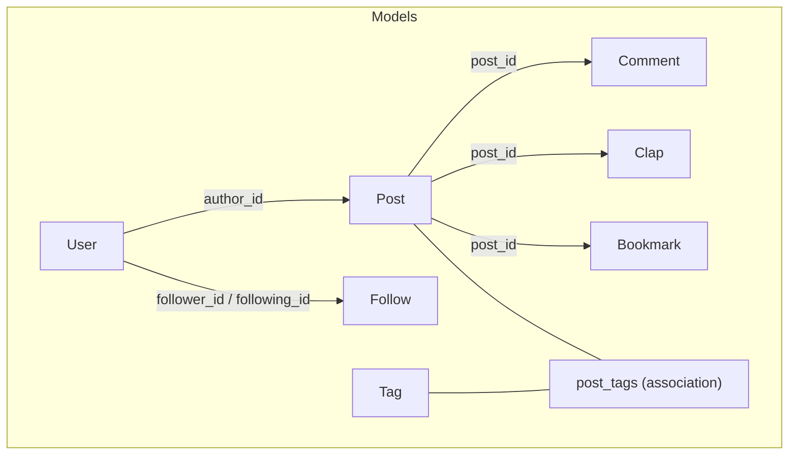
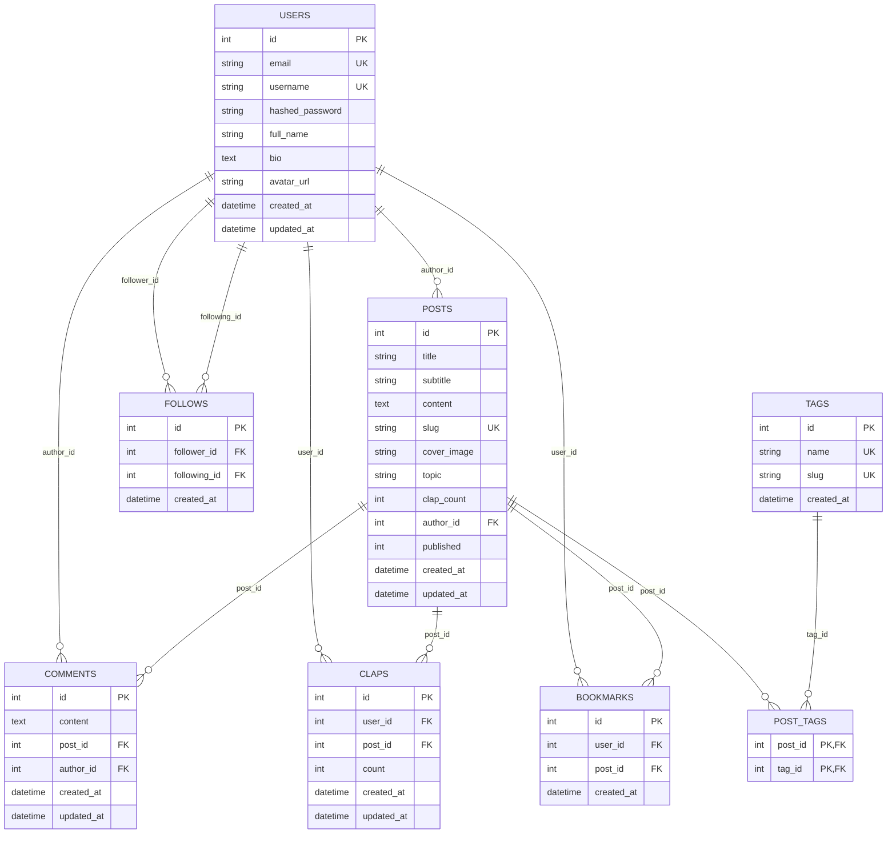
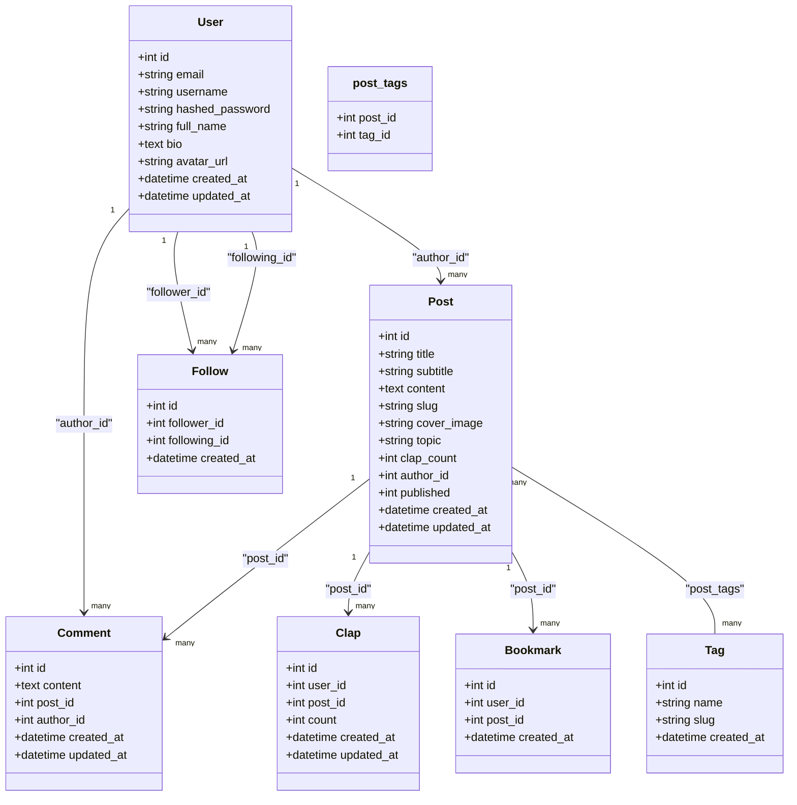
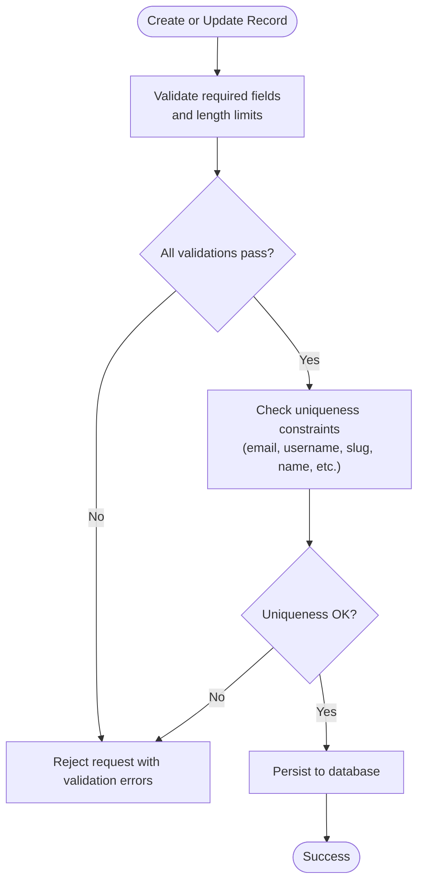
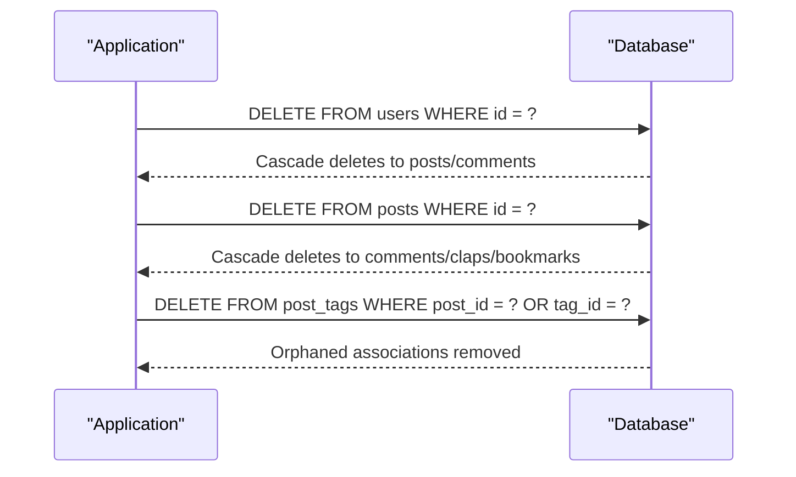
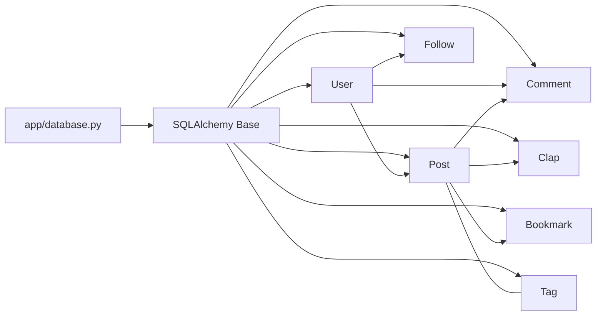

# Database Schema

<cite>
**Referenced Files in This Document**
- [user.py](file://app/models/user.py)
- [post.py](file://app/models/post.py)
- [comment.py](file://app/models/comment.py)
- [clap.py](file://app/models/clap.py)
- [follow.py](file://app/models/follow.py)
- [bookmark.py](file://app/models/bookmark.py)
- [tag.py](file://app/models/tag.py)
- [database.py](file://app/database.py)
</cite>

## Table of Contents
1. [Introduction](#introduction)
2. [Project Structure](#project-structure)
3. [Core Components](#core-components)
4. [Architecture Overview](#architecture-overview)
5. [Detailed Component Analysis](#detailed-component-analysis)
6. [Dependency Analysis](#dependency-analysis)
7. [Performance Considerations](#performance-considerations)
8. [Troubleshooting Guide](#troubleshooting-guide)
9. [Conclusion](#conclusion)

## Introduction
This document provides comprehensive data model documentation for the Lekhani database schema implemented with SQLAlchemy. It details entity relationships among User, Post, Comment, Clap, Follow, Bookmark, and Tag models; documents primary/foreign keys, indexes, constraints, and data types; explains relationship patterns (one-to-many, many-to-many, one-to-one); and includes database schema diagrams showing table structures and foreign key relationships. It also covers data validation rules, business constraints such as clap limits and tag restrictions, indexing strategies for performance optimization, data lifecycle management, migration patterns, and query optimization techniques used throughout the application.

## Project Structure
The data models are defined under app/models and share a common Base from app/database.py. The schema is composed of:
- Core entities: User, Post, Comment, Clap, Follow, Bookmark, Tag
- A many-to-many association table post_tags linking Posts and Tags
- Shared database configuration and session management in app/database.py

**Diagram sources**
- [user.py:6-27](file://app/models/user.py#L6-L27)
- [post.py:6-31](file://app/models/post.py#L6-L31)
- [comment.py:6-17](file://app/models/comment.py#L6-L17)
- [clap.py:7-19](file://app/models/clap.py#L7-L19)
- [follow.py:7-19](file://app/models/follow.py#L7-L19)
- [bookmark.py:7-17](file://app/models/bookmark.py#L7-L17)
- [tag.py:6-27](file://app/models/tag.py#L6-L27)

**Section sources**
- [database.py:1-27](file://app/database.py#L1-L27)
- [user.py:1-28](file://app/models/user.py#L1-L28)
- [post.py:1-32](file://app/models/post.py#L1-L32)
- [comment.py:1-18](file://app/models/comment.py#L1-L18)
- [clap.py:1-20](file://app/models/clap.py#L1-L20)
- [follow.py:1-21](file://app/models/follow.py#L1-L21)
- [bookmark.py:1-19](file://app/models/bookmark.py#L1-L19)
- [tag.py:1-29](file://app/models/tag.py#L1-L29)

## Core Components
This section summarizes each model’s fields, constraints, indexes, and relationships.

- User
  - Primary key: id (Integer, indexed)
  - Unique fields: email, username (both String, indexed)
  - Optional fields: full_name, bio (Text), avatar_url
  - Timestamps: created_at, updated_at (DateTime, auto-managed)
  - Relationships:
    - One-to-many to Post (author)
    - One-to-many to Comment (author)
    - Many-to-many to Follow via follower_id and following_id (bidirectional)

- Post
  - Primary key: id (Integer, indexed)
  - Fields: title (String, indexed), subtitle (String), content (Text), slug (String, unique, indexed), cover_image (String), topic (String, indexed), clap_count (Integer, default 0), published (Integer, 0=draft, 1=published)
  - Foreign key: author_id references users.id
  - Timestamps: created_at, updated_at
  - Relationships:
    - Many-to-one to User (author)
    - One-to-many to Comment
    - One-to-many to Clap
    - One-to-many to Bookmark
    - Many-to-many to Tag via post_tags

- Comment
  - Primary key: id (Integer, indexed)
  - Fields: content (Text), post_id (FK to posts.id), author_id (FK to users.id)
  - Timestamps: created_at, updated_at
  - Relationships:
    - Many-to-one to Post
    - Many-to-one to User

- Clap
  - Primary key: id (Integer, indexed)
  - Fields: user_id (FK to users.id), post_id (FK to posts.id), count (Integer, default 1)
  - Constraint: UniqueConstraint on (user_id, post_id) to prevent duplicate claps per user-post pair
  - Timestamps: created_at, updated_at
  - Relationships:
    - Many-to-one to User
    - Many-to-one to Post

- Follow
  - Primary key: id (Integer, indexed)
  - Fields: follower_id (FK to users.id, indexed), following_id (FK to users.id, indexed)
  - Constraint: UniqueConstraint on (follower_id, following_id) to prevent duplicate follow relations
  - Timestamp: created_at
  - Relationships:
    - Many-to-one to User (as follower)
    - Many-to-one to User (as following_user)

- Bookmark
  - Primary key: id (Integer, indexed)
  - Fields: user_id (FK to users.id, indexed), post_id (FK to posts.id, indexed)
  - Constraint: UniqueConstraint on (user_id, post_id) to prevent duplicate bookmarks per user-post pair
  - Timestamp: created_at
  - Relationships:
    - Many-to-one to User
    - Many-to-one to Post

- Tag
  - Primary key: id (Integer, indexed)
  - Fields: name (String(40), unique, indexed), slug (String(80), unique, indexed)
  - Timestamp: created_at
  - Relationship:
    - Many-to-many to Post via post_tags

- Association Table: post_tags
  - Columns: post_id (PK, FK to posts.id, ondelete=CASCADE), tag_id (PK, FK to tags.id, ondelete=CASCADE)
  - Composite primary key enforces uniqueness of (post_id, tag_id)

**Section sources**
- [user.py:6-27](file://app/models/user.py#L6-L27)
- [post.py:6-31](file://app/models/post.py#L6-L31)
- [comment.py:6-17](file://app/models/comment.py#L6-L17)
- [clap.py:7-19](file://app/models/clap.py#L7-L19)
- [follow.py:7-19](file://app/models/follow.py#L7-L19)
- [bookmark.py:7-17](file://app/models/bookmark.py#L7-L17)
- [tag.py:6-27](file://app/models/tag.py#L6-L27)

## Architecture Overview
The schema centers around User as the core actor who writes Posts and Comments, interacts with Posts through Claps and Bookmarks, follows other Users, and organizes Posts using Tags. The many-to-many relationship between Post and Tag is mediated by the post_tags association table.

**Diagram sources**
- [user.py:6-27](file://app/models/user.py#L6-L27)
- [post.py:6-31](file://app/models/post.py#L6-L31)
- [comment.py:6-17](file://app/models/comment.py#L6-L17)
- [clap.py:7-19](file://app/models/clap.py#L7-L19)
- [follow.py:7-19](file://app/models/follow.py#L7-L19)
- [bookmark.py:7-17](file://app/models/bookmark.py#L7-L17)
- [tag.py:6-27](file://app/models/tag.py#L6-L27)

## Detailed Component Analysis

### Entity Relationships and Patterns
- One-to-Many
  - User to Post: Each user can author many posts; posts reference users via author_id.
  - User to Comment: Each user can write many comments; comments reference users via author_id.
  - Post to Comment: Each post can have many comments; comments reference posts via post_id.
  - Post to Clap: Each post can receive many claps; claps reference posts via post_id.
  - Post to Bookmark: Each post can be bookmarked by many users; bookmarks reference posts via post_id.

- Many-to-Many
  - Post to Tag: Mediated by post_tags; composite primary key ensures uniqueness of (post_id, tag_id).

- Self-Referencing Many-to-Many (via Follow)
  - User to User: A user can follow many users; represented by Follow.follower_id and Follow.following_id referencing users.id.

- One-to-One
  - No explicit one-to-one relationships are defined in the current models.

**Diagram sources**
- [user.py:6-27](file://app/models/user.py#L6-L27)
- [post.py:6-31](file://app/models/post.py#L6-L31)
- [comment.py:6-17](file://app/models/comment.py#L6-L17)
- [clap.py:7-19](file://app/models/clap.py#L7-L19)
- [follow.py:7-19](file://app/models/follow.py#L7-L19)
- [bookmark.py:7-17](file://app/models/bookmark.py#L7-L17)
- [tag.py:6-27](file://app/models/tag.py#L6-L27)

**Section sources**
- [user.py:6-27](file://app/models/user.py#L6-L27)
- [post.py:6-31](file://app/models/post.py#L6-L31)
- [comment.py:6-17](file://app/models/comment.py#L6-L17)
- [clap.py:7-19](file://app/models/clap.py#L7-L19)
- [follow.py:7-19](file://app/models/follow.py#L7-L19)
- [bookmark.py:7-17](file://app/models/bookmark.py#L7-L17)
- [tag.py:6-27](file://app/models/tag.py#L6-L27)

### Data Validation Rules and Business Constraints
- Uniqueness and Required Fields
  - User.email and User.username must be unique and non-null.
  - Post.title, Post.content, and Post.slug must be non-null; Post.slug must be unique.
  - Tag.name and Tag.slug must be unique and non-null.
  - All foreign keys are non-null where defined.

- Duplicate Prevention
  - Clap.user_id + Clap.post_id must be unique to prevent multiple claps by the same user on the same post.
  - Bookmark.user_id + Bookmark.post_id must be unique to prevent duplicate bookmarks.
  - Follow.follower_id + Follow.following_id must be unique to prevent duplicate follow relations.

- Tag Restrictions
  - Tag.name is limited to 40 characters; Tag.slug is limited to 80 characters.

- Clap Limits
  - There is no explicit maximum clap limit enforced at the model level beyond the uniqueness constraint. The clap_count field on Post is an integer that defaults to 0 and can be incremented by application logic.

- Published Status
  - Post.published uses an integer flag (0=draft, 1=published). Application logic should enforce valid values.

[No sources needed since this diagram shows conceptual workflow, not actual code structure]

**Section sources**
- [user.py:9-17](file://app/models/user.py#L9-L17)
- [post.py:9-20](file://app/models/post.py#L9-L20)
- [clap.py:7-15](file://app/models/clap.py#L7-L15)
- [bookmark.py:7-14](file://app/models/bookmark.py#L7-L14)
- [follow.py:7-16](file://app/models/follow.py#L7-L16)
- [tag.py:14-20](file://app/models/tag.py#L14-L20)

### Indexing Strategy
- Primary Keys
  - All tables define an integer primary key column with index=True.

- Unique Indexes
  - User.email, User.username
  - Post.slug
  - Tag.name, Tag.slug
  - Composite unique constraints on Clap(user_id, post_id), Bookmark(user_id, post_id), Follow(follower_id, following_id)

- Query-Friendly Indexes
  - Post.title, Post.topic
  - Follow.follower_id, Follow.following_id
  - Bookmark.user_id, Bookmark.post_id

These indexes support frequent lookups by slug, title, topic, and foreign key columns commonly used in queries.

**Section sources**
- [user.py:9-17](file://app/models/user.py#L9-L17)
- [post.py:9-20](file://app/models/post.py#L9-L20)
- [clap.py:7-15](file://app/models/clap.py#L7-L15)
- [bookmark.py:7-14](file://app/models/bookmark.py#L7-L14)
- [follow.py:7-16](file://app/models/follow.py#L7-L16)
- [tag.py:14-20](file://app/models/tag.py#L14-L20)

### Data Lifecycle Management
- Cascading Deletes
  - User.posts, User.comments, Post.comments, Post.claps, Post.bookmarks use cascade="all, delete-orphan". Deleting a user cascades to their posts and comments; deleting a post cascades to its comments, claps, and bookmarks.
  - Association table post_tags uses ondelete="CASCADE" for both post_id and tag_id, ensuring orphaned associations are removed when referenced posts or tags are deleted.

- Timestamps
  - created_at and updated_at are managed automatically by SQLAlchemy defaults and onupdate behavior across most models.

**Diagram sources**
- [user.py:19-26](file://app/models/user.py#L19-L26)
- [post.py:22-26](file://app/models/post.py#L22-L26)
- [tag.py:6-11](file://app/models/tag.py#L6-L11)

**Section sources**
- [user.py:19-26](file://app/models/user.py#L19-L26)
- [post.py:22-26](file://app/models/post.py#L22-L26)
- [tag.py:6-11](file://app/models/tag.py#L6-L11)

### Migration Patterns
- The repository does not include Alembic migration files in the provided scope. Models are defined declaratively with SQLAlchemy Base. When migrations are introduced, ensure:
  - New tables and columns are added via Alembic revisions.
  - Unique constraints and indexes are explicitly declared in migrations to match model definitions.
  - Backfills for existing data (e.g., populating clap_count) are handled within migration scripts.

[No sources needed since this section provides general guidance]

### Query Optimization Techniques
- Eager Loading
  - Post.tags uses lazy="selectin" to reduce N+1 queries when loading tags alongside posts.

- Selective Index Usage
  - Queries filtering by slug, title, topic, and foreign keys benefit from existing indexes.

- Aggregation and Counters
  - Post.clap_count stores aggregated clap counts; keep it consistent with Clap records via application logic to avoid expensive COUNT operations.

- Avoid Over-Nesting Joins
  - For complex reads involving tags, prefer separate queries or selectin loading to minimize join overhead.

**Section sources**
- [post.py:26-30](file://app/models/post.py#L26-L30)

## Dependency Analysis
The models depend on shared infrastructure and each other through foreign keys and relationships.

**Diagram sources**
- [database.py:1-27](file://app/database.py#L1-L27)
- [user.py:6-27](file://app/models/user.py#L6-L27)
- [post.py:6-31](file://app/models/post.py#L6-L31)
- [comment.py:6-17](file://app/models/comment.py#L6-L17)
- [clap.py:7-19](file://app/models/clap.py#L7-L19)
- [follow.py:7-19](file://app/models/follow.py#L7-L19)
- [bookmark.py:7-17](file://app/models/bookmark.py#L7-L17)
- [tag.py:6-27](file://app/models/tag.py#L6-L27)

**Section sources**
- [database.py:1-27](file://app/database.py#L1-L27)
- [user.py:6-27](file://app/models/user.py#L6-L27)
- [post.py:6-31](file://app/models/post.py#L6-L31)
- [comment.py:6-17](file://app/models/comment.py#L6-L17)
- [clap.py:7-19](file://app/models/clap.py#L7-L19)
- [follow.py:7-19](file://app/models/follow.py#L7-L19)
- [bookmark.py:7-17](file://app/models/bookmark.py#L7-L17)
- [tag.py:6-27](file://app/models/tag.py#L6-L27)

## Performance Considerations
- Use selectin loading for Post.tags to avoid N+1 queries when rendering lists of posts with tags.
- Leverage existing indexes on slug, title, topic, and foreign keys for efficient filtering and joins.
- Keep Post.clap_count synchronized with Clap records to avoid expensive aggregations.
- Prefer targeted queries that filter by indexed columns (e.g., slug, topic) rather than scanning large tables.
- Monitor connection pool settings (pool_pre_ping, pool_recycle) configured in app/database.py to maintain stable connections under load.

[No sources needed since this section provides general guidance]

## Troubleshooting Guide
- Integrity Errors
  - Duplicate email/username/slug/name: Ensure uniqueness constraints are respected during create/update operations.
  - Duplicate clap/bookmark/follow: Validate before insert or handle integrity exceptions gracefully.

- Missing Records
  - If related records disappear unexpectedly, verify cascade behaviors and ensure application logic does not inadvertently trigger deletions.

- Stale Counts
  - If Post.clap_count is inconsistent with Clap records, reconcile by recalculating counts based on Clap entries and updating Post.clap_count.

- Connection Issues
  - Verify DATABASE_URL and connection arguments in app/database.py. Ensure check_same_thread is set appropriately for SQLite environments.

**Section sources**
- [database.py:5-15](file://app/database.py#L5-L15)
- [clap.py:7-15](file://app/models/clap.py#L7-L15)
- [bookmark.py:7-14](file://app/models/bookmark.py#L7-L14)
- [follow.py:7-16](file://app/models/follow.py#L7-L16)

## Conclusion
The Lekhani database schema defines a clear and extensible data model centered around Users, Posts, and their interactions through Comments, Claps, Bookmarks, and Tags. Strong constraints and indexes support data integrity and performance. Cascading deletes and timestamps simplify lifecycle management. While there is no explicit maximum clap limit at the model level, application logic can enforce business rules. With careful use of eager loading and targeted queries, the system can scale effectively while maintaining consistency and readability.