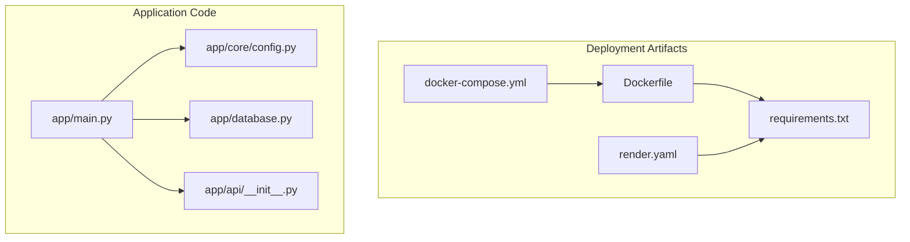
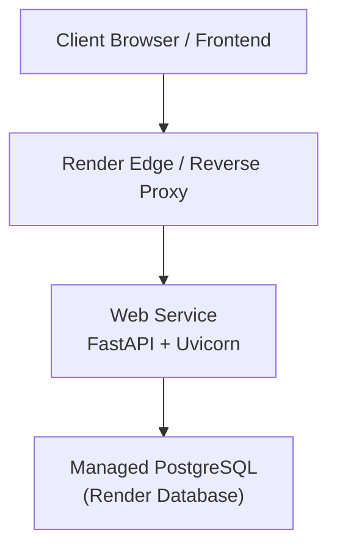
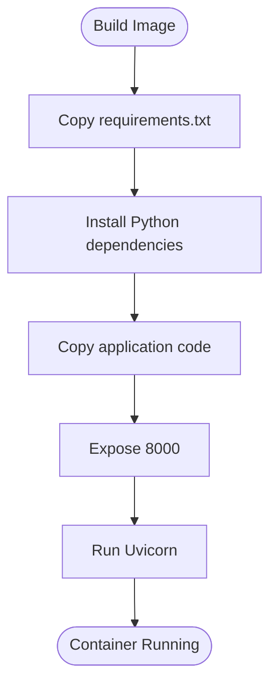
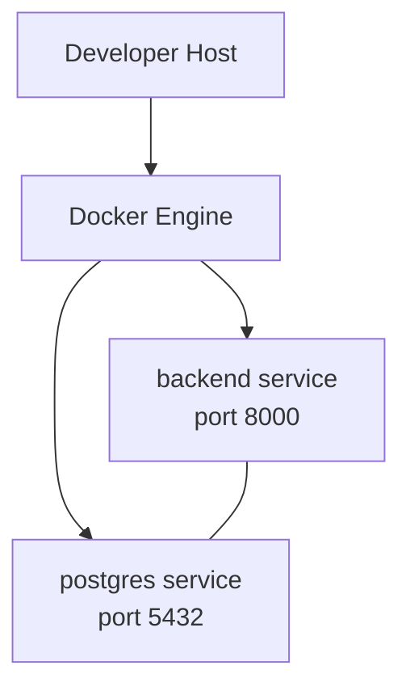
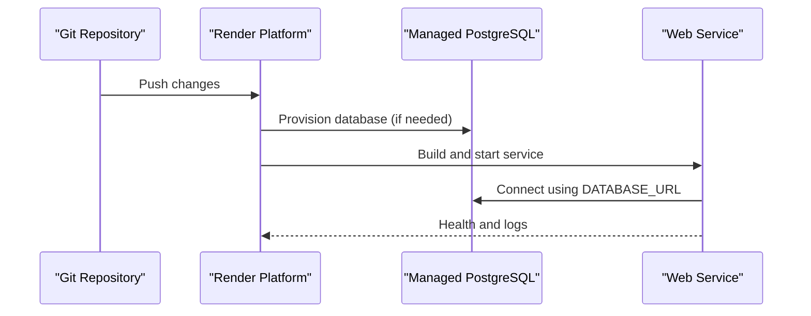
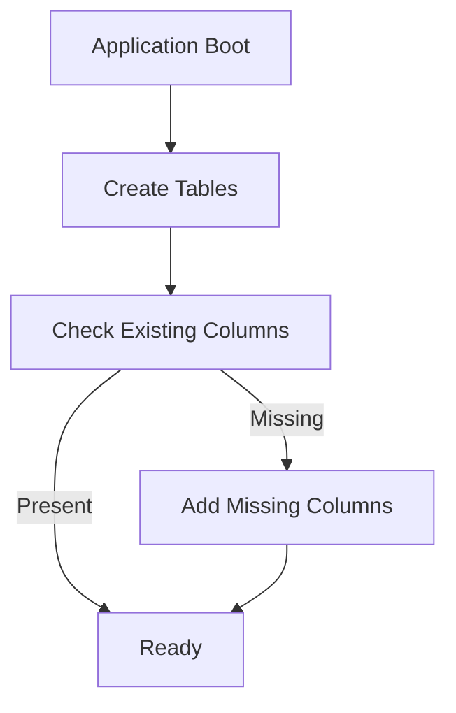
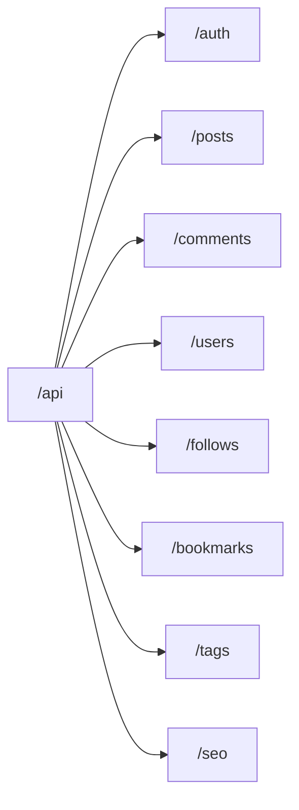
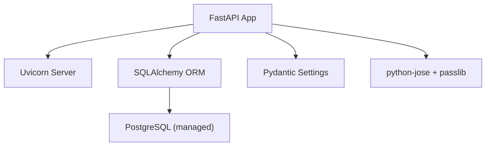

# Deployment Guide

<cite>
**Referenced Files in This Document**
- [Dockerfile](file://Dockerfile)
- [docker-compose.yml](file://docker-compose.yml)
- [render.yaml](file://render.yaml)
- [requirements.txt](file://requirements.txt)
- [app/main.py](file://app/main.py)
- [app/core/config.py](file://app/core/config.py)
- [app/database.py](file://app/database.py)
- [app/api/__init__.py](file://app/api/__init__.py)
</cite>

## Table of Contents
1. [Introduction](#introduction)
2. [Project Structure](#project-structure)
3. [Core Components](#core-components)
4. [Architecture Overview](#architecture-overview)
5. [Detailed Component Analysis](#detailed-component-analysis)
6. [Dependency Analysis](#dependency-analysis)
7. [Performance Considerations](#performance-considerations)
8. [Troubleshooting Guide](#troubleshooting-guide)
9. [Conclusion](#conclusion)
10. [Appendices](#appendices)

## Introduction
This guide provides comprehensive deployment documentation for the Lekhani backend, covering containerization with Docker, multi-container orchestration with docker-compose, and cloud deployment on Render using render.yaml. It also documents production environment setup, database provisioning, environment variable configuration, health checks, automation strategies, CI/CD pipeline setup, monitoring and logging, scaling considerations, common issues, rollback procedures, backup strategies, and performance tuning.

## Project Structure
The project is a FastAPI application with SQLAlchemy models, Pydantic settings, and Uvicorn as the ASGI server. Key deployment artifacts include:
- Dockerfile for containerizing the Python app
- docker-compose.yml for local development and multi-service orchestration
- render.yaml for defining Render services and managed PostgreSQL
- requirements.txt for Python dependencies
- Application code under app/, including main entrypoint, configuration, database layer, and API routers

**Diagram sources**
- [Dockerfile:1-32](file://Dockerfile#L1-L32)
- [docker-compose.yml:1-26](file://docker-compose.yml#L1-L26)
- [render.yaml:1-31](file://render.yaml#L1-L31)
- [requirements.txt:1-15](file://requirements.txt#L1-L15)
- [app/main.py:1-89](file://app/main.py#L1-L89)
- [app/core/config.py:1-48](file://app/core/config.py#L1-L48)
- [app/database.py:1-27](file://app/database.py#L1-L27)
- [app/api/__init__.py:1-15](file://app/api/__init__.py#L1-L15)

**Section sources**
- [Dockerfile:1-32](file://Dockerfile#L1-L32)
- [docker-compose.yml:1-26](file://docker-compose.yml#L1-L26)
- [render.yaml:1-31](file://render.yaml#L1-L31)
- [requirements.txt:1-15](file://requirements.txt#L1-L15)
- [app/main.py:1-89](file://app/main.py#L1-L89)
- [app/core/config.py:1-48](file://app/core/config.py#L1-L48)
- [app/database.py:1-27](file://app/database.py#L1-L27)
- [app/api/__init__.py:1-15](file://app/api/__init__.py#L1-L15)

## Core Components
- FastAPI application entrypoint initializes middleware, CORS, and routes; creates tables at startup and performs safe schema migrations for existing tables.
- Configuration uses pydantic-settings to load environment variables from .env or platform-provided env vars.
- Database layer configures SQLAlchemy engine and session factory with connection pooling and pre-ping.
- API router aggregates endpoints under /api prefix.

Key responsibilities:
- Container runtime and command execution via Uvicorn
- Environment-driven configuration (database URL, secrets, frontend URL, debug flags)
- Database initialization and migration helpers
- API routing and middleware stack

**Section sources**
- [app/main.py:1-89](file://app/main.py#L1-L89)
- [app/core/config.py:1-48](file://app/core/config.py#L1-L48)
- [app/database.py:1-27](file://app/database.py#L1-L27)
- [app/api/__init__.py:1-15](file://app/api/__init__.py#L1-L15)

## Architecture Overview
The backend runs as an ASGI service behind a reverse proxy (Render’s infrastructure). In development, Docker Compose can run the backend alongside a database service. In production, Render provisions a managed PostgreSQL instance and injects its connection string into the application via environment variables.

**Diagram sources**
- [render.yaml:1-31](file://render.yaml#L1-L31)
- [app/main.py:1-89](file://app/main.py#L1-L89)
- [app/database.py:1-27](file://app/database.py#L1-L27)

## Detailed Component Analysis

### Containerization with Docker
- Base image: Python 3.11 slim
- Working directory: /app
- System dependencies installed for compiling native packages
- Dependencies installed from requirements.txt
- Exposes port 8000
- Runs Uvicorn with host 0.0.0.0 and port 8000; includes --reload for development

Production notes:
- Remove --reload in production images
- Use a non-root user for security
- Pin dependency versions in requirements.txt for reproducibility
- Add health check endpoint and configure container healthcheck

**Diagram sources**
- [Dockerfile:1-32](file://Dockerfile#L1-L32)

**Section sources**
- [Dockerfile:1-32](file://Dockerfile#L1-L32)
- [requirements.txt:1-15](file://requirements.txt#L1-L15)

### Multi-Container Orchestration with docker-compose.yml
- Defines a single backend service that builds from the Dockerfile
- Maps host port 8000 to container port 8000
- Mounts source code and SQLite file for development convenience
- Sets PYTHONUNBUFFERED=1
- Uses a custom bridge network named lekhani-network

To add a database service:
- Add a PostgreSQL service with persistent volumes
- Pass DATABASE_URL to the backend via environment variables
- Link networks so both services communicate

**Diagram sources**
- [docker-compose.yml:1-26](file://docker-compose.yml#L1-L26)

**Section sources**
- [docker-compose.yml:1-26](file://docker-compose.yml#L1-L26)

### Cloud Deployment on Render with render.yaml
- Defines a managed PostgreSQL database named lekhani-db with databaseName lekhani and user lekhani
- Defines a web service lekhani-backend:
  - Runtime: python
  - Build command installs requirements
  - Start command runs Uvicorn bound to $PORT provided by Render
  - Environment variables:
    - DATABASE_URL injected from the managed database
    - SECRET_KEY generated automatically
    - DEBUG set to false
    - GOOGLE_CLIENT_ID configured externally
    - FRONTEND_URL set to production frontend domain
  - autoDeploy enabled

**Diagram sources**
- [render.yaml:1-31](file://render.yaml#L1-L31)
- [app/main.py:1-89](file://app/main.py#L1-L89)
- [app/database.py:1-27](file://app/database.py#L1-L27)

**Section sources**
- [render.yaml:1-31](file://render.yaml#L1-L31)

### Production Environment Setup
- Ensure DATABASE_URL points to a production database (Render injects it automatically)
- Set SECRET_KEY to a strong random value (Render generates one if not provided)
- Disable DEBUG mode
- Configure GOOGLE_CLIENT_ID for OAuth
- Set FRONTEND_URL to your production frontend domain
- Verify CORS ALLOW_ORIGINS includes your frontend domains

Environment variable precedence:
- Platform-provided environment variables (Render)
- .env file loaded by pydantic-settings

**Section sources**
- [app/core/config.py:1-48](file://app/core/config.py#L1-L48)
- [render.yaml:1-31](file://render.yaml#L1-L31)

### Database Provisioning and Migration Strategy
- At startup, the application creates all tables defined by SQLAlchemy models
- A helper ensures new columns are added safely to existing tables without breaking deployments
- For production, use a managed PostgreSQL instance and run migrations explicitly if needed

**Diagram sources**
- [app/main.py:11-31](file://app/main.py#L11-L31)
- [app/database.py:1-27](file://app/database.py#L1-L27)

**Section sources**
- [app/main.py:11-31](file://app/main.py#L11-L31)
- [app/database.py:1-27](file://app/database.py#L1-L27)

### Health Check Endpoints
- The root route returns a simple JSON response indicating the service is up
- For production readiness, add dedicated /health and /ready endpoints:
  - /health: basic status
  - /ready: verify database connectivity and other dependencies

Implementation guidance:
- Add a GET /health returning HTTP 200 with a status payload
- Add a GET /ready that attempts a lightweight database query and returns failure if unavailable
- Configure Render health checks to probe these endpoints

**Section sources**
- [app/main.py:83-85](file://app/main.py#L83-L85)

### API Routing Overview
- All API endpoints are mounted under /api
- Sub-routers include authentication, posts, comments, follows, bookmarks, tags, users, and SEO

**Diagram sources**
- [app/api/__init__.py:1-15](file://app/api/__init__.py#L1-L15)

**Section sources**
- [app/api/__init__.py:1-15](file://app/api/__init__.py#L1-L15)

## Dependency Analysis
External dependencies relevant to deployment:
- FastAPI and uvicorn[standard] for ASGI serving
- SQLAlchemy and psycopg2-binary for database access
- pydantic and pydantic-settings for configuration validation
- python-jose[cryptography] and passlib[bcrypt] for JWT and password hashing
- httpx and requests for HTTP client usage
- email-validator for input validation

**Diagram sources**
- [requirements.txt:1-15](file://requirements.txt#L1-L15)
- [app/database.py:1-27](file://app/database.py#L1-L27)
- [app/core/config.py:1-48](file://app/core/config.py#L1-L48)

**Section sources**
- [requirements.txt:1-15](file://requirements.txt#L1-L15)
- [app/database.py:1-27](file://app/database.py#L1-L27)
- [app/core/config.py:1-48](file://app/core/config.py#L1-L48)

## Performance Considerations
- Use a production-grade WSGI/ASGI server configuration:
  - Increase worker processes based on CPU cores
  - Tune connection pool size and recycling
- Optimize database queries and indexes
- Enable compression and caching where appropriate
- Monitor memory and CPU usage; scale horizontally when needed
- Avoid hot reload in production

[No sources needed since this section provides general guidance]

## Troubleshooting Guide
Common issues and resolutions:
- Port binding errors: ensure the process binds to 0.0.0.0 and the correct port
- Database connection failures: verify DATABASE_URL format and credentials
- CORS errors: confirm ALLOW_ORIGINS and frontend URL match
- Missing environment variables: ensure all required variables are set in the platform
- Slow startup due to migrations: pre-run migrations or optimize migration logic

Operational tips:
- Log application errors and request traces
- Use structured logging for observability
- Implement retries for transient database errors
- Validate environment variables at startup

**Section sources**
- [app/main.py:35-44](file://app/main.py#L35-L44)
- [app/core/config.py:1-48](file://app/core/config.py#L1-L48)
- [app/database.py:1-27](file://app/database.py#L1-L27)

## Conclusion
This guide outlined how to containerize the Lekhani backend, orchestrate services locally, and deploy to Render with a managed database. It covered environment configuration, health checks, and operational best practices. Following these steps will help you achieve reliable, secure, and scalable production deployments.

[No sources needed since this section summarizes without analyzing specific files]

## Appendices

### Deployment Automation Strategies
- Use Render’s auto-deploy feature to trigger builds on pushes
- Integrate GitHub Actions for linting, tests, and build verification before pushing to main
- Tag releases and promote through environments (staging → production)

### CI/CD Pipeline Setup
- Lint and type-check code
- Run unit and integration tests against a test database
- Build Docker image and push to a registry
- Deploy to staging automatically; require manual approval for production

### Monitoring and Logging Configuration
- Enable structured JSON logs
- Forward logs to a centralized logging service
- Set up metrics collection (request latency, error rates)
- Configure alerts for critical failures

### Scaling Considerations
- Horizontal scaling by increasing replicas
- Vertical scaling by upgrading plan resources
- Database scaling via managed provider options
- Cache frequently accessed data

### Rollback Procedures
- Keep previous release artifacts (images or git tags)
- Re-deploy the last known good version
- Restore database from backup if necessary

### Backup Strategies for Production Data
- Schedule automated backups of the managed database
- Store backups securely with encryption
- Test restore procedures regularly

### Security Best Practices
- Rotate secrets periodically
- Restrict CORS origins strictly
- Enforce HTTPS everywhere
- Validate and sanitize inputs

[No sources needed since this section provides general guidance]