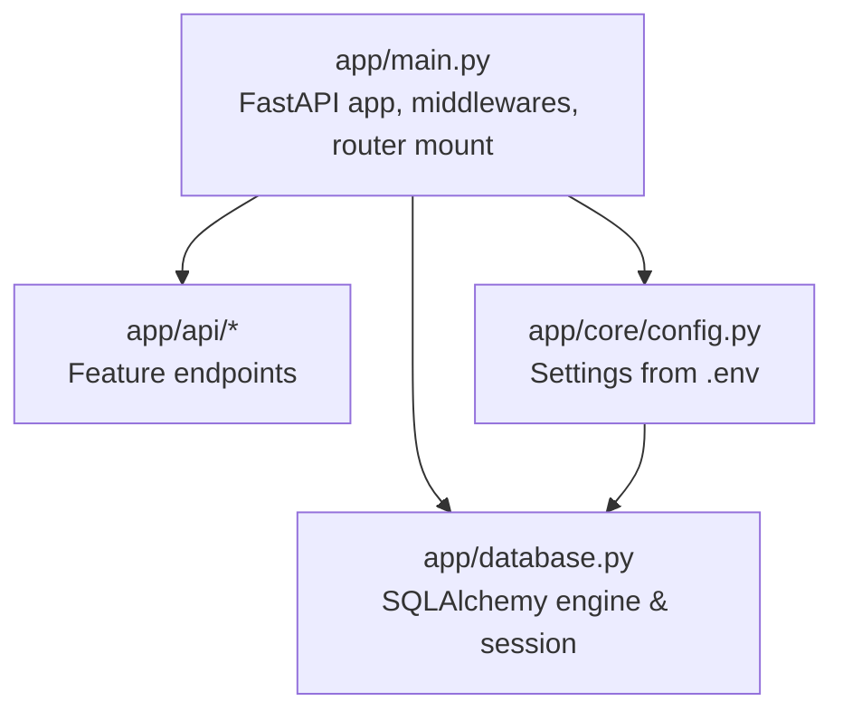
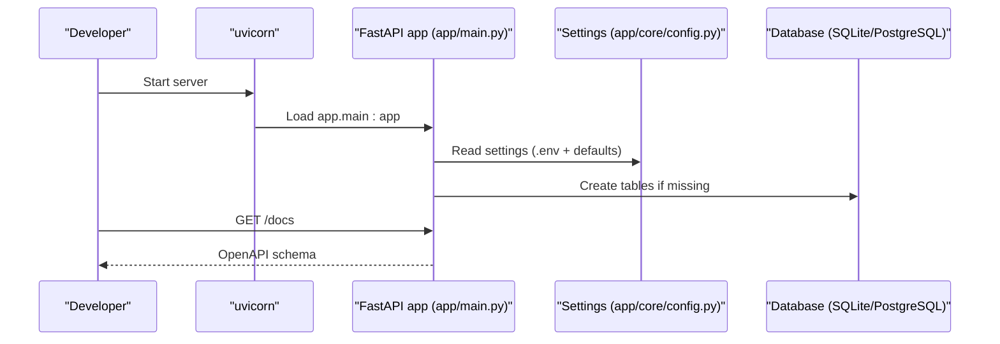

# Getting Started

<cite>
**Referenced Files in This Document**
- [README.md](file://README.md)
- [requirements.txt](file://requirements.txt)
- [app/main.py](file://app/main.py)
- [app/core/config.py](file://app/core/config.py)
- [app/database.py](file://app/database.py)
- [docker-compose.yml](file://docker-compose.yml)
- [Dockerfile](file://Dockerfile)
</cite>

## Table of Contents
1. [Introduction](#introduction)
2. [Project Structure](#project-structure)
3. [Core Components](#core-components)
4. [Architecture Overview](#architecture-overview)
5. [Detailed Component Analysis](#detailed-component-analysis)
6. [Dependency Analysis](#dependency-analysis)
7. [Performance Considerations](#performance-considerations)
8. [Troubleshooting Guide](#troubleshooting-guide)
9. [Conclusion](#conclusion)

## Introduction
This guide helps you set up and run the Lekhani backend locally, configure environment variables, choose a database (SQLite for development, PostgreSQL for production), and deploy with Docker. It also includes verification steps to ensure the API is running correctly at http://127.0.0.1:8000/docs.

## Project Structure
The backend is a FastAPI application organized by feature modules under app/api/endpoints, with core configuration, security, and dependencies in app/core; data models in app/models; Pydantic schemas in app/schemas; and shared database utilities in app/database.py. The entry point is app/main.py, which creates tables, registers middlewares, and mounts routers under /api.

**Diagram sources**
- [app/main.py:1-89](file://app/main.py#L1-L89)
- [app/core/config.py:1-48](file://app/core/config.py#L1-L48)
- [app/database.py:1-27](file://app/database.py#L1-L27)

**Section sources**
- [README.md:85-98](file://README.md#L85-L98)
- [app/main.py:1-89](file://app/main.py#L1-L89)

## Core Components
- Application entrypoint: app/main.py initializes the FastAPI app, ensures DB tables exist, adds CORS and other ASGI middlewares, and mounts routers under /api.
- Configuration: app/core/config.py loads settings from environment variables and a .env file, including DATABASE_URL, SECRET_KEY, FRONTEND_URL, ALLOW_ORIGINS, HOST, and PORT.
- Database: app/database.py configures SQLAlchemy engine based on DATABASE_URL, sets SQLite-specific connect args, and provides a get_db dependency.

Key responsibilities:
- app/main.py: App lifecycle, middleware registration, route mounting, root endpoint.
- app/core/config.py: Centralized settings with defaults and env overrides.
- app/database.py: Engine/session setup and connection pooling options.

**Section sources**
- [app/main.py:1-89](file://app/main.py#L1-L89)
- [app/core/config.py:1-48](file://app/core/config.py#L1-L48)
- [app/database.py:1-27](file://app/database.py#L1-L27)

## Architecture Overview
At runtime, uvicorn serves the FastAPI app defined in app/main.py. The app reads configuration from app/core/config.py (including .env), connects to a database via app/database.py, and exposes REST endpoints under /api. For local development, SQLite is used by default; for production, configure DATABASE_URL to use PostgreSQL.

**Diagram sources**
- [app/main.py:1-89](file://app/main.py#L1-L89)
- [app/core/config.py:1-48](file://app/core/config.py#L1-L48)
- [app/database.py:1-27](file://app/database.py#L1-L27)

## Detailed Component Analysis

### Local Development Setup (SQLite)
Follow these steps to run the backend locally using SQLite:

1. Install Python 3.9+ and pip.
2. Clone the repository and enter the project directory.
3. Copy the example environment file and adjust values as needed:
   - cp .env.example .env
4. Install dependencies:
   - pip install -r requirements.txt
5. Run the application with uvicorn:
   - uvicorn app.main:app --reload
6. Verify the API docs:
   - Open http://127.0.0.1:8000/docs in your browser.

Notes:
- Local development uses SQLite by default. The database file is created next to the app code.
- You can override settings via .env or environment variables.

**Section sources**
- [README.md:7-41](file://README.md#L7-L41)
- [app/core/config.py:11-15](file://app/core/config.py#L11-L15)
- [app/database.py:6-15](file://app/database.py#L6-L15)

### Environment Configuration
The application loads settings from a .env file located at the repository root. Key variables include:

- DATABASE_URL: Connection string. Default is SQLite for local; set to a PostgreSQL URL for production.
- SECRET_KEY: Used for signing tokens. Change this in production.
- GOOGLE_CLIENT_ID: Google OAuth client ID.
- FRONTEND_URL: Base URL for frontend (used in sitemap/RSS links).
- ALLOW_ORIGINS: List of allowed origins for CORS.
- HOST and PORT: Server binding host and port.

Configuration loading:
- Settings are loaded from .env via pydantic-settings.
- Defaults are provided in code when variables are not set.

Example usage patterns:
- Local: Leave DATABASE_URL unset to use SQLite.
- Production: Set DATABASE_URL to a PostgreSQL connection string and update SECRET_KEY.

**Section sources**
- [app/core/config.py:1-48](file://app/core/config.py#L1-L48)

### Production PostgreSQL Configuration
To run with PostgreSQL:

1. Provision a PostgreSQL instance and create a database.
2. Set DATABASE_URL to the PostgreSQL connection string in .env or your deployment environment.
3. Ensure SECRET_KEY is set to a strong random value.
4. Restart the application so it picks up the new DATABASE_URL.

Behavior:
- app/database.py detects SQLite vs. other databases and adjusts connect_args accordingly.
- app/main.py creates tables on startup using Base.metadata.create_all.

**Section sources**
- [app/core/config.py:11-15](file://app/core/config.py#L11-L15)
- [app/database.py:6-15](file://app/database.py#L6-L15)
- [app/main.py:11-12](file://app/main.py#L11-L12)

### Docker Deployment

#### Using docker-compose.yml
Recommended for local development with hot reload and persistent SQLite file:

- Build and start services:
  - docker compose up --build
- Access the API:
  - http://127.0.0.1:8000/docs

Details:
- The compose service builds from Dockerfile, maps port 8000, mounts source code for live reload, and persists app.db.
- The command runs uvicorn with --reload enabled.

**Section sources**
- [docker-compose.yml:1-26](file://docker-compose.yml#L1-L26)
- [Dockerfile:1-32](file://Dockerfile#L1-L32)

#### Using Dockerfile directly
If you prefer building and running the container manually:

- Build image:
  - docker build -t lekhani-backend .
- Run container:
  - docker run -p 8000:8000 lekhani-backend

Notes:
- The container installs system dependencies (gcc) and Python packages from requirements.txt.
- The CMD starts uvicorn bound to 0.0.0.0:8000 with --reload.

**Section sources**
- [Dockerfile:1-32](file://Dockerfile#L1-L32)

### First-Time Setup Checklist
- Python 3.9+ installed and accessible via python.
- pip available.
- Repository cloned.
- .env copied from .env.example and configured (optional for local).
- Dependencies installed via pip install -r requirements.txt.
- Server started with uvicorn app.main:app --reload.
- Browser opened at http://127.0.0.1:8000/docs.

**Section sources**
- [README.md:7-41](file://README.md#L7-L41)

## Dependency Analysis
The backend depends on FastAPI, uvicorn, SQLAlchemy, Pydantic, and various supporting libraries. The most relevant for setup are:

- FastAPI and uvicorn[standard]: Web framework and ASGI server.
- sqlalchemy and psycopg2-binary: ORM and PostgreSQL driver.
- pydantic and pydantic-settings: Data validation and settings management.
- python-dotenv: Loading .env files.
- passlib[bcrypt] and bcrypt: Password hashing.
- python-jose[cryptography]: JWT handling.
- email-validator: Email validation.
- httpx and requests: HTTP clients.
- python-multipart: Form parsing.

Install all dependencies with:
- pip install -r requirements.txt

**Section sources**
- [requirements.txt:1-15](file://requirements.txt#L1-L15)

## Performance Considerations
- Use SQLite for local development only. Switch to PostgreSQL for production workloads.
- Keep pool_pre_ping enabled to verify connections before use.
- Adjust pool_recycle according to your database’s connection limits.
- In production, disable uvicorn’s --reload flag for performance.

[No sources needed since this section provides general guidance]

## Troubleshooting Guide

Common issues and resolutions:

- ModuleNotFoundError or package not found
  - Ensure you installed dependencies with pip install -r requirements.txt.
  - If using virtual environments, activate the correct environment before running uvicorn.

- Port already in use
  - Stop any process using port 8000 or change HOST/PORT in .env and restart.

- Database errors on startup
  - Verify DATABASE_URL is correct for your environment.
  - For SQLite, ensure the app has write permissions to create app.db.
  - For PostgreSQL, confirm credentials, host, and database existence.

- CORS errors from frontend
  - Add your frontend origin to ALLOW_ORIGINS in .env or app/core/config.py.

- Docker build fails due to missing system packages
  - The Dockerfile installs gcc; ensure your Docker daemon has network access to install apt packages.

- Hot reload not working in Docker
  - Use docker-compose.yml which mounts source code and enables --reload.

Verification steps:
- Start the server and open http://127.0.0.1:8000/docs.
- Confirm the OpenAPI schema loads without errors.
- Test a simple endpoint such as the root path to ensure responses are returned.

**Section sources**
- [app/core/config.py:31-41](file://app/core/config.py#L31-L41)
- [app/database.py:6-15](file://app/database.py#L6-L15)
- [app/main.py:33-44](file://app/main.py#L33-L44)

## Conclusion
You now have everything needed to install, configure, and run the Lekhani backend locally with SQLite, switch to PostgreSQL for production, and deploy using Docker. Verify your setup by opening the interactive API docs at http://127.0.0.1:8000/docs.

[No sources needed since this section summarizes without analyzing specific files]