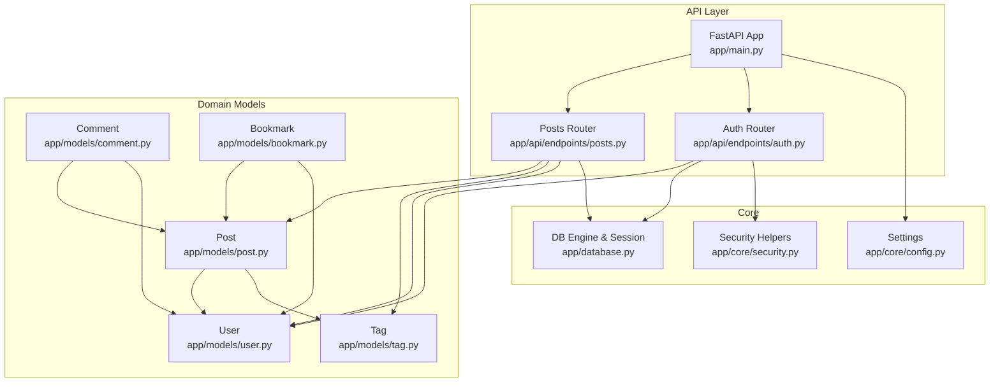
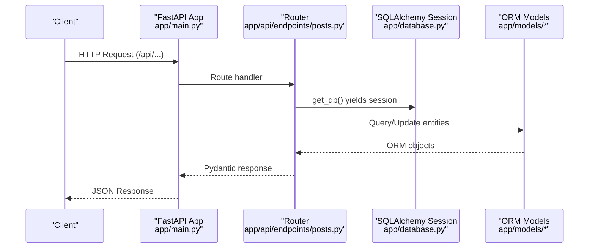
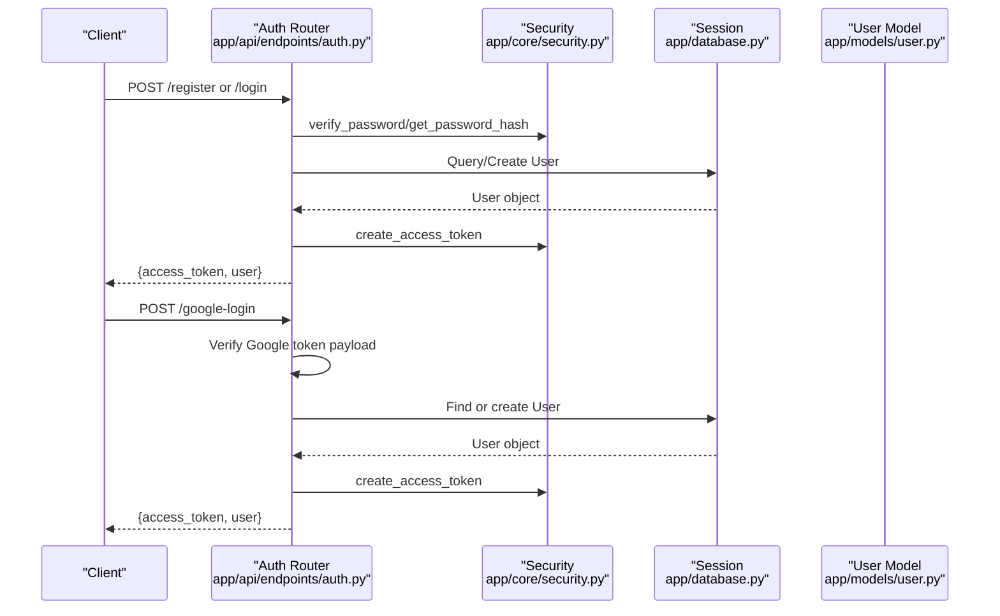
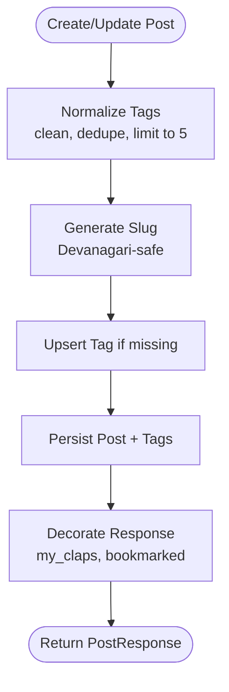
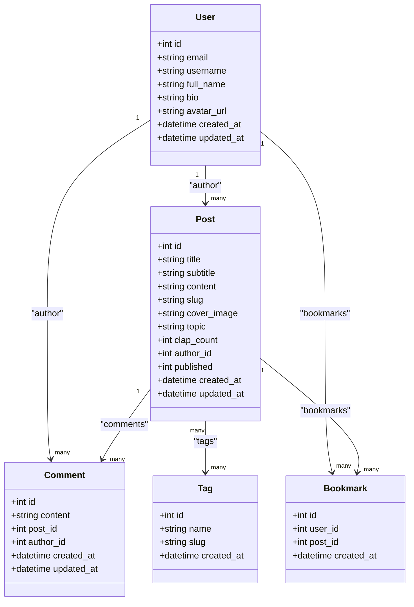
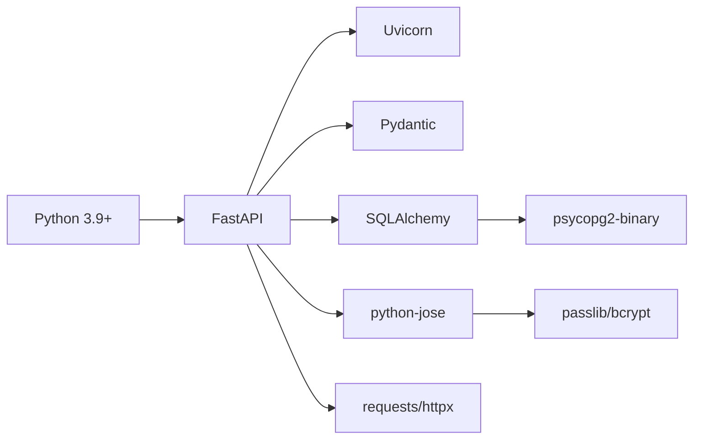

# Project Overview

<cite>
**Referenced Files in This Document**
- [README.md](file://README.md)
- [requirements.txt](file://requirements.txt)
- [app/main.py](file://app/main.py)
- [app/core/config.py](file://app/core/config.py)
- [app/database.py](file://app/database.py)
- [app/models/post.py](file://app/models/post.py)
- [app/models/user.py](file://app/models/user.py)
- [app/models/tag.py](file://app/models/tag.py)
- [app/models/comment.py](file://app/models/comment.py)
- [app/models/bookmark.py](file://app/models/bookmark.py)
- [app/api/endpoints/posts.py](file://app/api/endpoints/posts.py)
- [app/schemas/post.py](file://app/schemas/post.py)
- [app/api/endpoints/auth.py](file://app/api/endpoints/auth.py)
- [app/core/security.py](file://app/core/security.py)
</cite>

## Table of Contents
1. [Introduction](#introduction)
2. [Project Structure](#project-structure)
3. [Core Components](#core-components)
4. [Architecture Overview](#architecture-overview)
5. [Detailed Component Analysis](#detailed-component-analysis)
6. [Dependency Analysis](#dependency-analysis)
7. [Performance Considerations](#performance-considerations)
8. [Troubleshooting Guide](#troubleshooting-guide)
9. [Conclusion](#conclusion)

## Introduction
Lekhani (लेखनी) is a Medium-style backend platform for Hindi writers to publish and discover content such as कहानी (stories), निबंध (essays), and संस्मरण (memoirs). It provides authentication, post management, tagging, comments, clapping, bookmarks, follows, and SEO utilities like sitemap and RSS. The backend is built with FastAPI and SQLAlchemy, supports PostgreSQL in production, and uses Pydantic for request/response validation.

Key characteristics:
- Purpose: A community-driven publishing platform for Hindi-language creative writing.
- Audience: Writers and readers who consume कहानी, निबंध, and संस्मरण.
- Core capabilities: Auth (email/password and Google OAuth), posts CRUD, tags, comments, claps, bookmarks, follows, and SEO endpoints.

**Section sources**
- [README.md:1-10](file://README.md#L1-L10)
- [README.md:43-83](file://README.md#L43-L83)

## Project Structure
The backend follows a layered structure:
- API layer: FastAPI routers under app/api/endpoints for auth, posts, comments, users, follows, bookmarks, tags, and SEO.
- Domain models: SQLAlchemy ORM models under app/models for User, Post, Tag, Comment, Bookmark, etc.
- Schemas: Pydantic models under app/schemas for input/output validation.
- Core: Configuration, security helpers, and shared dependencies under app/core.
- Database: Engine, session factory, and base model under app/database.
- Application entrypoint: FastAPI app setup, middleware, and router registration under app/main.py.

**Diagram sources**
- [app/main.py:1-89](file://app/main.py#L1-L89)
- [app/api/endpoints/posts.py:1-298](file://app/api/endpoints/posts.py#L1-L298)
- [app/api/endpoints/auth.py:1-128](file://app/api/endpoints/auth.py#L1-L128)
- [app/models/user.py:1-28](file://app/models/user.py#L1-L28)
- [app/models/post.py:1-32](file://app/models/post.py#L1-L32)
- [app/models/tag.py:1-29](file://app/models/tag.py#L1-L29)
- [app/models/comment.py:1-18](file://app/models/comment.py#L1-L18)
- [app/models/bookmark.py:1-19](file://app/models/bookmark.py#L1-L19)
- [app/core/config.py:1-48](file://app/core/config.py#L1-L48)
- [app/core/security.py:1-34](file://app/core/security.py#L1-L34)
- [app/database.py:1-27](file://app/database.py#L1-L27)

**Section sources**
- [README.md:85-98](file://README.md#L85-L98)
- [app/main.py:1-89](file://app/main.py#L1-L89)

## Core Components
- FastAPI application: Initializes the app, sets up CORS and custom headers, creates tables, and mounts API routes under /api.
- Configuration: Centralized settings via Pydantic Settings, including DATABASE_URL, JWT secrets, frontend URL, and CORS origins.
- Database: SQLAlchemy engine and session factory; defaults to SQLite locally and supports PostgreSQL via DATABASE_URL.
- Authentication: Email/password and Google OAuth flows returning JWT tokens; password hashing with bcrypt.
- Posts domain: Full CRUD for posts, slug generation, tag normalization, clap counting, and viewer-specific decoration (clap count and bookmark state).
- Schemas: Pydantic models for validating inputs and shaping responses, including tag name/slug extraction.

Practical examples of platform capabilities:
- Register or log in to get a JWT token.
- Create a post with tags like ["कहानी", "निबंध"].
- Browse published feed filtered by topic, tag, search query, or following authors.
- Clap up to 50 times per reader on a post.
- Bookmark posts for later reading.
- Follow/unfollow other writers and view their profiles.

**Section sources**
- [app/main.py:11-89](file://app/main.py#L11-L89)
- [app/core/config.py:5-48](file://app/core/config.py#L5-L48)
- [app/database.py:1-27](file://app/database.py#L1-L27)
- [app/api/endpoints/auth.py:18-128](file://app/api/endpoints/auth.py#L18-L128)
- [app/core/security.py:1-34](file://app/core/security.py#L1-L34)
- [app/api/endpoints/posts.py:22-58](file://app/api/endpoints/posts.py#L22-L58)
- [app/schemas/post.py:1-60](file://app/schemas/post.py#L1-L60)

## Architecture Overview
High-level flow from client to database:

System boundaries:
- External services: Google OAuth token verification endpoint used during sign-in.
- Frontend: Consumes REST APIs; generates sitemap/RSS links using FRONTEND_URL.
- Storage: SQLite for local development; PostgreSQL recommended for production.

**Diagram sources**
- [app/main.py:33-89](file://app/main.py#L33-L89)
- [app/api/endpoints/posts.py:83-126](file://app/api/endpoints/posts.py#L83-L126)
- [app/database.py:10-25](file://app/database.py#L10-L25)
- [app/models/post.py:6-32](file://app/models/post.py#L6-L32)
- [app/api/endpoints/auth.py:18-87](file://app/api/endpoints/auth.py#L18-L87)

**Section sources**
- [README.md:33-41](file://README.md#L33-L41)
- [README.md:79-83](file://README.md#L79-L83)

## Detailed Component Analysis

### Authentication Flow
Handles email/password and Google OAuth login, issuing JWTs for subsequent requests.

**Diagram sources**
- [app/api/endpoints/auth.py:18-128](file://app/api/endpoints/auth.py#L18-L128)
- [app/core/security.py:10-32](file://app/core/security.py#L10-L32)
- [app/models/user.py:6-28](file://app/models/user.py#L6-L28)
- [app/database.py:20-25](file://app/database.py#L20-L25)

**Section sources**
- [app/api/endpoints/auth.py:18-128](file://app/api/endpoints/auth.py#L18-L128)
- [app/core/security.py:1-34](file://app/core/security.py#L1-L34)

### Posts Domain and Tagging
Manages creation, retrieval, updates, deletion, and interaction (claps) for posts, with robust tag handling and Devanagari-friendly slugs.

Key behaviors:
- Slug generation preserves Hindi characters and ensures uniqueness.
- Tag normalization enforces length constraints and limits to five tags per post.
- Viewer decoration attaches per-user clap counts and bookmark state.

**Diagram sources**
- [app/api/endpoints/posts.py:22-58](file://app/api/endpoints/posts.py#L22-L58)
- [app/api/endpoints/posts.py:186-214](file://app/api/endpoints/posts.py#L186-L214)
- [app/api/endpoints/posts.py:61-80](file://app/api/endpoints/posts.py#L61-L80)

**Section sources**
- [app/api/endpoints/posts.py:22-58](file://app/api/endpoints/posts.py#L22-L58)
- [app/api/endpoints/posts.py:83-126](file://app/api/endpoints/posts.py#L83-L126)
- [app/api/endpoints/posts.py:186-214](file://app/api/endpoints/posts.py#L186-L214)
- [app/schemas/post.py:1-60](file://app/schemas/post.py#L1-L60)

### Data Models and Relationships
Core entities and relationships:

**Diagram sources**
- [app/models/user.py:6-28](file://app/models/user.py#L6-L28)
- [app/models/post.py:6-32](file://app/models/post.py#L6-L32)
- [app/models/tag.py:14-29](file://app/models/tag.py#L14-L29)
- [app/models/comment.py:6-18](file://app/models/comment.py#L6-L18)
- [app/models/bookmark.py:7-19](file://app/models/bookmark.py#L7-L19)

**Section sources**
- [app/models/user.py:1-28](file://app/models/user.py#L1-L28)
- [app/models/post.py:1-32](file://app/models/post.py#L1-L32)
- [app/models/tag.py:1-29](file://app/models/tag.py#L1-L29)
- [app/models/comment.py:1-18](file://app/models/comment.py#L1-L18)
- [app/models/bookmark.py:1-19](file://app/models/bookmark.py#L1-L19)

## Dependency Analysis
Technology stack and runtime dependencies:
- Python 3.9+
- FastAPI and Uvicorn for ASGI server and routing
- SQLAlchemy for ORM and engine configuration
- Pydantic and pydantic-settings for configuration and validation
- psycopg2-binary for PostgreSQL connectivity
- python-jose for JWT operations
- passlib/bcrypt for password hashing
- httpx/requests for external calls (e.g., Google token verification)

**Diagram sources**
- [requirements.txt:1-15](file://requirements.txt#L1-L15)

**Section sources**
- [requirements.txt:1-15](file://requirements.txt#L1-L15)
- [README.md:7-10](file://README.md#L7-L10)

## Performance Considerations
- Database connection pooling: Enabled with pool_pre_ping and pool_recycle to maintain healthy connections.
- Selective loading: Tag relationships use selectin loading to reduce N+1 queries when listing posts.
- Pagination: Feed endpoints support skip/limit parameters to control result set size.
- Indexing: Frequently queried columns (title, slug, topic, author_id) are indexed to speed up lookups.
- Local vs production storage: SQLite for local development; PostgreSQL for scalable production workloads.

Recommendations:
- Use read replicas for heavy read traffic on feeds and post detail pages.
- Cache popular tags and top posts at the edge or application cache layer.
- Monitor slow queries and add composite indexes where appropriate (e.g., author_id + published).

**Section sources**
- [app/database.py:10-15](file://app/database.py#L10-L15)
- [app/models/tag.py:22-27](file://app/models/tag.py#L22-L27)
- [app/api/endpoints/posts.py:83-126](file://app/api/endpoints/posts.py#L83-L126)
- [app/models/post.py:9-16](file://app/models/post.py#L9-L16)

## Troubleshooting Guide
Common issues and resolutions:
- Google OAuth failures: Ensure GOOGLE_CLIENT_ID matches the verified token audience; check network access to Google’s tokeninfo endpoint.
- Invalid JSON body: Validate request payloads before sending to /google-login.
- Duplicate email/username: Registration rejects existing emails and usernames; update inputs accordingly.
- Unauthorized edits/deletes: Only the post author can modify or remove their posts; verify current_user context.
- Missing columns after migrations: On startup, the app attempts to add topic and clap_count columns if absent.

Operational tips:
- Use environment variables for SECRET_KEY, DATABASE_URL, and FRONTEND_URL.
- Enable DEBUG mode only in development.
- Confirm CORS origins include your frontend domains, especially Vercel preview URLs.

**Section sources**
- [app/api/endpoints/auth.py:18-87](file://app/api/endpoints/auth.py#L18-L87)
- [app/api/endpoints/auth.py:89-128](file://app/api/endpoints/auth.py#L89-L128)
- [app/api/endpoints/posts.py:217-267](file://app/api/endpoints/posts.py#L217-L267)
- [app/main.py:15-31](file://app/main.py#L15-L31)
- [app/core/config.py:5-48](file://app/core/config.py#L5-L48)

## Conclusion
Lekhani provides a focused, extensible backend for Hindi-language creative publishing. Its FastAPI-based architecture, clear separation of concerns, and robust data models enable features like tagged storytelling, reader engagement through claps and bookmarks, and social interactions via follows. With PostgreSQL support and thoughtful performance considerations, it scales well for both local experimentation and production deployments.