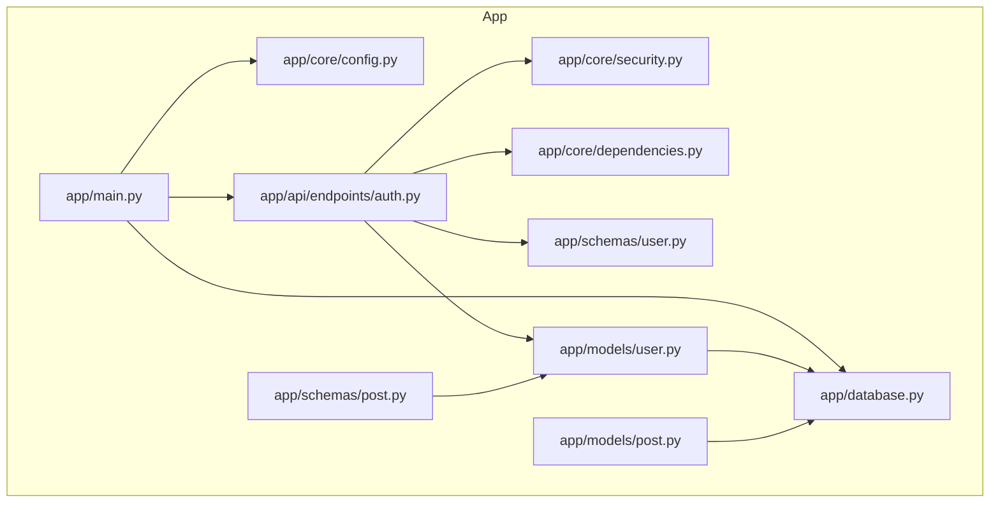
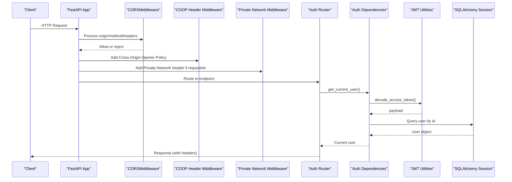
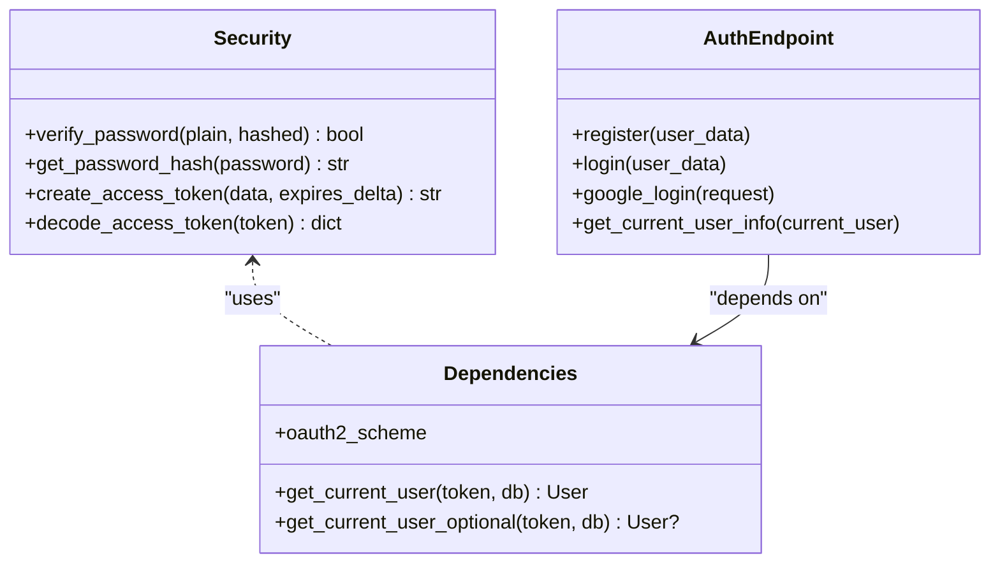
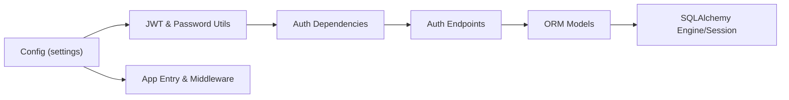

# Security Implementation

<cite>
**Referenced Files in This Document**
- [main.py](file://app/main.py)
- [config.py](file://app/core/config.py)
- [security.py](file://app/core/security.py)
- [dependencies.py](file://app/core/dependencies.py)
- [auth.py](file://app/api/endpoints/auth.py)
- [user.py](file://app/schemas/user.py)
- [post.py](file://app/schemas/post.py)
- [database.py](file://app/database.py)
- [user_model.py](file://app/models/user.py)
- [post_model.py](file://app/models/post.py)
</cite>

## Table of Contents
1. Introduction
2. Project Structure
3. Core Components
4. Architecture Overview
5. Detailed Component Analysis
6. Dependency Analysis
7. Performance Considerations
8. Troubleshooting Guide
9. Conclusion

## Introduction
This document provides a comprehensive security overview for the Lekhani backend, focusing on cross-origin request handling (CORS), security headers, input validation via Pydantic schemas, authorization patterns for sensitive endpoints, middleware architecture, request/response sanitization, SQL injection prevention through SQLAlchemy ORM, XSS protection measures, rate limiting considerations, request logging for security monitoring, and secure configuration management for secrets and environment variables. It also outlines common vulnerabilities, penetration testing approaches, and audit procedures tailored to FastAPI applications.

## Project Structure
The backend is organized into feature-based modules:
- API endpoints under app/api/endpoints
- Core services and utilities under app/core
- Data models under app/models
- Validation schemas under app/schemas
- Application entry point and middleware under app/main.py
- Database configuration under app/database.py

**Diagram sources**
- [main.py:1-89](file://app/main.py#L1-L89)
- [config.py:1-48](file://app/core/config.py#L1-L48)
- [security.py:1-34](file://app/core/security.py#L1-L34)
- [dependencies.py:1-53](file://app/core/dependencies.py#L1-L53)
- [auth.py:1-128](file://app/api/endpoints/auth.py#L1-L128)
- [user.py:1-37](file://app/schemas/user.py#L1-L37)
- [post.py:1-60](file://app/schemas/post.py#L1-L60)
- [database.py:1-27](file://app/database.py#L1-L27)
- [user_model.py:1-28](file://app/models/user.py#L1-L28)
- [post_model.py:1-32](file://app/models/post.py#L1-L32)

**Section sources**
- [main.py:1-89](file://app/main.py#L1-L89)
- [config.py:1-48](file://app/core/config.py#L1-L48)

## Core Components
- CORS and security headers: Centralized in the application entry point with explicit allow lists and regex patterns for Vercel domains; custom middlewares add Cross-Origin-Opener-Policy and private network access headers.
- Authentication and authorization: JWT-based token issuance and verification using pyjwt and passlib; dependency-injected current user resolution with optional variants for public/private endpoints.
- Input validation: Pydantic schemas enforce types, email formats, and provide structured responses.
- Database layer: SQLAlchemy engine/session configured with connection pooling and safe query construction via ORM relationships.

**Section sources**
- [main.py:33-81](file://app/main.py#L33-L81)
- [security.py:1-34](file://app/core/security.py#L1-L34)
- [dependencies.py:1-53](file://app/core/dependencies.py#L1-L53)
- [user.py:1-37](file://app/schemas/user.py#L1-L37)
- [post.py:1-60](file://app/schemas/post.py#L1-L60)
- [database.py:1-27](file://app/database.py#L1-L27)

## Architecture Overview
The security architecture layers are applied as follows:
- ASGI middleware stack handles global headers and CORS preflight/response behavior.
- FastAPI routers expose endpoints that depend on injected dependencies for authentication and database sessions.
- Pydantic schemas validate incoming payloads and serialize outgoing data safely.
- SQLAlchemy ORM prevents SQL injection by parameterizing queries.

**Diagram sources**
- [main.py:33-81](file://app/main.py#L33-L81)
- [dependencies.py:13-39](file://app/core/dependencies.py#L13-L39)
- [security.py:19-32](file://app/core/security.py#L19-L32)
- [auth.py:107-120](file://app/api/endpoints/auth.py#L107-L120)

## Detailed Component Analysis

### CORS Configuration and Security Headers
- CORS is enabled with an allow list and a regex pattern to accept any Vercel deployment domain. Credentials are allowed, and all methods/headers are permitted for simplicity.
- Custom middlewares add:
  - Cross-Origin-Opener-Policy: same-origin-allow-popups
  - Access-Control-Allow-Private-Network: true when the browser requests private-network preflight

Recommendations:
- Tighten allow_methods and allow_headers to only what is required.
- Validate and restrict allow_origins strictly per environment.

**Section sources**
- [main.py:35-44](file://app/main.py#L35-L44)
- [main.py:47-79](file://app/main.py#L47-L79)

### Authentication and Authorization Patterns
- Password hashing uses bcrypt via passlib; tokens are created and decoded using pyjwt with HS256 and a configurable secret key.
- Authorization is implemented via FastAPI dependencies:
  - get_current_user: requires a valid Bearer token and resolves the user from the database.
  - get_current_user_optional: returns None if no token or invalid token, enabling mixed public/private endpoints.

Security notes:
- Ensure SECRET_KEY is set via environment variables and never committed.
- Enforce short-lived tokens and consider refresh token rotation.

**Diagram sources**
- [security.py:1-34](file://app/core/security.py#L1-L34)
- [dependencies.py:1-53](file://app/core/dependencies.py#L1-L53)
- [auth.py:18-127](file://app/api/endpoints/auth.py#L18-L127)

**Section sources**
- [security.py:1-34](file://app/core/security.py#L1-L34)
- [dependencies.py:1-53](file://app/core/dependencies.py#L1-L53)
- [auth.py:18-127](file://app/api/endpoints/auth.py#L18-L127)

### Input Validation with Pydantic Schemas
- User schemas enforce email format, username presence, password fields, and structured responses.
- Post schemas define create/update/response models with validators to normalize tag representations.

Validation benefits:
- Type safety and automatic error responses for malformed inputs.
- Consistent serialization for API consumers.

**Section sources**
- [user.py:1-37](file://app/schemas/user.py#L1-L37)
- [post.py:1-60](file://app/schemas/post.py#L1-L60)

### SQL Injection Prevention via SQLAlchemy ORM
- All database interactions use SQLAlchemy ORM models and session-scoped queries, which parameterize values and prevent SQL injection.
- Engine configuration includes pool_pre_ping and pool_recycle for robust connection management.

Best practices:
- Avoid raw SQL where possible; if necessary, use sqlalchemy.text with bound parameters.
- Validate foreign keys and constraints at the model level.

**Section sources**
- [database.py:1-27](file://app/database.py#L1-L27)
- [user_model.py:1-28](file://app/models/user.py#L1-L28)
- [post_model.py:1-32](file://app/models/post.py#L1-L32)

### XSS Protection Measures
- The backend does not render HTML directly; it serves JSON APIs, reducing XSS risk.
- For any future HTML rendering, ensure content is escaped or sanitized before output.

Recommendations:
- If serving static HTML or templates, integrate a trusted sanitizer library.
- Set Content-Security-Policy headers to restrict script execution where applicable.

[No sources needed since this section provides general guidance]

### Request Logging for Security Monitoring
- Authentication endpoints log critical events such as login attempts, Google token verification outcomes, and user creation.
- Logs include contextual information like user IDs and emails while avoiding sensitive payload details.

Operational guidance:
- Centralize logging configuration and rotate logs securely.
- Avoid logging secrets, tokens, or full request bodies.

**Section sources**
- [auth.py:14-82](file://app/api/endpoints/auth.py#L14-L82)
- [auth.py:123-126](file://app/api/endpoints/auth.py#L123-L126)

### Secure Configuration Management
- Settings are loaded via Pydantic BaseSettings with environment variable overrides for secrets and URLs.
- Secret key, algorithm, token expiry, OAuth client ID, frontend URL, and CORS origins are configurable.

Hardening steps:
- Never commit default secret values to source control.
- Use a secrets manager or CI/CD vault integration in production.
- Restrict ALLOW_ORIGINS per environment and remove development-only entries.

**Section sources**
- [config.py:1-48](file://app/core/config.py#L1-L48)

### Rate Limiting
- No built-in rate limiter is present in the analyzed files.
- Recommended approach:
  - Integrate a FastAPI-compatible rate limiter (e.g., slowapi) with Redis or in-memory storage.
  - Apply endpoint-specific limits for auth flows and high-risk operations.
  - Return appropriate 429 responses and headers indicating retry-after.

[No sources needed since this section provides general guidance]

### Request/Response Sanitization
- Input validation via Pydantic ensures type correctness and basic structural integrity.
- Output models explicitly define fields to avoid accidental leakage of internal attributes.

Enhancements:
- Add field-level validators for length, allowed characters, and URL schemes.
- Normalize and sanitize strings (trim whitespace, limit lengths).

**Section sources**
- [user.py:1-37](file://app/schemas/user.py#L1-L37)
- [post.py:1-60](file://app/schemas/post.py#L1-L60)

## Dependency Analysis
The following diagram shows how core security components interact:

**Diagram sources**
- [config.py:1-48](file://app/core/config.py#L1-L48)
- [security.py:1-34](file://app/core/security.py#L1-L34)
- [dependencies.py:1-53](file://app/core/dependencies.py#L1-L53)
- [auth.py:1-128](file://app/api/endpoints/auth.py#L1-L128)
- [database.py:1-27](file://app/database.py#L1-L27)
- [user_model.py:1-28](file://app/models/user.py#L1-L28)

**Section sources**
- [config.py:1-48](file://app/core/config.py#L1-L48)
- [security.py:1-34](file://app/core/security.py#L1-L34)
- [dependencies.py:1-53](file://app/core/dependencies.py#L1-L53)
- [auth.py:1-128](file://app/api/endpoints/auth.py#L1-L128)
- [database.py:1-27](file://app/database.py#L1-L27)

## Performance Considerations
- Connection pooling: Enabled with pool_pre_ping and pool_recycle to maintain healthy connections.
- Token lifecycle: Short-lived access tokens reduce exposure window; consider refresh tokens for long sessions.
- Logging overhead: Keep logs concise and asynchronous in high-throughput environments.

[No sources needed since this section provides general guidance]

## Troubleshooting Guide
Common issues and resolutions:
- CORS failures:
  - Verify ALLOW_ORIGINS includes the exact frontend origin and that credentials are allowed when cookies are used.
  - Check regex patterns for Vercel domains and ensure they match the actual deployment URL.
- Authentication errors:
  - Confirm SECRET_KEY matches between token issuer and verifier.
  - Validate token expiration settings and clock synchronization across services.
- Database connectivity:
  - Ensure DATABASE_URL points to the correct environment and credentials are correct.
  - Monitor connection pool exhaustion and adjust pool sizes accordingly.
- Logging gaps:
  - Ensure logging levels are configured appropriately and outputs are forwarded to centralized systems.

**Section sources**
- [main.py:35-44](file://app/main.py#L35-L44)
- [config.py:11-23](file://app/core/config.py#L11-L23)
- [database.py:10-15](file://app/database.py#L10-L15)

## Conclusion
The Lekhani backend implements a solid foundation for security:
- Explicit CORS and security headers via middleware
- Robust JWT-based authentication and dependency-injected authorization
- Strong input validation with Pydantic
- Safe database interactions through SQLAlchemy ORM
- Basic security logging around authentication flows

To further harden the system:
- Enforce strict CORS policies and add additional security headers (HSTS, CSP, X-Frame-Options).
- Implement rate limiting and request throttling.
- Adopt centralized secrets management and rotate secrets regularly.
- Conduct regular security audits and penetration tests focused on auth flows, input validation, and data exposure.

[No sources needed since this section summarizes without analyzing specific files]