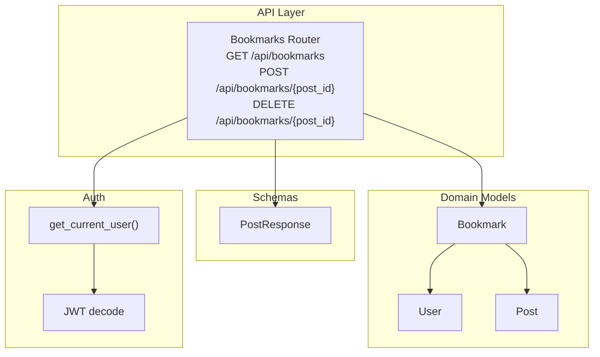
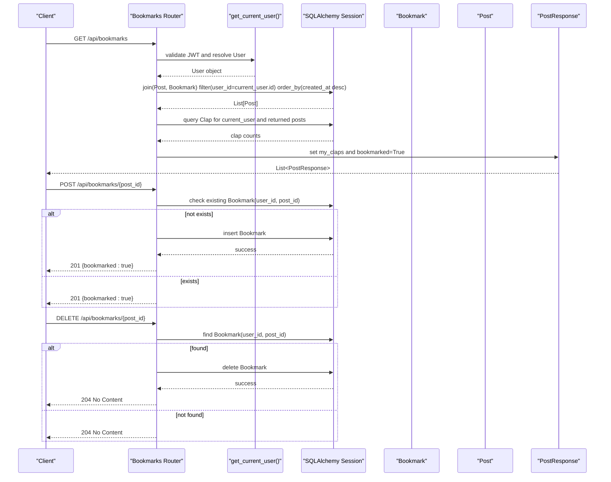
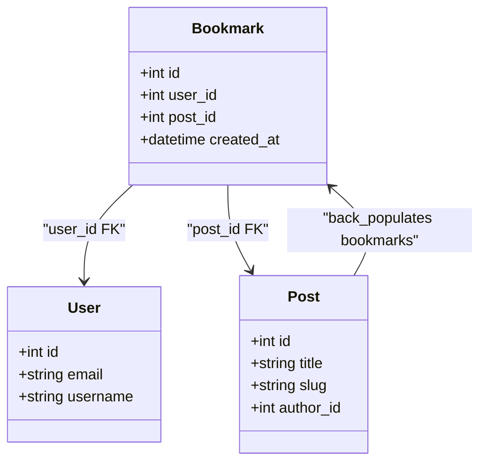
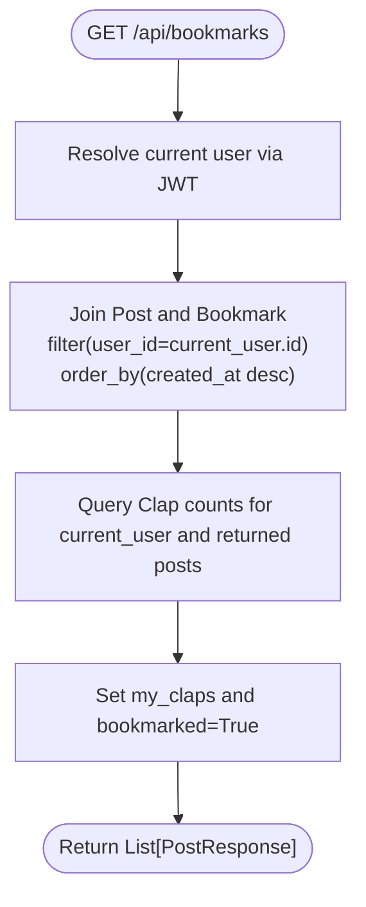
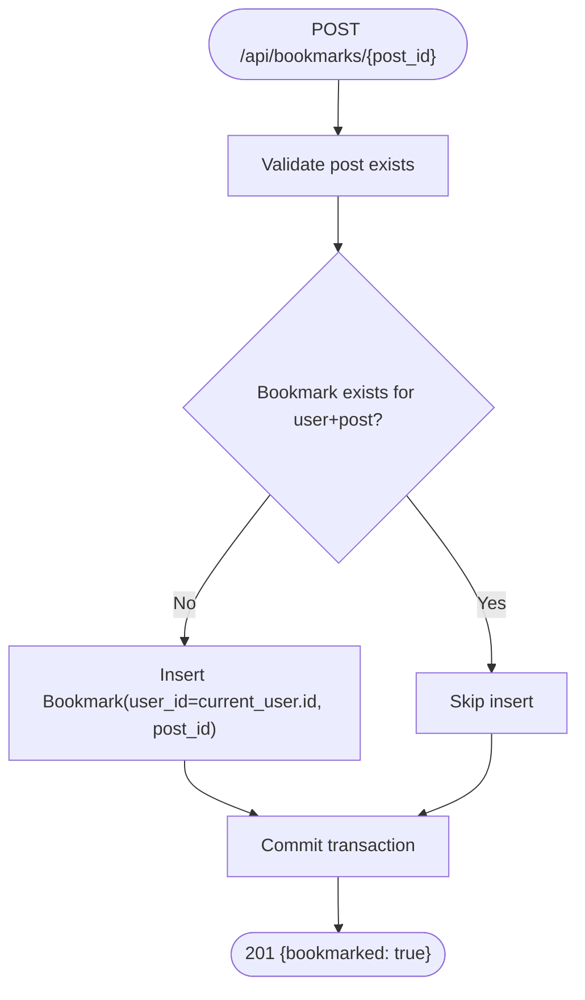
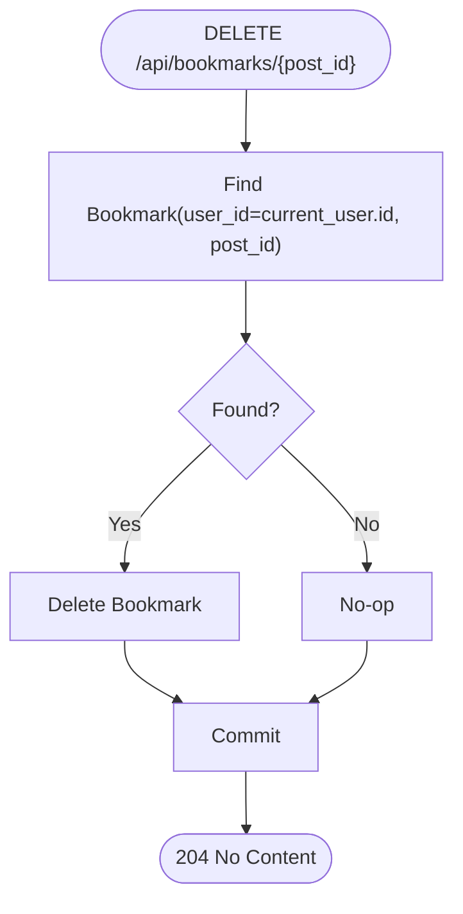
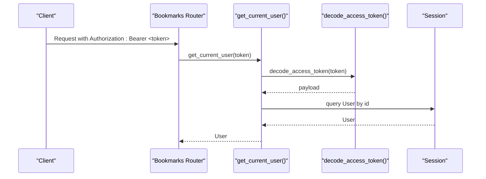
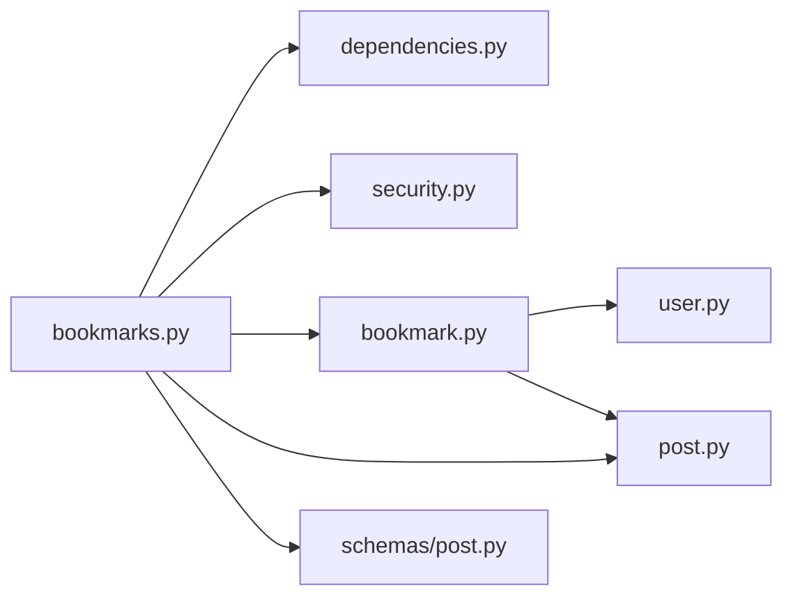

# Bookmark Functionality

<cite>
**Referenced Files in This Document**
- [bookmark.py](file://app/models/bookmark.py)
- [bookmarks.py](file://app/api/endpoints/bookmarks.py)
- [user.py](file://app/models/user.py)
- [post.py](file://app/models/post.py)
- [dependencies.py](file://app/core/dependencies.py)
- [security.py](file://app/core/security.py)
- [post.py (schema)](file://app/schemas/post.py)
</cite>

## Table of Contents
1. [Introduction](#introduction)
2. [Project Structure](#project-structure)
3. [Core Components](#core-components)
4. [Architecture Overview](#architecture-overview)
5. [Detailed Component Analysis](#detailed-component-analysis)
6. [Dependency Analysis](#dependency-analysis)
7. [Performance Considerations](#performance-considerations)
8. [Troubleshooting Guide](#troubleshooting-guide)
9. [Conclusion](#conclusion)
10. [Appendices](#appendices)

## Introduction
This document explains the bookmark functionality that allows authenticated users to save and manage posts. It covers the data model, API endpoints for creating/removing/listing bookmarks, authentication and ownership validation, query patterns for retrieving a user’s saved content, integration with post responses, and considerations for performance, consistency, and migration strategies.

## Project Structure
The bookmark feature spans models, API endpoints, schemas, and core security utilities:
- Data model: Bookmark links users to posts with timestamps.
- API endpoints: Create, remove, and list bookmarks for the current user.
- Schemas: PostResponse includes fields indicating whether a post is bookmarked and how many claps the current user gave.
- Security: JWT-based authentication ensures only authorized users access their own bookmarks.

**Diagram sources**
- [bookmarks.py:15-77](file://app/api/endpoints/bookmarks.py#L15-L77)
- [bookmark.py:7-17](file://app/models/bookmark.py#L7-L17)
- [post.py:6-26](file://app/models/post.py#L6-L26)
- [post.py (schema):26-39](file://app/schemas/post.py#L26-L39)
- [dependencies.py:13-39](file://app/core/dependencies.py#L13-L39)
- [security.py:29-32](file://app/core/security.py#L29-L32)

**Section sources**
- [bookmark.py:1-19](file://app/models/bookmark.py#L1-L19)
- [bookmarks.py:1-78](file://app/api/endpoints/bookmarks.py#L1-L78)
- [post.py:1-32](file://app/models/post.py#L1-L32)
- [post.py (schema):1-60](file://app/schemas/post.py#L1-L60)
- [dependencies.py:1-53](file://app/core/dependencies.py#L1-L53)
- [security.py:1-34](file://app/core/security.py#L1-L34)

## Core Components
- Bookmark model: Represents a unique link between a user and a post, including a timestamp.
- Bookmarks API: Endpoints to add, remove, and list bookmarks for the authenticated user.
- Authentication: JWT-based token decoding and user resolution via dependencies.
- Post response schema: Enriches returned posts with clap counts and bookmark status.

Key responsibilities:
- Enforce uniqueness per user-post pair at the database level.
- Validate that the requesting user owns the bookmark operation.
- Return posts with additional metadata (clap counts, bookmarked flag).

**Section sources**
- [bookmark.py:7-17](file://app/models/bookmark.py#L7-L17)
- [bookmarks.py:15-77](file://app/api/endpoints/bookmarks.py#L15-L77)
- [dependencies.py:13-39](file://app/core/dependencies.py#L13-L39)
- [post.py (schema):26-39](file://app/schemas/post.py#L26-L39)

## Architecture Overview
The bookmark flow uses FastAPI routers, SQLAlchemy ORM, and JWT authentication. The GET endpoint joins posts and bookmarks to return only the current user’s saved posts and enriches them with clap information. POST and DELETE enforce ownership by filtering on the current user’s ID.

**Diagram sources**
- [bookmarks.py:15-77](file://app/api/endpoints/bookmarks.py#L15-L77)
- [dependencies.py:13-39](file://app/core/dependencies.py#L13-L39)
- [security.py:29-32](file://app/core/security.py#L29-L32)

## Detailed Component Analysis

### Bookmark Model
- Fields:
  - id: primary key
  - user_id: foreign key to users
  - post_id: foreign key to posts
  - created_at: timestamp when the bookmark was created
- Constraints:
  - UniqueConstraint on (user_id, post_id) prevents duplicate bookmarks per user-post pair.
- Relationships:
  - Links to User and Post; Post has a back_populated relationship to Bookmark with cascade delete-orphan.

**Diagram sources**
- [bookmark.py:7-17](file://app/models/bookmark.py#L7-L17)
- [post.py:22-26](file://app/models/post.py#L22-L26)

**Section sources**
- [bookmark.py:7-17](file://app/models/bookmark.py#L7-L17)
- [post.py:22-26](file://app/models/post.py#L22-L26)

### API Endpoints

#### List My Bookmarks
- Method: GET
- Path: /api/bookmarks
- Authentication: Required (Bearer token)
- Behavior:
  - Joins Post and Bookmark filtered by current user.
  - Orders results by bookmark creation time descending.
  - Fetches clap counts for the current user across returned posts.
  - Sets my_claps and bookmarked=True on each post before returning.
- Response: Array of PostResponse objects.

**Diagram sources**
- [bookmarks.py:15-39](file://app/api/endpoints/bookmarks.py#L15-L39)
- [post.py (schema):26-39](file://app/schemas/post.py#L26-L39)

**Section sources**
- [bookmarks.py:15-39](file://app/api/endpoints/bookmarks.py#L15-L39)
- [post.py (schema):26-39](file://app/schemas/post.py#L26-L39)

#### Add Bookmark
- Method: POST
- Path: /api/bookmarks/{post_id}
- Authentication: Required
- Behavior:
  - Validates that the post exists.
  - Checks if the current user already bookmarked the post.
  - If not present, inserts a new Bookmark record.
  - Returns 201 with a simple confirmation payload.
- Notes:
  - Ownership is enforced implicitly by inserting under current_user.id.
  - Duplicate attempts are idempotent (no error raised).

**Diagram sources**
- [bookmarks.py:42-60](file://app/api/endpoints/bookmarks.py#L42-L60)

**Section sources**
- [bookmarks.py:42-60](file://app/api/endpoints/bookmarks.py#L42-L60)

#### Remove Bookmark
- Method: DELETE
- Path: /api/bookmarks/{post_id}
- Authentication: Required
- Behavior:
  - Finds the bookmark for the current user and post.
  - Deletes it if present.
  - Returns 204 No Content regardless of existence (idempotent).

**Diagram sources**
- [bookmarks.py:63-77](file://app/api/endpoints/bookmarks.py#L63-L77)

**Section sources**
- [bookmarks.py:63-77](file://app/api/endpoints/bookmarks.py#L63-L77)

### Authentication and Ownership Validation
- get_current_user:
  - Decodes JWT using settings.SECRET_KEY and algorithm.
  - Extracts user id from token payload and resolves the User entity.
  - Raises 401 Unauthorized for invalid or expired tokens.
- Ownership:
  - All bookmark operations filter by current_user.id, ensuring users can only manage their own bookmarks.

**Diagram sources**
- [dependencies.py:13-39](file://app/core/dependencies.py#L13-L39)
- [security.py:29-32](file://app/core/security.py#L29-L32)

**Section sources**
- [dependencies.py:13-39](file://app/core/dependencies.py#L13-L39)
- [security.py:29-32](file://app/core/security.py#L29-L32)

### Integration With Post Responses
- PostResponse includes:
  - clap_count: total claps on the post.
  - my_claps: claps given by the current user.
  - bookmarked: boolean indicating whether the current user bookmarked the post.
- For listing bookmarks, the endpoint sets bookmarked=True and populates my_claps based on clap queries.

**Section sources**
- [post.py (schema):26-39](file://app/schemas/post.py#L26-L39)
- [bookmarks.py:27-39](file://app/api/endpoints/bookmarks.py#L27-L39)

## Dependency Analysis
- API layer depends on:
  - Database session via get_db.
  - Current user via get_current_user.
  - Models: Post, Bookmark, Clap.
  - Schemas: PostResponse.
- Models:
  - Bookmark references User and Post via foreign keys.
  - Post has a back_populated relationship to Bookmark with cascade delete-orphan.
- Security:
  - JWT decoding relies on settings.SECRET_KEY and ALGORITHM.

**Diagram sources**
- [bookmarks.py:1-12](file://app/api/endpoints/bookmarks.py#L1-L12)
- [bookmark.py:1-17](file://app/models/bookmark.py#L1-L17)
- [post.py:1-26](file://app/models/post.py#L1-L26)
- [post.py (schema):1-39](file://app/schemas/post.py#L1-L39)
- [dependencies.py:1-9](file://app/core/dependencies.py#L1-L9)
- [security.py:1-7](file://app/core/security.py#L1-L7)

**Section sources**
- [bookmarks.py:1-12](file://app/api/endpoints/bookmarks.py#L1-L12)
- [bookmark.py:1-17](file://app/models/bookmark.py#L1-L17)
- [post.py:1-26](file://app/models/post.py#L1-L26)
- [post.py (schema):1-39](file://app/schemas/post.py#L1-L39)
- [dependencies.py:1-9](file://app/core/dependencies.py#L1-L9)
- [security.py:1-7](file://app/core/security.py#L1-L7)

## Performance Considerations
- Indexing:
  - Bookmark.user_id and Bookmark.post_id are indexed to optimize lookups and uniqueness checks.
  - Post.slug and Post.title are indexed to support efficient searches elsewhere in the system.
- Query efficiency:
  - Listing bookmarks uses a single join and orders by created_at to avoid N+1 issues.
  - Clap aggregation is performed in one query over the returned post IDs.
- Scalability tips:
  - Consider pagination for large bookmark collections.
  - Cache frequently accessed post metadata and clap counts where appropriate.
  - Use read replicas for heavy read workloads if needed.

**Section sources**
- [bookmark.py:11-14](file://app/models/bookmark.py#L11-L14)
- [post.py:9-15](file://app/models/post.py#L9-L15)
- [bookmarks.py:20-39](file://app/api/endpoints/bookmarks.py#L20-L39)

## Troubleshooting Guide
- 401 Unauthorized:
  - Causes: Missing, malformed, or expired JWT.
  - Resolution: Ensure Authorization header contains a valid Bearer token; refresh tokens as needed.
- 404 Not Found (when adding a bookmark):
  - Cause: The specified post does not exist.
  - Resolution: Verify post_id and ensure the post is accessible.
- Idempotency:
  - Adding an existing bookmark returns success without duplication due to the unique constraint and pre-check.
  - Removing a non-existent bookmark returns 204 No Content.

**Section sources**
- [dependencies.py:13-39](file://app/core/dependencies.py#L13-L39)
- [security.py:29-32](file://app/core/security.py#L29-L32)
- [bookmarks.py:42-60](file://app/api/endpoints/bookmarks.py#L42-L60)
- [bookmarks.py:63-77](file://app/api/endpoints/bookmarks.py#L63-L77)

## Conclusion
The bookmark system provides a secure, efficient way for users to save and retrieve posts. It enforces ownership through JWT-based authentication, maintains data integrity via unique constraints, and integrates seamlessly with post responses to show clap counts and bookmark status. For production-scale usage, consider adding pagination, caching, and robust monitoring around high-volume endpoints.

## Appendices

### Data Consistency When Posts Are Deleted or Modified
- Deletion behavior:
  - Post.bookmarks has cascade="all, delete-orphan", so deleting a post removes associated bookmarks automatically.
- Modification behavior:
  - Updating a post does not affect existing bookmarks; they remain linked by post_id.

**Section sources**
- [post.py:25](file://app/models/post.py#L25)

### Migration Strategies for Bookmark Data Preservation
- Preserve relationships:
  - Ensure migrations preserve foreign keys and unique constraints during schema changes.
- Backfills and audits:
  - If migrating to a new schema, run reconciliation jobs to detect orphaned bookmarks and align counts.
- Rollbacks:
  - Keep migration scripts reversible and test rollback procedures to restore consistent state.

### Search Capabilities Within Bookmarks
- Current implementation:
  - No dedicated search within bookmarks is implemented.
- Recommended approach:
  - Extend the GET endpoint to accept optional filters such as keyword, topic, date range, and sort options.
  - Combine filters with the existing join and apply indexes on searchable columns.

### Organization Features and Bulk Operations
- Organization features:
  - Introduce tags or folders for bookmarks and store them in a separate table linked to Bookmark.
- Bulk operations:
  - Add endpoints to add/remove multiple bookmarks in one request.
  - Validate ownership and enforce uniqueness for all items in the batch.