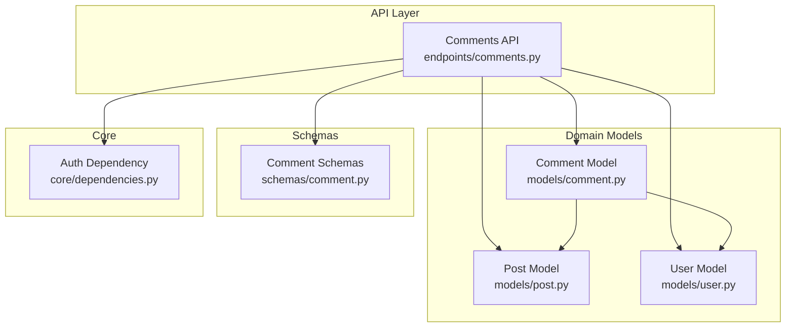
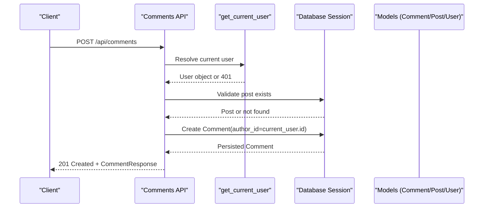
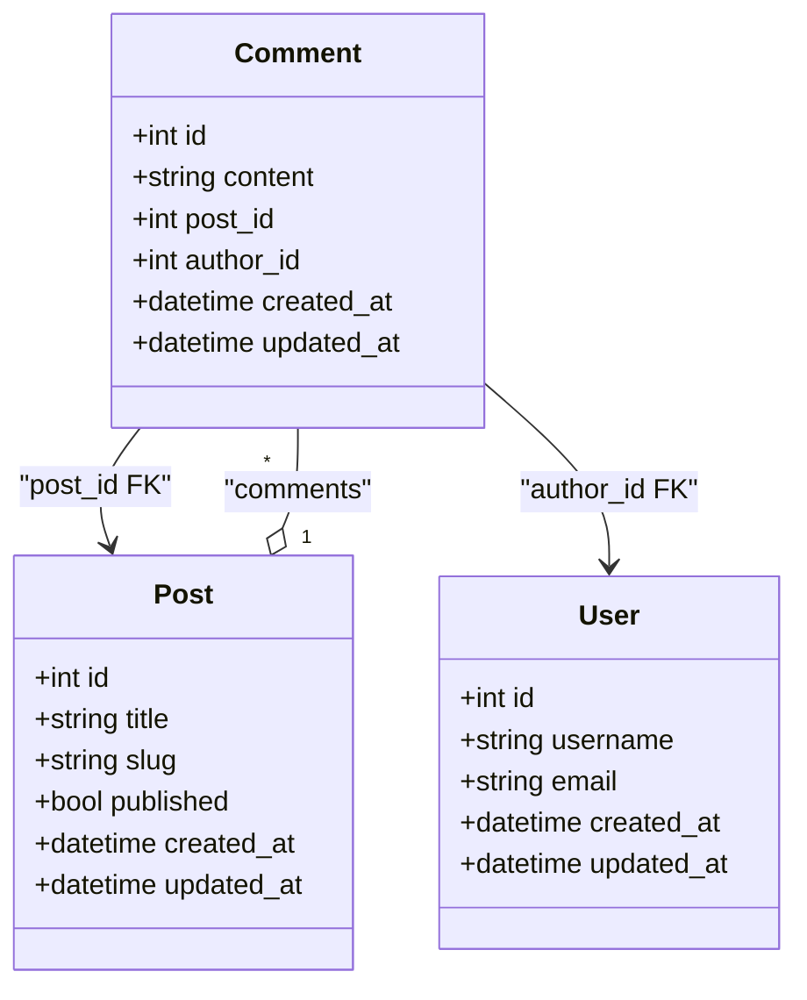
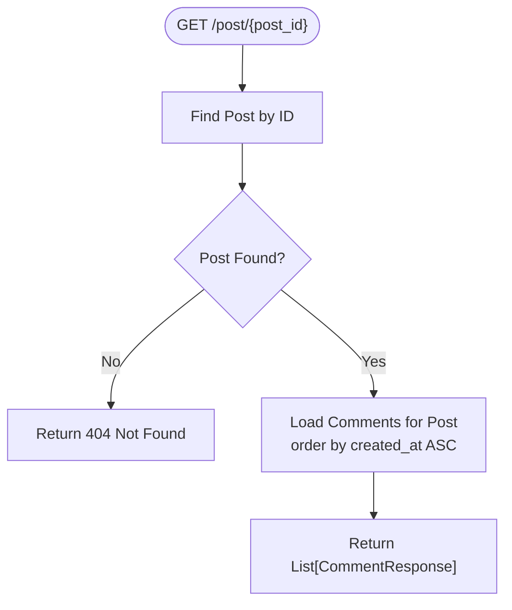
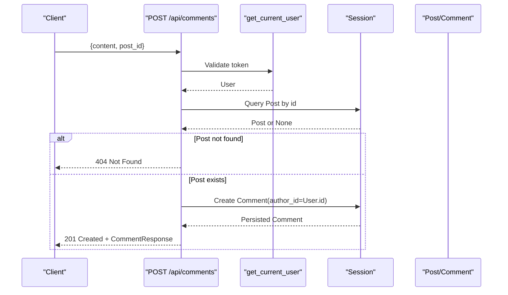
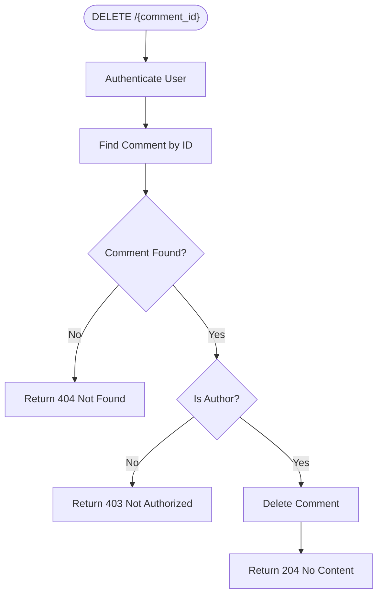
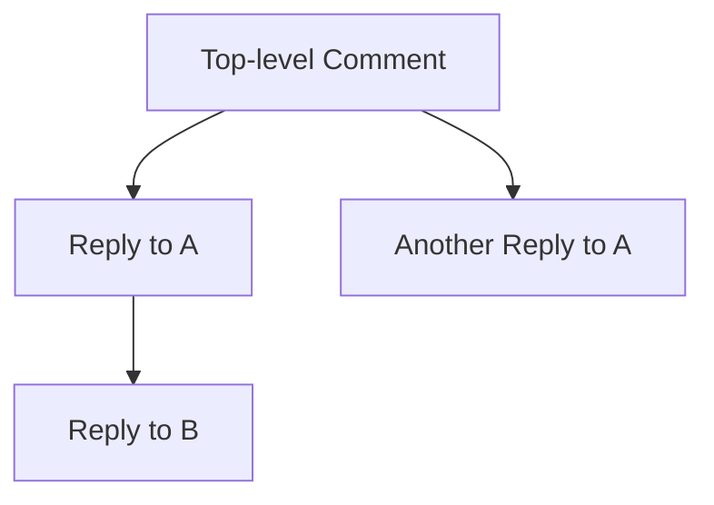
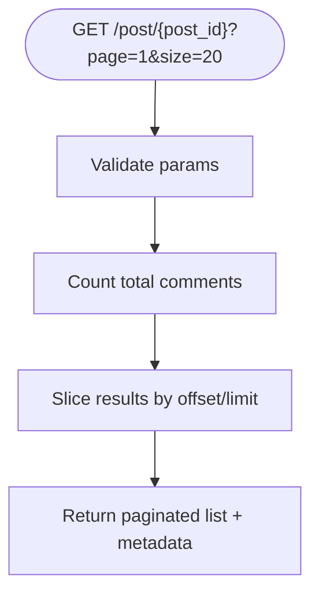
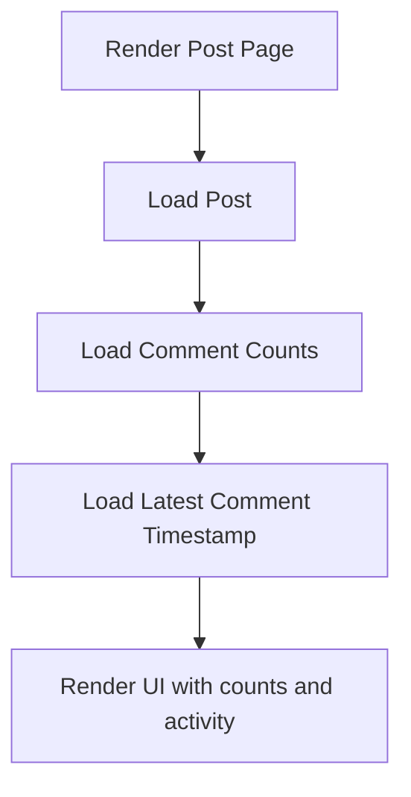
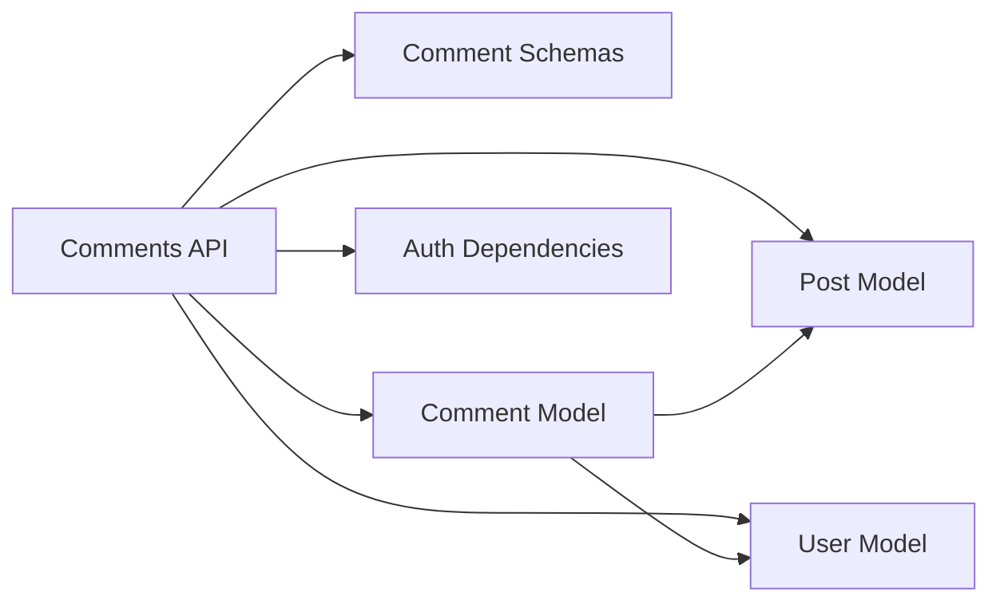

# Comment System

<cite>
**Referenced Files in This Document**
- [comment.py](file://app/models/comment.py)
- [post.py](file://app/models/post.py)
- [user.py](file://app/models/user.py)
- [comment_schema.py](file://app/schemas/comment.py)
- [comments_api.py](file://app/api/endpoints/comments.py)
- [dependencies.py](file://app/core/dependencies.py)
</cite>

## Table of Contents
1. [Introduction](#introduction)
2. [Project Structure](#project-structure)
3. [Core Components](#core-components)
4. [Architecture Overview](#architecture-overview)
5. [Detailed Component Analysis](#detailed-component-analysis)
6. [Dependency Analysis](#dependency-analysis)
7. [Performance Considerations](#performance-considerations)
8. [Troubleshooting Guide](#troubleshooting-guide)
9. [Conclusion](#conclusion)

## Introduction
This document explains the comment system architecture, including data models, API endpoints, authorization, and operational considerations. It focuses on how comments relate to posts and users, how CRUD operations are implemented, and where improvements can be made for threading, pagination, validation, security, and performance.

## Project Structure
The comment system spans models, schemas, API endpoints, and core dependencies:
- Data model: app/models/comment.py
- Related models: app/models/post.py, app/models/user.py
- Request/response schemas: app/schemas/comment.py
- API endpoints: app/api/endpoints/comments.py
- Authorization dependency: app/core/dependencies.py

**Diagram sources**
- [comments_api.py:1-62](file://app/api/endpoints/comments.py#L1-L62)
- [comment.py:1-18](file://app/models/comment.py#L1-L18)
- [post.py:1-32](file://app/models/post.py#L1-L32)
- [user.py:1-28](file://app/models/user.py#L1-L28)
- [comment_schema.py:1-32](file://app/schemas/comment.py#L1-L32)
- [dependencies.py:1-53](file://app/core/dependencies.py#L1-L53)

**Section sources**
- [comments_api.py:1-62](file://app/api/endpoints/comments.py#L1-L62)
- [comment.py:1-18](file://app/models/comment.py#L1-L18)
- [post.py:1-32](file://app/models/post.py#L1-L32)
- [user.py:1-28](file://app/models/user.py#L1-L28)
- [comment_schema.py:1-32](file://app/schemas/comment.py#L1-L32)
- [dependencies.py:1-53](file://app/core/dependencies.py#L1-L53)

## Core Components
- Comment model defines the persistent entity with fields for content, timestamps, and foreign keys to Post and User.
- Pydantic schemas define input validation (create/update) and output serialization (response).
- API endpoints implement retrieval, creation, and deletion of comments with authorization checks.
- Relationships tie comments to posts and users; post model includes cascade behavior for comments.

Key responsibilities:
- Data persistence and relationships: Comment, Post, User models
- Input/output contracts: Comment schemas
- HTTP surface: Comments API endpoints
- Authentication: Current user dependency

**Section sources**
- [comment.py:1-18](file://app/models/comment.py#L1-L18)
- [comment_schema.py:1-32](file://app/schemas/comment.py#L1-L32)
- [comments_api.py:1-62](file://app/api/endpoints/comments.py#L1-L62)
- [post.py:1-32](file://app/models/post.py#L1-L32)
- [user.py:1-28](file://app/models/user.py#L1-L28)
- [dependencies.py:1-53](file://app/core/dependencies.py#L1-L53)

## Architecture Overview
The comment system follows a layered design:
- API layer exposes REST endpoints for comments.
- Domain models represent database entities and relationships.
- Schemas enforce request validation and response shape.
- Core dependencies provide authenticated user context.

**Diagram sources**
- [comments_api.py:23-43](file://app/api/endpoints/comments.py#L23-L43)
- [dependencies.py:13-39](file://app/core/dependencies.py#L13-L39)
- [comment.py:6-18](file://app/models/comment.py#L6-L18)
- [post.py:6-32](file://app/models/post.py#L6-L32)

## Detailed Component Analysis

### Comment Model and Relationships
- Fields:
  - id: primary key
  - content: text body
  - post_id: foreign key to posts
  - author_id: foreign key to users
  - created_at, updated_at: timestamps
- Relationships:
  - Belongs to Post via post relationship
  - Belongs to User via author relationship
- Post model includes a back_populated comments relationship with cascade delete-orphan.

**Diagram sources**
- [comment.py:6-18](file://app/models/comment.py#L6-L18)
- [post.py:6-32](file://app/models/post.py#L6-L32)
- [user.py:6-28](file://app/models/user.py#L6-L28)

**Section sources**
- [comment.py:1-18](file://app/models/comment.py#L1-L18)
- [post.py:1-32](file://app/models/post.py#L1-L32)
- [user.py:1-28](file://app/models/user.py#L1-L28)

### Request/Response Schemas
- CommentBase: validates content presence.
- CommentCreate: requires post_id and content.
- CommentUpdate: optional content update.
- CommentAuthor: serializes minimal user info.
- CommentResponse: full comment payload with author details and timestamps.

Validation highlights:
- Content is required on create.
- post_id is required on create.
- Update allows partial content changes.

**Section sources**
- [comment_schema.py:1-32](file://app/schemas/comment.py#L1-L32)

### API Endpoints and Authorization

#### Retrieve Comments for a Post
- Endpoint: GET /api/comments/post/{post_id}
- Behavior:
  - Validates that the post exists; returns 404 if not found.
  - Returns all comments for the post ordered by creation time ascending.
- Authorization: Public read access (no current user required).

**Diagram sources**
- [comments_api.py:13-21](file://app/api/endpoints/comments.py#L13-L21)

**Section sources**
- [comments_api.py:13-21](file://app/api/endpoints/comments.py#L13-L21)

#### Create a Comment
- Endpoint: POST /api/comments
- Behavior:
  - Requires authentication via get_current_user.
  - Validates that the referenced post exists; returns 404 if not found.
  - Creates a new Comment with author_id set to the authenticated user’s id.
  - Persists and returns the created comment.
- Authorization: Requires valid bearer token; enforces ownership implicitly by setting author_id from the authenticated user.

**Diagram sources**
- [comments_api.py:23-43](file://app/api/endpoints/comments.py#L23-L43)
- [dependencies.py:13-39](file://app/core/dependencies.py#L13-L39)
- [comment.py:6-18](file://app/models/comment.py#L6-L18)
- [post.py:6-32](file://app/models/post.py#L6-L32)

**Section sources**
- [comments_api.py:23-43](file://app/api/endpoints/comments.py#L23-L43)
- [dependencies.py:13-39](file://app/core/dependencies.py#L13-L39)

#### Delete a Comment
- Endpoint: DELETE /api/comments/{comment_id}
- Behavior:
  - Requires authentication.
  - Verifies the comment exists; returns 404 if not found.
  - Enforces that only the comment’s author can delete it; otherwise returns 403.
  - Deletes the comment and returns 204 No Content.

**Diagram sources**
- [comments_api.py:45-61](file://app/api/endpoints/comments.py#L45-L61)

**Section sources**
- [comments_api.py:45-61](file://app/api/endpoints/comments.py#L45-L61)

### Threading and Hierarchy
- Current implementation does not include parent_id or recursive threading fields in the Comment model.
- To support nested discussions, consider adding a nullable parent_id field referencing Comment.id and implementing recursive loading strategies.

Conceptual threading flow:

[No sources needed since this diagram shows conceptual workflow, not actual code structure]

### Pagination Strategies
- The current retrieval endpoint returns all comments for a post without pagination.
- Recommended approach:
  - Add query parameters for page and size.
  - Use offset/limit or cursor-based pagination.
  - For threaded replies, paginate top-level comments and optionally lazy-load child threads per comment.

Conceptual pagination flow:

[No sources needed since this diagram shows conceptual workflow, not actual code structure]

### Validation Rules and Security Measures
- Validation:
  - Content is required when creating a comment.
  - post_id must reference an existing post.
- Security:
  - Creation and deletion require a valid bearer token.
  - Deletion enforces author-only access.
- Malicious content mitigation:
  - Implement server-side sanitization and length limits for content.
  - Apply rate limiting at the API layer.
  - Integrate content moderation services for XSS/HTML injection prevention.

**Section sources**
- [comment_schema.py:1-32](file://app/schemas/comment.py#L1-L32)
- [comments_api.py:23-61](file://app/api/endpoints/comments.py#L23-L61)
- [dependencies.py:13-39](file://app/core/dependencies.py#L13-L39)

### Integration With Post Views
- Displaying comment counts:
  - Compute count via a dedicated query or maintain a denormalized counter on Post.
- Latest activity:
  - Track latest comment timestamp per post to show recent activity.
- Performance:
  - Use eager loading or precomputed aggregates to avoid N+1 queries when rendering many posts.

Conceptual integration:

[No sources needed since this diagram shows conceptual workflow, not actual code structure]

## Dependency Analysis
- API depends on:
  - Schemas for validation and serialization.
  - Models for persistence and relationships.
  - Dependencies for authentication.
- Models depend on:
  - Database base and ORM utilities.
  - Other models via foreign keys and relationships.

**Diagram sources**
- [comments_api.py:1-62](file://app/api/endpoints/comments.py#L1-L62)
- [comment_schema.py:1-32](file://app/schemas/comment.py#L1-L32)
- [comment.py:1-18](file://app/models/comment.py#L1-L18)
- [post.py:1-32](file://app/models/post.py#L1-L32)
- [user.py:1-28](file://app/models/user.py#L1-L28)
- [dependencies.py:1-53](file://app/core/dependencies.py#L1-L53)

**Section sources**
- [comments_api.py:1-62](file://app/api/endpoints/comments.py#L1-L62)
- [comment_schema.py:1-32](file://app/schemas/comment.py#L1-L32)
- [comment.py:1-18](file://app/models/comment.py#L1-L18)
- [post.py:1-32](file://app/models/post.py#L1-L32)
- [user.py:1-28](file://app/models/user.py#L1-L28)
- [dependencies.py:1-53](file://app/core/dependencies.py#L1-L53)

## Performance Considerations
- Indexes:
  - Ensure indexes on post_id and author_id for efficient filtering and joins.
- Query optimization:
  - Use eager loading for author and post when returning comments to reduce N+1 queries.
  - Consider selectin or joinedload depending on ORM configuration.
- Pagination:
  - Implement offset/limit or cursor-based pagination to bound result sets.
- Caching:
  - Cache frequently accessed comment lists per post using a cache layer (e.g., Redis).
  - Invalidate caches on comment create/update/delete events.
- Aggregates:
  - Maintain denormalized comment_count and latest_comment_at on Post for fast UI rendering.

[No sources needed since this section provides general guidance]

## Troubleshooting Guide
Common issues and resolutions:
- 401 Unauthorized:
  - Missing or invalid bearer token; ensure client sends a valid JWT.
- 404 Not Found:
  - Referenced post or comment does not exist; verify IDs and existence before operations.
- 403 Not Authorized:
  - Attempting to delete a comment that is not authored by the current user; enforce ownership checks.
- Validation errors:
  - Missing content or post_id on create; ensure request payloads conform to schemas.

Operational tips:
- Log failed authentication attempts and malformed requests for observability.
- Add structured logging around comment lifecycle events for auditing.

**Section sources**
- [comments_api.py:13-61](file://app/api/endpoints/comments.py#L13-L61)
- [dependencies.py:13-39](file://app/core/dependencies.py#L13-L39)

## Conclusion
The comment system currently supports basic CRUD operations with clear relationships to posts and users, along with robust authorization for write operations. To enhance usability and scalability, introduce threading via parent-child relationships, implement pagination for large discussions, strengthen content validation and sanitization, and adopt caching and query optimizations for high-performance rendering of comment threads and post integrations.