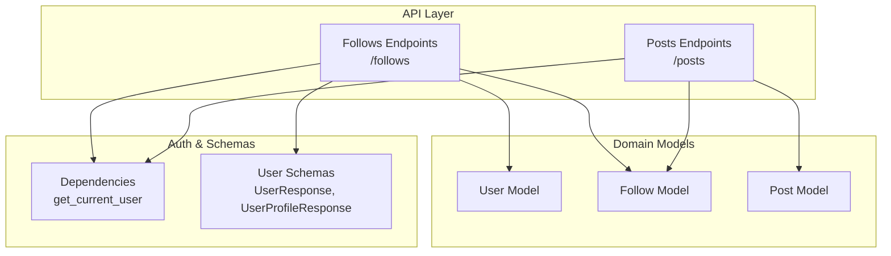
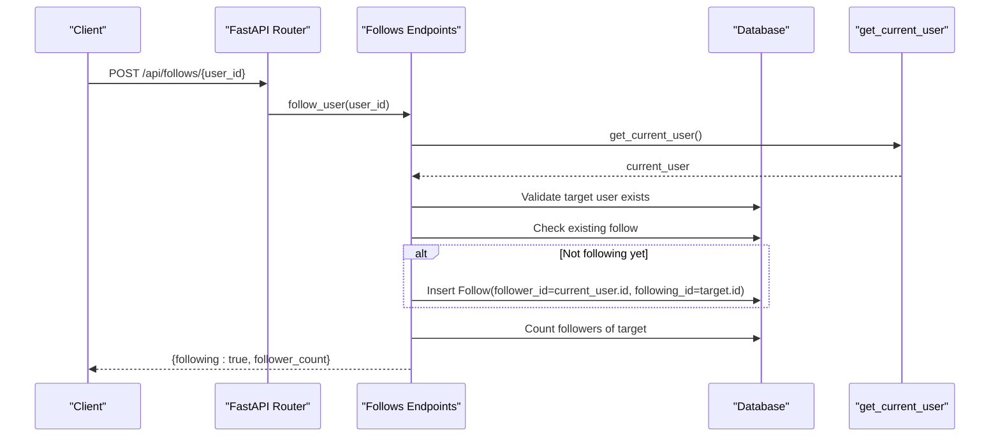
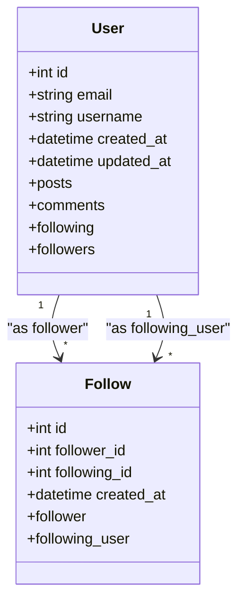
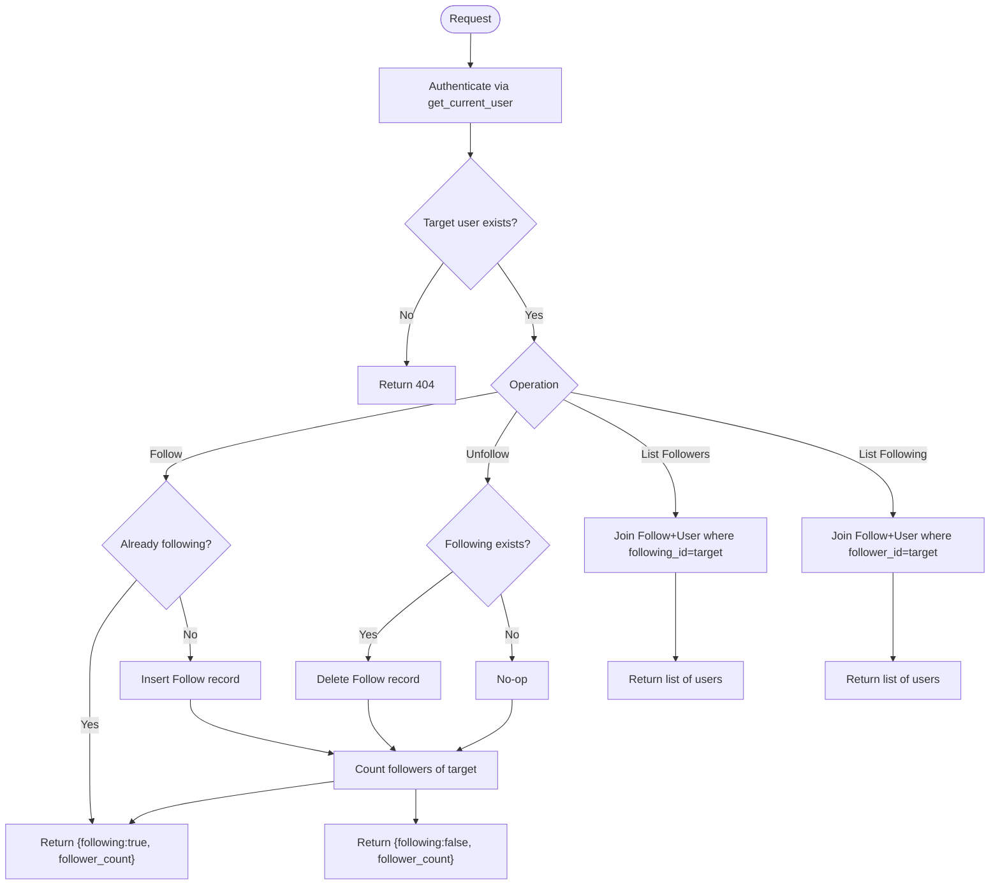
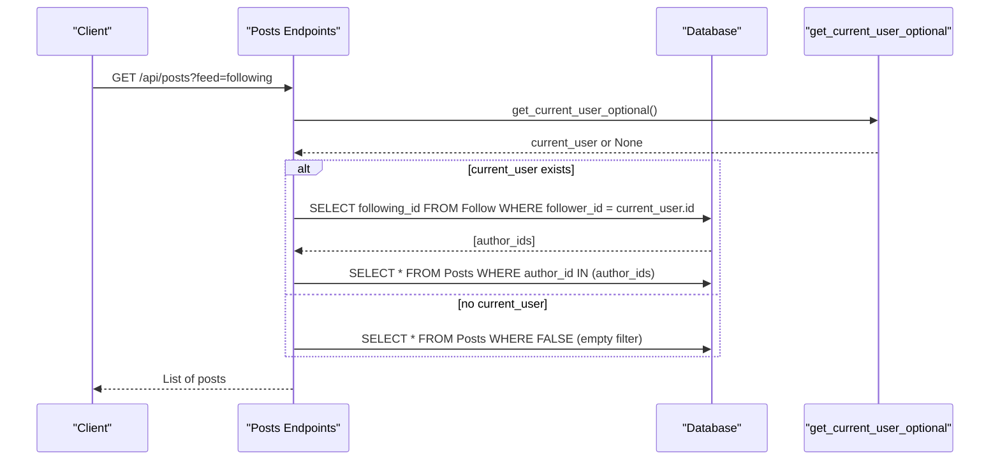
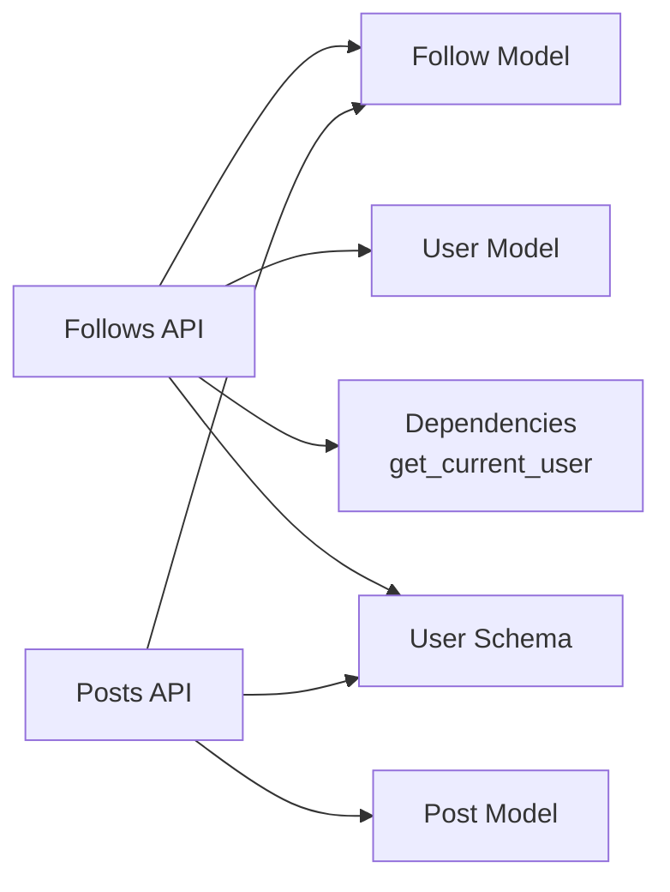

# Following System

<cite>
**Referenced Files in This Document**
- [follow.py](file://app/models/follow.py)
- [user.py](file://app/models/user.py)
- [posts.py](file://app/api/endpoints/posts.py)
- [follows.py](file://app/api/endpoints/follows.py)
- [dependencies.py](file://app/core/dependencies.py)
- [user.py](file://app/schemas/user.py)
- [__init__.py](file://app/api/__init__.py)
</cite>

## Table of Contents
1. [Introduction](#introduction)
2. [Project Structure](#project-structure)
3. [Core Components](#core-components)
4. [Architecture Overview](#architecture-overview)
5. [Detailed Component Analysis](#detailed-component-analysis)
6. [Dependency Analysis](#dependency-analysis)
7. [Performance Considerations](#performance-considerations)
8. [Troubleshooting Guide](#troubleshooting-guide)
9. [Conclusion](#conclusion)

## Introduction
This document explains the following system that allows users to follow and unfollow other writers, retrieve their followers and who they follow, and integrate with feed generation to show content from followed authors. It covers the data model, API endpoints, permission checks, query patterns for social connections, bidirectional relationships, mutual follow detection, and performance considerations for large graphs.

## Project Structure
The following system spans models, API endpoints, schemas, and dependency injection:
- Data model: Follow relationship between users
- API endpoints: Create/unfollow/list follows; list followers and following
- Feed integration: Posts endpoint filters by followed authors
- Authentication: Bearer token-based current user resolution

**Diagram sources**
- [follows.py:1-93](file://app/api/endpoints/follows.py#L1-L93)
- [posts.py:100-126](file://app/api/endpoints/posts.py#L100-L126)
- [follow.py:1-21](file://app/models/follow.py#L1-L21)
- [user.py:1-28](file://app/models/user.py#L1-L28)
- [dependencies.py:1-53](file://app/core/dependencies.py#L1-L53)
- [user.py:17-35](file://app/schemas/user.py#L17-L35)

**Section sources**
- [__init__.py:5-11](file://app/api/__init__.py#L5-L11)

## Core Components
- Follow model: Represents a directed relationship where one user follows another. Includes unique constraints to prevent duplicate follows and timestamps.
- User model: Provides relationships to Follow as both follower and followed, enabling traversal in both directions.
- Follows API: Endpoints to create/unfollow, list followers, and list following. Enforces authentication and basic authorization (users can only manage their own follow relationships).
- Posts API: Supports a “following” feed that returns posts authored by users the current user follows.
- Dependencies: Resolves the authenticated user via JWT bearer tokens.
- Schemas: Defines response structures for users and profiles, including counts and follow flags.

**Section sources**
- [follow.py:7-21](file://app/models/follow.py#L7-L21)
- [user.py:6-27](file://app/models/user.py#L6-L27)
- [follows.py:10-93](file://app/api/endpoints/follows.py#L10-L93)
- [posts.py:104-110](file://app/api/endpoints/posts.py#L104-L110)
- [dependencies.py:13-39](file://app/core/dependencies.py#L13-L39)
- [user.py:17-35](file://app/schemas/user.py#L17-L35)

## Architecture Overview
The following system integrates across three layers:
- API layer exposes REST endpoints for managing follows and reading feeds.
- Domain layer defines entities and relationships.
- Auth layer ensures requests are authorized and identifies the current user.

**Diagram sources**
- [follows.py:20-40](file://app/api/endpoints/follows.py#L20-L40)
- [dependencies.py:13-39](file://app/core/dependencies.py#L13-L39)

## Detailed Component Analysis

### Follow Model
The Follow model captures a directed relationship between two users:
- follower_id: The user doing the following
- following_id: The user being followed
- Unique constraint prevents duplicate follow entries
- Timestamped creation for ordering and analytics
- Relationships back to User for both sides

**Diagram sources**
- [user.py:6-27](file://app/models/user.py#L6-L27)
- [follow.py:7-21](file://app/models/follow.py#L7-L21)

**Section sources**
- [follow.py:7-21](file://app/models/follow.py#L7-L21)
- [user.py:19-26](file://app/models/user.py#L19-L26)

### Follows API Endpoints
Endpoints provide CRUD-like operations for follows:
- POST /{user_id}: Follow a user if not already following; return status and follower count
- DELETE /{user_id}: Unfollow a user; return status and follower count
- GET /{user_id}/followers: List users who follow the target
- GET /{user_id}/following: List users the target is following

Permission checks:
- All mutating endpoints require a valid bearer token via get_current_user
- Self-follow is disallowed
- Target existence is validated before mutation

Query patterns:
- Followers: Join Follow with User where following_id equals target
- Following: Join Follow with User where follower_id equals target
- Both lists ordered by creation time descending

**Diagram sources**
- [follows.py:13-93](file://app/api/endpoints/follows.py#L13-L93)
- [dependencies.py:13-39](file://app/core/dependencies.py#L13-L39)

**Section sources**
- [follows.py:20-40](file://app/api/endpoints/follows.py#L20-L40)
- [follows.py:43-60](file://app/api/endpoints/follows.py#L43-L60)
- [follows.py:63-76](file://app/api/endpoints/follows.py#L63-L76)
- [follows.py:79-92](file://app/api/endpoints/follows.py#L79-L92)

### Feed Integration with Posts
The posts endpoint supports a “following” feed that returns posts authored by users the current user follows:
- If feed == "following", fetch IDs of users the current user follows
- Filter posts by author_id in those IDs
- Works with optional authentication; unauthenticated users receive an empty set when filtering by following

**Diagram sources**
- [posts.py:104-110](file://app/api/endpoints/posts.py#L104-L110)
- [dependencies.py:42-51](file://app/core/dependencies.py#L42-L51)

**Section sources**
- [posts.py:104-110](file://app/api/endpoints/posts.py#L104-L110)

### Bidirectional Social Connections and Mutual Follow Detection
- The Follow model is directional: A follows B does not imply B follows A.
- To detect mutual follows between two users, check both directions:
  - A follows B: Follow.follower_id == A.id AND Follow.following_id == B.id
  - B follows A: Follow.follower_id == B.id AND Follow.following_id == A.id
- Mutual follow exists if both queries return a match.

Common operations:
- Check if user X follows user Y: Query Follow where follower_id == X.id and following_id == Y.id
- Get all followers of user Z: Join Follow and User where following_id == Z.id
- Get all users user Z follows: Join Follow and User where follower_id == Z.id

These patterns are implemented in the follows endpoints and can be reused elsewhere.

**Section sources**
- [follows.py:63-76](file://app/api/endpoints/follows.py#L63-L76)
- [follows.py:79-92](file://app/api/endpoints/follows.py#L79-L92)

### Permission Checks and Authorization
- Mutating endpoints (follow/unfollow) require a valid bearer token via get_current_user.
- Self-follow is explicitly rejected.
- Target user existence is validated before any mutation.
- These checks ensure users can only manage their own follow relationships.

**Section sources**
- [follows.py:20-40](file://app/api/endpoints/follows.py#L20-L40)
- [follows.py:43-60](file://app/api/endpoints/follows.py#L43-L60)
- [dependencies.py:13-39](file://app/core/dependencies.py#L13-L39)

## Dependency Analysis
The following diagram shows how components depend on each other:

**Diagram sources**
- [follows.py:1-93](file://app/api/endpoints/follows.py#L1-L93)
- [posts.py:100-126](file://app/api/endpoints/posts.py#L100-L126)
- [follow.py:1-21](file://app/models/follow.py#L1-L21)
- [user.py:1-28](file://app/models/user.py#L1-L28)
- [user.py:17-35](file://app/schemas/user.py#L17-L35)
- [dependencies.py:1-53](file://app/core/dependencies.py#L1-L53)

**Section sources**
- [__init__.py:5-11](file://app/api/__init__.py#L5-L11)

## Performance Considerations
- Indexes:
  - Follow.follower_id and Follow.following_id are indexed to optimize lookups for listing followers/following and feed filtering.
  - Users.email and users.username are indexed for auth and lookup efficiency.
- Queries:
  - Listing followers/following uses joins and order by created_at desc; consider pagination for large graphs.
  - Feed filtering uses IN clause over followed author IDs; ensure the list of followed IDs is cached or paginated appropriately.
- Counting followers:
  - Endpoint returns follower_count after mutations; this triggers an additional COUNT query per request. Consider caching counts or using materialized views for high-traffic targets.
- N+1 risks:
  - When returning lists of users or posts, avoid eager-loading heavy relationships unless needed. Use selective loading strategies.
- Scalability:
  - For very large social graphs, consider:
    - Caching followed author IDs per user
    - Precomputing follower counts
    - Using read replicas for heavy read workloads
    - Implementing cursor-based pagination for followers/following lists

[No sources needed since this section provides general guidance]

## Troubleshooting Guide
Common issues and resolutions:
- 401 Unauthorized:
  - Missing or invalid bearer token. Ensure the client sends a valid JWT in the Authorization header.
  - Expired token: Re-authenticate to obtain a new token.
- 404 Not Found:
  - Target user does not exist. Verify the user_id parameter.
- 400 Bad Request:
  - Attempting to follow yourself. Change the target to another user.
- Duplicate follow prevention:
  - The unique constraint prevents duplicate Follow records. Repeated follow attempts are idempotent and return success with current follower count.
- Feed returns empty:
  - If feed == "following" and the user has no followed authors, the result will be empty. Confirm the user’s follow relationships.

**Section sources**
- [follows.py:13-17](file://app/api/endpoints/follows.py#L13-L17)
- [follows.py:20-40](file://app/api/endpoints/follows.py#L20-L40)
- [follows.py:43-60](file://app/api/endpoints/follows.py#L43-L60)
- [dependencies.py:13-39](file://app/core/dependencies.py#L13-L39)

## Conclusion
The following system provides a robust, permission-checked mechanism for users to follow and unfollow other writers, retrieve social connections, and consume personalized feeds based on followed authors. The design leverages clear relational modeling, efficient indexing, and straightforward API contracts. For production-scale usage, consider adding caching for follower counts and followed author sets, along with pagination for large lists.