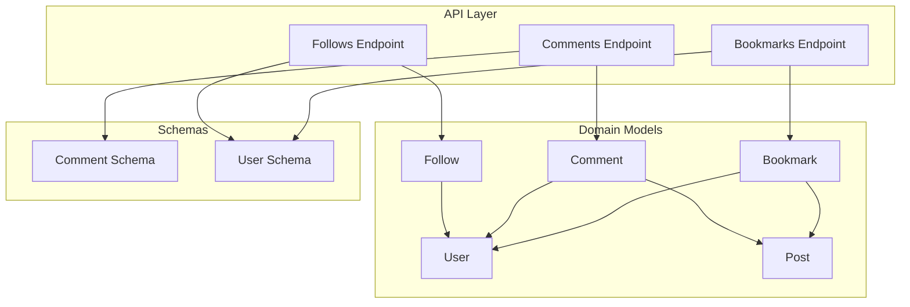
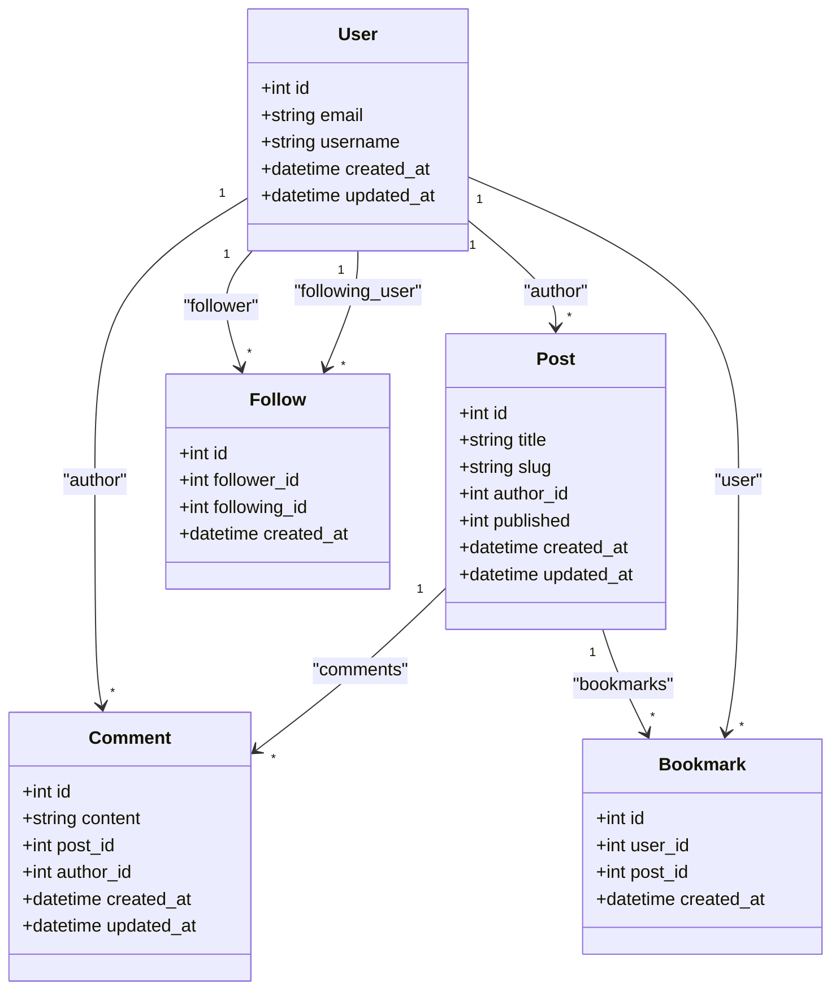
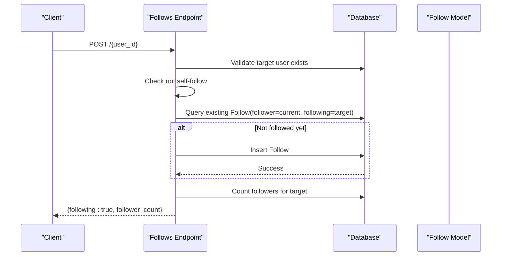
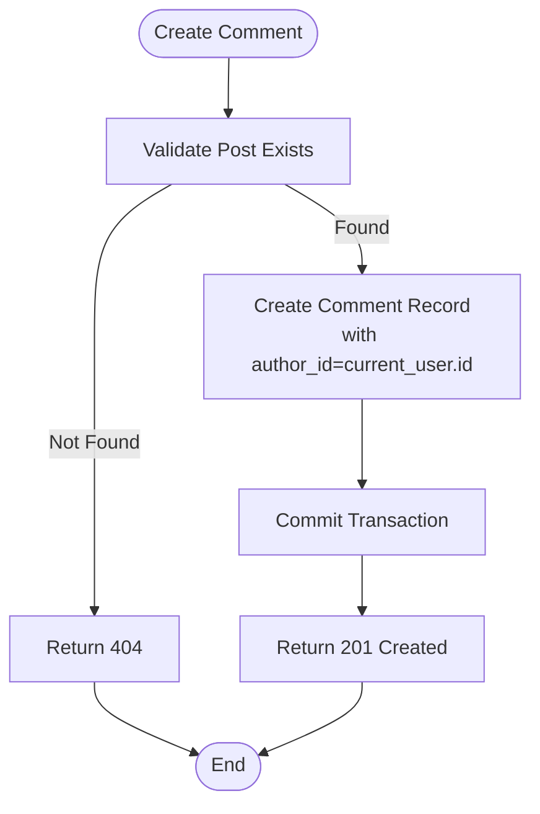
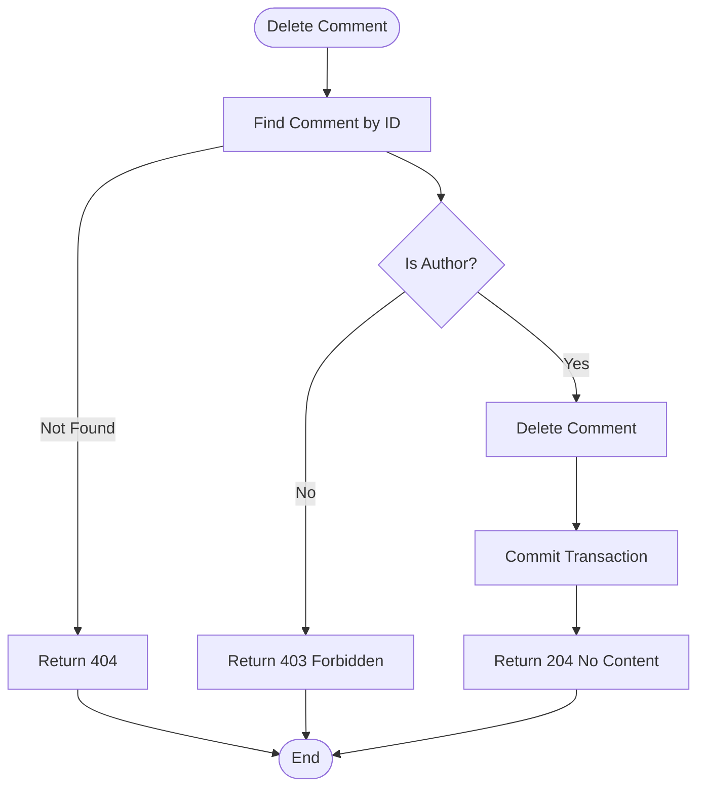
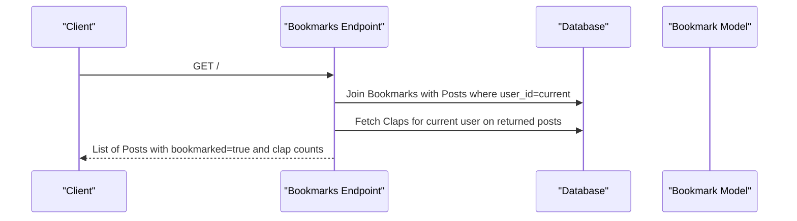
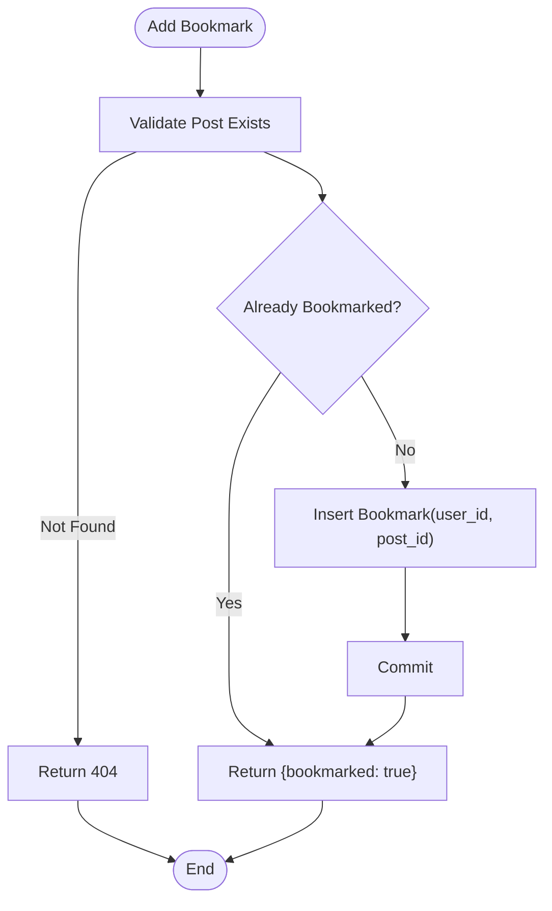
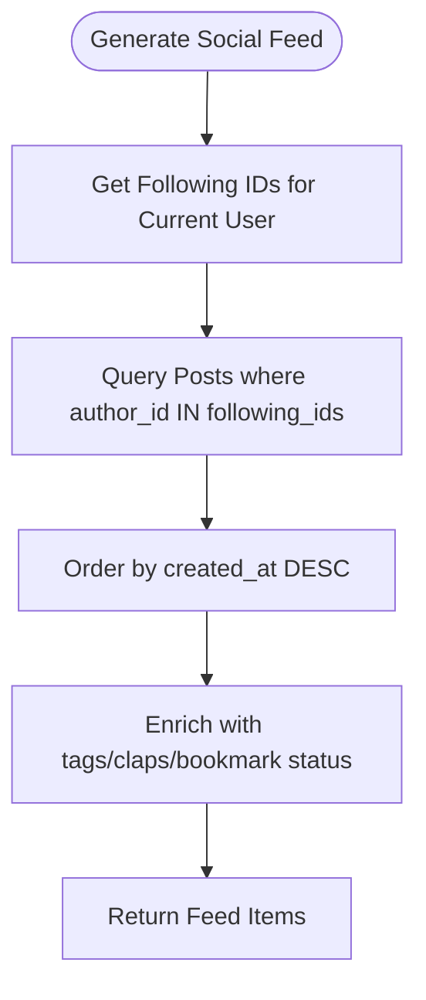
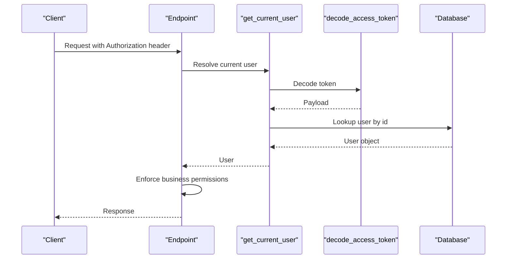

# Social Features

<cite>
**Referenced Files in This Document**
- [follow.py](file://app/models/follow.py)
- [comment.py](file://app/models/comment.py)
- [bookmark.py](file://app/models/bookmark.py)
- [user.py](file://app/models/user.py)
- [post.py](file://app/models/post.py)
- [follows.py](file://app/api/endpoints/follows.py)
- [comments.py](file://app/api/endpoints/comments.py)
- [bookmarks.py](file://app/api/endpoints/bookmarks.py)
- [comment.py](file://app/schemas/comment.py)
- [user.py](file://app/schemas/user.py)
- [dependencies.py](file://app/core/dependencies.py)
</cite>

## Table of Contents
1. [Introduction](#introduction)
2. [Project Structure](#project-structure)
3. [Core Components](#core-components)
4. [Architecture Overview](#architecture-overview)
5. [Detailed Component Analysis](#detailed-component-analysis)
6. [Dependency Analysis](#dependency-analysis)
7. [Performance Considerations](#performance-considerations)
8. [Troubleshooting Guide](#troubleshooting-guide)
9. [Conclusion](#conclusion)

## Introduction
This document explains Lekhani’s social interaction features: following/unfollowing writers, commenting on posts, bookmarking favorite content, and the foundations for engagement tracking and real-time feed generation based on social connections. It covers data models, API endpoints, permission enforcement, and patterns that support scalability and performance as the user base grows.

## Project Structure
The social features are implemented across domain models (SQLAlchemy), Pydantic schemas, and FastAPI endpoints. The key files involved are:
- Models: Follow, Comment, Bookmark, User, Post
- Endpoints: follows, comments, bookmarks
- Schemas: Comment, User
- Core dependency injection for authentication

**Diagram sources**
- [follows.py:1-93](file://app/api/endpoints/follows.py#L1-L93)
- [comments.py:1-62](file://app/api/endpoints/comments.py#L1-L62)
- [bookmarks.py:1-78](file://app/api/endpoints/bookmarks.py#L1-L78)
- [follow.py:1-21](file://app/models/follow.py#L1-L21)
- [comment.py:1-18](file://app/models/comment.py#L1-L18)
- [bookmark.py:1-19](file://app/models/bookmark.py#L1-L19)
- [user.py:1-28](file://app/models/user.py#L1-L28)
- [post.py:1-32](file://app/models/post.py#L1-L32)
- [comment.py](file://app/schemas/comment.py)
- [user.py](file://app/schemas/user.py)

**Section sources**
- [follows.py:1-93](file://app/api/endpoints/follows.py#L1-L93)
- [comments.py:1-62](file://app/api/endpoints/comments.py#L1-L62)
- [bookmarks.py:1-78](file://app/api/endpoints/bookmarks.py#L1-L78)
- [follow.py:1-21](file://app/models/follow.py#L1-L21)
- [comment.py:1-18](file://app/models/comment.py#L1-L18)
- [bookmark.py:1-19](file://app/models/bookmark.py#L1-L19)
- [user.py:1-28](file://app/models/user.py#L1-L28)
- [post.py:1-32](file://app/models/post.py#L1-L32)
- [comment.py](file://app/schemas/comment.py)
- [user.py](file://app/schemas/user.py)

## Core Components
- Follow system: Users can follow/unfollow other users; endpoints return follower counts and lists of followers/following.
- Comment system: Users can create and delete comments on posts; only authors can delete their own comments.
- Bookmark system: Users can add/remove bookmarks to save favorite posts; a list endpoint returns bookmarked posts with clap metadata.
- Authentication and authorization: JWT-based current user resolution ensures operations are scoped to the authenticated user.

Key responsibilities:
- Data integrity via unique constraints and foreign keys.
- Permission checks at the API layer to ensure users modify only their own resources.
- Efficient queries using indexes and joins.

**Section sources**
- [follows.py:20-60](file://app/api/endpoints/follows.py#L20-L60)
- [comments.py:23-61](file://app/api/endpoints/comments.py#L23-L61)
- [bookmarks.py:15-78](file://app/api/endpoints/bookmarks.py#L15-L78)
- [dependencies.py:13-39](file://app/core/dependencies.py#L13-L39)

## Architecture Overview
The social feature architecture separates concerns between API endpoints, domain models, and schemas. Endpoints enforce permissions and orchestrate database operations against well-defined models. Relationships between entities are modeled explicitly to support social graph queries and content ownership.

**Diagram sources**
- [user.py:6-27](file://app/models/user.py#L6-L27)
- [post.py:6-27](file://app/models/post.py#L6-L27)
- [follow.py:7-19](file://app/models/follow.py#L7-L19)
- [comment.py:6-17](file://app/models/comment.py#L6-L17)
- [bookmark.py:7-17](file://app/models/bookmark.py#L7-L17)

## Detailed Component Analysis

### Follow System
Purpose:
- Allow users to follow/unfollow other writers.
- Provide lists of followers and following.
- Return follower counts after mutations.

Implementation highlights:
- Unique constraint prevents duplicate follow relationships.
- Endpoints validate target existence and prevent self-following.
- Followers/following lists are ordered by creation time.

**Diagram sources**
- [follows.py:20-40](file://app/api/endpoints/follows.py#L20-L40)
- [follow.py:7-19](file://app/models/follow.py#L7-L19)

Permission model:
- Only authenticated users can follow/unfollow others.
- Self-follow is rejected.

Data consistency:
- Unique constraint on (follower_id, following_id) ensures one-to-one relationship per pair.

Scalability considerations:
- Indexes on follower_id and following_id optimize follower/following queries.
- Avoid N+1 by batching follower count updates if needed.

**Section sources**
- [follows.py:13-40](file://app/api/endpoints/follows.py#L13-L40)
- [follows.py:43-60](file://app/api/endpoints/follows.py#L43-L60)
- [follows.py:63-92](file://app/api/endpoints/follows.py#L63-L92)
- [follow.py:7-19](file://app/models/follow.py#L7-L19)

### Comment System
Purpose:
- Enable threaded discussions on posts.
- Allow comment creation and deletion by authors.

Implementation highlights:
- Comments belong to posts and have an author.
- Creation validates post existence.
- Deletion enforces ownership: only the comment author can delete it.

**Diagram sources**
- [comments.py:23-43](file://app/api/endpoints/comments.py#L23-L43)
- [comment.py:6-17](file://app/models/comment.py#L6-L17)

Deletion flow:

**Diagram sources**
- [comments.py:45-61](file://app/api/endpoints/comments.py#L45-L61)

Threading note:
- The current schema does not include parent_comment_id or thread fields. To enable threaded discussions, extend the Comment model with a parent reference and adjust endpoints accordingly.

**Section sources**
- [comments.py:13-21](file://app/api/endpoints/comments.py#L13-L21)
- [comments.py:23-43](file://app/api/endpoints/comments.py#L23-L43)
- [comments.py:45-61](file://app/api/endpoints/comments.py#L45-L61)
- [comment.py:6-17](file://app/models/comment.py#L6-L17)
- [comment.py](file://app/schemas/comment.py)

### Bookmark System
Purpose:
- Allow users to save favorite posts.
- Provide a personal bookmark list with clap metadata.

Implementation highlights:
- Unique constraint on (user_id, post_id) prevents duplicate bookmarks.
- List endpoint joins bookmarks to posts and enriches results with clap counts for the current user.
- Add/remove endpoints manage user-specific bookmarks.

**Diagram sources**
- [bookmarks.py:15-39](file://app/api/endpoints/bookmarks.py#L15-L39)
- [bookmark.py:7-17](file://app/models/bookmark.py#L7-L17)

Add/Remove flows:

**Diagram sources**
- [bookmarks.py:42-60](file://app/api/endpoints/bookmarks.py#L42-L60)
- [bookmark.py:7-17](file://app/models/bookmark.py#L7-L17)

**Section sources**
- [bookmarks.py:15-39](file://app/api/endpoints/bookmarks.py#L15-L39)
- [bookmarks.py:42-60](file://app/api/endpoints/bookmarks.py#L42-L60)
- [bookmarks.py:63-78](file://app/api/endpoints/bookmarks.py#L63-L78)
- [bookmark.py:7-17](file://app/models/bookmark.py#L7-L17)

### Engagement Tracking Foundations
- Clap counts exist on posts and are used to enrich bookmark responses.
- While dedicated activity feeds are not implemented, the presence of timestamps and counts provides a foundation for building engagement metrics and analytics.

Recommendations:
- Introduce an ActivityLog model to capture events like follow, comment, bookmark, clap with timestamps and actor/target references.
- Use this log to power activity feeds and notifications.

[No sources needed since this section proposes future enhancements]

### Real-Time Feed Generation Based on Social Connections
Conceptual approach:
- Build a feed by aggregating posts authored by users the current user follows.
- Order by recency and optionally filter by topics/tags.
- For real-time updates, consider WebSocket events triggered by new posts from followed users.

[No sources needed since this diagram shows conceptual workflow, not actual code structure]

## Dependency Analysis
Authentication and authorization:
- The get_current_user dependency decodes JWT tokens, resolves the user from the database, and raises appropriate errors for invalid/expired tokens.
- Endpoints depend on this dependency to scope operations to the authenticated user.

**Diagram sources**
- [dependencies.py:13-39](file://app/core/dependencies.py#L13-L39)

**Section sources**
- [dependencies.py:13-39](file://app/core/dependencies.py#L13-L39)

## Performance Considerations
- Indexing:
  - Follows: follower_id and following_id are indexed to speed up follower/following queries.
  - Comments: post_id and author_id should be indexed to optimize retrieval and ownership checks.
  - Bookmarks: user_id and post_id are indexed to accelerate user-specific lookups and uniqueness checks.
- Query efficiency:
  - Use joins to fetch related data (e.g., bookmarks with posts).
  - Batch enrichment queries (e.g., clap counts) to avoid N+1 issues.
- Pagination:
  - Implement pagination for followers/following and comment lists to handle large datasets.
- Denormalization:
  - Consider caching follower counts and clap counts for hot posts to reduce repeated aggregation.
- Concurrency:
  - Use database transactions and unique constraints to prevent race conditions during follow/bookmark mutations.

[No sources needed since this section provides general guidance]

## Troubleshooting Guide
Common issues and resolutions:
- Unauthorized access:
  - Ensure valid JWT tokens are provided; expired or malformed tokens result in 401 responses.
- Not found errors:
  - Verify resource IDs exist before mutations; endpoints raise 404 when targets are missing.
- Permission denied:
  - Deleting comments requires ownership; only the comment author can delete.
- Duplicate relationships:
  - Unique constraints prevent duplicate follows and bookmarks; endpoints check for existing records before insert.

Operational tips:
- Log failed authentication attempts and decode errors for monitoring.
- Monitor slow queries on join-heavy endpoints (e.g., bookmarks list with clap enrichment).
- Validate input payloads early to reduce unnecessary database work.

**Section sources**
- [dependencies.py:13-39](file://app/core/dependencies.py#L13-L39)
- [comments.py:45-61](file://app/api/endpoints/comments.py#L45-L61)
- [follows.py:20-40](file://app/api/endpoints/follows.py#L20-L40)
- [bookmarks.py:42-60](file://app/api/endpoints/bookmarks.py#L42-L60)

## Conclusion
Lekhani’s social features provide a solid foundation for following writers, commenting on posts, and bookmarking content. The data models and endpoints enforce clear permissions and maintain data integrity through constraints and ownership checks. To scale further, introduce activity logging, pagination, caching, and optional threading for comments. These additions will enhance real-time experiences and keep performance stable as the user base grows.