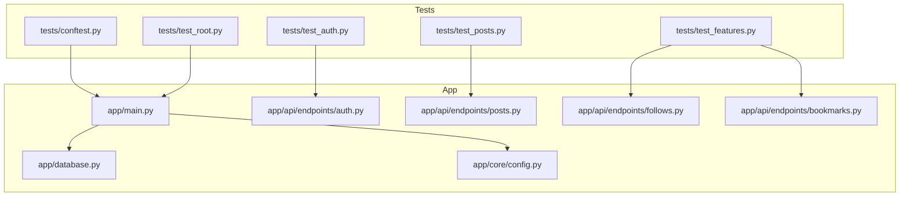
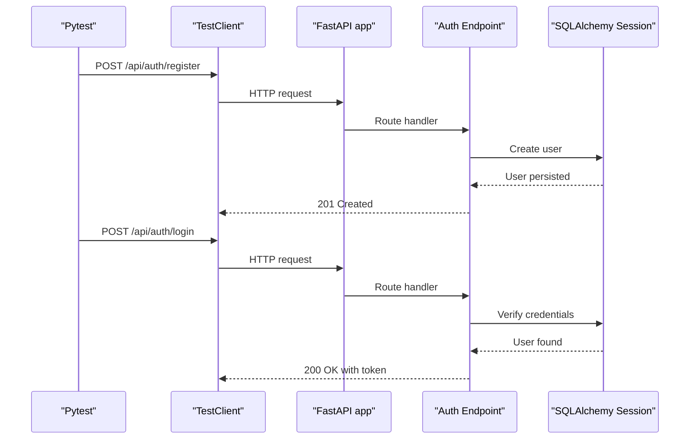
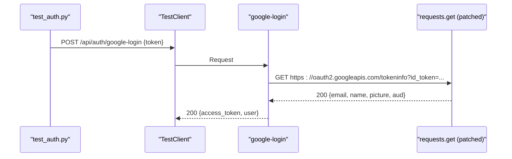
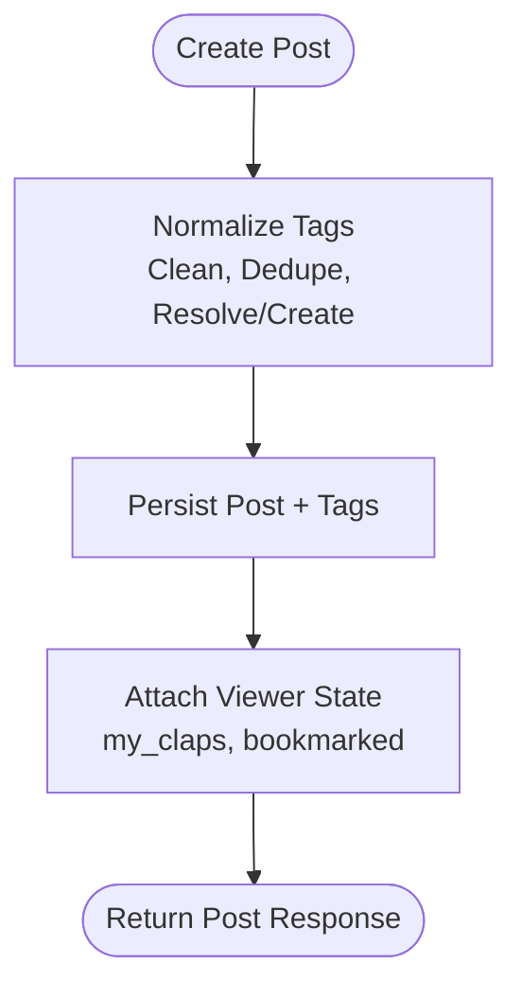
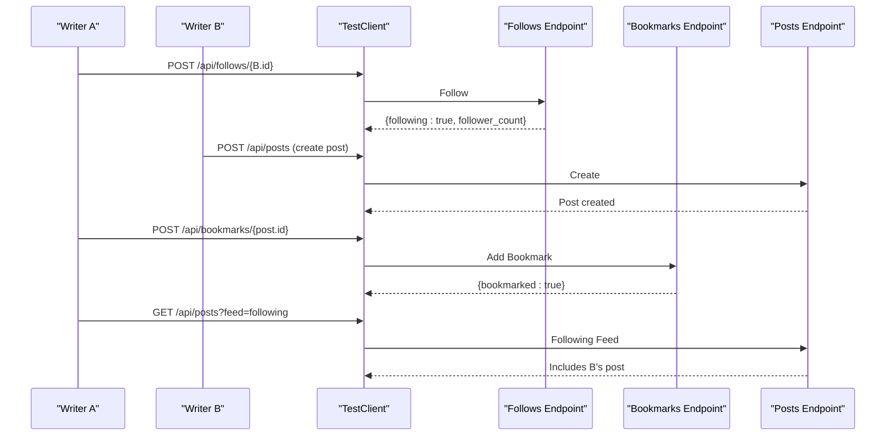
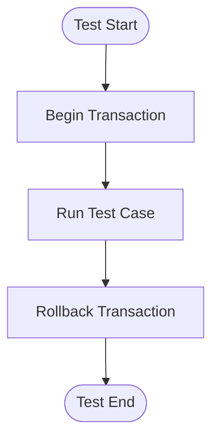
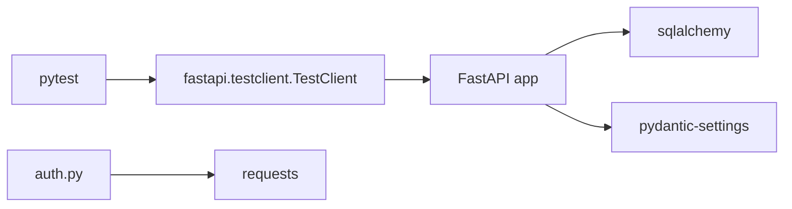

# Testing Strategy

<cite>
**Referenced Files in This Document**
- [conftest.py](file://tests/conftest.py)
- [test_auth.py](file://tests/test_auth.py)
- [test_posts.py](file://tests/test_posts.py)
- [test_features.py](file://tests/test_features.py)
- [test_root.py](file://tests/test_root.py)
- [main.py](file://app/main.py)
- [database.py](file://app/database.py)
- [auth.py](file://app/api/endpoints/auth.py)
- [posts.py](file://app/api/endpoints/posts.py)
- [follows.py](file://app/api/endpoints/follows.py)
- [bookmarks.py](file://app/api/endpoints/bookmarks.py)
- [config.py](file://app/core/config.py)
- [requirements.txt](file://requirements.txt)
</cite>

## Table of Contents
1. [Introduction](#introduction)
2. [Project Structure](#project-structure)
3. [Core Components](#core-components)
4. [Architecture Overview](#architecture-overview)
5. [Detailed Component Analysis](#detailed-component-analysis)
6. [Dependency Analysis](#dependency-analysis)
7. [Performance Considerations](#performance-considerations)
8. [Troubleshooting Guide](#troubleshooting-guide)
9. [Conclusion](#conclusion)

## Introduction
This document describes the testing strategy for the Lekhani backend. It explains how pytest is used to validate API endpoints, manage test fixtures, and exercise authentication, posts CRUD, social features (follows and bookmarks), and tag-related functionality. It also covers database setup, isolation strategies, mocking external dependencies, coverage expectations, CI integration, performance considerations, and debugging techniques.

## Project Structure
The tests live under a dedicated tests directory and use FastAPI’s TestClient to drive HTTP requests against the application. The conftest module centralizes shared fixtures, including an authenticated client and helper fixtures for multiple users.

**Diagram sources**
- [conftest.py:1-54](file://tests/conftest.py#L1-L54)
- [test_auth.py:1-30](file://tests/test_auth.py#L1-L30)
- [test_posts.py:1-45](file://tests/test_posts.py#L1-L45)
- [test_features.py:1-95](file://tests/test_features.py#L1-L95)
- [test_root.py:1-5](file://tests/test_root.py#L1-L5)
- [main.py:1-89](file://app/main.py#L1-L89)
- [database.py:1-27](file://app/database.py#L1-L27)
- [config.py:1-48](file://app/core/config.py#L1-L48)
- [auth.py:1-128](file://app/api/endpoints/auth.py#L1-L128)
- [posts.py:1-298](file://app/api/endpoints/posts.py#L1-L298)
- [follows.py:1-93](file://app/api/endpoints/follows.py#L1-L93)
- [bookmarks.py:1-78](file://app/api/endpoints/bookmarks.py#L1-L78)

**Section sources**
- [conftest.py:1-54](file://tests/conftest.py#L1-L54)
- [main.py:1-89](file://app/main.py#L1-L89)
- [database.py:1-27](file://app/database.py#L1-L27)
- [config.py:1-48](file://app/core/config.py#L1-L48)

## Core Components
- Pytest with FastAPI TestClient: Tests send real HTTP requests to the app instance, enabling full-stack validation of routing, middleware, dependency injection, and database interactions.
- Shared fixtures:
  - test_client: Provides a TestClient configured with mocked Google OAuth calls and a test client ID.
  - writer_a and writer_b: Register and log in two distinct users to support multi-user scenarios like follows and bookmarks.
- Test modules:
  - Authentication flows: registration, login, and Google login.
  - Posts CRUD: creation with tags, filtering by tags, updating tags.
  - Social features: follow/unfollow, followers list, bookmark add/remove, reading list, following feed, popular tags.
  - Root endpoint: basic health check.

Key responsibilities:
- conftest.py sets up the test environment and reusable user sessions.
- test_auth.py validates auth endpoints and token responses.
- test_posts.py validates post creation, tagging, and retrieval.
- test_features.py validates cross-entity workflows (follows, bookmarks, feeds, tags).
- test_root.py validates the root route response.

**Section sources**
- [conftest.py:8-54](file://tests/conftest.py#L8-L54)
- [test_auth.py:1-30](file://tests/test_auth.py#L1-L30)
- [test_posts.py:1-45](file://tests/test_posts.py#L1-L45)
- [test_features.py:1-95](file://tests/test_features.py#L1-L95)
- [test_root.py:1-5](file://tests/test_root.py#L1-L5)

## Architecture Overview
The test suite drives the FastAPI application via TestClient. Endpoints depend on SQLAlchemy sessions injected through get_db, and security dependencies for current user resolution. External services such as Google OAuth are mocked at the module level to avoid network calls during tests.

**Diagram sources**
- [test_auth.py:1-30](file://tests/test_auth.py#L1-L30)
- [auth.py:89-120](file://app/api/endpoints/auth.py#L89-L120)
- [database.py:20-25](file://app/database.py#L20-L25)
- [main.py:81-85](file://app/main.py#L81-L85)

## Detailed Component Analysis

### Authentication Testing
- Registration and login:
  - Creates a unique user and asserts 201 status.
  - Logs in and asserts 200 status with access_token and user payload.
- Google login:
  - Uses a mock Google token and verifies that the endpoint returns a token and user object.
  - The fixture patches the underlying HTTP call to return a controlled payload and sets GOOGLE_CLIENT_ID to a deterministic value.

**Diagram sources**
- [test_auth.py:22-29](file://tests/test_auth.py#L22-L29)
- [auth.py:18-87](file://app/api/endpoints/auth.py#L18-L87)
- [conftest.py:8-21](file://tests/conftest.py#L8-L21)

**Section sources**
- [test_auth.py:1-30](file://tests/test_auth.py#L1-L30)
- [auth.py:18-120](file://app/api/endpoints/auth.py#L18-L120)
- [conftest.py:8-21](file://tests/conftest.py#L8-L21)

### Posts CRUD and Tagging
- Create post with tags:
  - Validates tag normalization and deduplication.
  - Ensures default values for bookmarked and my_claps.
- Get posts filtered by tag:
  - Verifies that posts returned include the requested tag.
- Update post tags:
  - Confirms that tags can be replaced atomically.

**Diagram sources**
- [posts.py:33-58](file://app/api/endpoints/posts.py#L33-L58)
- [posts.py:186-214](file://app/api/endpoints/posts.py#L186-L214)
- [posts.py:61-80](file://app/api/endpoints/posts.py#L61-L80)

**Section sources**
- [test_posts.py:1-45](file://tests/test_posts.py#L1-L45)
- [posts.py:22-58](file://app/api/endpoints/posts.py#L22-L58)
- [posts.py:186-249](file://app/api/endpoints/posts.py#L186-L249)

### Social Features: Follows and Bookmarks
- Follow flow:
  - Follow another user, verify follower count and profile state.
  - Prevent self-follow.
  - Retrieve followers list and confirm inclusion.
  - Unfollow and verify state change.
- Bookmark flow:
  - Add bookmark, verify reading list includes the post.
  - Remove bookmark and verify removal from reading list.
- Following feed:
  - When user A follows B, B’s posts appear in A’s following feed.
  - Anonymous following feed returns empty list without error.
- Popular tags:
  - Tags endpoint returns tags with post counts.
  - Posts by tag slug include expected tags.

**Diagram sources**
- [test_features.py:6-40](file://tests/test_features.py#L6-L40)
- [test_features.py:43-62](file://tests/test_features.py#L43-L62)
- [test_features.py:65-79](file://tests/test_features.py#L65-L79)
- [follows.py:20-40](file://app/api/endpoints/follows.py#L20-L40)
- [bookmarks.py:42-60](file://app/api/endpoints/bookmarks.py#L42-L60)
- [posts.py:83-126](file://app/api/endpoints/posts.py#L83-L126)

**Section sources**
- [test_features.py:1-95](file://tests/test_features.py#L1-L95)
- [follows.py:1-93](file://app/api/endpoints/follows.py#L1-L93)
- [bookmarks.py:1-78](file://app/api/endpoints/bookmarks.py#L1-L78)
- [posts.py:83-126](file://app/api/endpoints/posts.py#L83-L126)

### Database Setup and Isolation
- Engine and session:
  - The engine is created based on DATABASE_URL with connection pooling enabled.
  - get_db provides a scoped session per request.
- Application startup:
  - Tables are created at import time using Base.metadata.create_all.
  - Migration helpers ensure schema compatibility by adding missing columns if needed.
- Test isolation:
  - Tests run against the same database instance configured by settings.
  - For transactional isolation, consider wrapping each test in a transaction and rolling back after completion. This can be implemented by overriding get_db or using a pytest fixture that begins a transaction before each test and rolls it back afterward.

[No sources needed since this diagram shows conceptual workflow, not actual code structure]

**Section sources**
- [database.py:1-27](file://app/database.py#L1-L27)
- [main.py:11-31](file://app/main.py#L11-L31)
- [config.py:11-15](file://app/core/config.py#L11-L15)

### Root Endpoint
- Simple health check returning application metadata.

**Section sources**
- [test_root.py:1-5](file://tests/test_root.py#L1-L5)
- [main.py:83-85](file://app/main.py#L83-L85)

## Dependency Analysis
External dependencies relevant to testing:
- FastAPI and TestClient: Used to drive HTTP requests.
- SQLAlchemy: ORM layer for database operations.
- Requests: Used by Google login; patched in tests to avoid network calls.
- pydantic-settings: Configuration management.

**Diagram sources**
- [requirements.txt:1-15](file://requirements.txt#L1-L15)
- [conftest.py:1-6](file://tests/conftest.py#L1-L6)
- [auth.py:1-11](file://app/api/endpoints/auth.py#L1-L11)

**Section sources**
- [requirements.txt:1-15](file://requirements.txt#L1-L15)
- [conftest.py:1-6](file://tests/conftest.py#L1-L6)
- [auth.py:1-11](file://app/api/endpoints/auth.py#L1-L11)

## Performance Considerations
- Use SQLite for fast local tests; switch to PostgreSQL in production.
- Keep test data minimal; create only what is necessary for assertions.
- Avoid heavy computations in fixtures; precompute where possible.
- For load testing, consider tools like Locust or k6 to simulate concurrent users exercising endpoints such as posts listing and clap submission.
- Monitor query performance in decorate_posts and tag queries; consider indexing frequently filtered columns (e.g., tags slug/name, post published flag).

[No sources needed since this section provides general guidance]

## Troubleshooting Guide
Common issues and resolutions:
- Google OAuth failures in tests:
  - Ensure the fixture patches requests.get and sets GOOGLE_CLIENT_ID to a known value.
  - Validate that the mocked response includes required fields (email, aud).
- Authentication errors:
  - Confirm that writer_a and writer_b fixtures register and log in successfully before use.
  - Check that Authorization headers are passed correctly in subsequent requests.
- Database constraints:
  - If tests fail due to duplicate keys, ensure unique email/username generation in fixtures.
  - For transactional isolation, wrap tests in transactions and rollback after each test.
- Tag normalization:
  - Verify that tag names meet length constraints and are normalized consistently.
- CORS and middleware:
  - If frontend integration tests fail, ensure CORS origins include the test frontend URL.

**Section sources**
- [conftest.py:8-21](file://tests/conftest.py#L8-L21)
- [auth.py:18-87](file://app/api/endpoints/auth.py#L18-L87)
- [posts.py:33-58](file://app/api/endpoints/posts.py#L33-L58)

## Conclusion
The Lekhani backend employs a pragmatic testing approach using pytest and FastAPI’s TestClient. Shared fixtures streamline multi-user scenarios, while targeted test modules cover authentication, posts CRUD, social features, and tag operations. External dependencies are mocked to ensure deterministic outcomes. To strengthen reliability, adopt transactional isolation per test, expand coverage across all endpoints, and integrate continuous checks in CI pipelines. For performance validation, incorporate load testing and monitor critical query paths.